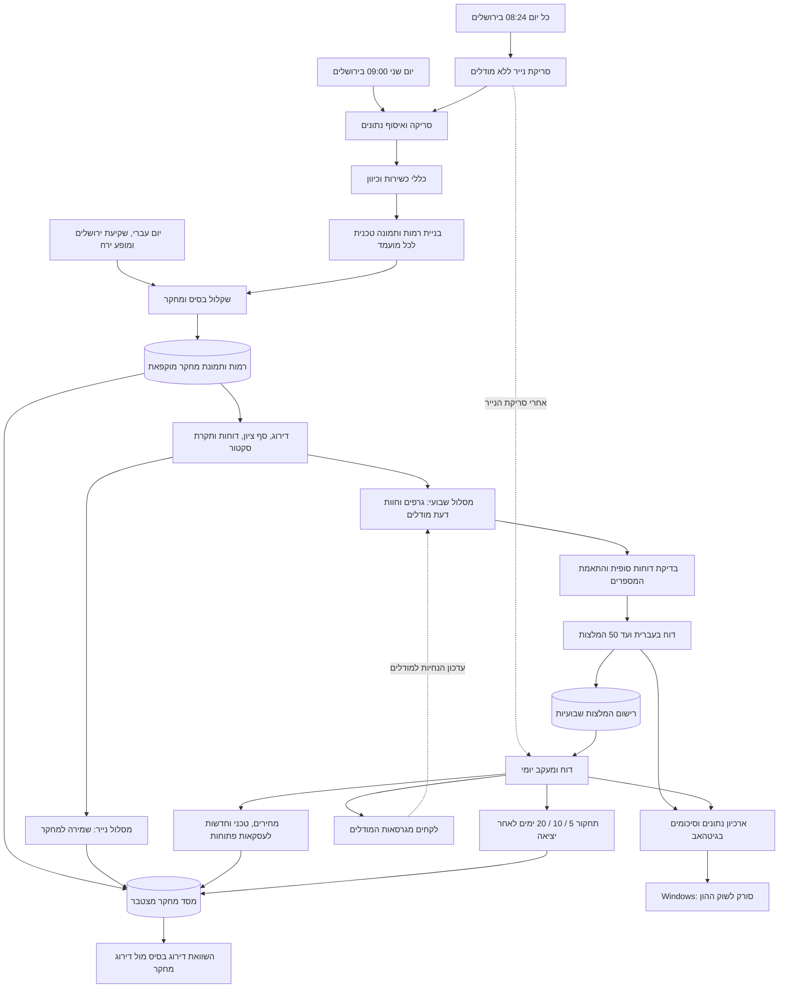
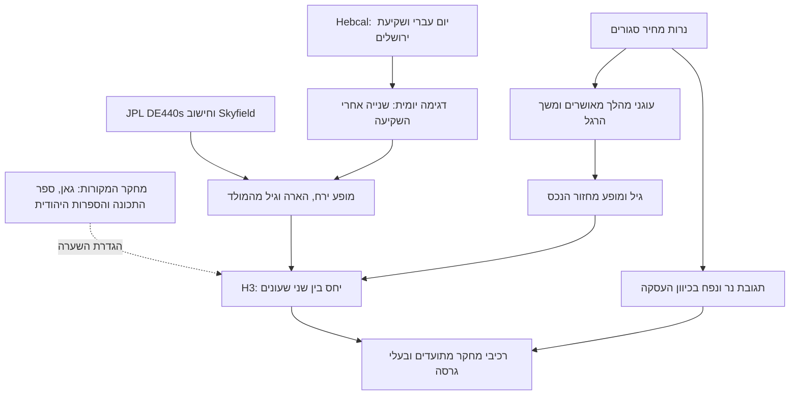
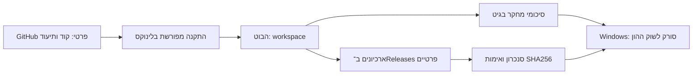

# ארכיטקטורת הסורק לשוק ההון

מיפוי מ־10.10.2026: מסלול הקוד שנבדק ב־`b93a48c` בתוספת Grok כאנליסט, לפי העדכון האחרון של אילן. התרשימים מתארים את הקוד בגיטהאב; הנספח משווה למסמך 8.10 ולהחלטות המאוחרות בשיחה. ההתקנה בלינוקס ושגרת גרוק החיה טרם אומתו.

המערכת אוספת נתונים, מסננת ומדרגת מועמדים, מפיקה תיק ניתוח לכל מועמד, עוקבת אחר המלצות שבועיות וצוברת ראיות לשיפור השיטה. במסלול שנבדק אין שליחת פקודות לברוקר. ״עסקה״ כאן היא רשומת מעקב עם כניסה ויציאה לפי כללי המדידה, ולא אישור ביצוע בחשבון מסחר.

## תמונת המערכת

החצים מציגים זרימת מידע; סדר הפעולות המדויק מפורט בהמשך. המתזמן מפעיל תהליכים ברצף, עם קובצי ביניים ומסד SQLite. במסלול הנייר אין קריאה לחלק השבועי של גרפים, מודלים ורישום המלצות. נשמרות ראיות גם על מועמדים שלא נבחרו.

## מפת הרכיבים

| שכבה | אחריות | קוד מרכזי |
|---|---|---|
| תזמור | מועדים, נעילה משותפת, שלבים שהושלמו | [run_scheduled.py](scanner/run_scheduled.py) |
| סריקה | מחירים, אינדיקטורים, העשרות וקריפטו | [swing_scan.py](scanner/swing_scan.py), [scanner_crypto.py](modules/scanner_crypto.py) |
| ניהול הסריקה | חיבור השלבים, דירוג ובחירה | [run_unified_scan.py](scanner/run_unified_scan.py) |
| רמות משותפות | מקור המספרים לדוח, לגרף, למודלים ולרישום | [scanner_levelsfile.py](modules/scanner_levelsfile.py), [levels_schema.json](scanner/levels_schema.json) |
| ניתוח טכני | ATR וסטופים, תמיכה/התנגדות, גלים, גאומטריה ופיבו/אליוט | [scanner_stops.py](modules/scanner_stops.py), [scanner_levels.py](modules/scanner_levels.py), [scanner_waves.py](modules/scanner_waves.py), [scanner_geometry.py](modules/scanner_geometry.py), [scanner_elliott_v2.py](modules/scanner_elliott_v2.py) |
| מחקר משוקלל | שבע קבוצות ראיות, כיסוי ותרומה לציון | [scanner_research_score.py](modules/scanner_research_score.py) |
| לוח אסטרונומי | יום עברי, ירושלים, מופע ירח והרחבת הלוח | [scanner_lunar_calendar.py](modules/scanner_lunar_calendar.py), [ensure_research_calendar.py](scanner/ensure_research_calendar.py) |
| מודלים | סנטימנט, קטליסטים, כותרות, אנליסט וביקורת; תקציב ותיעוד | [scanner_platforms.py](scanner/scanner_platforms.py) |
| תוצרים | גרפי PNG/PDF ודוחות בעברית | [scanner_charts.py](modules/scanner_charts.py), [unified_report.py](scanner/unified_report.py) |
| חיי המלצה | רישום, כניסה למדידה, סטופים, ביקורת וסגירה | [scanner_lessons.py](modules/scanner_lessons.py), [run_checkpoints.py](scanner/run_checkpoints.py) |
| מעקב יומי | חדשות וטכני לעסקאות פתוחות ותחקור לאחר יציאה | [run_daily_report.py](scanner/run_daily_report.py), [scanner_trade_followup.py](modules/scanner_trade_followup.py) |
| מחקר מצטבר | הקפאת תצפיות, תוצאות והשוואת דירוגים | [scanner_research_ledger.py](modules/scanner_research_ledger.py) |
| שמירה והעברה | ארכיונים פרטיים ואימות הסנכרון ל־Windows | [publish_research_archive.py](scanner/publish_research_archive.py), [scanner_artifact_archive.py](modules/scanner_artifact_archive.py), [sync_windows_research.py](ops/sync_windows_research.py) |

## הסריקה השבועית — לפי סדר הביצוע

1. **הכנה:** המתזמן מכין את לוח ירושלים לחודש הנוכחי והבא, נועל את התהליך ומפעיל `run_unified_scan.py`. נקבע זמן חיתוך לנתונים ונוצרת תיקיית ריצה נפרדת.
2. **יקום ואיסוף:** רשימת טיקרים מוגדרת ב־`swing_scan.py`, עם הרחבה דרך `SCAN_EXTRA_TICKERS`. זו אינה סריקה אוטומטית של כל המניות בארה״ב. מחירי מניות מגיעים מ־yfinance וקריפטו מ־Alpaca. חדשות, מאקרו, פונדמנטלס ונתוני שורט מתווספים בשכבות ההעשרה.
3. **כשירות:** מחיר מניה 5 דולר ומעלה, שווי שוק 1.5 מיליארד דולר ומעלה ונפח דולרי ממוצע מעל 14 מיליון דולר. ETF ומדדים נשלפים להקשר אך מסוננים מהמלצות המניות.
4. **כיוון:** לונג דורש מחיר מעל SMA50, שיפוע SMA50 עולה, מרחק שאינו מעל 3 ATR מ־SMA20 וסטופ זמין. נדרש מחיר מעל SMA200 כשהוא זמין; מניה צעירה ללא SMA200 אינה נפסלת רק בשל החוסר. שורט דורש `ck_score >= 3` ומחיר מתחת ל־SMA200. קריפטו נבחן בלונג בלבד לפי מסלולו.
5. **תיק טכני:** לכל מועמד שעבר כללים נבנים פיבו, אליוט, תמיכה/התנגדות, פרופיל נפח, גלי נפח, כניסה ייחוסית, סטופ ויעד. גאומטריית גאן/נרות של שכבת המחקר מחושבת לאותו חיתוך ולכיוון העסקה.
6. **ציון ושער דוחות מוקדם:** מחושב ציון הבסיס, מופעלת שכבת המחקר ונשמר קובץ הרמות. מקורות דוחות זמינים נבדקים לפני הפנייה למודלים.
7. **בחירה מוקדמת:** סף ברירת מחדל 60, עד 50 שמות ותקרה של 2 לכל שילוב נכס/כיוון/סקטור. אין מכסת לונג ושורט נפרדת. חלק מהחסומים עקב דוח נשמרים למחקר חריגה. במקביל מחושבת בחירה לפי הבסיס ללא המחקר.
8. **הקפאת המחקר:** נשמרים כל המועמדים שנבנו להם רמות, הבחירה המוקדמת, ציוני הבסיס והמחקר והראיות, לפני חוות הדעת והתוצאות העתידיות.
9. **גרפים ומודלים:** הגרפים קוראים מקובצי הרמות. סדר `run_platforms` השבועי הוא Grok (סנטימנט וניתוח נוסף) → Perplexity → Jev → Claude → GPT (ביקורת על שניהם). Jev מסנן כותרות ל־Claude/GPT; הוא אינו השלב הראשון במסלול השבועי.
10. **בדיקה סופית:** מידע הדוחות מעודכן גם מהמודלים ונבדקת חריגה מוגדרת. כניסה/סטופ/יעד מושווים בין הרמות, הדוח, שורות הטראקר ואינדקס הגרפים. חוסר התאמה מוציא מועמד מההמלצות.
11. **פלט ורישום:** נשמרים `selected.json`, דוח עברי וגרפים. המלצות שבועיות תקינות נרשמות למעקב; ניסיון ונייר אינם נכנסים למאגר ההמלצות. המתזמן אורז את החומר לסנכרון.

**הקשר שוק:** מאקרו ומשטר שוק עוברים להקשר המודלים והדוח. במסלול הראשי שנבדק אין קריאה ל־`tracker/market_regime.py` כשער חובה שמקדים את הסריקה. זהו רכיב במסלול הטראקר הוותיק, ולא חסימה ראשונה מובטחת במסלול המאוחד.

## מקורות הנתונים

| סוג | מקור או מתאם בקוד | שימוש |
|---|---|---|
| נרות מניות | yfinance ומטמון המחירים של הסורק | סינון, רמות, דירוג ומעקב |
| נרות קריפטו | Alpaca | נרות יומיים לפי UTC; לונג בלבד |
| חדשות | Alpaca/Benzinga דרך `scanner_news` | סריקה, Jev ומעקב יומי |
| אירועים וקטליסטים | מקורות דוחות Yahoo/OpenBB/Nasdaq ו־Perplexity | חסימת דוחות והקשר |
| פונדמנטלס, שורט ומאקרו | SEC EDGAR, מתאמי OpenBB, FRED ומקורות נוספים במודולי ההעשרה | עמודות נתונים והקשר; חלקן במשקל 0 |
| סנטימנט X | מטמון פוסטים או חיפוש Grok | חוות דעת מתועדת |
| יום עברי ושקיעה | Hebcal, ירושלים | שיוך יום המחקר |
| מופע ירח | חישוב Skyfield עם JPL DE440s | מופע, הארה וגיל מהמולד האסטרונומי |

מקור שהוגדר בקוד אינו הבטחה לזמינות או להרשאות אצל הבוט. כשל בשכבת העשרה אופציונלית נשמר ככשל/חוסר כיסוי לפי המודול; כשל בסריקת הבסיס יכול לעצור את הריצה.

## איך מחושב הציון

**יעד השילוב: 70% מציון הבסיס המקורי המלא ו־30% מחקר.** במפרט מ־8.10 הציון הפעיל כולל טכני, סטופים/יעדים ומומנטום; המומנטום הוא 10 מתוך 100. המסמך אינו מפרט נוסחה ליתר 90 הנקודות, ולכן אין להמציא חלוקה עבורן.

**בקוד שנבדק, הבסיס הזמין הוא מומנטום 12–1 בלבד.** `unified_score` מחזיר אחוזון בלונג, היפוכו בשורט ואחוזון קריפטו (עם חלופה גולמית בהיעדר אחוזון). אינדיקטורים אחרים משתתפים בסינון, ברמות ובמחקר. זהו פער מול המפרט: מנגנון 30/70 קיים, אך טרם אומת שהוא משמר את ציון הבסיס המלא של הבוט.

בכיסוי מלא: `ציון סופי = 0.70 × בסיס + 0.30 × מחקר`.

| רכיב מחקר | מתוך המחקר | מתוך הציון הכולל בכיסוי מלא | מה נמדד |
|---|---:|---:|---|
| יחס מחזור ירח–נכס | 20% | 6% | יחס השעונים מותנה בתגובת נר ונפח |
| גאן | 15% | 4.5% | קרבה לתיבה/זוויות וזמן בנרות |
| פיבונאצ׳י | 15% | 4.5% | רמות נסיגה וספירלה בכיוון העסקה |
| אליוט | 15% | 4.5% | מצב הספירה, קצה הגל ואיכות האישור |
| נרות | 10% | 3% | התאמת התצורה לכיוון |
| נפח | 10% | 3% | משפחות התחלה/סיום ונפח ביחס לעבר |
| הסכמה בין הרכיבים | 15% | 4.5% | גאומטריה, נר ונפח בהקשר המחזורי |

הנוסחה הכללית היא `S = B + 0.30 × Σ wᵢ × (Rᵢ − B)`, רק על רכיבים זמינים. חלקו של רכיב חסר חוזר לבסיס. אם זמינים 80% מתקציב המחקר, המשקל בפועל הוא 24% מחקר ו־76% בסיס. נתון חסר אינו אפס.

המחקר משנה את הדירוג בלבד; הוא אינו משנה ישירות כניסה, סטופ, יעד או כללי כשירות. המשקל 30% הוא בחירת ניסוי של המשתמש, ולא הסתברות הצלחה או פרמטר שנלמד מהתוצאות.

מקור: [הנוסחאות](modules/scanner_research_score.py), [הדירוג והבחירה](scanner/run_unified_scan.py).

## גאן, ספר התכונה והיום העברי

היום העברי ומופע הירח נשמרים בנפרד. יום המחקר מתחלף **לאחר שקיעת ירושלים**; דגימת הירח היא שנייה לאחר השקיעה הפותחת את היום. רגע השקיעה המדויק משויך ליום הקודם לפי ההגדרה שסוכמה. זמן הנכס נשען על הנר האחרון שהושלם. שני זמני המדידה נשמרים.

שלב הנכס מחושב מגיל מהלך וממשך רגל מאושרת. בגרסה הנוכחית: `relation = (1 + cos(lunar_phase − asset_phase)) / 2`. זו השערה מספרית שלנו, ולא נוסחה שיוחסה לספר או לגאן. אין כלל שירח מתמלא מחייב עלייה, ואין כאן הוכחה לחיזוי גל אליוט.

ספרי המקור אינם נקראים מחדש אוטומטית בכל סריקה. הם בסיס מתועד להשערות; הנתונים החדשים בודקים את ההשערות שמומשו. השוואת המהדורות, מבוא השמש והמקורות התלמודיים נשמרת במחקר. שבתאי, צמידויות פלנטריות נוספות וכל הרעיונות שבמקורות אינם כולם משתנים פעילים בציון.

[מפת הייחוס והגבולות](research/jewish-lunar/GANN_TEKUNA_MAPPING.he.md) · [מאגר המקורות](research/jewish-lunar/sources/README.md).

## חוות הדעת של המודלים

**תפקידים מאושרים:** Claude הוא אנליסט; Grok הוא אנליסט נוסף לצד סנטימנט X וקריפטו; GPT הוא פרקליט השטן מול שניהם. ההגדרה הקודמת של Claude במסמך 8.10 היא היסטורית.

| רכיב | תפקיד | השפעה |
|---|---|---|
| Grok | סנטימנט X וקריפטו, ובנפרד ניתוח טכני, תזה, קטליסטים, יסודות וסיכון | שתי חוות דעת באותה קריאה; מדידה נפרדת לסנטימנט ולאנליסט |
| Perplexity | חדשות, קטליסטים ומועד דוח | חוות דעת; תאריך דוח וחריגה יכולים להשפיע על השער הסופי |
| Jev | סינון וסיווג כותרות | הקשר ל־Claude/GPT; טריגרים בנקודות ביקורת |
| Claude | חיבור הטכני, האירועים והסנטימנט לתזה | עמדה וסיכונים; חלק מתנאי חריגת הדוחות |
| GPT | ביקורת נפרדת על התזות של Grok ו־Claude | נימוק מול כל אנליסט; חלק מתנאי חריגת הדוחות |

למודלים אין משקל ישיר בציון, והם אינם מחליפים את הרמות המחושבות. עם זאת, חריגת חסימת הדוחות דורשת קטליסט חזק עם מקור מאומת, תמיכת Claude בשכנוע 70 ומעלה ועמדת GPT מסוג approve או flag. בהיעדר תאריך דוח מאומת, הקוד מסמן חוסר אימות ואינו חוסם אוטומטית.

50 מועמדים אינם מבטיחים 50 העשרות מלאות: תקציב המודלים נפרד מכמות המועמדים. הקריאות, העלויות, הכשלים וגרסאות ההנחיות נרשמים.

Grok מקבל את עובדות הבוט והגרף הזמין לפני ניתוח Claude. Claude מקבל את סנטימנט Grok אך לא את התזה שלו; GPT מקבל את שני הניתוחים. בדוח מוצגים תזה, סיכון, עמדה וביטחון, לצד הסכמה או מחלוקת. שימוש בנתונים משותפים אינו יוצר שתי ראיות עצמאיות. חוסר בנתונים או כשל ניתוח מסומנים במפורש.

הניתוח הנוסף נמדד כ־`grok_analyst` עם לקחים משלו, גם בביקורת יומית ביום 5/10 כאשר מופעלים המודלים. עלות הקריאה נספרת פעם אחת תחת Grok; תשובה ארוכה יותר יכולה להגדיל את עלות הטוקנים. [חוזה התפקיד, המדידה והבדיקות](docs/GROK_ANALYST.he.md).

## מעקב יומי וחיי העסקה

המשימה היומית מפעילה תחילה סריקת נייר ללא מודלים, ואחריה `run_daily_report.py`. הדוח יכול להפעיל מודלים בנקודות ביקורת לפי טריגרים ותקציב; `--no-models` של סריקת הנייר אינו מבטל אותם אוטומטית בדוח.

```mermaid
stateDiagram-v2
    state "המלצה שבועית נבחרה" as Selected
    state "ממתינה לפתיחה לצורך מדידה" as Pending
    state "מעקב פתוח בכל יום" as Open
    state "סגירה לפי הכללים" as Closed
    state "תחקור לאחר יציאה" as Audit
    state "הושלמו שלוש בדיקות היציאה" as Done
    [*] --> Selected
    Selected --> Pending
    Pending --> Open: מחיר פתיחה זמין
    Open --> Open: טכני וחדשות; ביקורת ביום 5 וביום 10
    Open --> Closed: סטופ או סוף יום 20
    Closed --> Audit: ימים 5, 10, 20 אחרי היציאה
    Audit --> Done: שמירת התוצאות
```

זהו תיאור עסקי: ב־CSV הרשומה כבר מסומנת `open` בזמן ההמתנה לפתיחה; הדוח מזהה את ההמתנה באמצעות זמינות מחיר הכניסה.

- **מדי יום, לכל עסקה פתוחה:** מחיר ונר אחרון שהושלם, תשואה בכיוון העסקה, עודף מול SPY או BTC, מחיר מול SMA50/200, קרבה לסטופ, יעד, מצב טכני ורכיבי מחקר. נשמרים סימנים תומכים ומחלישים וכותרות עם מקור וזמן.
- **ביום 5 וביום 10 מהכניסה:** חישוב טכני וגרף לנקודת הביקורת. Jev קודם לבדיקת הטריגרים; המודלים האחרים נקראים רק כשיש שינוי מהותי והתקציב מאפשר זאת.
- **יציאה למדידה:** מניות — סטופ נגרר 4×ATR14. לונג עשוי לכלול מימוש חצי בפיבו 1.618, עם 2.618 כחלופה לפי מיקום הרמה, או ללא יעד חלקי כשאין רגל מתאימה. קריפטו לונג — סטופ קבוע 3×ATR14. הבדיקה על סגירות לפי המנוע הקיים, ולא הוראת סטופ תוך־יומית בברוקר. יש גם סגירה באופק 20 נרות.
- **אחרי היציאה:** בדיקות נפרדות אחרי 5, 10 ו־20 נרות, כשהיום הראשון הוא היום שאחרי היציאה. נשמרים המשך התנועה, עודף מול המדד, תנועה מרבית בעד ונגד וחדשות שנאספו במועד התחקור.

במניות נספרים ימי מסחר; בקריפטו נרות יומיים בכל השבוע. חדשות לעסקאות פתוחות נאספות גם בסוף השבוע. מחיר חסר אינו תשואה אפס, וכשל מקור חדשות אינו ״אין חדשות״.

**שלושה שעוני בדיקה:** ביקורת מודלים ביום 5/10 מהכניסה; מחקר דירוגים אחרי 5/10/20 מהכניסה; ותחקור אחרי 5/10/20 מהיציאה. אלה מדידות שונות.

## מה המערכת לומדת

| מנגנון | מה קיים | מה אינו מתבצע אוטומטית |
|---|---|---|
| מחקר דירוגים | תמונות מוקפאות והשוואת בסיס מול מחקר על אותו יקום | התאמת 30% או אופטימיזציה של הנוסחאות |
| ביקורת המודלים | השוואת עמדות לתוצאות המלצות סגורות ולמדד | אימון מחדש של מודל השפה |
| לקחים שבועיים | גרסאות הנחיות מתוך דפוסי טעויות; לפחות 3 עסקאות סגורות לפלטפורמה | שינוי סטופים או כללי כניסה |
| כלי מחקר נוספים | `research_columns` ו־`tool_stats` לפי כללים נפרדים | מתן משקל לכל כלי רק כי הופיע בסריקה |
| תחקור לאחר יציאה | האם המחיר המשיך בכיוון ובאילו תנאים | פתיחה מחדש או ספירת ההמשך כרווח שבוצע |

מסד המחקר מפריד שבועי/נייר/ניסיון, כיוונים, נכסים וגרסאות. תוצאות שהבשילו נשמרות. בדיקה יומית חוזרת אינה אוסף חדש של ניסויים עצמאיים.

ההשוואה הנוכחית היא של **דירוגים לפני המודלים**, עם תשואות גולמיות באופקים קבועים. היא אינה תשואת תיק לאחר עמלות, השאלה, סטופים ומימוש חלקי. גם תשואת המחיר במאגר ההמלצות אינה חשבונאות מלאה של המימוש החלקי. ניסויי פירוק השפעה — מחיר בלבד, מחיר עם ירח, מחיר עם שעון הנכס ומחיר עם שניהם — עדיין דורשים מסלול נפרד.

## נתונים, שחזור ושמירה

| קובץ / מאגר | תפקיד |
|---|---|
| `scan_raw.csv`, `crypto_scan.csv` | נתוני הסריקה והעמודות שנאספו |
| `levels/*.json` | רמות וראיות, זמן חיתוך וחתימות נתונים |
| `candidates_full.csv` | מועמדים, ציונים וסיבות בחירה/פסילה |
| `research_scores.json`, `research_score_manifest.json` | פירוט ניקוד, כיסוי, גרסאות ומקורות לוח |
| `research_snapshot.json` | הקפאת היקום והדירוגים לפני המודלים |
| `selected.json`, `research_final_selection.json` | בחירה סופית לאחר השערים |
| `tracker_rows.csv`, `reconciliation.json` | שורות לטראקר והתאמת המספרים |
| `positions_registry.csv` | מצב ההמלצות השבועיות והיציאות |
| `platform_verdicts_ledger.csv` | עמדות מודלים, גרסאות ועלויות |
| `paper_trades_ledger.csv` | רישום נייר נפרד; אינו מאגר פוזיציות |
| `scan-runs/research/research.sqlite` | קבוצות סריקה, איתותים, תצפיות, תוצאות, מעקב וחדשות |
| `daily/YYYY-MM-DD/` | דוח יומי, מחקר, מעקב וחדשות |
| `prompts/` | גרסאות לקחים והנחיות פעילות |

תיקיית Windows מכילה מחקר, מקורות, קוד, קבצים שהועלו, `bot-data`, `archives` וגרסאות קודמות. מעקב Codex הוגדר ל־10:30 בירושלים ותלוי בזמינות המחשב וסביבת Codex.

המפרסם אוסף `scan-runs`, `news-cache`, `scanner-momentum-cache`, `openbb-snapshots`, `prompts` ולוח שנה. SQLite מגובה באופן עקבי. Windows מאמת חבילות וקבצים ושומר גרסאות קודמות.

זהו ארכיון של שורשים מוגדרים, ולא גיבוי מלא של `/workspace`. קובצי Excel ותוצאות מחקר מחוץ לשורשים דורשים הוספת כיסוי מפורשת. מפתחות וחבילות מותקנות מוחרגים. [פירוט השמירה](ops/WINDOWS_STORAGE.he.md).

## רכיבים מקבילים

- **הטראקר הוותיק:** `tracker/build7.py`, `engine.py` והכלים הנלווים מפיקים ומנתחים מאגר היסטורי ו־Excel. המסלול המאוחד כותב `tracker_rows.csv`, אך אינו מפעיל את `build7.py` ישירות. המעקב החדש משתמש ב־CSV וב־SQLite; הטראקר הוותיק מוזן ל־`tool_stats` כשקיים.
- **TradingView:** Pine וריליי Vercel הם מסלול קליטת התראות מקביל, ולא מקור הנרות ההכרחי לסורק. תיעוד הריליי מציין שהעברה לשגרת הבוט טרם הוגדרה; מצב חי המאשר השלמת החיבור לא נבדק כאן.
- **OpenStock ו־TradingAgents:** כלי מחקר משלימים בלפטופ. מתאם OpenStock מספק מחיר וחדשות לריצה חיה וחוסם שימוש בהם בבקטסט היסטורי. אין במסלול המאוחד קריאה שמריצה TradingAgents כחלק חובה מכל סריקה.

## מצב המימוש והפערים

| נושא | מצב לפי הבדיקה |
|---|---|
| מנגנון 30/70, מעקב ותחקור יציאה | ממומשים בריפו; 62 בדיקות מקומיות ו־CI עברו קודם. מעבר הבדיקות אינו מאמת שחזור של ציון הבסיס המלא |
| Grok כאנליסט נוסף | נוסף בקוד, בדוח ובמדידת תוצאות; נשמרו תפקידי X וקריפטו. בדיקות ספקים מדומות עברו; ריצה חיה בלינוקס טרם אומתה |
| חומרי המחקר ב־Windows | נשמרו ואומתו בתיקייה המקומית |
| תזמון בלינוקס | קובצי התקנה ושירות קיימים; הפעלה אצל הבוט טרם אומתה |
| העברת נתונים חיה | ממתינה לארכיון ראשון; מצב הסנכרון האחרון `waiting_for_linux_archive` |
| הבסיס המלא במפרט 8.10 | מומנטום מוגדר בו כ־10/100; הנוסחה ליתר הנקודות ומסלול הפעלתה טרם אומתו. בקוד שנבדק הבסיס הוא מומנטום בלבד |
| ETF כמועמדים | טרם משולבים בבחירה, אף שנכללו בבקשה |
| בחירה מחדש אחרי המודלים | יש הסרת חסומים/חריגות ותקרה של 50; אין הרצה מלאה נוספת של הדירוג ומגבלות הסקטור. הפלט יכול לרדת וחריגות דורשות תשומת לב לתקרת הסקטור |
| למידה מספרית אוטומטית | אינה ממומשת; קיימים מחקר מצטבר ולקחים בהנחיות |
| זמינות ספקים | נדרשים כיסוי והרשאות; ריצה מלאה מול כל הספקים לא אומתה כאן |
| שחזור היסטורי | הקפאת המחקר החדש מונעת שכתוב; מידע חי כמו שווי שוק אינו משחזר לבדו יקום היסטורי נטול הטיות |

לפני שמציגים את שילוב המחקר כהרחבה נאמנה לסורק המקורי, נדרש לאתר את נוסחת הבסיס המלאה ואת השגרה שמפעילה אותה, ולשחזר ציון לדוגמה מול פלט הבוט. לאחר התאמת הבסיס יש לאמת ריצה מלאה עד ארכיון שהורד ל־Windows. הוספת ETF וניסויי פירוק תרומת המחקר נותרו צעדי המשך. אלה בדיקות נדרשות, ולא פעולות שכבר בוצעו.

[התקנת לינוקס](ops/LINUX_DEPLOYMENT.he.md) · [גבולות הבדיקות](research/jewish-lunar/VALIDATION.md).

## השוואה למסמך המקור מ־8.10

[המסמך שסיפק אילן](docs/sources/scanner-architecture-2026-10-08.pdf) כולל חמישה עמודים ומתאר את מפרט הבוט ל־8.10.2026. הוא מוסיף הקשר שאינו נלמד מקובץ הכניסה בגיטהאב לבדו. תיאור רכיב כפעיל במסמך אינו אימות של סביבת הלינוקס כיום.

| נושא | מסמך 8.10 | הקוד שנבדק וההחלטות המאוחרות |
|---|---|---|
| ציון הבסיס | טכני, סטופים/יעדים ומומנטום; מומנטום 10/100 (עמ׳ 2, 4) | `unified_score` נשען על מומנטום בלבד. השלמת הבסיס המקורי היא פער פתוח |
| משקל מחקר | יתר ההעשרות במשקל 0 עד אימות (עמ׳ 4) | בקשת אילן המאוחרת מקצה 30% לשכבה הניסיונית; אין בכך אישור ליתרון מסחרי |
| מועדי הסריקה | שני ורביעי 09:00 (עמ׳ 1) | הבקשה המאוחרת: עד 50 ביום שני, מעקב בכל יום ותחקור 5/10/20 לאחר יציאה |
| הקשר שוק | משטר שוק לפני יצירת מועמדים (עמ׳ 2) | במסלול המאוחד אינו שער ראשון מחייב; נדרש בירור מול השגרה החיצונית |
| פלטפורמות | אתגור כ־10 מובילים; Claude פרקליט השטן, GPT אופציונלי נוסף (עמ׳ 3) | העדכון המאושר: Claude ו־Grok אנליסטים; Grok ממשיך גם ב־X וקריפטו; GPT מאתגר את שניהם. הרחבה ל־50 אינה מגדילה תקציב העשרות |
| מקורות ומעקב | Alpaca למחירים וחדשות; טראקר Google Sheets (עמ׳ 2, 5) | מניות דרך yfinance, קריפטו דרך Alpaca; מעקב CSV/SQLite ומסלול Excel נפרד |
| אימות קדימה | סטאפים מ־12.10; החלטה לאחר 30 תוצאות ו־8–10 ימי כניסה, עם הפרדת מניות/ETF (עמ׳ 4) | נדרש לשמר הפרדת ניסויים וגרסאות; ETF עדיין מסוננים מהמועמדים במסלול הנוכחי |

**סדר הייחוס להמשך:** העדכון האחרון שאילן אישר הוא הקובע. מסמך 8.10 מתעד את תכנון הבסיס באותו מועד, והקוד מעיד על המימוש הזמין. ההבהרה ש־Claude הוא האנליסט מאשרת את תפקידו העדכני. שינוי לוח זמנים או משקל בשיחה אינו הוכחה שהבוט כבר משתמש בו. אין להשלים נוסחאות חסרות בהשערה.

**היסטוריית העדכון:** מסמך המקור נשמר ללא שינוי. ההשוואה אליו תיעודית; הוספת Grok כאנליסט מומשה בעקבות בקשה נפרדת ומאוחרת של אילן. הוספת התפקיד אינה משנה משקל דירוג, כניסה, סטופ או יעד. גרסאות הארכיטקטורה הקודמות נשמרות לשחזור.
