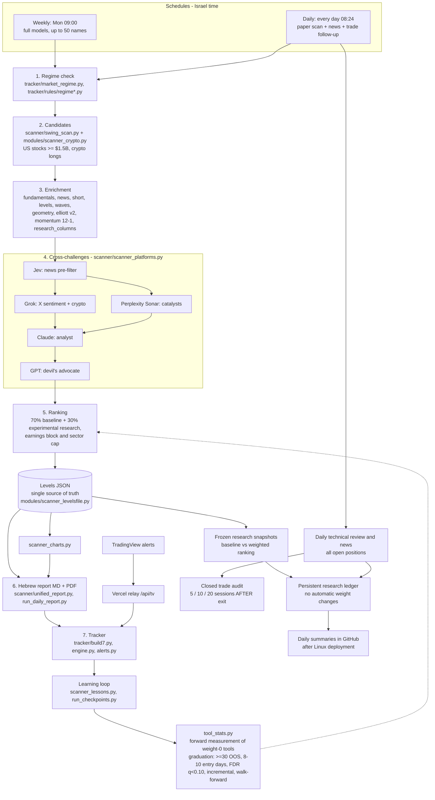

# Architecture / ארכיטקטורה

The active stop rules live in `modules/scanner_stops.py` and the causal ATR stop engine in `modules/stop_rules.py`.
The 30% Gann/Tekunah overlay is the user's explicit experimental allocation, not a validated graduation.
Other research/model columns retain their existing policies. The ranking is computed before model
enrichment; the final earnings/reconciliation gate can still remove recommendations.
See `research/jewish-lunar/FORWARD_RESEARCH.he.md` and `ops/LINUX_DEPLOYMENT.he.md`.
