# דוח סורק מאוחד – סריקה שבועית (יום שני)
**זמן הסריקה:** 2026-10-26 09:08 (שעון ישראל) · **תיקייה:** `/home/runner/work/stock-scanner/stock-scanner/runtime/scan-runs/2026-10-26_09082` · **הופק:** 26.10.2026 09:56 (שעון ישראל)

> **בדיקת התאמה (קובץ הרמות מול הדוח, שורות הטראקר ואינדקס הגרפים, סבולת 1e-6 יחסית):** 33 מתוך 33 תואמים · אין אי-התאמות.

> ## 🔴 חסר קרדיט
> - **חסר קרדיט - OpenRouter (Claude)**: העמודות של הפלטפורמה הזו ריקות בדוח. צריך לטעון קרדיט ולהריץ שוב.
> - **חסר קרדיט - OpenRouter (GPT)**: העמודות של הפלטפורמה הזו ריקות בדוח. צריך לטעון קרדיט ולהריץ שוב.
> - **חסר קרדיט - OpenRouter (Perplexity)**: העמודות של הפלטפורמה הזו ריקות בדוח. צריך לטעון קרדיט ולהריץ שוב.

> **חשוב:** עמודות המודלים (Jev, ‏Grok, ‏Perplexity, ‏Claude אנליסט, ‏GPT פרקליט השטן) הן **לתיעוד בלבד, במשקל 0**. הכניסה, הסטופ והיעד מגיעים רק מכללי הבוט, דרך קובץ הרמות של הריצה, ואף מודל לא שינה אותם. פסקי הדין נמדדים **רק קדימה, מ-12.10.2026**, בלי בקטסט היסטורי. כלל הדוחות (אין כניסה חדשה בתוך 5 ימי מסחר לפני דוח) הוא **כלל פעיל**. זה לא ייעוץ השקעות.

## 1. מצב השוק
- **נקודת חיתוך לנתונים (PIT):** 2026-10-26 07:08:00+00:00 UTC
- **תשואת 10 שנים:** 4.988% (שינוי 20 יום: ‎-19.6 נ"ב) · **30 שנים:** 5.315% · **מרווח 2-10:** 0.31
- **VIX:** 19.45 · **AAII שוורים פחות דובים:** — (סקר מ-—)

| מדד | סגירה | 5 ימים % | 15 ימים % | 60 ימים % | RSI | מבנה ממוצעים | שיפוע SMA50 |
|---|---|---|---|---|---|---|---|
| SPY | 759.97 | ‎-0.43 | ‎-1.26 | 2.72 | 36.9 | mixed | down |
| QQQ | 704.40 | ‎-0.76 | ‎-6.03 | 3.16 | 23.7 | mixed | down |
| IWM | 275.75 | 1.96 | ‎-2.05 | ‎-5.51 | 37.4 | bear | down |
| SMH | 527.20 | ‎-2.33 | ‎-16.40 | ‎-2.17 | 15.0 | bear | down |
| ^VIX | 19.45 | ‎-2.70 | 27.04 | 21.64 | 64.5 | mixed | up |

## 2. איך נבחרו המועמדים
- **40 שמות עברו את הכללים** (הרשימה המלאה ב-`candidates_full.csv`, עם ציוני הכללים, הרמות מקובץ הרמות, כניסה/סטופ/יעד ודגל הדוח). מתוכם נבחרו עד **50** לדוח.
- **מניות לונג:** סגירה מעל SMA50 ו-SMA200, שיפוע SMA50 עולה, עד 3 ATR מעל SMA20, שווי ≥ $1.5B, מחזור > $14M, מחיר ≥ $5.
- **מניות שורט:** רק מי שעובר את כלל השורט המאושר (ck_score≥3 וסגירה מתחת ל-SMA200).
- **קריפטו (לונג בלבד):** BTC, ‏ETH, ‏SOL ומטבעות גדולים, נרות יומיים של Alpaca. אותו מסנן מגמה, סטופ קבוע 3×ATR14 על סגירה יומית, בלי יעד. שורט קריפטו מוקפא. Grok הוא פלטפורמת הסנטימנט הראשית.
- **דירוג אחד לכולם (אין חלוקה קבועה לונג/שורט):** ציון אחיד 0–100 = אחוזון המומנטום 12-1 בתוך קבוצת הנכס, ובשורט הפוך (100 פחות האחוזון). ככל שהציון גבוה יותר המומנטום מצביע לכיוון העסקה, ושורט מדורג מעל לונג רק כשהמומנטום שלו חזק יותר. נבחרים עד 50 בעלי הציון הגבוה ביותר - יכולים להיות 20 לונג ו-0 שורט. **סף כניסה: 60** (דגל `--min-score`); מתחתיו שם לא נכנס גם אם נשארו פחות מ-50 מקומות. ברירת המחדל 60 נקבעה לפי מדגם מאומת (139 סטאפי מניות עם תוצאה ליום 20, 15 ימי כניסה שונים): מציון 60 ומעלה שיעור הפגיעה בתשואה מכוונת ליום 20 היה 58.9% מול 51.8% מתחת, בלי יתרון בממוצע. מדגם קטן - הסף עצמו נמדד קדימה.
- **גיוון:** מגבלת הסקטור כבויה בריצה הזו.
- **כלל הדוחות (פעיל):** אין כניסה חדשה במניה אם הדוח הבא בתוך 5 ימי מסחר מיום הכניסה. מקורות התאריך: לוח Yahoo, ‏OpenBB/Nasdaq ו-Perplexity (רק כשהוא מאשר עם מקור). אם יש מחלוקת, לוקחים את התאריך **המוקדם**. אין תאריך מאומת: מסומן "תאריך דוח לא מאומת". חריגה רק בקטליזטור חזק מאוד: Perplexity מדרג "חזק" עם מקור מתוארך, Claude בביטחון 70 ומעלה בעד, ו-GPT לא הטיל וטו. מניה שנחסמה מוחלפת בשם הבא בדירוג, והיא עדיין נרשמת ביומן למדידה.
- **מקור אמת יחיד:** לכל שם נבנה קובץ `levels/<TICKER>.json` (נרות מהמטמון של הסריקה, hash של הנרות, פיבוטים, ספירת אליוט v1 ו-v2, פיבו, VP120, תמיכה/התנגדות, גלי נפח, RSI/CCI, כניסה/סטופ/יעד, סטטוס דוח). הגרף, הדוח, שורות הטראקר והמודלים קוראים רק ממנו.
- **המודלים רואים את הגרף:** Claude, ‏GPT, ‏Grok ו-Perplexity מקבלים את תמונת הגרף (1280 פיקסלים) כקלט הראשי לקריאה הטכנית, וכל מספר בטקסט מגיע מקובץ הרמות. כל מודל אומר אם הוא חולק על ספירת האליוט, הפיבו או התמיכה/התנגדות שצוירו (עמודה ניסיונית `chart_count_disagree`).

## 3. המלצות – מניות (11)
| # | טיקר | כיוון | כניסה (ייחוס) | סטופ | יעד | דירוג | דוח | Jev | Grok | Perplexity | Claude | GPT | חולקים על הגרף |
|---|---|---|---|---|---|---|---|---|---|---|---|---|---|
| 1 | **NFLX** | שורט | 65.85 | 74.33 | אין | 95.3 | 2027-01-19 (58 י"מ) | — | ✅ אישור (‎+0) | ⚠️ דגל | 62 (תומך) | ⚠️ דגל | 2/4 |
| 2 | **CRWD** | לונג | 257.57 | 205.96 | 340.38 | 94.4 | 2026-12-01 (26 י"מ) | חיובי (+0.57) | ✅ אישור (‎+0) | ⚠️ דגל | 45 (ניטרלי) | ⚠️ דגל | 0/4 |
| 3 | **UBER** | שורט | 66.70 | 74.16 | אין | 92.5 | 2026-11-04 (8 י"מ) | — | ⚠️ דגל (‎+1) | ⚠️ דגל | 45 (ניטרלי) | ⚠️ דגל | 2/4 |
| 4 | **TXN** | לונג | 284.69 | 247.99 | 330.03 | 87.9 | תאריך דוח לא מאומת | חיובי (+0.44) | ✅ אישור (‎+0) | ⚠️ דגל | 48 (ניטרלי) | ⚠️ דגל | 2/4 |
| 5 | **ADI** | לונג | 391.07 | 339.11 | 468.82 | 86.9 | 2026-11-24 (22 י"מ) | — | ✅ אישור (‎+1) | ⚠️ דגל | 45 (ניטרלי) | ⚠️ דגל | 2/4 |
| 6 | **OXY** | לונג | 64.17 | 57.65 | 67.78 | 76.6 | 2026-11-09 (11 י"מ) | חיובי (+1.00) | ✅ אישור (‎+0) | ⚠️ דגל | 45 (ניטרלי) | ⚠️ דגל | 2/4 |
| 7 | **AMGN** | לונג | 439.26 | 396.92 | 458.81 | 75.7 | 2026-11-03 (7 י"מ) | חיובי (+1.00) | ✅ אישור (‎+0) | ⚠️ דגל | 62 (תומך) | ⚠️ דגל | 2/4 |
| 8 | **AAPL** | לונג | 347.73 | 322.09 | 367.24 | 69.2 | 2026-11-02 (6 י"מ) | — | ✅ אישור (‎+0) | ⚠️ דגל | 45 (ניטרלי) | ⚠️ דגל | 1/4 |
| 9 | **T** | שורט | 20.93 | 24.05 | אין | 65.4 | 2027-01-26 (63 י"מ) | שלילי (-0.73) | ✅ אישור (‎+0) | ⚠️ דגל | 62 (תומך) | ⚠️ דגל | 2/4 |
| 10 | **PFE** | לונג | 30.03 | 27.79 | 31.70 | 63.6 | 2026-11-03 (7 י"מ) | — | ✅ אישור (‎+0) | ⚠️ דגל | 52 (ניטרלי) | ⚠️ דגל | 1/4 |
| 11 | **TMO** | לונג | 673.82 | 591.59 | 749.34 | 61.7 | תאריך דוח לא מאומת | חיובי (+0.78) | ✅ אישור (‎+1) | ✅ אישור | 68 (תומך) | ⚠️ דגל | 1/4 |

_דירוג: הציון האחיד 0–100 (אחוזון מומנטום 12-1, הפוך בשורט). Grok בסוגריים: סנטימנט 2- עד 2+. Claude: ביטחון 0–100 ועמדה. "חולקים על הגרף": כמה מודלים אמרו שספירת האליוט/פיבו/תמיכה שצוירו לא נראית נכונה. הכל במשקל 0._

## 4. קריפטו – לונג בלבד (0)
אין שם קריפטו שעבר את מסנן המגמה בריצה הזו.

## 5. חריגה: קטליזטור חזק (0)
אין.

## 6. נחסם - דוח בתוך 5 ימי מסחר (3)
| טיקר | כיוון | דוח הבא | ימי מסחר עד הדוח | מקורות | Perplexity קטליזטור | Claude | GPT |
|---|---|---|---|---|---|---|---|
| BA | שורט | 2026-10-27 | 2 | 2026-10-27 (Yahoo calendar); 2026-10-27 (Perplexity (מאושר, עם מקורות)) | strong | 45 | חסר קרדיט |
| LLY | לונג | 2026-10-29 | 4 | 2026-10-29 (Yahoo calendar); 2026-10-29 (Perplexity (מאושר, עם מקורות)) | strong | — | חסר קרדיט |
| KO | לונג | 2026-10-27 | 2 | 2026-10-27 (Yahoo calendar) | — | — | חסר קרדיט |

_השמות האלה לא בהמלצות, אבל פסקי הדין שלהם נרשמו ביומן למדידה._

## 7. לא תואם (0)
אין. כל המספרים בדוח, בשורות הטראקר ובאינדקס הגרפים זהים לקובץ הרמות.

## 8. פירוט לכל מועמד
### 1. NFLX – שורט · דירוג 95.3
- **רמות (קובץ הרמות, נר אחרון 2026-10-23, hash 3833a3b9a903871e):** כניסה 65.85 · סטופ 74.33 (chandelier_close 4.0xATR14, ATR14=2.1194) · יעד: אין – ללא יעד קבוע - שנדלייר 4xATR14 על סגירה (כלל מאושר)
- **טכני:** SMA20 69.15 · SMA50 74.27 · SMA200 82.27 · מומנטום 12-1 ‎-0.358 · RSI14 37.1 · CCI20 ‎-121
- **ניסיוני (משקל 0):** אליוט v2: W5 in progress (provisional) · אליוט v1: in_W3 (W2 done) · פיבו v2 81.02→66.54 (1.618=57.59) · VP120 POC 73.14 (VAH 79.98, VAL 65.74) · תמיכה 65.08 · התנגדות 70.63 · סוף גל: 2 משפחות (volume_exhaustion,momentum_divergence) · תחילת גל: 3 (wave_volume_dominance,momentum_divergence,elliott_context)
- **דוח:** מותר - דוח בעוד 58 ימי מסחר · מקורות: 2027-01-19 (Yahoo calendar)
- **סוויפ נזילות (ייחוס בלבד, משקל 0):** לא
- **ספירלת פיבו – יעדי ייחוס בלבד (משקל 0, לא משנה סטופ/יעד; השורט נשאר עם סטופ נגרר 4×ATR בלי יעד):** T1 — (—) · T2 — (—) · מצב: none

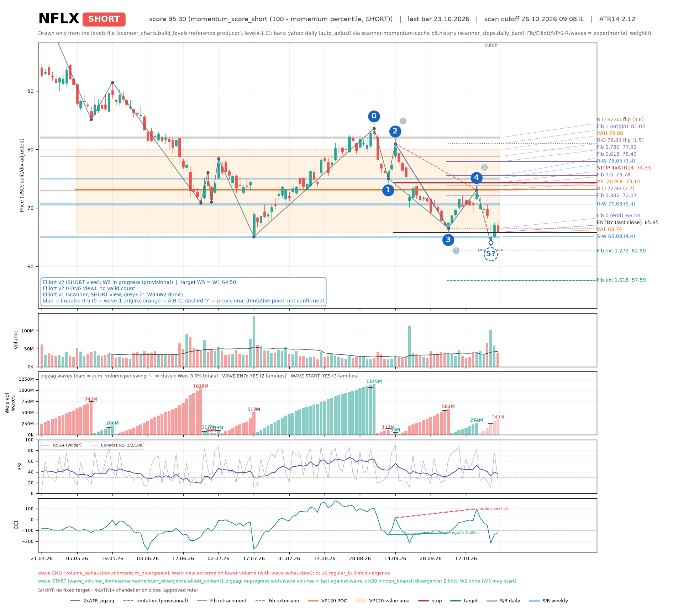

- **Jev (typesafe/jev-1.13):** 15 כותרות · 0 בביטחון ≥0.8 (סומכים על Jev) · 8 הועברו ל-Claude לשיפוט (ביטחון נמוך או חשד למניפולציה; 0 חשודות, 3 הודעות חברה) · סנטימנט — · קטליזטור — · הסכמה עם Claude 6/8
- **Grok (grok-4.3, חיפוש X של Grok):** ✅ אישור · סנטימנט ‎+0 · ביטחון low · 0 פוסטים · אין דעות משמעותיות ב-X · חשבונות מאומתים: —
- **Perplexity (perplexity/sonar-pro):** ⚠️ דגל · הדוח האחרון והורדות התחזית כבר התרחשו, אך קיימת אי-ודאות גבוהה לאחר הדוח והתרחיש הטכני המסומן אינו מאושר מספיק לשורט נקי. · קטליזטור: moderate (2026-10-20 https://finance.yahoo.com/markets/stocks/article/netflix-stock-sinks-as-revenue-forecast-falls-short-of-estimates-201748159.html)
  - ב-20 באוקטובר נטפליקס דיווחה על תוצאות הרבעון השלישי, ולכן מדובר בקטליזטור שכבר התרחש. ב-30 הימים הקרובים לא נמצא אירוע חברה עתידי מתוארך ומאומת במקורות שנבדקו; זכויות שידור מונדיאל 2030 בספרד ובאנדורה עשויות לתמוך בסנטימנט. · דוח הבא: — · דגלים: החברה הורידה את תחזית הכנסות הפרסום ל-2026 מ-$3 billion לכ-$2.7 billion עקב השקה איטית של יכולות מוצרי הפרסום. / תחזית הכנסות הרבעון הרביעי הייתה $13.44 billion, מתחת לקונצנזוס של $13.51 billion; תחזית תזרים המזומנים החופשי הופחתה ועלויות ארגון מחדש צפויות ללחוץ על המרווחים. / קיימים חששות מתחרות גוברת, שחיקת מרווחים והאטת צמיחת הכנסות; לא נמצא במקורות שנבדקו מידע מאומת על ליטיגציה, דילול, חוב חריג או בעיה חשבונאית.
- **Claude, אנליסט (anthropic/claude-sonnet-4.5):** ביטחון **62/100** · תומך · סיכון: ריבאונד טכני מרמת oversold קיצונית
  - תזה: SHORT נתמך על ידי חולשה טכנית ברורה (שבירת תמיכות, מומנטום שלילי), הורדת תחזיות החברה והורדות דירוג אנליסטים לאחר הדוח. הסיכון הוא oversold קיצוני שעלול לייצר ריבאונד טכני לטווח קצר, במיוחד עם Ackman חוזר למניה. · טכני (מהגרף): המניה בירידה חדה מ-81 ל-65.85, עם Elliott v2 מציע גל 5 ירידה פרוביזיונלי ליעד 64.5. RSI 37 ו-CCI -120 מצביעים על oversold, אך המומנטום חלש (ציון 4.7) והמחיר מתחת לכל הממוצעים; הכניסה בסגירה אחרונה עם סטופ 4xATR ב-74.33.
- **GPT, פרקליט השטן (openai/gpt-5.6-sol):** ⚠️ דגל · הסיכון הגדול: ריבאונד חד מתמיכה וממכירות יתר · המגמה יורדת, אך מיקום הכניסה וסימני התשישות יוצרים סיכון ממשי לתיקון נגד השורט.
  - נגד התזה של Claude: התזה ממעיטה בכך שהחדשות השליליות כבר פורסמו ושהמחיר נמצא באזור תמיכה עם סימני תשישות וסטייה שורית.
- **האם הגרף נראה נכון? (ניסיוני):** Grok: n/a: אין מידע מספיק · Perplexity: yes: אני חולק על הספירה הראשית ועל העוגן משום ש-W5 מסומן כפרוביזורי, בעוד שהמחיר כבר בחן את אזור התמיכה והמבנה הסופי אינו מאושר. · Claude: no: ספירת Elliott v2 (גל 5 פרוביזיונלי) והעיגון פיבונאצ'י מ-81.02 ל-66.54 נראים סבירים על הגרף; רמות S/R תואמות את המבנה. · GPT: yes: ספירת גל 5 פרוביזורית וסותרת את תרחיש גל 3, בעוד עוגן הפיבונאצ'י ורמות התמיכה נראים סבירים. · קלט: grok=img pplx=img claude=img gpt=img
- **אתגור הדדי:** Claude 62 (supports) מול GPT flag: מעורב

### 2. CRWD – לונג · דירוג 94.4
- **רמות (קובץ הרמות, נר אחרון 2026-10-23, hash f15d724f73bf448a):** כניסה 257.57 · סטופ 205.96 (chandelier_close 4.0xATR14, ATR14=12.90) · יעד: 340.38 – חצי ב-Fib 1.618 (סגירה), השאר בשנדלייר 4xATR
- **טכני:** SMA20 255.68 · SMA50 234.80 · SMA200 163.61 · מומנטום 12-1 1.077 · RSI14 55.9 · CCI20 ‎-28
- **ניסיוני (משקל 0):** אליוט v2: W2 correction zigzag: B in progress (provisional) · אליוט v1: in_W3 (W2 done) · פיבו v2 200.60→286.99 (1.618=340.38) · VP120 POC 171.33 (VAH 235.20, VAL 152.34) · תמיכה 232.37 · התנגדות 286.99 · סוף גל: 1 משפחות (wave_volume_dominance) · תחילת גל: 2 (momentum_divergence,elliott_context)
- **דוח:** מותר - דוח בעוד 26 ימי מסחר · מקורות: 2026-12-01 (Yahoo calendar)
- **סוויפ נזילות (ייחוס בלבד, משקל 0):** לא · **עבר בדיקה, שביר, משקל 0**

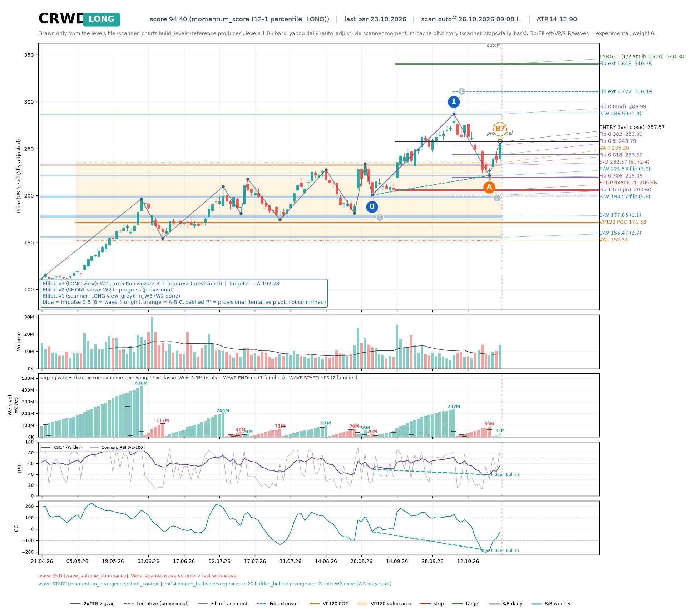

- **Jev (typesafe/jev-1.13):** 15 כותרות · 4 בביטחון ≥0.8 (סומכים על Jev) · 8 הועברו ל-Claude לשיפוט (ביטחון נמוך או חשד למניפולציה; 0 חשודות, 4 הודעות חברה) · סנטימנט חיובי (+0.57) · קטליזטור product · הסכמה עם Claude 7/8
- **Grok (grok-4.3, חיפוש X של Grok):** ✅ אישור · סנטימנט ‎+0 · ביטחון low · 10 פוסטים · אין חדשות שליליות ב-X · חשבונות מאומתים: —
- **Perplexity (perplexity/sonar-pro):** ⚠️ דגל · הדוחות צפויים בתוך חלון ההחזקה הקרוב ולכן קיימת חשיפה לאירוע בינארי משמעותי. · קטליזטור: moderate (2026-10-28 https://www.marketbeat.com/stocks/NASDAQ/CRWD/)
  - ב־14 הימים האחרונים נרשמו העלאות יעדי מחיר משמעותיות מצד מספר אנליסטים, כולל Mizuho, Citi, BTIG ו־Wells Fargo. במהלך 30 הימים הקרובים צפוי פרסום התוצאות הרבעוניות, אך התאריך אינו מאושר במקור רשמי; אין מקור שסיפק אירוע חברה חתום נוסף. · דוח הבא: 2026-11-28 (לא מאושר) · דגלים: תאריך הדוחות אינו מאושר ומקורות שונים מציגים תאריכים שונים. / מחיר המניה גבוה מיעד המחיר הממוצע של האנליסטים, המצביע על אפסייד מוגבל או דאונסייד. / המניה עלולה להיות חשופה לתנודתיות בינארית סביב הדוחות הקרובים.
- **Claude, אנליסט (anthropic/claude-sonnet-4.5):** ביטחון **45/100** · ניטרלי · סיכון: ספירת Elliott v2 provisional מצביעה על סיכון להמשך תיקון ל-192.28 במקום עלייה
  - תזה: המומנטום חזק (ציון 94.4) והמניה מעל ממוצעים נעים מרכזיים, אך הספירה האליוטית provisional מעלה ספק אם W2 אכן הסתיים. יעדי האנליסטים (275-312) נמוכים או קרובים למחיר הנוכחי, מה שמצמצם את האפסייד הצפוי. · טכני (מהגרף): המניה סגרה בדיוק על רמת הכניסה 257.57, מעל SMA20/50 ומתחת להתנגדות שבועית ב-286.99. דיברגנציה בוליש נסתרת ב-RSI וב-CCI, אך ה-Elliott v2 מסומן כ-provisional (B בתהליך) ומצביע על המשך תיקון פוטנציאלי ל-192.28.
- **GPT, פרקליט השטן (openai/gpt-5.6-sol):** ⚠️ דגל · הסיכון הגדול: המשך גל C מטה במקום תחילת W3 · המגמה הארוכה חיובית, אך יחס הסיכון מחמיר בשל תרחיש תיקון פתוח, תמחור קיצוני ואפסייד אנליסטים מוגבל.
  - נגד התזה של Claude: התזה חלשה בהישענותה על ציון המומנטום למרות ספירת Elliott סותרת ותמחור קיצוני.
- **האם הגרף נראה נכון? (ניסיוני):** Grok: no: הספירה והעוגנים נראים תקינים · Perplexity: no · Claude: no: הספירה האליוטית והעיגון הפיבונאצ'י נראים סבירים על הגרף, אך הסימון provisional מצדיק זהירות · GPT: no: העוגן 200.6–286.99 ורמות התמיכה וההתנגדות נראים סבירים, וספירת B הזמנית מתאימה לתיקון המוצג. · קלט: grok=img pplx=img claude=img gpt=img
- **אתגור הדדי:** Claude 45 (neutral) מול GPT flag: מעורב

### 3. UBER – שורט · דירוג 92.5
- **רמות (קובץ הרמות, נר אחרון 2026-10-23, hash 0b3ff528197430a1):** כניסה 66.70 · סטופ 74.16 (chandelier_close 4.0xATR14, ATR14=1.8654) · יעד: אין – ללא יעד קבוע - שנדלייר 4xATR14 על סגירה (כלל מאושר)
- **טכני:** SMA20 69.34 · SMA50 72.29 · SMA200 73.84 · מומנטום 12-1 ‎-0.249 · RSI14 38.6 · CCI20 ‎-144
- **ניסיוני (משקל 0):** אליוט v2: W3 in progress (provisional) · אליוט v1: in_W3 (W2 done) · פיבו v2 82.36→67.22 (1.618=57.86) · VP120 POC 71.34 (VAH 75.24, VAL 68.46) · תמיכה 66.19 · התנגדות 67.70 · סוף גל: 1 משפחות (momentum_divergence) · תחילת גל: 2 (wave_volume_dominance,elliott_context)
- **דוח:** מותר - דוח בעוד 8 ימי מסחר · מקורות: 2026-11-04 (Yahoo calendar); 2026-11-04 (Perplexity (מאושר, עם מקורות))
- **סוויפ נזילות (ייחוס בלבד, משקל 0):** לא
- **ספירלת פיבו – יעדי ייחוס בלבד (משקל 0, לא משנה סטופ/יעד; השורט נשאר עם סטופ נגרר 4×ATR בלי יעד):** T1 — (—) · T2 — (—) · מצב: none

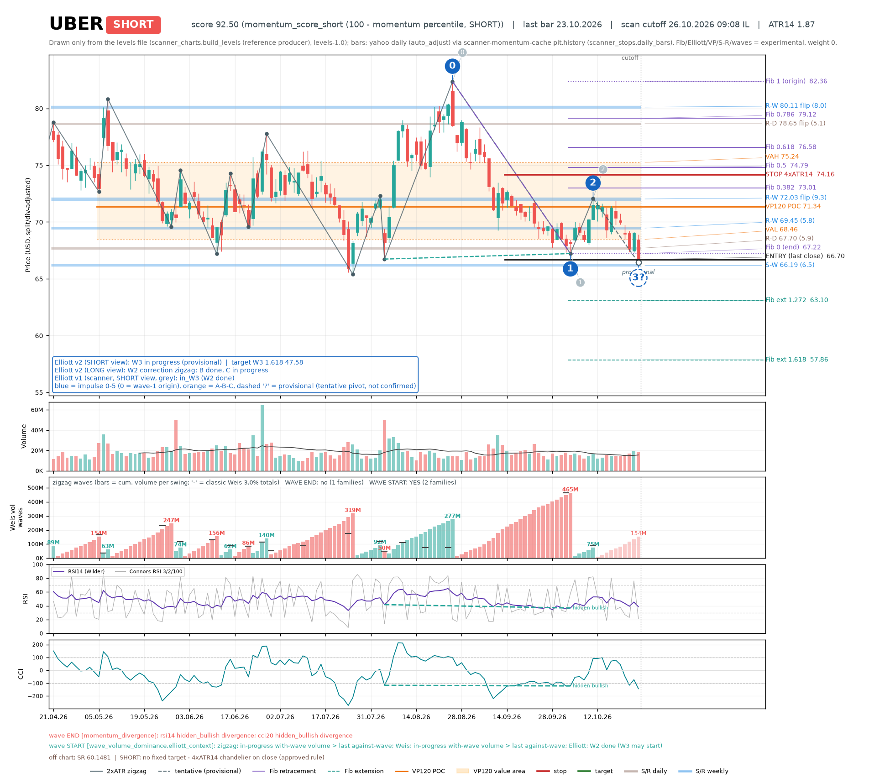

- **Jev (typesafe/jev-1.13):** 15 כותרות · 0 בביטחון ≥0.8 (סומכים על Jev) · 8 הועברו ל-Claude לשיפוט (ביטחון נמוך או חשד למניפולציה; 0 חשודות, 2 הודעות חברה) · סנטימנט — · קטליזטור — · הסכמה עם Claude 4/8
- **Grok (grok-4.3, חיפוש X של Grok):** ⚠️ דגל · סנטימנט ‎+1 · ביטחון low · 8 פוסטים · סנטימנט קל חיובי ב-X ללא חדשות נגד השורט · חשבונות מאומתים: @Julian_Trades1
- **Perplexity (perplexity/sonar-pro):** ⚠️ דגל · הדוחות מתוכננים בתוך כ-15 ימי מסחר ולכן קיימת חשיפה לאירוע בינארי קרוב. · קטליזטור: strong (2026-11-04 https://finance.yahoo.com/calendar/earnings?symbol=UBER)
  - הדוח לרבעון השלישי מתוכנן ל-4 בנובמבר 2026 לפני פתיחת המסחר, ולכן הוא אירוע בינארי קרוב לשורט. החברה סיפקה תחזית EPS של 0.84–0.88, מתחת להערכת האנליסטים של 0.89, והדבר הכביד על המניה. · דוח הבא: 2026-11-04 · דגלים: התחזית לרבעון השלישי היא EPS של 0.84–0.88, מתחת לצפי של 0.89. / תחזיות הרווח השנתיות ירדו: Erste הפחיתה את תחזית FY2027 מ-4.42 ל-4.41. / הערכת Yahoo צופה ירידה של 69.8% ב-EPS הרבעוני לעומת הרבעון המקביל.
- **Claude, אנליסט (anthropic/claude-sonnet-4.5):** ביטחון **45/100** · ניטרלי · סיכון: דוח רבעוני בעוד 8 ימים עם פוטנציאל להפתעה חיובית ודיברגנציה בוליש במומנטום
  - תזה: המבנה הטכני תומך בהמשך ירידה לכיוון יעדי פיבונאצ'י ואליוט (63-58), אך הדיברגנציה הבוליש והקרבה לדוח רבעוני מהוות סיכונים משמעותיים. הכניסה בסמוך לתמיכה שבועית (66.19) מצמצמת את פוטנציאל הרווח לטווח הקצר. · טכני (מהגרף): המניה נסחרת מתחת לכל הממוצעים (SMA20/50/200) עם מומנטום חלש (ציון 7.5) ומתחת ל-VA של VP120. הספירה האליוטית מציעה W3 פרובזיונלית כלפי מטה עם יעד 47.58, אך קיימת דיברגנציה בוליש נסתרת ב-RSI וב-CCI המעידה על חולשה פוטנציאלית בתזה השורטית.
- **GPT, פרקליט השטן (openai/gpt-5.6-sol):** ⚠️ דגל · הסיכון הגדול: ריבאונד חד מתמיכה סביב דוח קרוב · המגמה שלילית, אך נקודת הכניסה ליד תמיכה והסיכון הבינארי מהדוח מחלישים מהותית את השורט.
  - נגד התזה של Claude: החולשה המרכזית היא ההסתמכות על W3 פרוביזורית ויעדים רחוקים למרות תמיכה קרובה ודיברגנציות בוליש.
- **האם הגרף נראה נכון? (ניסיוני):** Grok: no: ספירה אליוט ו-Fib נראים תקינים · Perplexity: yes: הספירה והעוגן נראים אפשריים, אך הגל השלישי המסומן פרוביזורי והסטייה החיובית ב-RSI/CCI מתנגשת עם המשך שורט חד-משמעי. · Claude: no: הספירה האליוטית והעיגון של פיבונאצ'י נראים הגיוניים על הגרף, אם כי הספירה פרובזיונלית · GPT: yes: ספירת W3 עדיין פרוביזורית והיעד הרחוק אינו משכנע מול התמיכה והדיברגנציות הבוליש הנראות בגרף. · קלט: grok=img pplx=img claude=img gpt=img
- **אתגור הדדי:** Claude 45 (neutral) מול GPT flag: מעורב

### 4. TXN – לונג · דירוג 87.9
- **רמות (קובץ הרמות, נר אחרון 2026-10-23, hash 1a8c200c09d80de8):** כניסה 284.69 · סטופ 247.99 (chandelier_close 4.0xATR14, ATR14=9.1744) · יעד: 330.03 – חצי ב-Fib 1.618 (סגירה), השאר בשנדלייר 4xATR
- **טכני:** SMA20 283.84 · SMA50 272.40 · SMA200 255.34 · מומנטום 12-1 0.626 · RSI14 55.1 · CCI20 ‎-17
- **ניסיוני (משקל 0):** אליוט v2: W2 in progress (provisional) · אליוט v1: no valid count · פיבו v2 248.13→298.75 (1.618=330.03) · VP120 POC 280.97 (VAH 308.75, VAL 273.39) · תמיכה 273.77 · התנגדות 287.48 · סוף גל: 0 משפחות (—) · תחילת גל: 1 (volume_exhaustion)
- **דוח:** תאריך דוח לא מאומת
- **סוויפ נזילות (ייחוס בלבד, משקל 0):** לא · **עבר בדיקה, שביר, משקל 0**

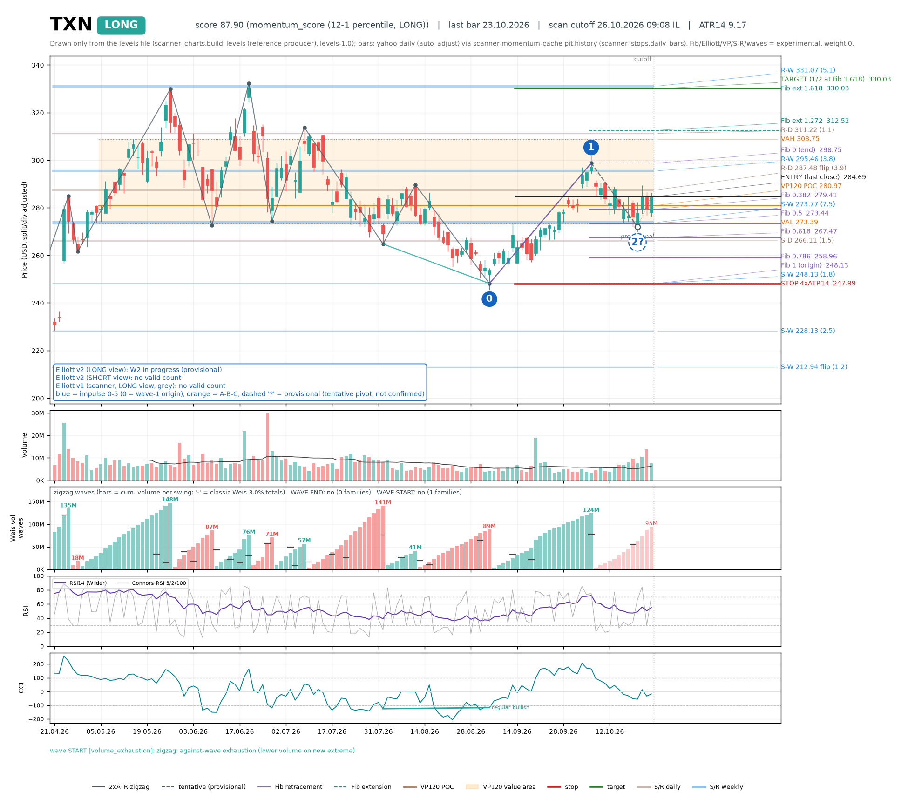

- **Jev (typesafe/jev-1.13):** 15 כותרות · 2 בביטחון ≥0.8 (סומכים על Jev) · 8 הועברו ל-Claude לשיפוט (ביטחון נמוך או חשד למניפולציה; 0 חשודות, 1 הודעות חברה) · סנטימנט חיובי (+0.44) · קטליזטור earnings · הסכמה עם Claude 6/8
- **Grok (grok-4.3, חיפוש X של Grok):** ✅ אישור · סנטימנט ‎+0 · ביטחון low · 0 פוסטים · אין חדשות שליליות ב-X, אין סיבה לדחות את ה-LONG · חשבונות מאומתים: —
- **Perplexity (perplexity/sonar-pro):** ⚠️ דגל · אירוע הדוחות כבר עבר, אך המניה נמצאת מיד לאחר קטליזטור בינארי משמעותי והספירה הטכנית אינה מאושרת. · קטליזטור: strong (2026-10-21 https://investor.ti.com/news-releases/news-release-details/ti-reports-third-quarter-2026-financial-results-and-shareholder)
  - ב-21 באוקטובר פורסמו תוצאות רבעון שלישי חזקות מהצפוי, עם רווח למניה של 2.62 דולר והכנסות של 6.06 מיליארד דולר. החברה סיפקה תחזית רבעון רביעי מעל הקונצנזוס, כאשר הביקוש בתעשייה, ברכב ובמרכזי נתונים התחזק. · דוח הבא: — · דגלים: קיימת מחלוקת אנליסטים לגבי התמחור והאפסייד, כולל הורדות יעד מצד Mizuho ו-UBS. / התחזית לרבעון הרביעי חיובית, אך UBS תיארה את ההנחיה כשטוחה; נדרש מעקב אחר קצב הצמיחה לאחר הזינוק האחרון. / הגרף מציג ספירה ראשית של Elliott כפרוביזורית בלבד, ולכן קיים סיכון שהמבנה הטכני והיעדים יפורשו מחדש.
- **Claude, אנליסט (anthropic/claude-sonnet-4.5):** ביטחון **48/100** · ניטרלי · סיכון: ספירת Elliott לא מאושרת והתגובה החלשה לדוחות מעלה ספק בהמשך העלייה
  - תזה: המומנטום גבוה (87.9) והמניה מעל ממוצעים, אך ספירת Elliott פרוביזורית בלבד והתגובה לדוחות החזקים הייתה מאופקת. יעד 330 (Fib 1.618) דורש עליה של 16% מול סטופ רחב (13%), ומחלוקת אנליסטים מעידה על חוסר קונצנזוס. · טכני (מהגרף): המניה נסגרה ב-284.69, מעל ממוצעים נעים (SMA20: 283.84, SMA50: 272.40, SMA200: 255.34) ובתוך ה-VA של VP120 (VAL: 273.39, VAH: 308.75). ספירת Elliott פרוביזורית מציעה W2 בתהליך, אך RSI ניטרלי (55.13) ו-CCI שלילי קלות (-17.3), והמניה ירדה 3.1% ב-15 ימים האחרונים.
- **GPT, פרקליט השטן (openai/gpt-5.6-sol):** ⚠️ דגל · הסיכון הגדול: כשל פריצה לאחר קטליזטור שכבר מתומחר · המגמה הארוכה חיובית, אך תגובת המחיר החלשה, ההתנגדות הקרובה והספירה הלא מאושרת פוגעות ביחס הסיכוי לסיכון.
  - נגד התזה של Claude: החולשה בתזה היא ההישענות על ציון מומנטום 87.9 אף שהתשואה ל־15 יום שלילית והמחיר טרם פרץ התנגדות קרובה.
- **האם הגרף נראה נכון? (ניסיוני):** Grok: no: ספירה אליוט ורמות פיב נראות תקינות · Perplexity: yes: הספירה הראשית מסומנת כפרוביזורית והגל השני עדיין מסומן בסימן שאלה, ולכן איני מאשר את הספירה או את עוגן הפיבוט בביטחון. · Claude: no: הספירה הפרוביזורית של W2 והעיגון הפיבונאצ'י מ-248.13 ל-298.75 נראים סבירים על הגרף, אך הסטטוס הפרוביזורי מהווה סיכון · GPT: yes: ספירת W2 נשענת על שפל זמני לא מאושר, ולכן יעד ההרחבה והמבנה המצויר אינם מבוססים דיים. · קלט: grok=img pplx=img claude=img gpt=img
- **אתגור הדדי:** Claude 48 (neutral) מול GPT flag: מעורב

### 5. ADI – לונג · דירוג 86.9
- **רמות (קובץ הרמות, נר אחרון 2026-10-23, hash 7f814b6c6864bf36):** כניסה 391.07 · סטופ 339.11 (chandelier_close 4.0xATR14, ATR14=12.99) · יעד: 468.82 – חצי ב-Fib 1.618 (סגירה), השאר בשנדלייר 4xATR
- **טכני:** SMA20 403.60 · SMA50 384.03 · SMA200 367.46 · מומנטום 12-1 0.612 · RSI14 47.3 · CCI20 ‎-147
- **ניסיוני (משקל 0):** אליוט v2: W2 in progress (provisional) · אליוט v1: no valid count · פיבו v2 348.00→422.67 (1.618=468.82) · VP120 POC 391.45 (VAH 417.52, VAL 369.24) · תמיכה 381.03 · התנגדות 397.97 · סוף גל: 0 משפחות (—) · תחילת גל: 1 (volume_exhaustion)
- **דוח:** מותר - דוח בעוד 22 ימי מסחר · מקורות: 2026-11-24 (Yahoo calendar); 2026-11-24 (Perplexity (מאושר, עם מקורות))
- **סוויפ נזילות (ייחוס בלבד, משקל 0):** לא · **עבר בדיקה, שביר, משקל 0**

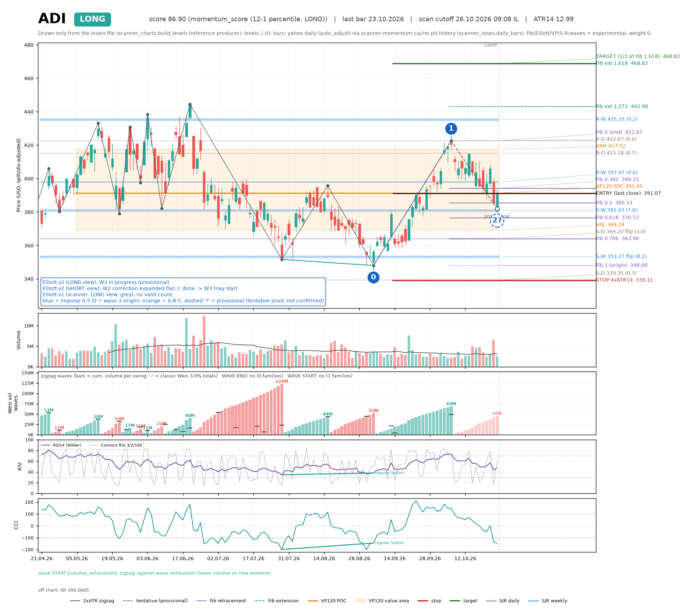

- **Jev (typesafe/jev-1.13):** 12 כותרות · 0 בביטחון ≥0.8 (סומכים על Jev) · 8 הועברו ל-Claude לשיפוט (ביטחון נמוך או חשד למניפולציה; 0 חשודות, 4 הודעות חברה) · סנטימנט — · קטליזטור — · הסכמה עם Claude 8/8
- **Grok (grok-4.3, חיפוש X של Grok):** ✅ אישור · סנטימנט ‎+1 · ביטחון low · 1 פוסטים · אין סיבה שלילית ברורה ב-X לאישור LONG · חשבונות מאומתים: —
- **Perplexity (perplexity/sonar-pro):** ⚠️ דגל · הדוח ב-24 בנובמבר נמצא בתוך חלון ההחזקה הקרוב ולכן יש לסמן את העסקה בשל אירוע בינארי משמעותי. · קטליזטור: strong (2026-11-24 https://investor.analog.com/press-releases)
  - החברה הודיעה ב-22 באוקטובר שתפרסם את תוצאות הרבעון הרביעי ב-24 בנובמבר, ולכן הדוח הוא קטליזטור קרוב ומשמעותי. לא נמצאו בתוצאות שסופקו אירועים חיוביים ספציפיים נוספים של החברה ב-14 הימים האחרונים או ב-30 הימים הקרובים. · דוח הבא: 2026-11-24 · דגלים: הדוח הבא צפוי בתוך כ-15 ימי מסחר, ולכן קיימת אי-ודאות בינארית לסווינג לונג. / לא נמצאו בתוצאות שסופקו ראיות עדכניות לבעיות חשבונאיות, ליטיגציה מהותית, דילול או רגולציה. / ההנחיה שצוינה לרבעון הרביעי היא טווח EPS של 3.710–4.010; לא נמצא שינוי הנחיה עדכני בתוצאות שסופקו.
- **Claude, אנליסט (anthropic/claude-sonnet-4.5):** ביטחון **45/100** · ניטרלי · סיכון: דוח רבעוני בעוד 22 ימים עם אי-ודאות בינארית
  - תזה: הסטאפ מציע כניסה ליד POC לאחר תיקון, עם יעד פיבונאצ'י אטרקטיבי ב-468.82 (יחס סיכון-תגמול 1:1.5). עם זאת, הדוח הקרוב והמומנטום הטכני החלש מציבים סימן שאלה על העיתוי. · טכני (מהגרף): המניה נסחרת ב-POC של VP120 (391.45) לאחר תיקון של 6.3% ב-15 ימים מהשיא ב-422.67. ספירת אליוט מציעה W2 זמנית בתהליך, אך RSI נייטרלי (47.3) ו-CCI שלילי (-147.27) מעידים על חולשה לטווח קצר.
- **GPT, פרקליט השטן (openai/gpt-5.6-sol):** ⚠️ דגל · הסיכון הגדול: דוח קרוב מול חולשה טכנית ותמחור גבוה · המגמה הארוכה חיובית, אך החולשה הקצרה, ההתנגדויות והדוח הקרוב הופכים את הלונג לרגיש במיוחד לתזמון.
  - נגד התזה של Claude: התזה מייחסת משקל רב מדי ל-POC וליעד פיבונאצ'י אף שאין עדיין אישור להיפוך או לספירת אליוט תקפה.
- **האם הגרף נראה נכון? (ניסיוני):** Grok: no: ספירה ורמות נראות תקינות · Perplexity: yes: הספירה הראשית מסומנת כפרוביזורית, והגל היורד האחרון עדיין אינו מאושר ולכן עוגן פיבונאצ'י ורמות התמיכה עשויים להשתנות. · Claude: no: ספירת W2 זמנית והעיגון של פיבונאצ'י מ-348 ל-422.67 נראים הגיוניים על הגרף · GPT: yes: ספירת W2 מסומנת כזמנית ואינה נתמכת בספירה תקפה או בנקודת סיום מאושרת, אף שעוגני הפיבונאצ'י וה-S/R סבירים. · קלט: grok=img pplx=img claude=img gpt=img
- **אתגור הדדי:** Claude 45 (neutral) מול GPT flag: מעורב

### 6. OXY – לונג · דירוג 76.6
- **רמות (קובץ הרמות, נר אחרון 2026-10-23, hash 69b15bb7f25c353c):** כניסה 64.17 · סטופ 57.65 (chandelier_close 4.0xATR14, ATR14=1.6307) · יעד: 67.78 – חצי ב-Fib 1.618 (סגירה), השאר בשנדלייר 4xATR
- **טכני:** SMA20 59.99 · SMA50 59.72 · SMA200 55.18 · מומנטום 12-1 0.419 · RSI14 68.6 · CCI20 119
- **ניסיוני (משקל 0):** אליוט v2: no valid count · אליוט v1: no valid count · פיבו v2 53.41→61.87 (1.618=67.09) · VP120 POC 57.47 (VAH 60.43, VAL 53.12) · תמיכה 63.77 · התנגדות 66.83 · סוף גל: 1 משפחות (wave_volume_dominance) · תחילת גל: 2 (volume_exhaustion,wave_volume_dominance)
- **דוח:** מותר - דוח בעוד 11 ימי מסחר · מקורות: 2026-11-09 (Yahoo calendar); 2026-11-09 (Perplexity (מאושר, עם מקורות))
- **סוויפ נזילות (ייחוס בלבד, משקל 0):** לא · **עבר בדיקה, שביר, משקל 0**

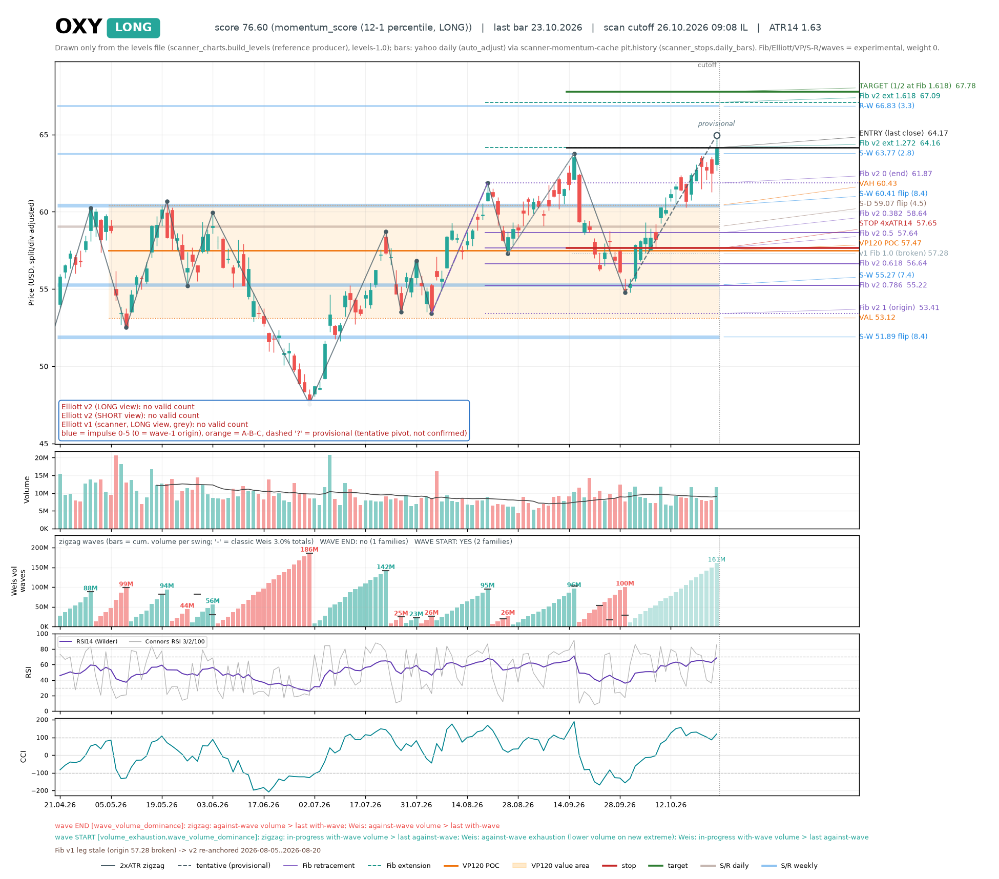

- **Jev (typesafe/jev-1.13):** 8 כותרות · 3 בביטחון ≥0.8 (סומכים על Jev) · 3 הועברו ל-Claude לשיפוט (ביטחון נמוך או חשד למניפולציה; 0 חשודות, 0 הודעות חברה) · סנטימנט חיובי (+1.00) · קטליזטור analyst · הסכמה עם Claude 3/3
- **Grok (grok-4.3, חיפוש X של Grok):** ✅ אישור · סנטימנט ‎+0 · ביטחון low · 5 פוסטים · אין דיון משמעותי ב-X · חשבונות מאומתים: —
- **Perplexity (perplexity/sonar-pro):** ⚠️ דגל · הדוחות מתפרסמים בתוך כ-15 ימי מסחר מהכניסה, ולכן קיימת חשיפה לאירוע בינארי קרוב. · קטליזטור: moderate (2026-11-09 https://www.zacks.com/stock/research/OXY/earnings-announcements)
  - הקטליזטור המרכזי הוא פרסום דוחות הרבעון השלישי ב-2026-11-09, ולכן אירוע מהותי נמצא בתוך חלון ההחזקה. עדכוני האנליסטים האחרונים מצביעים על ציפיות מעורבות: חוזקה במחירי הנפט ובפעילות המידסטרים, אך חולשה אפשרית עקב השבתות בצינורות בגולף ומחיר גז נמוך יותר. · דוח הבא: 2026-11-09 · דגלים: פרסום הדוחות הקרוב עלול לחשוף רבעון חלש מהצפוי עקב השבתות בגולף אמריקה בגלל בעיות בצינורות של צד שלישי ו-cut נמוך יותר של נפט. / החברה נותרה חשופה למינוף ולמגדל חוב; פרשנות אנליסטית לקראת הדוחות העלתה צורך לטפל בחלקים היקרים יותר של החוב. / ההנחיה ל-2027 מתוארת כ-soft, עם capex של 5.9 מיליארד דולר לפי תחזית אנליסטים, בעוד שחולשה במחירי הגז עלולה לפגוע בהנחות התפעוליות.
- **Claude, אנליסט (anthropic/claude-sonnet-4.5):** ביטחון **45/100** · ניטרלי · סיכון: דוח רבעוני חלש ב-9.11 עקב השבתות תפעוליות ומחירי גז
  - תזה: מומנטום טכני חזק ושדרוגי אנליסטים תומכים בהמשך עלייה לטווח קצר, אך הכניסה בשיא לקראת דוח רבעוני מסוכן עם סיכונים תפעוליים ידועים. יחס סיכון-תשואה צר (6.5 דולר סטופ מול 3.6 דולר ליעד הראשון). · טכני (מהגרף): המניה בעלייה חזקה מעל כל הממוצעים (SMA20/50/200), עם מומנטום גבוה (76.6) ו-RSI 68.6. הכניסה ב-64.17 קרובה מאוד לשיא האחרון, מעל POC ו-VAH של VP120, אך ללא ספירת אליוט תקפה והפיבונאצ'י מסומן כ-stale.
- **GPT, פרקליט השטן (openai/gpt-5.6-sol):** ⚠️ דגל · הסיכון הגדול: דוח קרוב שעלול לחשוף חולשה תפעולית · המומנטום חיובי, אך תמחור הסיכון מול היעד והדוח הקרוב הופכים את הלונג לפגיע.
  - נגד התזה של Claude: התזה נשענת מדי על מומנטום והעלאות יעדים, אף שרוב הדירוגים נותרו Hold/Neutral והמחיר כבר מתוח.
- **האם הגרף נראה נכון? (ניסיוני):** Grok: n/a: אין מידע · Perplexity: yes: הספירה המסומנת אינה מאומתת לפי התרשים עצמו, והעוגן וההתנגדויות נראים פחות אמינים משום שהמחיר כבר מתקרב לאזורי התנגדות בעוד התוויות מציינות שאין ספירת Elliott תקפה. · Claude: n/a: אין ספירת אליוט תקפה מוצגת, הפיבונאצ'י מסומן stale אך רמות S/R נראות סבירות · GPT: yes: אין ספירת אליוט תקפה, פיבונאצ'י v1 מיושן והפיבונאצ'י החלופי נשען על עיגון מחדש. · קלט: grok=img pplx=img claude=img gpt=img
- **אתגור הדדי:** Claude 45 (neutral) מול GPT flag: מעורב

### 7. AMGN – לונג · דירוג 75.7
- **רמות (קובץ הרמות, נר אחרון 2026-10-23, hash c948d57e9f563f4a):** כניסה 439.26 · סטופ 396.92 (chandelier_close 4.0xATR14, ATR14=10.58) · יעד: 458.81 – חצי ב-Fib 1.618 (סגירה), השאר בשנדלייר 4xATR
- **טכני:** SMA20 421.32 · SMA50 417.01 · SMA200 368.54 · מומנטום 12-1 0.410 · RSI14 60.9 · CCI20 117
- **ניסיוני (משקל 0):** אליוט v2: W3 in progress (provisional) · אליוט v1: in_W3 (W2 done) · פיבו v2 374.46→426.59 (1.618=458.81) · VP120 POC 325.70 (VAH 410.57, VAL 321.66) · תמיכה 426.30 · התנגדות 445.49 · סוף גל: 0 משפחות (—) · תחילת גל: 2 (wave_volume_dominance,elliott_context)
- **דוח:** מותר - דוח בעוד 7 ימי מסחר · מקורות: 2026-11-03 (Yahoo calendar); 2026-11-03 (Perplexity (מאושר, עם מקורות))
- **סוויפ נזילות (ייחוס בלבד, משקל 0):** כן (שורט, רמה 447.03 pivot) · **עבר בדיקה, שביר, משקל 0**

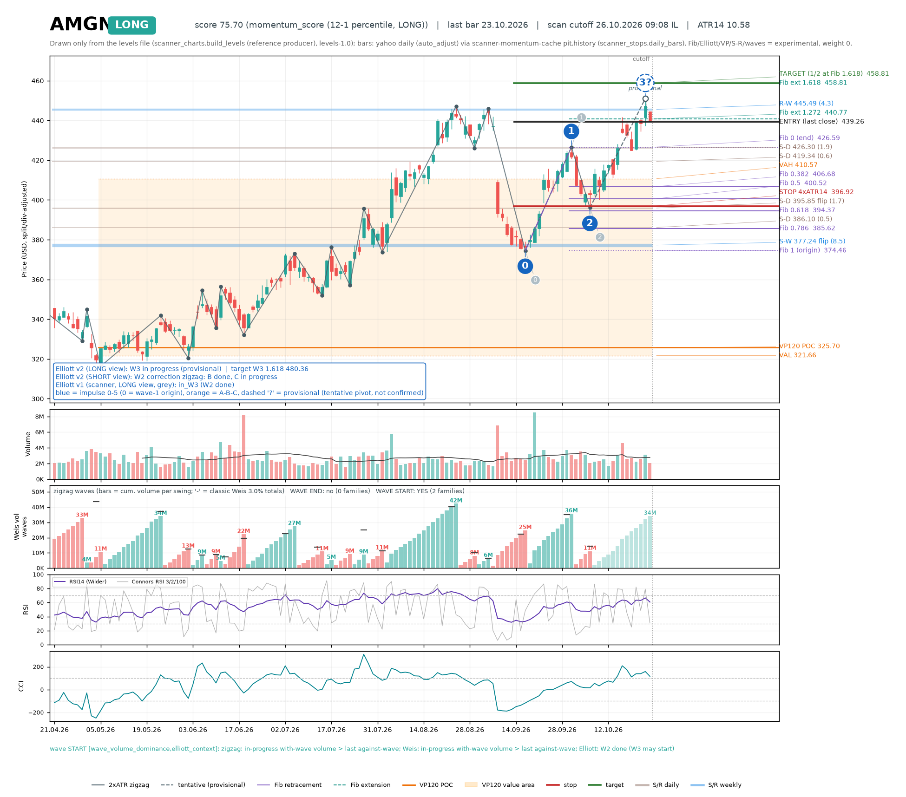

- **Jev (typesafe/jev-1.13):** 10 כותרות · 3 בביטחון ≥0.8 (סומכים על Jev) · 7 הועברו ל-Claude לשיפוט (ביטחון נמוך או חשד למניפולציה; 0 חשודות, 3 הודעות חברה) · סנטימנט חיובי (+1.00) · קטליזטור product · הסכמה עם Claude 6/7
- **Grok (grok-4.3, חיפוש X של Grok):** ✅ אישור · סנטימנט ‎+0 · ביטחון low · 0 פוסטים · אין סנטימנט שלילי ברור ב-X · חשבונות מאומתים: —
- **Perplexity (perplexity/sonar-pro):** ⚠️ דגל · הקטליזט החיובי חזק, אך הדוחות הצפויים ב־3 בנובמבר נמצאים בתוך כ־15 ימי המסחר הקרובים ולכן קיימת חשיפת אירוע משמעותית. · קטליזטור: strong (2026-10-24 https://www.biopharmawatch.com/company/AMGN)
  - ב־24 באוקטובר 2026 דווחו תוצאות ביניים חיוביות מניסוי DeLLphi-305: IMDELLTRA בשילוב IMFINZI הפחיתו את סיכון התמותה ב־58% בסרטן ריאות מסוג ES-SCLC. באותו מועד דווח גם על קיצור זמן המעקב הנדרש לאחר שתי המנות הראשונות של IMDELLTRA, צעד שעשוי לשפר נגישות לטיפול. · דוח הבא: 2026-11-03 · דגלים: דוח הרווחים הבא צפוי ב־3 בנובמבר 2026, סמוך לאופק החזקה של כמה שבועות ולחלון אירוע בינארי. / מועד הדוחות אינו מאושר רשמית לפי מקור MarketBeat, אף שמקורות אחרים מציגים אותו כמועד מתוזמן. / לא נמצאו במידע שנאסף פרטים מספקים על חשבונאות, ליטיגציה, דילול או חוב כדי לאשר דגל מהותי נוסף.
- **Claude, אנליסט (anthropic/claude-sonnet-4.5):** ביטחון **62/100** · תומך · סיכון: דוח רווחים ב-3 בנובמבר (7 ימי מסחר) עלול ליצור תנודתיות ולסכל את התזה לפני הגעה ליעד
  - תזה: המניה נמצאת בתחילת גל 3 אליוטי פוטנציאלי עם מומנטום חזק, נתוני מוצר חיוביים ותמיכה אנליטית. היחס סיכון-תשואה (1:0.46 ליעד הראשון) חלש, אך פוטנציאל ל-480 (יעד W3) משפר את התמונה. · טכני (מהגרף): המניה סיימה ב-439.26 לאחר עלייה של 9% ב-15 ימים, מעל כל הממוצעים הנעים (SMA20/50/200). הספירה האליוטית מציעה תחילת גל 3 לאחר תיקון W2 שהסתיים ב-374.46, עם יעד W3 ב-480.36. RSI ב-60.86 ו-CCI ב-116.58 מצביעים על מומנטום חיובי ללא קניית יתר.
- **GPT, פרקליט השטן (openai/gpt-5.6-sol):** ⚠️ דגל · הסיכון הגדול: דוח רווחים בינארי בעוד 7 ימי מסחר · המומנטום חיובי, אך תמחור מתוח טכנית, יחס סיכוי־סיכון חלש ודוח קרוב מחלישים את העסקה.
  - נגד התזה של Claude: התזה נשענת מדי על ספירת אליוט זמנית ועל יעד 480, בעוד היעד הקבוע הראשון מעניק יחס סיכוי־סיכון חלש.
- **האם הגרף נראה נכון? (ניסיוני):** Grok: n/a: ללא פוסטים רלוונטיים · Perplexity: yes: הספירה הראשית מסומנת כפרוביזורית, והגל השלישי והיעד נראים אגרסיביים לאחר עלייה חדה והתקרבות להתנגדות. · Claude: no: הספירה האליוטית והעיגון הפיבונאצ'י (374.46-426.59) נראים הגיוניים על הגרף, W2 הסתיים באזור תמיכה ברור · GPT: yes: עוגן הפיבונאצ'י והתמיכה סבירים, אך גל 3 מסומן כזמני והפסגה טרם אושרה מול התנגדות שבועית קרובה. · קלט: grok=img pplx=img claude=img gpt=img
- **אתגור הדדי:** Claude 62 (supports) מול GPT flag: מעורב

### 8. AAPL – לונג · דירוג 69.2
- **רמות (קובץ הרמות, נר אחרון 2026-10-23, hash 1422f7acc04aa68b):** כניסה 347.73 · סטופ 322.09 (chandelier_close 4.0xATR14, ATR14=6.4112) · יעד: 367.24 – חצי ב-Fib 1.618 (סגירה), השאר בשנדלייר 4xATR
- **טכני:** SMA20 338.91 · SMA50 329.47 · SMA200 294.11 · מומנטום 12-1 0.305 · RSI14 63.9 · CCI20 134
- **ניסיוני (משקל 0):** אליוט v2: W3 in progress (provisional) · אליוט v1: in_W3 (W2 done) · פיבו v2 309.90→345.34 (1.618=367.24) · VP120 POC 310.28 (VAH 334.52, VAL 289.16) · תמיכה 344.99 · התנגדות — · סוף גל: 2 משפחות (volume_exhaustion,momentum_divergence) · תחילת גל: 3 (wave_volume_dominance,momentum_divergence,elliott_context)
- **דוח:** מותר - דוח בעוד 6 ימי מסחר · מקורות: 2026-11-02 (Yahoo calendar); 2026-11-02 (Perplexity (מאושר, עם מקורות))
- **סוויפ נזילות (ייחוס בלבד, משקל 0):** כן (שורט, רמה 348.15 pivot) · **עבר בדיקה, שביר, משקל 0**

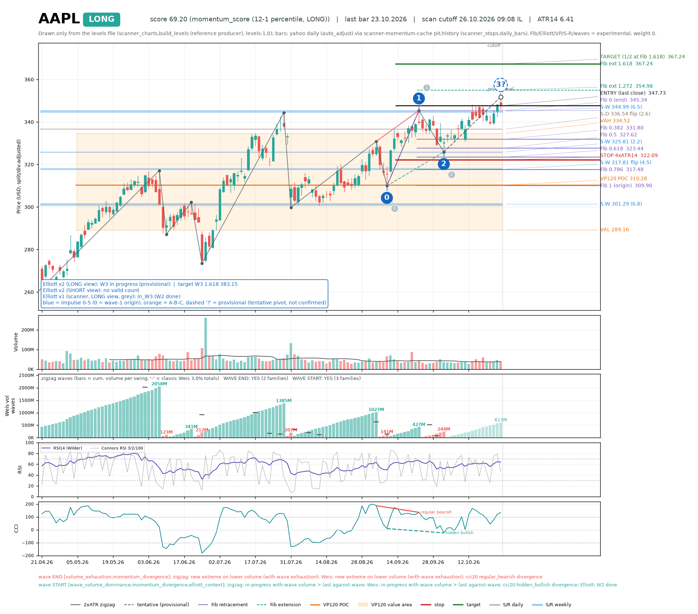

- **Jev (typesafe/jev-1.13):** 15 כותרות · 0 בביטחון ≥0.8 (סומכים על Jev) · 8 הועברו ל-Claude לשיפוט (ביטחון נמוך או חשד למניפולציה; 0 חשודות, 1 הודעות חברה) · סנטימנט — · קטליזטור — · הסכמה עם Claude 6/8
- **Grok (grok-4.3, חיפוש X של Grok):** ✅ אישור · סנטימנט ‎+0 · ביטחון low · 3 פוסטים · אין חדשות שליליות חזקות ב-X נגד LONG · חשבונות מאומתים: @gulVasikova, @Joey204K, @Economyvefinans
- **Perplexity (perplexity/sonar-pro):** ⚠️ דגל · הדוחות צפויים בתוך כ־15 ימי מסחר ולכן קיימת חשיפה לאירוע בינארי קרוב, בנוסף לאזהרות לגבי ההנחיות ומשלוחי ה־iPhone. · קטליזטור: strong (2026-11-02 https://finance.yahoo.com/markets/stocks/articles/apple-faces-slightly-challenging-earnings-154117419.html)
  - הקטליזטור המרכזי הוא פרסום תוצאות הרבעון הפיסקלי הרביעי ב־2 בנובמבר, כאשר המשקיעים יתמקדו במכירות iPhone, בשולי הרווח ובהנחיות לרבעון דצמבר. ב־30 הימים האחרונים עלו חששות לקיצוץ משלוחי iPhone, עלויות זיכרון ולחץ אפשרי על השוליים, לצד דיווחים על ביקוש מעודד בחלק מהשווקים. · דוח הבא: 2026-11-02 · דגלים: הדוחות הקרובים מהווים אירוע בינארי קרוב, עם חשש להנחיות חלשות לרבעון דצמבר. / Loop Capital דיווחה על קיצוץ של 13 מיליון משלוחי iPhone במחצית השנייה של 2026 וללא צפי להשבתם. / עלויות זיכרון גואות ועלולות ללחוץ על שולי הרווח; UBS ציינה האטה בצמיחת ה־App Store.
- **Claude, אנליסט (anthropic/claude-sonnet-4.5):** ביטחון **45/100** · ניטרלי · סיכון: דוח רבעוני בעוד 6 ימים עם חששות להנחיות חלשות וקיצוץ 13M יחידות iPhone
  - תזה: הסטאפ תומך בהמשך W3 אליוטית עם יעד 367-383, נתמך בהשקת Duo וממוצעים עולים. אולם הדוח הקרוב מהווה סיכון בינארי גבוה, עם חששות אנליסטים לקיצוץ משלוחים והנחיות חלשות שעלולים לבטל את התזה. · טכני (מהגרף): המניה במגמת עלייה ברורה מעל כל הממוצעים, עם ספירת אליוט שמציעה W3 בהתפתחות לכיוון 383. המומנטום חיובי (RSI 63.9, CCI 133.9), אך הנר האחרון הוא spinning top ויש דיברגנציה דובית רגילה ב-CCI שסימנה את סוף הגל.
- **GPT, פרקליט השטן (openai/gpt-5.6-sol):** ⚠️ דגל · הסיכון הגדול: דוח קרוב והנחיות חלשות מהצפוי · המגמה חיובית, אך התמחור, יחס הסיכוי־סיכון והאירוע הבינארי הקרוב מחלישים את עסקת הלונג.
  - נגד התזה של Claude: הישענות התזה על W3 חלשה משום שהספירה עדיין זמנית ומופיעים במקביל אותות לסיום גל.
- **האם הגרף נראה נכון? (ניסיוני):** Grok: no: ספירה אליוט ו-Fib נראים תקינים · Perplexity: no: הספירה, עוגן פיבונאצ׳י ורמות התמיכה וההתנגדות נראים עקביים עם מבנה העלייה והמחיר המוצג בתרשים. · Claude: no: ספירת האליוט W3 נראית סבירה עם W1 ו-W2 מזוהים היטב, והפיבונאצ'י מעוגן נכון בתחתית W2 · GPT: yes: סימון W3 נשען על שיא זמני לא מאושר, בעוד שהגרף מציג תשישות נפח ודיברגנציה דובית סמוך לשיא. · קלט: grok=img pplx=img claude=img gpt=img
- **אתגור הדדי:** Claude 45 (neutral) מול GPT flag: מעורב

### 9. T – שורט · דירוג 65.4
- **רמות (קובץ הרמות, נר אחרון 2026-10-23, hash 2093eb4468afb123):** כניסה 20.93 · סטופ 24.05 (chandelier_close 4.0xATR14, ATR14=0.7800) · יעד: אין – ללא יעד קבוע - שנדלייר 4xATR14 על סגירה (כלל מאושר)
- **טכני:** SMA20 23.38 · SMA50 24.53 · SMA200 24.49 · מומנטום 12-1 0.032 · RSI14 31.6 · CCI20 ‎-181
- **ניסיוני (משקל 0):** אליוט v2: W3 in progress (provisional) · אליוט v1: in_W3 (W2 done) · פיבו v2 24.69→21.96 (1.618=20.27) · VP120 POC 21.94 (VAH 24.75, VAL 21.00) · תמיכה 19.89 · התנגדות 21.84 · סוף גל: 2 משפחות (volume_exhaustion,wave_volume_dominance) · תחילת גל: 2 (wave_volume_dominance,elliott_context)
- **דוח:** מותר - דוח בעוד 63 ימי מסחר · מקורות: 2027-01-26 (Perplexity (מאושר, עם מקורות))
- **סוויפ נזילות (ייחוס בלבד, משקל 0):** לא
- **ספירלת פיבו – יעדי ייחוס בלבד (משקל 0, לא משנה סטופ/יעד; השורט נשאר עם סטופ נגרר 4×ATR בלי יעד):** T1 — (—) · T2 — (—) · מצב: broken_below_A

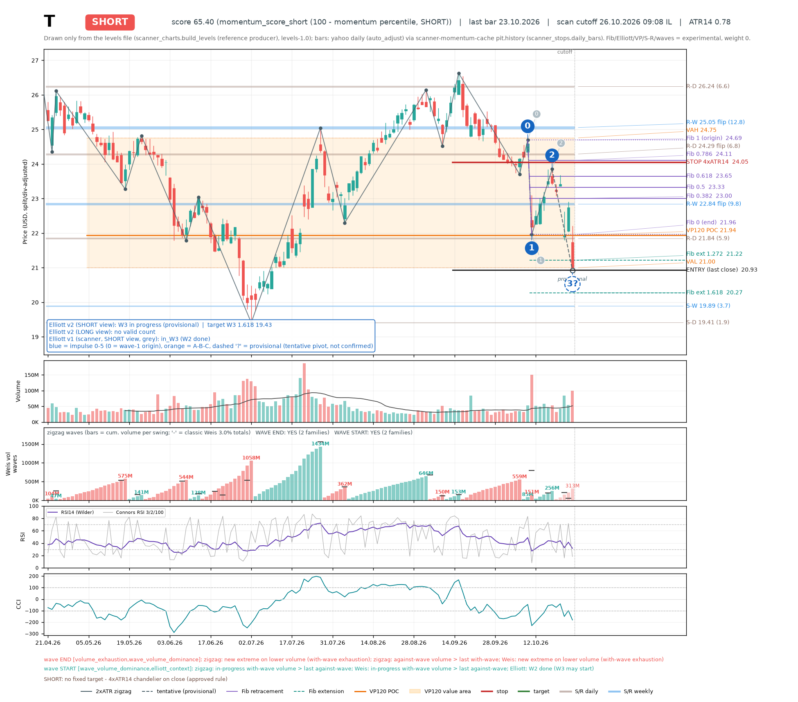

- **Jev (typesafe/jev-1.13):** 15 כותרות · 3 בביטחון ≥0.8 (סומכים על Jev) · 7 הועברו ל-Claude לשיפוט (ביטחון נמוך או חשד למניפולציה; 0 חשודות, 2 הודעות חברה) · סנטימנט שלילי (-0.73) · קטליזטור other · הסכמה עם Claude 4/7
- **Grok (grok-4.3, חיפוש X של Grok):** ✅ אישור · סנטימנט ‎+0 · ביטחון low · 0 פוסטים · אין סנטימנט שלילי ב-X נגד השורט · חשבונות מאומתים: —
- **Perplexity (perplexity/sonar-pro):** ⚠️ דגל · תאריך הדוחות הבא يقع בתוך חלון الاحتفاظ المتوقع، كما أن رفع التوجيه الأخير يجعل صفقة الشورت معرضة لارتداد إيجابي. · קטליזטור: strong (2026-10-21 https://about.att.com/story/2026/3q-earnings.html)
  - ב-21 באוקטובר AT&T פרסמה תוצאות רבעון שלישי מעל התחזיות והעלתה את תחזית הרווח המתואם ל-2026 ל-2.40 דולר למניה. במהלך 30 הימים הקרובים לא נמצא אירוע חברה בינארי מתוזמן נוסף; התחרות מצד SpaceX בתחום האלחוטי נותרה סיכון מתמשך. · דוח הבא: 2027-01-26 · דגלים: לחץ תחרותי אפשרי מ-SpaceX בשירותי אלחוט, שהוביל להפחתות יעדי מחיר מצד אנליסטים. / מספר אנליסטים הפחיתו יעדי מחיר או דירוג במהלך 30 הימים האחרונים למרות העלאת התחזית. / המניה פרסמה תוצאות חזקות והעלאת תחזית לאחרונה, ולכן שורט עלול להתמודד עם סיכון של המשך מומנטום חיובי.
- **Claude, אנליסט (anthropic/claude-sonnet-4.5):** ביטחון **62/100** · תומך · סיכון: ריבאונד טכני מרמת תמיכה נוכחית או חדשות חיוביות לגבי SpaceX
  - תזה: השורט נתמך על ידי מומנטום טכני חלש, ספירה אליוטית לכיוון W3, ולחץ תחרותי מ-SpaceX שגורם לאנליסטים להוריד יעדי מחיר. עם זאת, הסיכון הוא שהמניה כבר ירדה 12.9% ב-15 ימים ועשויה למצוא תמיכה ליד רמת 21 דולר. · טכני (מהגרף): המניה נמצאת במגמת ירידה חדה מתחת לכל הממוצעים הנעים (SMA20/50/200), עם RSI נמוך (31.65) ו-CCI שלילי מאוד (-180.64). הספירה האליוטית מציעה W3 בתהליך לכיוון יעד 19.43, והמחיר נמצא מתחת ל-VA של VP120, מה שתומך בהמשך לחץ מכירה.
- **GPT, פרקליט השטן (openai/gpt-5.6-sol):** ⚠️ דגל · הסיכון הגדול: ריבאונד חד ממכירות־יתר לאחר דוחות חזקים והעלאת תחזית · המגמה יורדת, אך מכירות־יתר, תמיכה קרובה וחדשות יסוד חיוביות יוצרים סיכון ממשי לשורט מאוחר.
  - נגד התזה של Claude: החולשה המרכזית היא הסתמכות על ספירת W3 זמנית ועל איום SpaceX לא ודאי לאחר שהירידה החדה כבר תימחרה פחד רב.
- **האם הגרף נראה נכון? (ניסיוני):** Grok: n/a: אין דיונים ב-X על ספירת אליוט/פיב · Perplexity: yes: הספירה הראשית מסומנת כפרוביזורית, והגל היורד האחרון נראה יותר כמו המשך ירידה מאשר אישור ברור לגל 3 לאחר העוגן המסומן. · Claude: no: הספירה האליוטית והעיגון הפיבונאצ'י נראים סבירים, עם W2 שהושלם ו-W3 בתהליך לכיוון 19.43 · GPT: yes: ספירת W3 מסומנת כזמנית, בעוד אותות סיום גל ותשישות נפח מחלישים את ודאות ההמשך מטה. · קלט: grok=img pplx=img claude=img gpt=img
- **אתגור הדדי:** Claude 62 (supports) מול GPT flag: מעורב

### 10. PFE – לונג · דירוג 63.6
- **רמות (קובץ הרמות, נר אחרון 2026-10-23, hash 6aa1d67403bb4691):** כניסה 30.03 · סטופ 27.79 (chandelier_close 4.0xATR14, ATR14=0.5597) · יעד: 31.70 – חצי ב-Fib 1.618 (סגירה), השאר בשנדלייר 4xATR
- **טכני:** SMA20 28.79 · SMA50 28.30 · SMA200 26.18 · מומנטום 12-1 0.230 · RSI14 65.6 · CCI20 111
- **ניסיוני (משקל 0):** אליוט v2: W2 correction zigzag: C done -> W3 may start · אליוט v1: no valid count · פיבו v2 23.21→29.21 (1.618=32.92) · VP120 POC 25.31 (VAH 27.55, VAL 23.21) · תמיכה 29.15 · התנגדות — · סוף גל: 0 משפחות (—) · תחילת גל: 3 (volume_exhaustion,wave_volume_dominance,momentum_divergence)
- **דוח:** מותר - דוח בעוד 7 ימי מסחר · מקורות: 2026-11-03 (Yahoo calendar); 2026-11-03 (Perplexity (מאושר, עם מקורות))
- **סוויפ נזילות (ייחוס בלבד, משקל 0):** לא · **עבר בדיקה, שביר, משקל 0**

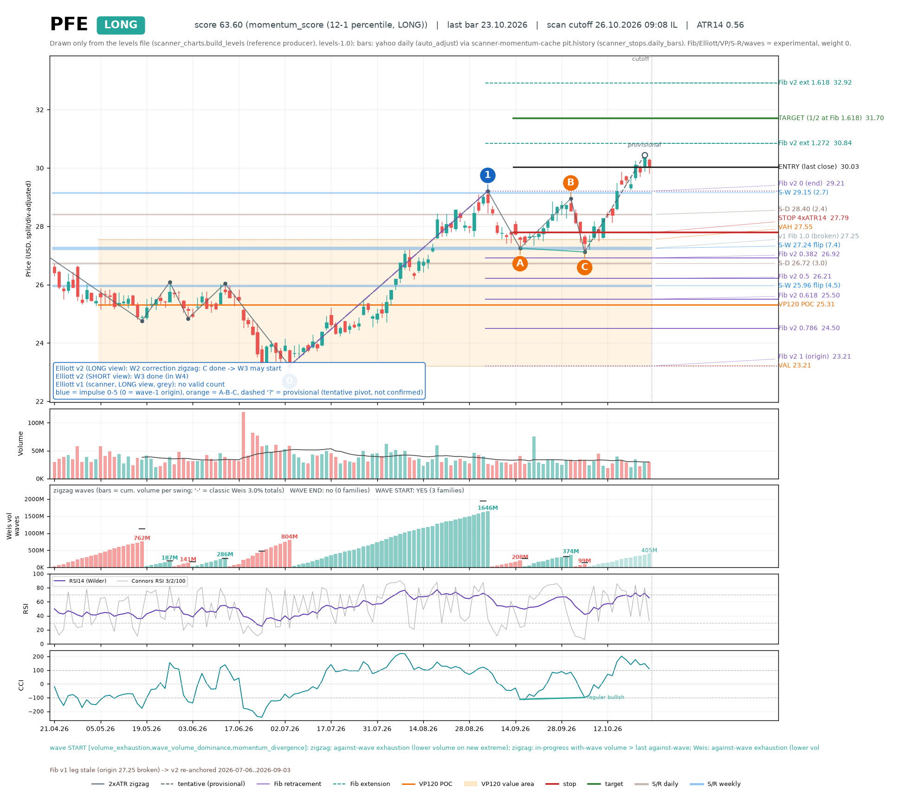

- **Jev (typesafe/jev-1.13):** 8 כותרות · 0 בביטחון ≥0.8 (סומכים על Jev) · 5 הועברו ל-Claude לשיפוט (ביטחון נמוך או חשד למניפולציה; 0 חשודות, 0 הודעות חברה) · סנטימנט — · קטליזטור — · הסכמה עם Claude 4/5
- **Grok (grok-4.3, חיפוש X של Grok):** ✅ אישור · סנטימנט ‎+0 · ביטחון low · 0 פוסטים · אין פוסטים רלוונטיים ב-X · חשבונות מאומתים: —
- **Perplexity (perplexity/sonar-pro):** ⚠️ דגל · הדוחות צפויים בתוך כ-15 ימי מסחר ולכן קיימת חשיפת אירוע משמעותית לפוזיציית LONG קצרה. · קטליזטור: strong (2026-10-23 https://investors.pfizer.com/rss/PressRelease.aspx)
  - אישור FDA ל-TUKYSA כטיפול תחזוקה קו-ראשון בסרטן שד מתקדם HER2+ פורסם ב-23 באוקטובר 2026. דוח הרבעון השלישי צפוי ב-3 בנובמבר 2026, בתוך אופק ההחזקה הקרוב. · דוח הבא: 2026-11-03 · דגלים: תביעה של התובע הכללי בפלורידה נגד Pfizer והמנכ״ל בנושא טענות לשיווק מטעה של חיסון COVID-19. / החוב הכולל עלה ל-63.2 מיליארד דולר ביוני 2026, והמינוף צפוי להישאר סביב 2.7 או לעלות מעט. / אובדן בלעדיות ותחליפים גנריים/ביוסימילריים מפעילים לחץ על ההכנסות; הכנסות COVID-19 המעודכנות ירדו לכ-4 מיליארד דולר לעומת 5 מיליארד דולר.
- **Claude, אנליסט (anthropic/claude-sonnet-4.5):** ביטחון **52/100** · ניטרלי · סיכון: דוח רבעוני ב-3 בנובמבר עלול לשבש את המומנטום הטכני
  - תזה: הסט-אפ הטכני תומך בהמשך מומנטום לטווח קצר לאחר תיקון ABC, עם יעד ריאלי ב-31.70 (Fib 1.618). עם זאת, הפונדמנטלים חלשים (צמיחה שלילית, חוב גבוה, תביעה משפטית) והדוח הקרוב מהווה סיכון משמעותי. · טכני (מהגרף): המניה סיימה ב-30.03 מעל כל הממוצעים הנעים (SMA20/50/200), RSI ב-65.61 ו-CCI ב-110.79 מצביעים על מומנטום חיובי אך קרוב לרמות קנייה מוגזמת. הספירה האליוטית מציעה סיום תיקון ABC והתחלת גל 3 עולה, עם תמיכה שבועית ב-29.15 ממש מתחת לכניסה.
- **GPT, פרקליט השטן (openai/gpt-5.6-sol):** ⚠️ דגל · הסיכון הגדול: דוח קרוב מול צמיחת EPS שלילית חדה · המומנטום חיובי, אך תמחור מתוח יחסית, עוגנים טכניים לא עקביים וסיכון דוח קרוב מחלישים את יחס הסיכוי־סיכון.
  - נגד התזה של Claude: הטענה שהיעד 31.70 הוא Fib 1.618 חלשה, משום ש-Fib v2 מציב 1.618 ב-32.9156 ואילו Fib v1 המיושן מציב אותו ב-30.0006.
- **האם הגרף נראה נכון? (ניסיוני):** Grok: no: הספירה והעוגנים נראים תקינים · Perplexity: no: הספירה הראשית, עוגן פיבונאצ׳י ורמות התמיכה/התנגדות נראים עקביים עם העלייה, התיקון והפריצה המוצגים בגרף. · Claude: no: ספירת ABC נראית סבירה עם פיבוט C ברור ב-29.21, והעיגון מחדש של הפיבונאצ'י מ-23.21 הגיוני · GPT: yes: ספירת גל 3 נשענת על שיא פרוביזורי, v1 חסר ספירה תקפה, ולא מסומנת התנגדות מעל שיאים סמוכים. · קלט: grok=img pplx=img claude=img gpt=img
- **אתגור הדדי:** Claude 52 (neutral) מול GPT flag: מעורב

### 11. TMO – לונג · דירוג 61.7
- **רמות (קובץ הרמות, נר אחרון 2026-10-23, hash a0578c8ddca146c8):** כניסה 673.82 · סטופ 591.59 (chandelier_close 4.0xATR14, ATR14=20.56) · יעד: 749.34 – חצי ב-Fib 1.618 (סגירה), השאר בשנדלייר 4xATR
- **טכני:** SMA20 672.10 · SMA50 644.76 · SMA200 548.53 · מומנטום 12-1 0.200 · RSI14 53.8 · CCI20 ‎-1
- **ניסיוני (משקל 0):** אליוט v2: W2 in progress (provisional) · אליוט v1: no valid count · פיבו v2 635.32→705.79 (1.618=749.34) · VP120 POC 469.77 (VAH 624.40, VAL 434.50) · תמיכה 641.98 · התנגדות 683.30 · סוף גל: 1 משפחות (wave_volume_dominance) · תחילת גל: 1 (volume_exhaustion)
- **דוח:** תאריך דוח לא מאומת
- **סוויפ נזילות (ייחוס בלבד, משקל 0):** לא · **עבר בדיקה, שביר, משקל 0**

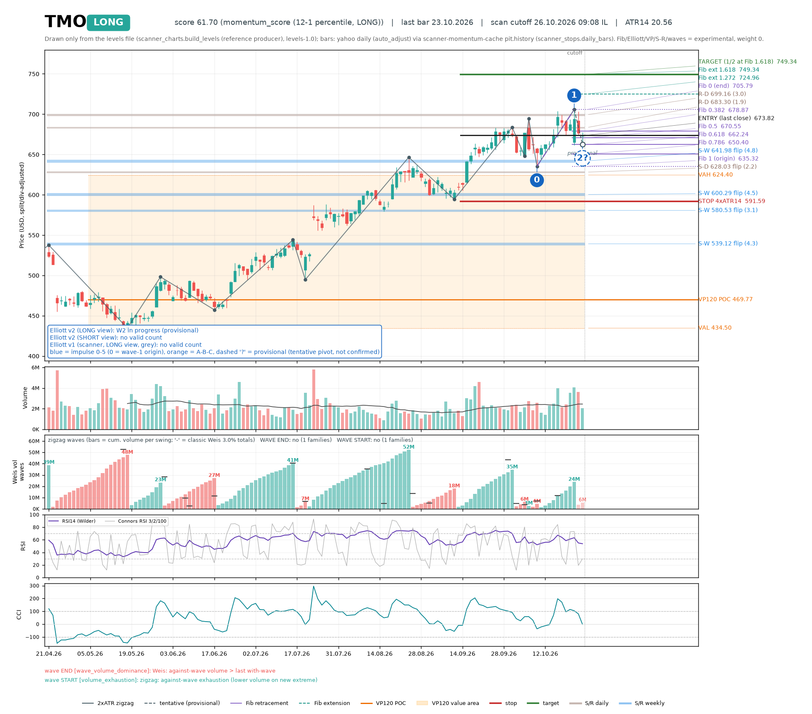

- **Jev (typesafe/jev-1.13):** 15 כותרות · 3 בביטחון ≥0.8 (סומכים על Jev) · 7 הועברו ל-Claude לשיפוט (ביטחון נמוך או חשד למניפולציה; 0 חשודות, 0 הודעות חברה) · סנטימנט חיובי (+0.78) · קטליזטור earnings · הסכמה עם Claude 6/7
- **Grok (grok-4.3, חיפוש X של Grok):** ✅ אישור · סנטימנט ‎+1 · ביטחון medium · 5 פוסטים · סנטימנט ניטרלי-חיובי ללא חדשות שליליות · חשבונות מאומתים: @ThierryBorgeat, @john_stocks1, @Arkalos77
- **Perplexity (perplexity/sonar-pro):** ✅ אישור · הדוחות והעלאת התחזית כבר פורסמו לפני הכניסה, ואין במקורות שנבדקו אירוע בינארי קרוב או סיבה מהותית לפסילה. · קטליזטור: strong (2026-10-21 https://ir.thermofisher.com/investors/news-events/news/news-details/2026/Thermo-Fisher-Scientific-Reports-Third-Quarter-2026-Results/default.aspx)
  - החברה פרסמה ב-21.10.2026 תוצאות רבעון שלישי חזקות מהצפי, עם הכנסות של 12.14 מיליארד דולר ו-EPS של 6.68 דולר, וכן העלתה את תחזית 2026. בתוך 30 הימים הקרובים לא נמצא אירוע חברה מתוזמן נוסף במקורות שנבדקו. · דוח הבא: — · דגלים: התחייבויות שוטפות ופירעונות חוב ארוך-טווח הסתכמו ב-3.37 מיליארד דולר נכון ל-27.06.2026. / החברה דיווחה על עלויות ארגון מחדש, צמצומי כוח אדם ואיחוד מתקנים. / קיימות תביעות ודרישות בתחומי אחריות מוצר, קניין רוחני, תעסוקה ומסחר.
- **Claude, אנליסט (anthropic/claude-sonnet-4.5):** ביטחון **68/100** · תומך · סיכון: יעד 749.34 קרוב למחיר הנוכחי (11% פוטנציאל) ומתחת ליעדי אנליסטים; סטופ רחב ב-591.59 (12.2% מתחת)
  - תזה: המניה נמצאת במגמת עלייה ארוכת טווח מעל כל הממוצעים, עם קטליסט חיובי של דוח חזק והעלאת תחזיות. אנליסטים העלו יעדי מחיר ל-756-810 דולר, מעל היעד הנוכחי של 749.34. · טכני (מהגרף): המניה סגרה ב-673.82 מעל SMA20 (672.10) ו-SMA50 (644.76), במומנטום חיובי של 61.7. הספירה האליוטית זמנית (W2 in progress) והמחיר נמצא מעל אזור הערך של VP120, אך RSI נייטרלי ב-53.84 ו-CCI קרוב לאפס.
- **GPT, פרקליט השטן (openai/gpt-5.6-sol):** ⚠️ דגל · הסיכון הגדול: כשל בפריצה לאחר קטליסט שכבר מגולם · המגמה הארוכה חיובית, אך יחס הסיכוי־סיכון, ההתנגדות הקרובה והיעדר ספירת גל תקפה מצדיקים זהירות.
  - נגד התזה של Claude: התזה נשענת על יעדי אנליסטים ועל דוח שכבר פורסם, אף שהאישור הטכני להמשך העלייה חלש וזמני.
- **האם הגרף נראה נכון? (ניסיוני):** Grok: no: ספירת אליוט ופיב נראות תקינות · Perplexity: no: הספירה, עוגן פיבונאצ׳י ורמות התמיכה/התנגדות נראים סבירים ביחס למבנה העלייה והפיבוטים המוצגים. · Claude: no: הספירה האליוטית הזמנית (W2) והעיגון הפיבונאצ'י מ-635.32 ל-705.79 נראים סבירים על הגרף, והתמיכה ב-641.98 תואמת את המבנה. · GPT: yes: ספירת W2 מסומנת כזמנית, ספירת v1 אינה תקפה והעוגן האחרון טרם אושר, לכן המבנה המצויר אינו אמין דיו. · קלט: grok=img pplx=img claude=img gpt=img
- **אתגור הדדי:** Claude 68 (supports) מול GPT flag: מעורב

### 12. QCOM – לונג · דירוג 57.9
- **רמות (קובץ הרמות, נר אחרון 2026-10-23, hash 606414ff1280100c):** כניסה 175.91 · סטופ 148.75 (chandelier_close 4.0xATR14, ATR14=6.7901) · יעד: 245.24 – חצי ב-Fib 1.618 (סגירה), השאר בשנדלייר 4xATR
- **טכני:** SMA20 178.17 · SMA50 175.86 · SMA200 168.12 · מומנטום 12-1 0.172 · RSI14 48.0 · CCI20 ‎-54
- **ניסיוני (משקל 0):** אליוט v2: W2 in progress (provisional) · אליוט v1: no valid count · פיבו v2 142.12→205.85 (1.618=245.24) · VP120 POC 173.29 (VAH 211.38, VAL 158.28) · תמיכה 169.08 · התנגדות 178.71 · סוף גל: 2 משפחות (wave_volume_dominance,momentum_divergence) · תחילת גל: 2 (volume_exhaustion,wave_volume_dominance)
- **דוח:** מותר - דוח בעוד 8 ימי מסחר · מקורות: 2026-11-04 (Yahoo calendar); 2026-11-04 (Perplexity (מאושר, עם מקורות))
- **סוויפ נזילות (ייחוס בלבד, משקל 0):** לא · **עבר בדיקה, שביר, משקל 0**

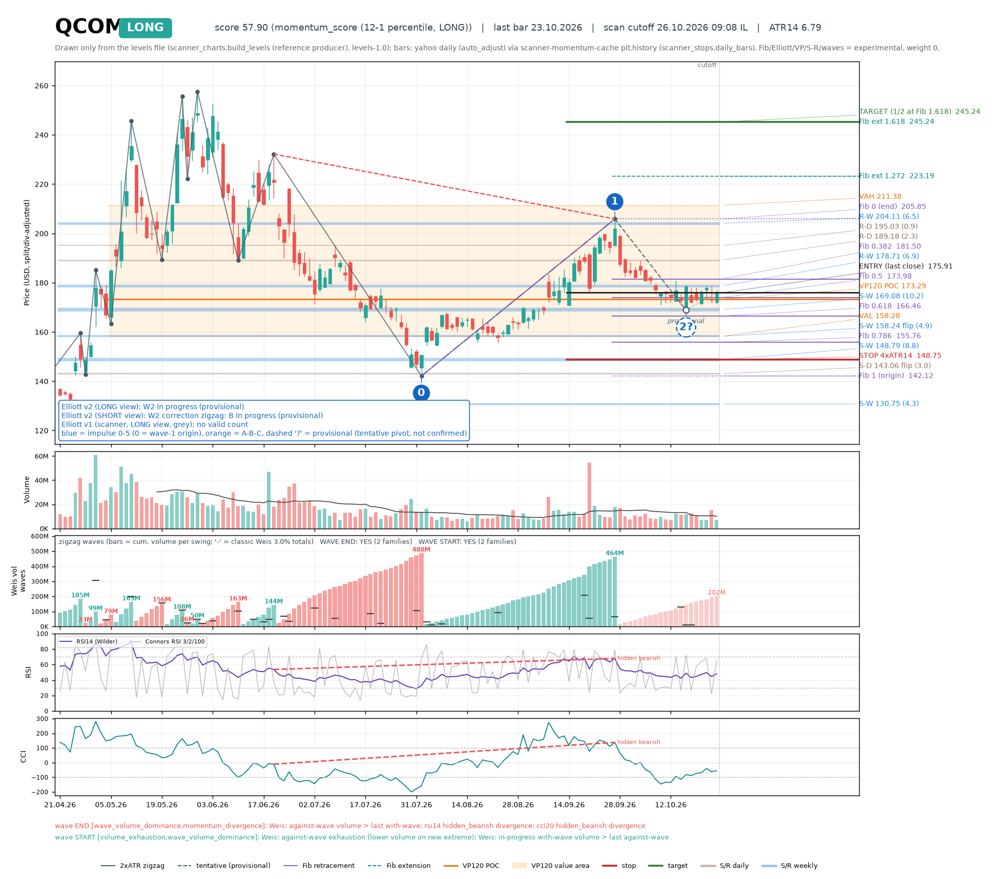

- **Jev (typesafe/jev-1.13):** 11 כותרות · 0 בביטחון ≥0.8 (סומכים על Jev) · 8 הועברו ל-Claude לשיפוט (ביטחון נמוך או חשד למניפולציה; 0 חשודות, 4 הודעות חברה) · סנטימנט — · קטליזטור — · הסכמה עם Claude 5/8
- **Grok (grok-4.3, חיפוש X של Grok):** ✅ אישור · סנטימנט ‎-1 · ביטחון low · 1 פוסטים · אין סיבה ברורה נגד ה-LONG מהפוסטים · חשבונות מאומתים: @WiseAss_ets
- **Perplexity (perplexity/sonar-pro):** ⚠️ דגל · הדוחות ב־4 בנובמבר נמצאים בתוך כ־15 ימי המסחר הקרובים ולכן קיימת חשיפה בינארית משמעותית לכניסה לונג כעת. · קטליזטור: strong (2026-11-04 https://www.qualcomm.com/news/releases/2026/10/qualcomm-schedules-fourth-quarter-and-fiscal-2026-earnings-relea)
  - הדוח לרבעון הרביעי ולשנת הכספים 2026 צפוי להתפרסם לאחר סגירת המסחר ב־4 בנובמבר, ולכן הוא קטליזטור בינארי קרוב. החברה העלתה את יעד ההכנסות ממגזרים שאינם מכשירים ל־40 מיליארד דולר בשנת הכספים 2029, ושני פרויקטי סיליקון מותאם צפויים להתחיל לייצר הכנסות ברבעון דצמבר. · דוח הבא: 2026-11-04 · דגלים: הכנסות המכשירים ירדו ב־20% משנה לשנה ברבעון השלישי. / הרווח למניה ברבעון השלישי החמיץ את תחזית הקונצנזוס. / הדירוג הממוצע של האנליסטים הוא Hold, והתחזיות סביב החברה מעורבות.
- **Claude, אנליסט (anthropic/claude-sonnet-4.5):** ביטחון **42/100** · ניטרלי · סיכון: אכזבה בדוח ה-4 בנובמבר או החמרה בסכסוך Arm
  - תזה: הסיכוי לעלייה תלוי בהפתעה חיובית בדוח הקרוב, אך הרקע הטכני חלש (מתחת לשיא, מומנטום בינוני) והפונדמנטלי מעורב (ירידה ב-EPS, דירוג Hold). פיטורים גלובליים והתדיינות משפטית עם Arm מוסיפים סיכון. · טכני (מהגרף): המניה נסחרת בתוך ה-VA של VP120 (158-211), קרוב ל-SMA50 ול-POC, לאחר ירידה של 4.8% ב-15 ימים. RSI ב-48 ו-CCI שלילי מצביעים על מומנטום ניטרלי-חלש, והספירה האליוטית זמנית (W2 בתהליך) ללא אישור.
- **GPT, פרקליט השטן (openai/gpt-5.6-sol):** ⚠️ דגל · הסיכון הגדול: אכזבה בדוח הקרוב ופתיחת פער מטה · הטכני אינו מאשר מגמת עלייה חזקה והסיכון הבינארי קרוב על רקע עסקי מעורב.
  - נגד התזה של Claude: חולשת התזה היא ההנחה שהעלייה תלויה בעיקר בהפתעת דוח, ללא ביסוס ליתרון הסתברותי בהפתעה כזו.
- **האם הגרף נראה נכון? (ניסיוני):** Grok: no: הספירה והעוגנים נראים תקינים · Perplexity: yes: הספירה הראשית והעוגנים נראים פרוביזוריים, בעוד שהתרשים מציג RSI ו־CCI עם סטייה דובית נסתרת והתבססות מתחת לאזור ההתנגדות. · Claude: no: הספירה האליוטית הזמנית (W2) והעיגון הפיבונאצ'י מ-142 ל-205 נראים סבירים על הגרף · GPT: yes: ספירת W2 מסומנת כזמנית וללא פיבוט מאושר, ולכן אינה תומכת ביעד ההרחבה. · קלט: grok=img pplx=img claude=img gpt=img
- **אתגור הדדי:** Claude 42 (neutral) מול GPT flag: מעורב

### 13. SCHW – שורט · דירוג 55.1
- **רמות (קובץ הרמות, נר אחרון 2026-10-23, hash 9d74e04cb8f11e5a):** כניסה 90.58 · סטופ 99.09 (chandelier_close 4.0xATR14, ATR14=2.1279) · יעד: אין – ללא יעד קבוע - שנדלייר 4xATR14 על סגירה (כלל מאושר)
- **טכני:** SMA20 95.21 · SMA50 102.67 · SMA200 97.47 · מומנטום 12-1 0.068 · RSI14 30.5 · CCI20 ‎-117
- **ניסיוני (משקל 0):** אליוט v2: no valid count · אליוט v1: no valid count · פיבו v2 —→— (1.618=—) · VP120 POC 91.42 (VAH 102.82, VAL 84.33) · תמיכה 90.40 · התנגדות 92.76 · סוף גל: 1 משפחות (wave_volume_dominance) · תחילת גל: 1 (wave_volume_dominance)
- **דוח:** מותר - דוח בעוד 60 ימי מסחר · מקורות: 2027-01-21 (Yahoo calendar)
- **סוויפ נזילות (ייחוס בלבד, משקל 0):** לא
- **ספירלת פיבו – יעדי ייחוס בלבד (משקל 0, לא משנה סטופ/יעד; השורט נשאר עם סטופ נגרר 4×ATR בלי יעד):** T1 107.26 (fan:2@fib0.236) · T2 102.76 (fan:1@fib0.382) · מצב: triggered_earlier

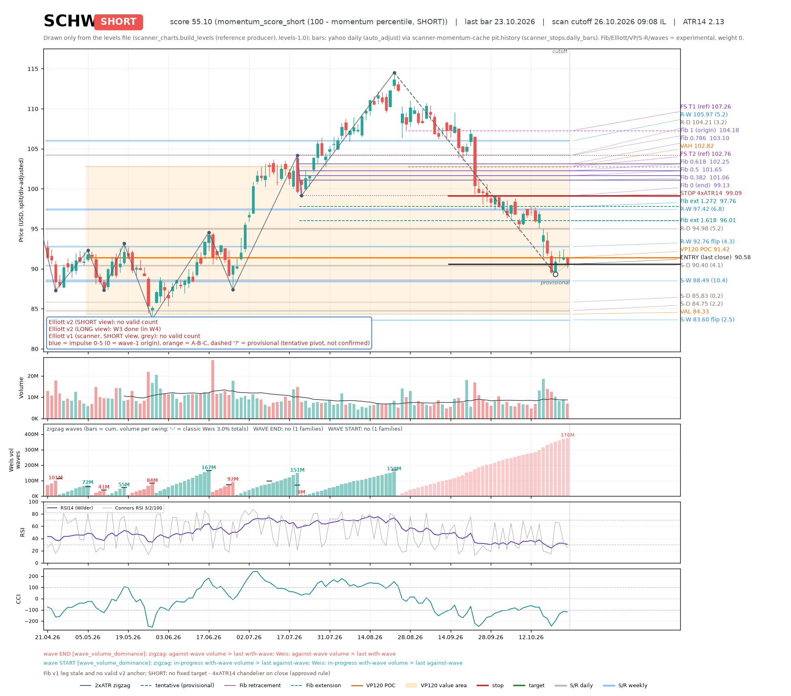

- **Jev (typesafe/jev-1.13):** 9 כותרות · 3 בביטחון ≥0.8 (סומכים על Jev) · 4 הועברו ל-Claude לשיפוט (ביטחון נמוך או חשד למניפולציה; 0 חשודות, 2 הודעות חברה) · סנטימנט שלילי (-1.00) · קטליזטור analyst · הסכמה עם Claude 4/4
- **Grok (grok-4.3, חיפוש X של Grok):** ✅ אישור · סנטימנט ‎+0 · ביטחון low · 4 פוסטים · חדשות האק תומכות בשורט אך סנטימנט מעורב · חשבונות מאומתים: @OracleNYSE, @X_thetrader, @Andrew32847
- **Perplexity (perplexity/sonar-pro):** ✅ אישור · אין תאריך דוחות מאומת בתוך כ-15 ימי המסחר הקרובים ואין קטליזטור בינארי מתועד בסמוך. · קטליזטור: none
  - הדוח לרבעון השלישי פורסם ב-15 באוקטובר 2026, ולכן אינו קטליזטור עתידי. לא נמצא מקור מאומת לאירוע חברה משמעותי נוסף ב-30 הימים הקרובים. · דוח הבא: — · דגלים: הכנסות הרבעון היו 7.17 מיליארד לעומת צפי של 7.18 מיליארד, והערכת EPS לשנת 2026 הופחתה. / קיימות הורדות רבות של יעדי מחיר לאחר הדוח, כולל Morgan Stanley, Goldman Sachs, UBS, Evercore, Truist ו-Bank of America. / לא נמצא במידע שנאסף מקור מאומת לבעיית חשבונאות, תביעה מהותית, דילול, חוב או אירוע רגולטורי חמור.
- **Claude, אנליסט (anthropic/claude-sonnet-4.5):** ביטחון **58/100** · תומך · סיכון: oversold חמור (RSI 30.5) ליד תמיכה 90.4 עלול לייצר ריבאונד
  - תזה: המומנטום השלילי חזק (ירידה של 6.3% ב-15 יום, momentum_score 44.9), תמיכה טכנית חלשה ב-90.4, וחדשות שליליות (האק AI, הורדות יעדים) תומכים בשורט. הסיכון הוא oversold קיצוני שעלול לגרום לריבאונד טכני. · טכני (מהגרף): המניה בירידה חדה מ-114 ל-90.58, מתחת לכל הממוצעים (SMA20=95.2, SMA50=102.7, SMA200=97.5). RSI14 ב-30.48 וCRSI ב-24.91 מצביעים על oversold, אך גלי נפח מאשרים המשך לחץ מכירה.
- **GPT, פרקליט השטן (openai/gpt-5.6-sol):** ⚠️ דגל · הסיכון הגדול: ריבאונד חד ממכירות־יתר ליד תמיכה · המגמה שלילית, אך תזמון השורט חלש בשל מכירות־יתר, תמיכה קרובה והיעדר קטליזטור מאומת.
  - נגד התזה של Claude: התזה מחלישה את עצמה כשהיא רודפת אחרי ירידה של 6.3% סמוך לתמיכה וללא קטליזטור עתידי.
- **האם הגרף נראה נכון? (ניסיוני):** Grok: n/a · Perplexity: yes · Claude: n/a: אין ספירת אליוט תקפה מוצגת, רק ציון 'no valid count' · GPT: yes: אין ספירת אליוט תקפה ועוגן הפיבונאצ'י מסומן כמיושן, אף שהתמיכה סביב 90.4 נראית סבירה. · קלט: grok=img pplx=img claude=img gpt=img
- **אתגור הדדי:** Claude 58 (supports) מול GPT flag: מעורב

### 14. RTX – שורט · דירוג 53.3
- **רמות (קובץ הרמות, נר אחרון 2026-10-23, hash cde46b8c5ab287f1):** כניסה 191.01 · סטופ 209.25 (chandelier_close 4.0xATR14, ATR14=4.5594) · יעד: אין – ללא יעד קבוע - שנדלייר 4xATR14 על סגירה (כלל מאושר)
- **טכני:** SMA20 187.39 · SMA50 197.11 · SMA200 194.23 · מומנטום 12-1 0.075 · RSI14 49.9 · CCI20 85
- **ניסיוני (משקל 0):** אליוט v2: W2 in progress (provisional) · אליוט v1: no valid count · פיבו v2 226.41→179.02 (1.618=149.73) · VP120 POC 193.98 (VAH 199.10, VAL 171.78) · תמיכה 185.27 · התנגדות 191.05 · סוף גל: 0 משפחות (—) · תחילת גל: 0 (—)
- **דוח:** תאריך דוח לא מאומת
- **סוויפ נזילות (ייחוס בלבד, משקל 0):** לא
- **ספירלת פיבו – יעדי ייחוס בלבד (משקל 0, לא משנה סטופ/יעד; השורט נשאר עם סטופ נגרר 4×ATR בלי יעד):** T1 — (—) · T2 — (—) · מצב: expired

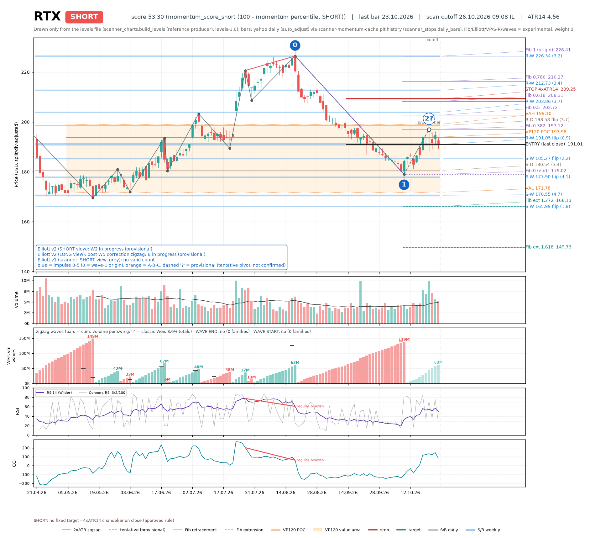

- **Jev (typesafe/jev-1.13):** 15 כותרות · 2 בביטחון ≥0.8 (סומכים על Jev) · 8 הועברו ל-Claude לשיפוט (ביטחון נמוך או חשד למניפולציה; 0 חשודות, 4 הודעות חברה) · סנטימנט שלילי (-1.00) · קטליזטור analyst · הסכמה עם Claude 7/8
- **Grok (grok-4.3, חיפוש X של Grok):** ⚠️ דגל · סנטימנט ‎+1 · ביטחון medium · 6 פוסטים · חדשות חיוביות על תחזית RTX סותרות את ה-SHORT · חשבונות מאומתים: —
- **Perplexity (perplexity/sonar-pro):** ✅ אישור · הדוח האחרון כבר פורסם, לא נמצא אירוע בינארי קרוב או סיבה מהותית מתועדת לווטו, אך הספירה הטכנית הפרוביזורית מצדיקה זהירות. · קטליזטור: moderate (2026-10-20 https://www.rtx.com/news/news-center/2026/10/20/rtx-reports-q3-2026-results?ref=pulsechain.nexus)
  - החברה פרסמה תוצאות רבעון שלישי ב-20 באוקטובר 2026 ודיווחה על מכירות של 25.0 מיליארד דולר ו-EPS מתואם של 2.26 דולר, כולל תרומה של 0.25 דולר מהחזר עלויות IEEPA. לא זוהה במקורות שסופקו אירוע חברה בינארי נוסף במהלך 30 הימים הקרובים. · דוח הבא: — · דגלים: סיכוני שרשרת אספקה וביצוע, לצד שאלות לגבי איכות תזרים המזומנים. / תמחור גבוה יחסית עלול להגביל את העלייה בטווח הקצר. / המקורות מציינים מכירות של בעלי עניין, אך ללא פירוט מספיק להערכת חומרתן.
- **Claude, אנליסט (anthropic/claude-sonnet-4.5):** ביטחון **25/100** · מתנגד · סיכון: המשך מומנטום חיובי מחוזים חדשים ותמיכה טכנית ב-POC
  - תזה: הסטאפ השורט חלש: המניה נמצאת באזור ניטרלי טכנית ללא אות שבירה, החדשות עסקיות חיוביות (חוזים חדשים, השקעות), והאנליסטים מעלים יעדי מחיר. הספקולציה על תיקון W2 אליוטי אינה מאושרת (provisional) ואינה מספקת בסיס מוצק לשורט. · טכני (מהגרף): המניה ב-191.01 נמצאת בתוך ה-VA של VP120 (VAL 171.78, VAH 199.10) ומעל POC ב-193.98, עם RSI ניטרלי ב-49.93. המחיר נסחר מתחת ל-SMA50 (197.11) אך מעל SMA20 (187.39), והתמונה הטכנית מעורבת ללא אות כיווני ברור.
- **GPT, פרקליט השטן (openai/gpt-5.6-sol):** ⛔ וטו · הסיכון הגדול: המשך מהלך עליות בעקבות הדוח והחדשות החיוביות · המומנטום החיובי, היעדר שבירה מאושרת ורצף הקטליזטורים החיוביים סותרים את השורט.
  - נגד התזה של Claude: האנליסט טועה בקביעה שהמחיר מעל POC 193.9761, משום שהסגירה היא 191.01.
- **האם הגרף נראה נכון? (ניסיוני):** Grok: n/a: null · Perplexity: yes: הספירה הראשית מסומנת כפרוביזורית, והתרשים עצמו מציין שפיבוט השיא האחרון אינו מאושר ולכן ספירת Elliott אינה מבוססת דיה; עוגן Fibonacci ורמות התמיכה/התנגדות נראים סבירים אך אינם מאומתים. · Claude: yes: הספירה האליוטית מסומנת כ-provisional וחלשה, והמחיר באזור ניטרלי ללא אישור לתיקון W2 · GPT: yes: ספירת W2 נשענת על נקודת סיום לא מאושרת וללא ספירת v1 תקפה, ולכן אינה משכנעת חזותית. · קלט: grok=img pplx=img claude=img gpt=img
- **אתגור הדדי:** Claude 25 (opposes) מול GPT veto: הסכמה שלילית: Claude חלש, GPT וטו

### 15. GE – שורט · דירוג 52.3
- **רמות (קובץ הרמות, נר אחרון 2026-10-23, hash a662a85f1e1867b7):** כניסה 285.64 · סטופ 322.13 (chandelier_close 4.0xATR14, ATR14=9.1214) · יעד: אין – ללא יעד קבוע - שנדלייר 4xATR14 על סגירה (כלל מאושר)
- **טכני:** SMA20 306.82 · SMA50 323.19 · SMA200 322.45 · מומנטום 12-1 0.078 · RSI14 25.9 · CCI20 ‎-257
- **ניסיוני (משקל 0):** אליוט v2: W3 in progress (provisional) · אליוט v1: in_W3 (W2 done) · פיבו v2 328.67→296.61 (1.618=276.80) · VP120 POC 316.83 (VAH 353.09, VAL 280.57) · תמיכה 281.19 · התנגדות 292.69 · סוף גל: 2 משפחות (volume_exhaustion,momentum_divergence) · תחילת גל: 4 (effort_result,wave_volume_dominance,momentum_divergence,elliott_context)
- **דוח:** מותר - דוח בעוד 60 ימי מסחר · מקורות: 2027-01-21 (Yahoo calendar)
- **סוויפ נזילות (ייחוס בלבד, משקל 0):** לא
- **ספירלת פיבו – יעדי ייחוס בלבד (משקל 0, לא משנה סטופ/יעד; השורט נשאר עם סטופ נגרר 4×ATR בלי יעד):** T1 — (—) · T2 — (—) · מצב: none

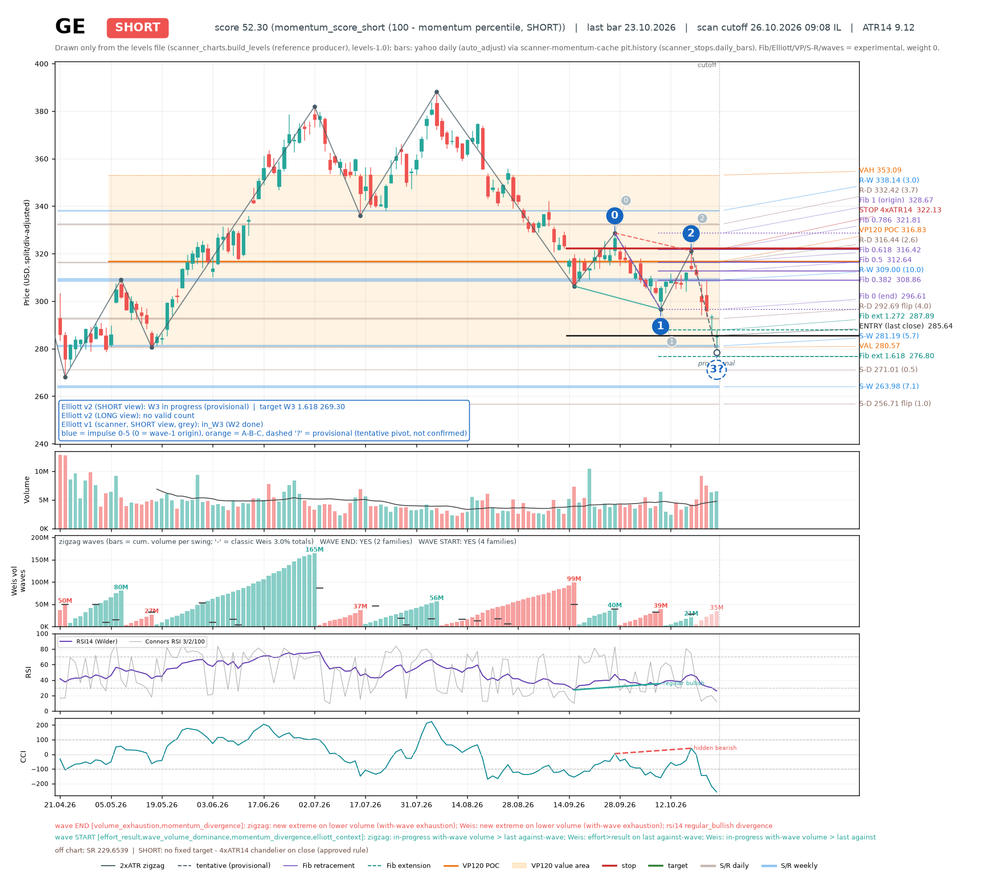

- **Jev (typesafe/jev-1.13):** 15 כותרות · 0 בביטחון ≥0.8 (סומכים על Jev) · 8 הועברו ל-Claude לשיפוט (ביטחון נמוך או חשד למניפולציה; 0 חשודות, 1 הודעות חברה) · סנטימנט — · קטליזטור — · הסכמה עם Claude 6/8
- **Grok (grok-4.3, חיפוש X של Grok):** ✅ אישור · סנטימנט ‎+0 · ביטחון low · 0 פוסטים · אין דיון או חדשות ב-X נגד השורט · חשבונות מאומתים: —
- **Perplexity (perplexity/sonar-pro):** ⚠️ דגל · הדוח האחרון והעלאת התחזית הם קטליזטור בינארי חזק שכבר התרחש, אך אין תאריך דוחות עתידי מאומת ולכן הסיכון המיידי לשורט נובע בעיקר מתנודתיות לאחר הדוח. · קטליזטור: strong (2026-10-20 https://www.geaerospace.com/investor-relations/ir-updates)
  - ב-20 באוקטובר GE פרסמה תוצאות רבעון שלישי חזקות והעלתה את תחזית 2026 בכל המדדים, כולל EPS, הכנסות, רווח תפעולי ותזרים חופשי. במהלך 30 הימים הקרובים לא נמצא אירוע חברה מתוזמן נוסף במקורות שנבדקו. · דוח הבא: — · דגלים: המניה נסחרת תחת לחץ למרות הכאת תחזיות והעלאת תחזית, לפי JPMorgan. / מספר בתי השקעות הורידו יעדי מחיר לאחר הדוחות, אף ששמרו על דירוגים חיוביים. / אין במקורות שנבדקו מידע עדכני מספק על ליטיגציה, דילול, חוב או סוגיות רגולטוריות מהותיות.
- **Claude, אנליסט (anthropic/claude-sonnet-4.5):** ביטחון **45/100** · ניטרלי · סיכון: oversold קיצוני עם דיברגנציה bullish ותוצאות חזקות
  - תזה: הירידה החדה (7.6- ב-15 יום) והמומנטום החלש (47.7) תומכים בהמשך לחץ לטווח קצר, במיוחד אם W3 אליוטית מתפתחת. עם זאת, רמת oversold קיצונית, דיברגנציה bullish ב-RSI ותוצאות חזקות יוצרים סיכון גבוה להתהפכות או קונסולידציה. · טכני (מהגרף): המניה בירידה חדה מתחת לכל הממוצעים (SMA20/50/200 כולם מעל 306), RSI14 ב-25.94 ו-CCI ב-256- מצביעים על oversold קיצוני. הספירה האליוטית מציעה W3 פרובזיונלית כלפי מטה ליעד 269.30, אך הדוג'י האחרון ואיתותי דיברגנציה bullish ב-RSI מעלים סיכון להתהפכות.
- **GPT, פרקליט השטן (openai/gpt-5.6-sol):** ⚠️ דגל · הסיכון הגדול: ריבאונד חד ממצב מכירות־יתר לאחר תוצאות והעלאת תחזית · המגמה יורדת, אך התזמון לשורט פגיע במיוחד להיפוך ממכירות־יתר על רקע יסודות ותחזית חזקים.
  - נגד התזה של Claude: התזה נשענת על המשך W3 פרוביזורית אף שהאינדיקציות לתשישות ולדיברגנציה שורית מערערות את ההמשך המיידי.
- **האם הגרף נראה נכון? (ניסיוני):** Grok: n/a: אין פוסטים רלוונטיים ב-X · Perplexity: no: הספירה, עוגן פיבונאצ׳י ורמות התמיכה וההתנגדות נראים עקביים עם הירידה האחרונה, אך גל 3 מסומן כפרוביזורי. · Claude: no: הספירה האליוטית והעיגון הפיבונאצ'י נראים עקביים עם מבנה הירידה, אך הסימון 'פרובזיונלי' מתאים לחוסר הוודאות · GPT: yes: ספירת W3 המצוירת אינה מאושרת ונחלשת מול דיברגנציה שורית, תשישות נפח ותמיכות סמוכות. · קלט: grok=img pplx=img claude=img gpt=img
- **אתגור הדדי:** Claude 45 (neutral) מול GPT flag: מעורב

### 16. BAC – שורט · דירוג 48.6
- **רמות (קובץ הרמות, נר אחרון 2026-10-23, hash be0e91e466a46a9f):** כניסה 50.56 · סטופ 55.44 (chandelier_close 4.0xATR14, ATR14=1.2191) · יעד: אין – ללא יעד קבוע - שנדלייר 4xATR14 על סגירה (כלל מאושר)
- **טכני:** SMA20 52.91 · SMA50 57.63 · SMA200 54.64 · מומנטום 12-1 0.120 · RSI14 26.4 · CCI20 ‎-99
- **ניסיוני (משקל 0):** אליוט v2: W2 in progress (provisional) · אליוט v1: W5_done (correction next) · פיבו v2 54.93→49.26 (1.618=45.76) · VP120 POC 50.57 (VAH 60.71, VAL 49.12) · תמיכה 50.46 · התנגדות 51.14 · סוף גל: 3 משפחות (volume_exhaustion,wave_volume_dominance,climax) · תחילת גל: 1 (wave_volume_dominance)
- **דוח:** מותר - דוח בעוד 57 ימי מסחר · מקורות: 2027-01-15 (Yahoo calendar); 2027-01-15 (Perplexity (מאושר, עם מקורות))
- **סוויפ נזילות (ייחוס בלבד, משקל 0):** לא
- **ספירלת פיבו – יעדי ייחוס בלבד (משקל 0, לא משנה סטופ/יעד; השורט נשאר עם סטופ נגרר 4×ATR בלי יעד):** T1 57.55 (fan:2@fib0.382) · T2 57.55 (fan:1@fib0.382) · מצב: triggered_earlier

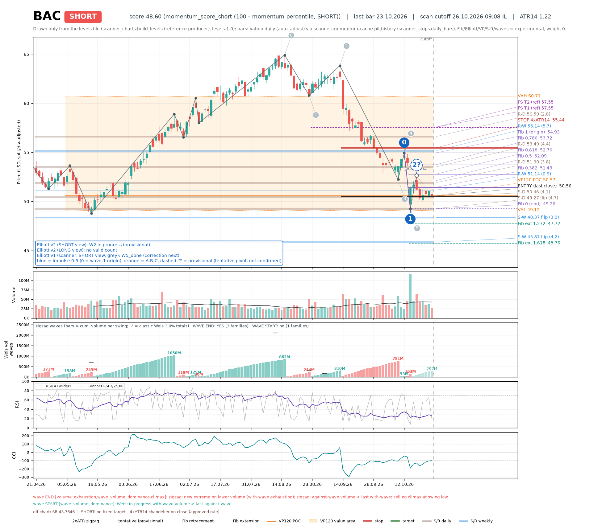

- **Jev (typesafe/jev-1.13):** 15 כותרות · 1 בביטחון ≥0.8 (סומכים על Jev) · 5 הועברו ל-Claude לשיפוט (ביטחון נמוך או חשד למניפולציה; 0 חשודות, 3 הודעות חברה) · סנטימנט שלילי (-1.00) · קטליזטור analyst · הסכמה עם Claude 5/5
- **Grok (grok-4.3, חיפוש X של Grok):** ✅ אישור · סנטימנט ‎+0 · ביטחון low · 0 פוסטים · אין פוסטים רלוונטיים ב-X · חשבונות מאומתים: —
- **Perplexity (perplexity/sonar-pro):** ✅ אישור · מועד הדוחות הבא רחוק מעבר לחלון ההחזקה, ואין מקור לאירוע בינארי קרוב; עם זאת קיימים סיכונים רגולטוריים והורדות תחזית. · קטליזטור: moderate (2026-10-14 https://investor.bankofamerica.com/events-and-presentations/events/detail/20261014-q3-2026-bank-of-america-earnings-conference-call)
  - ב־14 באוקטובר BAC פרסם תוצאות רבעון שלישי, עם EPS של 1.08 דולר מתחת לקונצנזוס של 1.10 דולר, ובמקביל דווח על קנסות והסדרים רגולטוריים בסך יותר מ־1.21 מיליארד דולר. הקטליזטור הקרוב המרכזי הוא פרסום התוצאות הבא ב־15 בינואר 2027; לא נמצא אירוע חברה בינארי נוסף מתועד ב־30 הימים הקרובים. · דוח הבא: 2027-01-15 · דגלים: קנסות והסדרים רגולטוריים בסך יותר מ־1.21 מיליארד דולר, כאשר החיוב הפחית את EPS המדולל ב־0.17 דולר. / EPS רבעוני של 1.08 דולר החמיץ את תחזית הקונצנזוס של 1.10 דולר. / מספר אנליסטים הורידו יעדי מחיר ותחזיות רווח לאחר תוצאות הרבעון השלישי.
- **Claude, אנליסט (anthropic/claude-sonnet-4.5):** ביטחון **45/100** · ניטרלי · סיכון: oversold קיצוני ליד תמיכה חזקה - פוטנציאל לריבאונד טכני
  - תזה: SHORT טכני לאחר ירידה של 10% ב-15 ימים, עם מומנטום שלילי (ציון 51.4) וסנטימנט חלש בעקבות קנסות והחמצת רווח. הסיכון: oversold חמור עם סימני קלימקס עלול לייצר ריבאונד חד מתמיכה נוכחית. · טכני (מהגרף): המניה בירידה חדה מ-65 ל-50.56, מתחת לכל הממוצעים הנעים (SMA20/50/200). RSI ב-26.39 ו-CCI ב-98.91- מצביעים על oversold קיצוני, עם סימני קלימקס מכירה בנפח ליד 49.26. הכניסה ב-50.56 קרובה ל-POC (50.57) ולתמיכה יומית ב-50.46.
- **GPT, פרקליט השטן (openai/gpt-5.6-sol):** ⛔ וטו · הסיכון הגדול: ריבאונד חד ממכירות־יתר ותמיכה · הסיכון לריבאונד גובר על אישור השורט בהיעדר קטליזטור שלילי קרוב.
  - נגד התזה של Claude: התזה חלשה במיוחד משום שהיא רודפת אחרי הירידה דווקא בנקודת תמיכה ומיצוי, בעוד ציון המומנטום 51.4 אינו משכנע.
- **האם הגרף נראה נכון? (ניסיוני):** Grok: no: ספירה אליוט ורמות פיב נראות תואמות למגמה יורדת · Perplexity: no · Claude: no: ספירת אליוט W2 זמנית והעיגון פיבונאצ'י מ-54.93 ל-49.26 נראים סבירים למבנה הנוכחי · GPT: yes: ספירת W2 מסומנת כזמנית ואינה משכנעת מול קלימקס המכירות, אף שעוגן הפיבונאצ'י ורמות התמיכה נראים סבירים. · קלט: grok=img pplx=img claude=img gpt=img
- **אתגור הדדי:** Claude 45 (neutral) מול GPT veto: מעורב

### 17. PLTR – לונג · דירוג 48.6
- **רמות (קובץ הרמות, נר אחרון 2026-10-23, hash 4e7f92c69cc5d6e1):** כניסה 196.75 · סטופ 164.22 (chandelier_close 4.0xATR14, ATR14=8.1314) · יעד: 242.84 – חצי ב-Fib 1.618 (סגירה), השאר בשנדלייר 4xATR
- **טכני:** SMA20 195.51 · SMA50 184.75 · SMA200 153.15 · מומנטום 12-1 0.097 · RSI14 54.4 · CCI20 ‎-7
- **ניסיוני (משקל 0):** אליוט v2: W2 correction zigzag: B in progress (provisional) · אליוט v1: in_W3 (W2 done) · פיבו v2 164.55→212.94 (1.618=242.84) · VP120 POC 135.14 (VAH 174.57, VAL 114.90) · תמיכה 187.17 · התנגדות 207.52 · סוף גל: 0 משפחות (—) · תחילת גל: 3 (wave_volume_dominance,momentum_divergence,elliott_context)
- **דוח:** מותר - דוח בעוד 6 ימי מסחר · מקורות: 2026-11-02 (Yahoo calendar); 2026-11-02 (Perplexity (מאושר, עם מקורות))
- **סוויפ נזילות (ייחוס בלבד, משקל 0):** לא · **עבר בדיקה, שביר, משקל 0**

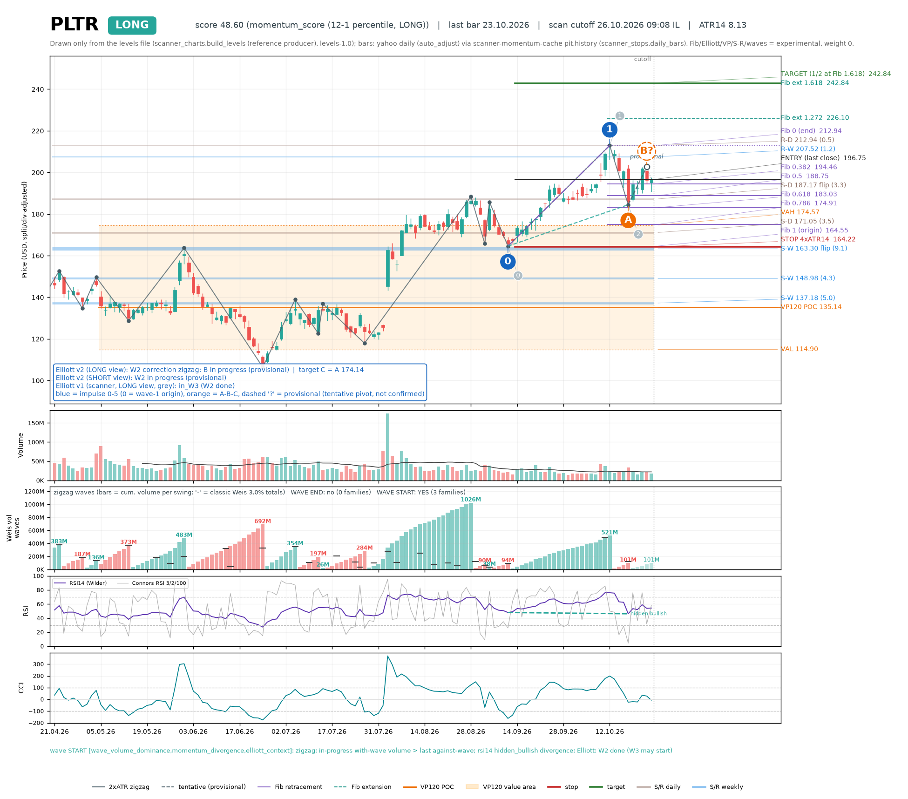

- **Jev (typesafe/jev-1.13):** 15 כותרות · 3 בביטחון ≥0.8 (סומכים על Jev) · 8 הועברו ל-Claude לשיפוט (ביטחון נמוך או חשד למניפולציה; 0 חשודות, 1 הודעות חברה) · סנטימנט חיובי (+1.00) · קטליזטור product · הסכמה עם Claude 8/8
- **Grok (grok-4.3, חיפוש X של Grok):** ✅ אישור · סנטימנט ‎+1 · ביטחון medium · 10 פוסטים · אין סיבה ברורה ב-X נגד LONG · חשבונות מאומתים: @theboredanalyst, @GrantWhitaker_, @TraderMatrixHQ, @OptionKing33996, @cobracommanduhr
- **Perplexity (perplexity/sonar-pro):** ⚠️ דגל · הדוחות ב-2 בנובמבר נמצאים בתוך כ-15 ימי המסחר הקרובים, ולכן קיימת קטליזטור בינארי קרוב ותנודתיות מהותית אפשרית. · קטליזטור: strong (2026-11-02 https://www.techi.com/quote/PLTR/earnings/)
  - ב-12 באוקטובר הוכרז המיזם Regna AI של Palantir ו-Ondas ליישומי AI ריבוניים בתחומי הביטחון והתשתיות. ב-2 בנובמבר צפויה פרסום תוצאות הרבעון השלישי, אירוע קרוב שעלול להגדיל את התנודתיות. · דוח הבא: 2026-11-02 · דגלים: התמחור הגבוה מותיר את המניה רגישה לאכזבה בדוחות או להנחיות חלשות. / התרחבות המיזם Regna AI עדיין אינה כוללת תרומה כספית מדווחת או חוזים נקובים. / החברה תלויה במידה משמעותית בהמרת פיילוטים מסחריים לחוזי ייצור ובהמשך חוזים ממשלתיים; קיימים גם סיכוני ביקורת גיאופוליטית.
- **Claude, אנליסט (anthropic/claude-sonnet-4.5):** ביטחון **62/100** · תומך · סיכון: אכזבה בדוח הרבעוני או בהנחיות עתידיות עקב תמחור קיצוני
  - תזה: הסטאפ תומך בהמשך עלייה לאחר תיקון בריא, עם קונפלואנס של ספירת Elliott v1 (W3), Fib 1.618 ביעד, ומומנטום חיובי לקראת דוח. הסיכון העיקרי הוא התמחור הקיצוני והתלות באכזבה אפשרית בדוח או בהנחיות. · טכני (מהגרף): המניה סגרה בדיוק על ה-SMA20 (196.75) לאחר תיקון מהשיא ב-212.94, עם RSI ניטרלי (54.42) והאמר בולט בסגירה האחרונה. הגרף מציג ספירת Elliott v2 זיגזג תיקוני עם B זמני בתהליך, אך v1 מציע W3 פוטנציאלי עולה ליעד 262.74.
- **GPT, פרקליט השטן (openai/gpt-5.6-sol):** ⚠️ דגל · הסיכון הגדול: אכזבה בדוח או בתחזית תחת תמחור קיצוני · הצמיחה תומכת בסיפור, אך הסתירה הטכנית, ההתנגדות הקרובה והדוח הקרוב מחלישים מהותית את הלונג.
  - נגד התזה של Claude: התזה נשענת על W3 משני וסותר, ואף מציגה היעדר חוב כעובדה כשהנתון למעשה חסר.
- **האם הגרף נראה נכון? (ניסיוני):** Grok: no: ספירה אליוט ו-Fib נראים תקינים על הגרף · Perplexity: yes: הספירה מסומנת כפרוביזורית, והתרחיש מציג תיקון W2 אפשרי כאשר נקודת B עדיין לא מאושרת, לכן אין אישור מספיק לספירה וליעדי פיבונאצ׳י. · Claude: no: ספירת Elliott v2 הזיגזג התיקוני והעיגון Fib מ-164.55 ל-212.94 נראים הגיוניים על הגרף · GPT: yes: ספירת W3 אינה משכנעת מול ספירת הזיגזג הראשית והזמנית שעדיין מאפשרת גל C יורד. · קלט: grok=img pplx=img claude=img gpt=img
- **אתגור הדדי:** Claude 62 (supports) מול GPT flag: מעורב

### 18. UNH – לונג · דירוג 43.9
- **רמות (קובץ הרמות, נר אחרון 2026-10-23, hash 655f77039ae885b1):** כניסה 418.09 · סטופ 372.45 (chandelier_close 4.0xATR14, ATR14=11.41) · יעד: 430.90 – חצי ב-Fib 1.618 (סגירה), השאר בשנדלייר 4xATR
- **טכני:** SMA20 389.21 · SMA50 387.60 · SMA200 357.72 · מומנטום 12-1 0.065 · RSI14 66.1 · CCI20 120
- **ניסיוני (משקל 0):** אליוט v2: no valid count · אליוט v1: no valid count · פיבו v2 252.96→399.40 (1.618=489.89) · VP120 POC 378.13 (VAH 412.70, VAL 370.80) · תמיכה 400.66 · התנגדות 419.66 · סוף גל: 1 משפחות (wave_volume_dominance) · תחילת גל: 1 (wave_volume_dominance)
- **דוח:** מותר - דוח בעוד 54 ימי מסחר · מקורות: 2027-01-12 (Yahoo calendar); 2027-01-26 (Perplexity (מאושר, עם מקורות))
- **סוויפ נזילות (ייחוס בלבד, משקל 0):** לא · **עבר בדיקה, שביר, משקל 0**

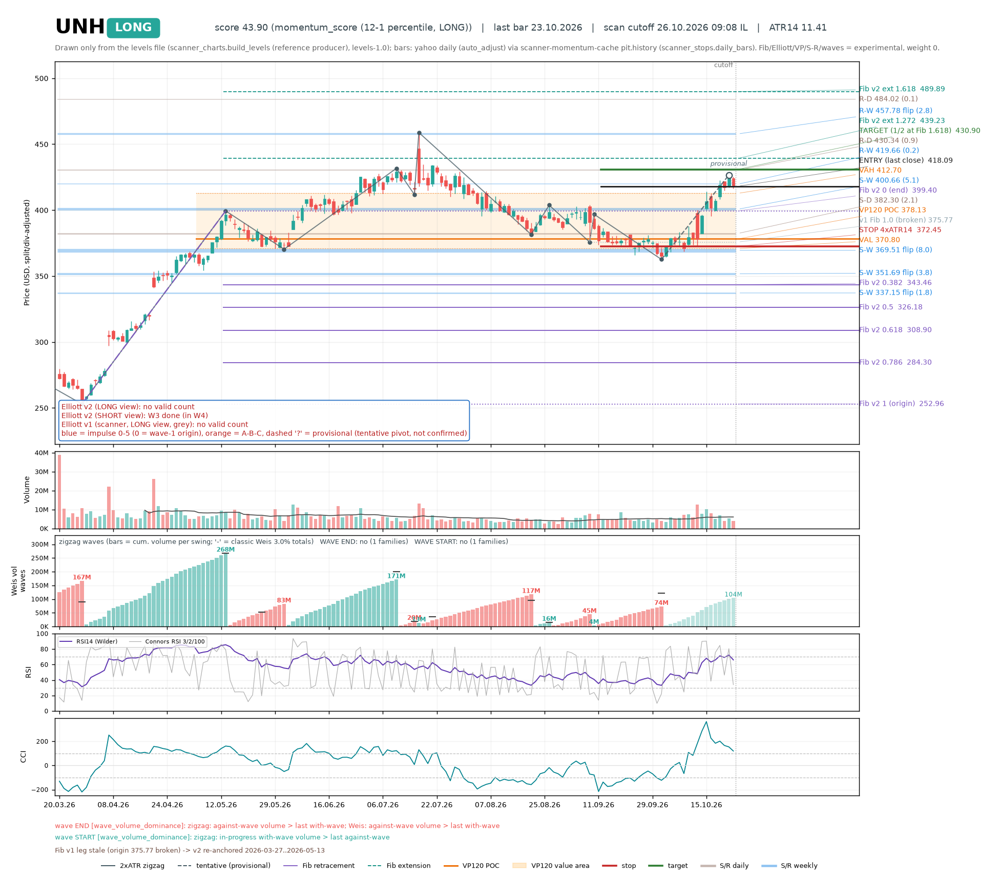

- **Jev (typesafe/jev-1.13):** 15 כותרות · 1 בביטחון ≥0.8 (סומכים על Jev) · 6 הועברו ל-Claude לשיפוט (ביטחון נמוך או חשד למניפולציה; 0 חשודות, 2 הודעות חברה) · סנטימנט חיובי (+1.00) · קטליזטור analyst · הסכמה עם Claude 6/6
- **Grok (grok-4.3, חיפוש X של Grok):** ✅ אישור · סנטימנט ‎+1 · ביטחון medium · 6 פוסטים · סנטימנט חיובי-נייטרלי ללא סיבה לווטו על LONG · חשבונות מאומתים: @Auto_MA_T_Ka, @salazaredge
- **Perplexity (perplexity/sonar-pro):** ✅ אישור · הדוחות והעלאת התחזית כבר פורסמו, והדוח הבא המתוארך נמצא מעבר לאופק ההחזקה של כמה שבועות; עם זאת, קיימים סיכוני עלויות רפואיות ורגולציה. · קטליזטור: strong (2026-10-13 https://www.unitedhealthgroup.com/newsroom/2026/2026-10-13-uhg-reports-third-quarter-2026-results.html)
  - ב-13 באוקטובר החברה דיווחה על תוצאות רבעון שלישי והעלתה את תחזית הרווח לשנת 2026. ב-30 הימים הקרובים אין אירוע חברה בינארי מתוארך נוסף, אך תחזית 2027 לפני סוף השנה עשויה להיות קטליזטור. · דוח הבא: 2027-01-26 · דגלים: סיכוני עלויות רפואיות, במיוחד ב-Medicare Advantage, עלולים לפגוע במרווחים ובתחזית. / החברה מציינת חשיפה להתדיינות, חקירות, ביקורות ושינויים רגולטוריים. / האנליסטים חלוקים, וכמה מהם הורידו יעדי מחיר לאחר הדוחות למרות העלאת התחזית.
- **Claude, אנליסט (anthropic/claude-sonnet-4.5):** ביטחון **35/100** · ניטרלי · סיכון: כניסה בהתנגדות עם RSI/CCI מוגזמים וללא קטליזטור קרוב
  - תזה: המומנטום חיובי אך הכניסה מתבצעת בהתנגדות שבועית עם אינדיקטורים מוגזמים, ללא ספירה טכנית תקפה. הסיכון-תגמול (12.8 נקודות עלייה מול 45.6 נקודות סטופ) אינו אטרקטיבי לעסקה ללא קטליזטור קרוב. · טכני (מהגרף): המניה נסחרת מעל כל הממוצעים הנעים (SMA20/50/200) לאחר עלייה של 12.4% ב-15 ימים, אך RSI 66 ו-CCI 120 מצביעים על קנייה מוגזמת קצרת טווח. הכניסה ב-418.09 צמודה להתנגדות שבועית ב-419.66, ללא ספירת אליוט תקפה או אישור טכני ברור להמשך.
- **GPT, פרקליט השטן (openai/gpt-5.6-sol):** ⚠️ דגל · הסיכון הגדול: כשל פריצה בהתנגדות השבועית לאחר מהלך חד · המגמה חיובית, אך התזמון מול התנגדות ויחס העלייה־לסיכון החלש יוצרים חשש ממשי לכשל פריצה.
  - נגד התזה של Claude: החולשה בתזה היא הצגת RSI 66.09 כקניית יתר מובהקת, אף שהוא בעיקר מצביע על מומנטום חזק.
- **האם הגרף נראה נכון? (ניסיוני):** Grok: no: הספירה Elliott ו-Fib נראות תקינות על הגרף · Perplexity: yes: הספירה הראשית מסומנת ללא ספירה תקפה, והעוגנים ורמות התמיכה/התנגדות נראים זמניים או לא מאושרים בגרף. · Claude: n/a: אין ספירת אליוט תקפה מוצגת, הפיבונאצ'י v2 מעוגן מ-252.96 (מרץ 2026) והתמיכה/התנגדות נראות סבירות · GPT: yes: יעד 430.9021 מיוחס ל־Fib 1.618 אך אינו תואם ל־1.618 המוצג ב־489.8935 או לעוגן הישן ב־409.8417. · קלט: grok=img pplx=img claude=img gpt=img
- **אתגור הדדי:** Claude 35 (neutral) מול GPT flag: מעורב

### 19. GS – שורט · דירוג 33.6
- **רמות (קובץ הרמות, נר אחרון 2026-10-23, hash 5c8a9f58874f8040):** כניסה 875.68 · סטופ 973.28 (chandelier_close 4.0xATR14, ATR14=24.40) · יעד: אין – ללא יעד קבוע - שנדלייר 4xATR14 על סגירה (כלל מאושר)
- **טכני:** SMA20 892.86 · SMA50 958.51 · SMA200 951.97 · מומנטום 12-1 0.264 · RSI14 37.5 · CCI20 ‎-108
- **ניסיוני (משקל 0):** אליוט v2: W2 in progress (provisional) · אליוט v1: W5_done (correction next) · פיבו v2 931.00→859.03 (1.618=814.55) · VP120 POC 1,035.52 (VAH 1,107.86, VAL 934.26) · תמיכה 859.04 · התנגדות 897.88 · סוף גל: 4 משפחות (volume_exhaustion,wave_volume_dominance,momentum_divergence,elliott_context) · תחילת גל: 0 (—)
- **דוח:** מותר - דוח בעוד 58 ימי מסחר · מקורות: 2027-01-19 (Yahoo calendar); 2027-01-19 (Perplexity (מאושר, עם מקורות))
- **סוויפ נזילות (ייחוס בלבד, משקל 0):** לא
- **ספירלת פיבו – יעדי ייחוס בלבד (משקל 0, לא משנה סטופ/יעד; השורט נשאר עם סטופ נגרר 4×ATR בלי יעד):** T1 960.83 (fan:4@fib0.5) · T2 960.83 (circle:0.786@fib0.5) · מצב: triggered_earlier

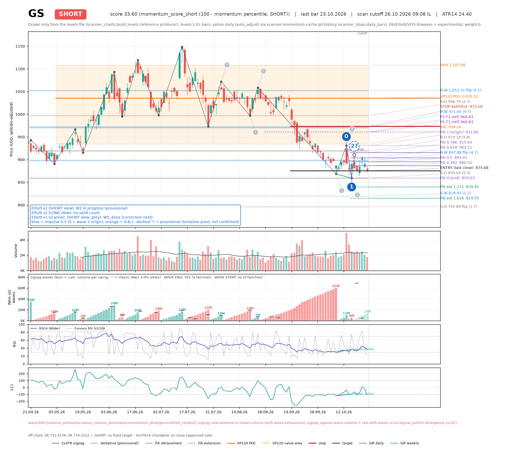

- **Jev (typesafe/jev-1.13):** 15 כותרות · 0 בביטחון ≥0.8 (סומכים על Jev) · 7 הועברו ל-Claude לשיפוט (ביטחון נמוך או חשד למניפולציה; 0 חשודות, 5 הודעות חברה) · סנטימנט — · קטליזטור — · הסכמה עם Claude 6/7
- **Grok (grok-4.3, חיפוש X של Grok):** ✅ אישור · סנטימנט ‎+0 · ביטחון low · 7 פוסטים · אין חדשות או סנטימנט ב-X נגד SHORT · חשבונות מאומתים: —
- **Perplexity (perplexity/sonar-pro):** ⚠️ דגל · הדוחות כבר פורסמו, אך קיימת תנודתיות סביב עדכוני יעדי המחיר והתרשים הטכני אינו מאשר בביטחון את הספירה. · קטליזטור: moderate (2026-10-13 https://www.goldmansachs.com/pressroom/press-releases/2026/2026-10-13-q3-results)
  - ב-13 באוקטובר פורסמו תוצאות הרבעון השלישי, עם הכנסות של 18.68 מיליארד דולר ורווח נקי של 5.29 מיליארד דולר; זהו אירוע שכבר התרחש ב-14 הימים האחרונים. ב-12 באוקטובר הוכרז דיבידנד רבעוני של 5 דולר למניה, שישולם ב-30 בדצמבר לבעלי מניות רשומים ב-2 בדצמבר; לא נמצא אירוע חברה ספציפי נוסף ב-30 הימים הקרובים. · דוח הבא: 2027-01-19 · דגלים: האנליסטים RBC ו-KBW הורידו יעדי מחיר לאחר הדוחות, אף שהרווח וההכנסות עלו על הקונצנזוס. / הפרשות לליטיגציה ולהליכים רגולטוריים היו 23 מיליון דולר ברבעון; קיימת חשיפה מתמשכת להליכים משפטיים ורגולטוריים. / הדוחות מצביעים על פער בין תוצאות חזקות לבין חולשה אפשרית בסנטימנט: המניה נסחרה מתחת לשיא הקודם והאנליסטים ממשיכים לציין סיכוני ריבית, שוקי הון ופעילות מיזוגים ורכישות.
- **Claude, אנליסט (anthropic/claude-sonnet-4.5):** ביטחון **25/100** · מתנגד · סיכון: ריבאונד מהירה מרמת oversold עם דיברגנציה בוליש קיימת
  - תזה: הגרף מציג דיברגנציה בוליש ואיתותי תשישות נפח לאחר ירידה, אך המומנטום עדיין שלילי (מתחת לכל הממוצעים) והקטליסט הקרוב (דוח) כבר התרחש עם תגובת אנליסטים מעורבת. הסיכון-תגמול לשורט כאן חלש: הסטופ רחוק (973.28, +11.1%) מול פוטנציאל ירידה מוגבל לתמיכה ב-859 (-1.9%). · טכני (מהגרף): המניה נסחרת מתחת לכל הממוצעים הנעים (SMA20/50/200) לאחר ירידה של 2.98% ב-15 ימים, עם RSI14 של 37.51 ו-CCI20 של -107.61 המצביעים על oversold. הגרף מראה גל ירידה עם דיברגנציה בוליש ברגולר (RSI, CCI) ואיתותי תשישות נפח, אך המחיר עדיין מתחת ל-VA120 ומעל תמיכה ב-859.
- **GPT, פרקליט השטן (openai/gpt-5.6-sol):** ⛔ וטו · הסיכון הגדול: ריבאונד חד מהתמיכה בעקבות תשישות ודיברגנציה שורית · הצטברות אותות היפוך שוריים סמוך לתמיכה יחד עם יסודות חזקים סותרת כניסת שורט כעת.
  - נגד התזה של Claude: החולשה העיקרית היא ההנחה שהתמיכה ב-859 מגבילה את פוטנציאל הירידה, אף שתמיכה יכולה להישבר.
- **האם הגרף נראה נכון? (ניסיוני):** Grok: no: ספירה אליוט ורמות פיב נראות תקינות · Perplexity: yes: הספירה הראשית מסומנת כפרוביזורית, והתרשים עצמו מציג גל W2 בתהליך ללא גל W3 מאושר; לכן אין בסיס מספיק לאשר את ספירת אליוט, עוגן פיבונאצ'י ורמות התמיכה כהכרעה טכנית. · Claude: no: הספירה האליוטית (W2 זמני לאחר W5 שהושלם) והעיגון פיבונאצ'י (931-859) נראים סבירים על הגרף; רמות S/R תואמות את הפיבוטים. · GPT: yes: ספירת W2 זמנית, אינה מאושרת ומתנגשת עם ספירת W5_done ואותות סיום הגל. · קלט: grok=img pplx=img claude=img gpt=img
- **אתגור הדדי:** Claude 25 (opposes) מול GPT veto: הסכמה שלילית: Claude חלש, GPT וטו

### 20. MS – שורט · דירוג 32.7
- **רמות (קובץ הרמות, נר אחרון 2026-10-23, hash ac178a93da558074):** כניסה 179.49 · סטופ 199.68 (chandelier_close 4.0xATR14, ATR14=5.0480) · יעד: אין – ללא יעד קבוע - שנדלייר 4xATR14 על סגירה (כלל מאושר)
- **טכני:** SMA20 186.57 · SMA50 200.87 · SMA200 193.10 · מומנטום 12-1 0.270 · RSI14 34.1 · CCI20 ‎-102
- **ניסיוני (משקל 0):** אליוט v2: W2 in progress (provisional) · אליוט v1: W5_done (correction next) · פיבו v2 193.30→176.44 (1.618=166.02) · VP120 POC 215.16 (VAH 226.62, VAL 193.89) · תמיכה 176.60 · התנגדות 184.53 · סוף גל: 4 משפחות (volume_exhaustion,wave_volume_dominance,momentum_divergence,elliott_context) · תחילת גל: 1 (wave_volume_dominance)
- **דוח:** מותר - דוח בעוד 56 ימי מסחר · מקורות: 2027-01-14 (Yahoo calendar); 2027-01-21 (Perplexity (מאושר, עם מקורות))
- **סוויפ נזילות (ייחוס בלבד, משקל 0):** לא
- **ספירלת פיבו – יעדי ייחוס בלבד (משקל 0, לא משנה סטופ/יעד; השורט נשאר עם סטופ נגרר 4×ATR בלי יעד):** T1 — (—) · T2 — (—) · מצב: none

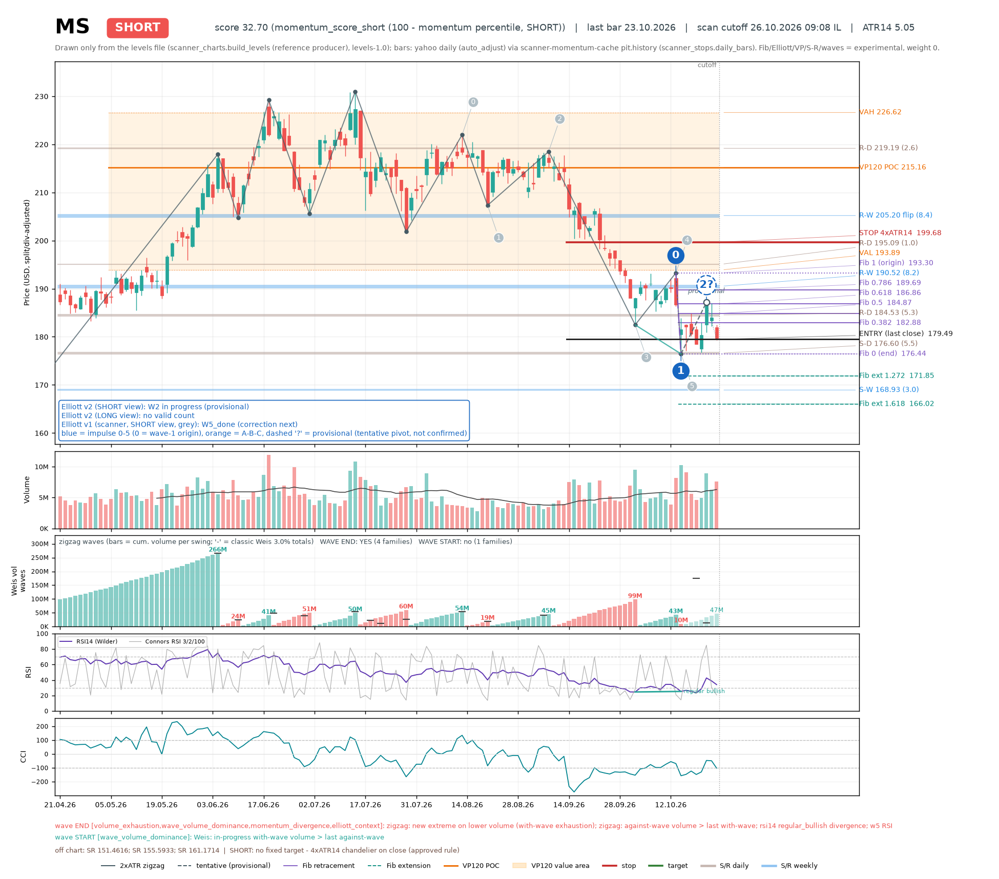

- **Jev (typesafe/jev-1.13):** 15 כותרות · 0 בביטחון ≥0.8 (סומכים על Jev) · 5 הועברו ל-Claude לשיפוט (ביטחון נמוך או חשד למניפולציה; 0 חשודות, 4 הודעות חברה) · סנטימנט — · קטליזטור — · הסכמה עם Claude 4/5
- **Grok (grok-4.3, חיפוש X של Grok):** ✅ אישור · סנטימנט ‎+0 · ביטחון low · 0 פוסטים · אין סנטימנט X משמעותי נגד השורט · חשבונות מאומתים: —
- **Perplexity (perplexity/sonar-pro):** ⚠️ דגל · הדוחות האחרונים כבר פורסמו, אך הורדות מחיר היעד הרבות והמחיר ליד תמיכה טכנית מצדיקים דגל ולא אישור חד לשורט. · קטליזטור: moderate (2026-10-14 https://www.sec.gov/Archives/edgar/data/895421/000089542126000288/a3q26msearningsrelease.htm)
  - ב־14 באוקטובר פורסמו תוצאות רבעון שלישי חזקות מהצפי, עם הכנסות של 20.34 מיליארד דולר ורווח למניה של 3.03 דולר. במהלך 30 הימים הקרובים לא נמצא אירוע חברה משמעותי נוסף מעבר לעדכוני אנליסטים; מועד הדוחות הבא שפורסם הוא 21 בינואר 2027. · דוח הבא: 2027-01-21 · דגלים: ריבוי הורדות מחיר יעד לאחר הדוחות, למרות עקיפת תחזיות הרווח וההכנסות. / הדוחות הבאים צפויים ב־21 בינואר 2027, מעבר לחלון ההחזקה הקצר שנבחן. / לא נמצאה במקורות שנבדקו אינדיקציה עדכנית ברורה לבעיית חשבונאות, תביעה מהותית, דילול חריג, קיצוץ תחזית או אירוע רגולטורי חמור.
- **Claude, אנליסט (anthropic/claude-sonnet-4.5):** ביטחון **42/100** · ניטרלי · סיכון: דיברגנציה בוליש ב-RSI וספירת W2 זמנית מעלים סיכון לריבאונד חד
  - תזה: השורט מבוסס על מומנטום שלילי ומיקום מתחת ל-SMA20/50, אך הדיברגנציה הבוליש ב-RSI והספירה הזמנית W2 מצביעים על סיכון גבוה לריבאונד טכני קצר טווח לפני המשך ירידה. היעדר קטליסט שלילי מיידי מחליש את התזה. · טכני (מהגרף): המניה ירדה 5.7% ב-15 ימים האחרונים ונסגרה על 179.49, מתחת ל-SMA20 (186.57) ול-SMA50 (200.87). ה-RSI14 נמוך (34.12) והמומנטום מראה דיברגנציה בוליש רגילה; הספירה האליוטית v2 מציעה W2 זמני (פרובזיונלי) לאחר ירידה חדה, מה שמעלה סיכון להמשך תיקון כלפי מעלה לפני ירידה נוספת.
- **GPT, פרקליט השטן (openai/gpt-5.6-sol):** ⛔ וטו · הסיכון הגדול: ריבאונד חד מתמיכה לאחר מיצוי הירידה · הקרבה לתמיכה, הדיברגנציה הבולישית, מיצוי הגל והיסודות החזקים סותרים שורט חדש ללא קטליסט שלילי.
  - נגד התזה של Claude: חולשת התזה היא מתן משקל למיקום מתחת לממוצעים נעים, שהם אינדיקטורים מפגרים, למרות הצטברות אותות היפוך.
- **האם הגרף נראה נכון? (ניסיוני):** Grok: no: ספירה אליוט ופיב תואמות מגמה יורדת · Perplexity: yes: הספירה והעוגנים נראים טנטטיביים, והמחיר קרוב לאזורי תמיכה עם סטייה שורית ב־RSI, לכן אין אישור טכני חד לספירת הירידה. · Claude: no: הספירה v2 (W2 זמני) והפיבונאצ'י מעוגנים באופן הגיוני לשיא ושפל האחרונים; רמות S/R סבירות. · GPT: yes: ספירת W2 נשענת על פיבוט זמני לא מאושר ומתנגשת עם ספירת W5 שהושלמה ואותות סיום הגל. · קלט: grok=img pplx=img claude=img gpt=img
- **אתגור הדדי:** Claude 42 (neutral) מול GPT veto: הסכמה שלילית: Claude חלש, GPT וטו

### 21. WMT – לונג · דירוג 30.8
- **רמות (קובץ הרמות, נר אחרון 2026-10-23, hash 1eb59132948c4495):** כניסה 119.89 · סטופ 109.95 (chandelier_close 4.0xATR14, ATR14=2.4840) · יעד: 132.50 – חצי ב-Fib 1.618 (סגירה), השאר בשנדלייר 4xATR
- **טכני:** SMA20 112.19 · SMA50 109.40 · SMA200 118.04 · מומנטום 12-1 0.013 · RSI14 69.6 · CCI20 106
- **ניסיוני (משקל 0):** אליוט v2: W5 in progress (provisional) · אליוט v1: in_W3 (W2 done) · פיבו v2 103.39→121.38 (1.618=132.50) · VP120 POC 106.40 (VAH 117.84, VAL 102.80) · תמיכה 115.79 · התנגדות 121.11 · סוף גל: 1 משפחות (volume_exhaustion) · תחילת גל: 2 (wave_volume_dominance,elliott_context)
- **דוח:** מותר - דוח בעוד 19 ימי מסחר · מקורות: 2026-11-19 (Yahoo calendar); 2026-11-19 (Perplexity (מאושר, עם מקורות))
- **סוויפ נזילות (ייחוס בלבד, משקל 0):** כן (שורט, רמה 121.38 pivot) · **עבר בדיקה, שביר, משקל 0**

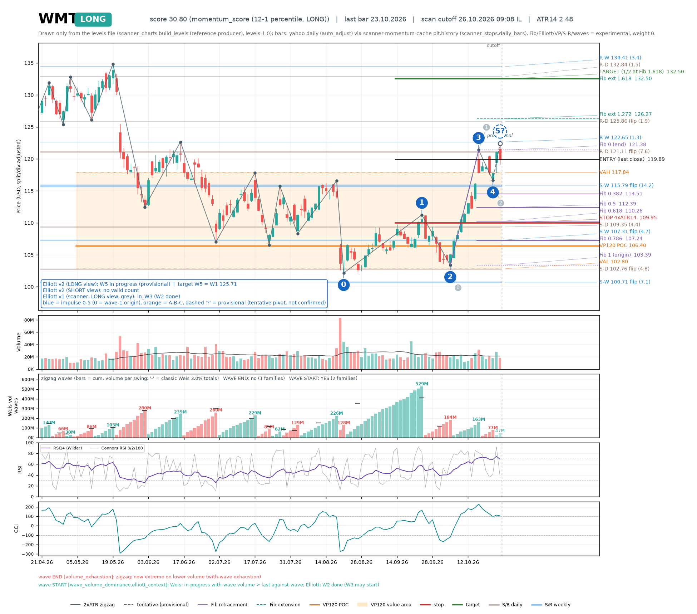

- **Jev (typesafe/jev-1.13):** 15 כותרות · 0 בביטחון ≥0.8 (סומכים על Jev) · 8 הועברו ל-Claude לשיפוט (ביטחון נמוך או חשד למניפולציה; 0 חשודות, 4 הודעות חברה) · סנטימנט — · קטליזטור — · הסכמה עם Claude 5/8
- **Grok (grok-4.3, חיפוש X של Grok):** ✅ אישור · סנטימנט ‎+1 · ביטחון medium · 8 פוסטים · אין חדשות שליליות ב-X נגד ה-LONG · חשבונות מאומתים: @MarcosMillaYT, @HTX_Global, @ConnorJBates_, @irbezek
- **Perplexity (perplexity/sonar-pro):** ⚠️ דגל · מועד הדוחות הצפוי ב-19 בנובמבר נמצא בתוך חלון ההחזקה הקרוב ולכן מהווה סיכון אירוע משמעותי. · קטליזטור: moderate (2026-10-15 https://www.marketscreener.com/quote/stock/WALMART-INC-4841/consensus/)
  - ב-12 באוקטובר נפתח מרכז הגשמה חדש של Walmart בסטוקטון, קליפורניה, לחיזוק יכולת המשלוחים בחוף המערבי. ב-22 באוקטובר החברה הציגה כלים לסוכני קניות מבוססי בינה מלאכותית, ובתקופה הקרובה צפויה הרחבת משלוחי הרחפנים לדנוור ולסיאטל ב-2027. · דוח הבא: 2026-11-19 · דגלים: מועד הדוחות הבא הוא 19 בנובמבר, בתוך כ-15 ימי מסחר, ולכן קיים סיכון אירוע משמעותי לפוזיציית LONG. / המניה נסחרת במכפיל רווח עתידי גבוה יחסית, והערכת השווי עשויה להגביל את האפסייד או להגדיל את רגישות המניה לאכזבה. / לא נמצאו בתוצאות שנאספו אינדיקציות מאומתות לחיתוך תחזית, בעיית חשבונאות, דילול חריג, חוב חריג או ליטיגציה מהותית בתקופה שנבדקה.
- **Claude, אנליסט (anthropic/claude-sonnet-4.5):** ביטחון **45/100** · ניטרלי · סיכון: דוח רבעוני בעוד 19 ימי מסחר עם קנייה מוגזמת טכנית והערכת שווי גבוהה
  - תזה: המניה בעלייה חזקה (החודש הטוב ביותר מאז 1999 לפי הכותרות) עם שדרוגי אנליסטים ויוזמות AI חדשות, אך אינדיקטורים טכניים מראים קנייה מוגזמת ונפח מתדלדל. הכניסה בסמוך לשיא עם דוח רבעוני בעוד 19 ימים מגדילה סיכון. · טכני (מהגרף): המניה פרצה מעל ממוצע 200 יום ומתקרבת לשיא היסטורי; ספירת אליוט v2 מציעה גל 5 זמני ביעד 125.71, אך RSI 69.6 ו-CCI 105.6 מצביעים על קנייה מוגזמת. נפח האחרון נמוך (volume exhaustion) והנר האחרון הוא dark cloud cover, סימן היסוס.
- **GPT, פרקליט השטן (openai/gpt-5.6-sol):** ⚠️ דגל · הסיכון הגדול: מימוש חד סביב הדוח לאחר מהלך מתוח ותמחור גבוה · הפריצה אפשרית, אך העיתוי, ההתנגדות הקרובה, תשישות הנפח והתמחור הופכים את יחס הוודאות לחלש.
  - נגד התזה של Claude: התזה חלשה בכך שהיא נותנת משקל לשדרוגים וליוזמות שעשויים כבר להיות מגולמים לאחר העלייה החדה.
- **האם הגרף נראה נכון? (ניסיוני):** Grok: no: ספירת הגל וה-Fib נראים תקינים ויזואלית · Perplexity: no · Claude: no: ספירת אליוט v2 (גל 5 זמני) והעיגון פיבונאצ'י מ-103.39 ל-121.38 נראים סבירים על הגרף · GPT: yes: ספירת גל 5 עדיין זמנית, מתנגשת עם ספירת W3 החלופית ואינה נתמכת היטב מול תשישות הנפח. · קלט: grok=img pplx=img claude=img gpt=img
- **אתגור הדדי:** Claude 45 (neutral) מול GPT flag: מעורב

### 22. PG – לונג · דירוג 28.0
- **רמות (קובץ הרמות, נר אחרון 2026-10-23, hash 5c44bf952baf2d6f):** כניסה 161.02 · סטופ 148.65 (chandelier_close 4.0xATR14, ATR14=3.0930) · יעד: אין – אין סווינג מאושר - 100% בשנדלייר 4xATR
- **טכני:** SMA20 151.81 · SMA50 147.41 · SMA200 146.35 · מומנטום 12-1 ‎-0.015 · RSI14 65.9 · CCI20 130
- **ניסיוני (משקל 0):** אליוט v2: W3 in progress (provisional) / beyond target · אליוט v1: in_W3 (W2 done) · פיבו v2 140.93→148.50 (1.618=153.18) · VP120 POC 144.71 (VAH 149.03, VAL 141.54) · תמיכה 150.34 · התנגדות 164.29 · סוף גל: 1 משפחות (momentum_divergence) · תחילת גל: 3 (wave_volume_dominance,momentum_divergence,elliott_context)
- **דוח:** מותר - דוח בעוד 60 ימי מסחר · מקורות: 2027-01-21 (Yahoo calendar)
- **סוויפ נזילות (ייחוס בלבד, משקל 0):** לא · **עבר בדיקה, שביר, משקל 0**

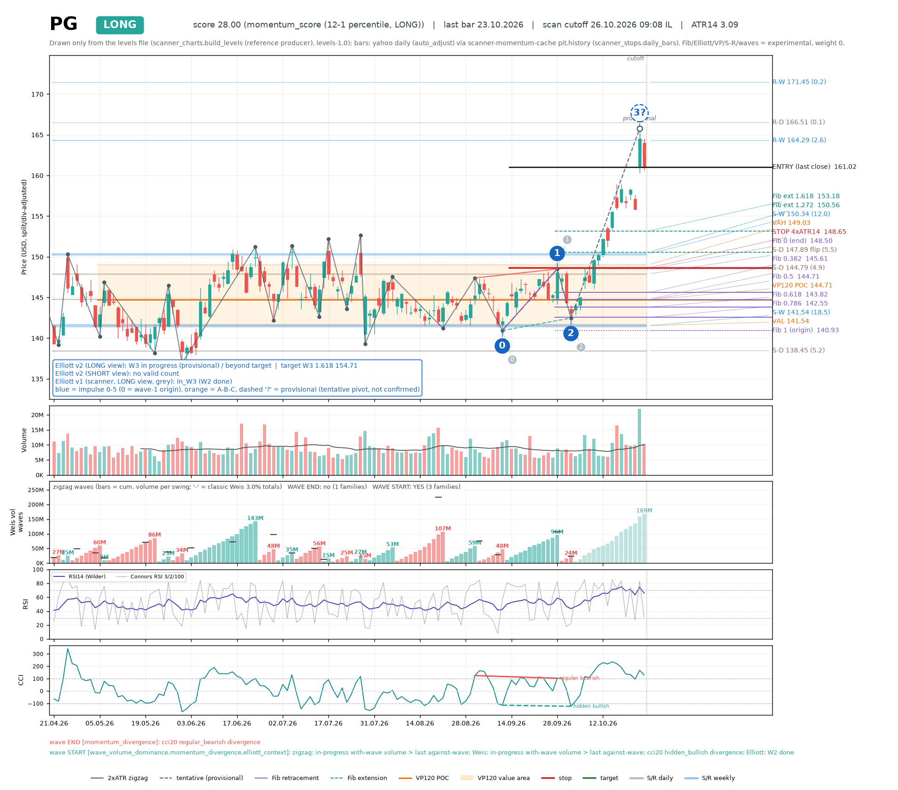

- **Jev (typesafe/jev-1.13):** 15 כותרות · 6 בביטחון ≥0.8 (סומכים על Jev) · 6 הועברו ל-Claude לשיפוט (ביטחון נמוך או חשד למניפולציה; 0 חשודות, 0 הודעות חברה) · סנטימנט חיובי (+0.69) · קטליזטור analyst · הסכמה עם Claude 3/6
- **Grok (grok-4.3, חיפוש X של Grok):** ✅ אישור · סנטימנט ‎+1 · ביטחון medium · 4 פוסטים · אין חדשות שליליות ב-X נגד LONG · חשבונות מאומתים: @OmenScope, @DalsnaFinance, @JoshuaTA
- **Perplexity (perplexity/sonar-pro):** ⚠️ דגל · הדוחות פורסמו לאחרונה והתחזית לא שופרה, בעוד שהתרשים מציג סטייה דובית ונסיגה מהשיא. · קטליזטור: moderate (2026-10-22 https://www.pginvestor.com/news/default.aspx)
  - החברה פרסמה את תוצאות הרבעון הראשון ב-22 באוקטובר, עם EPS של 2.00 והותרת תחזית הצמיחה האורגנית לשנת הכספים 2027 על 1%–3%.[1][2] ב-23 באוקטובר פורסמו העלאות רבות של יעדי מחיר מצד אנליסטים, אך אלה אינן אירוע עסקי בינארי.[1][3] · דוח הבא: — · דגלים: התחזית לצמיחה אורגנית נותרה מתונה על 1%–3%, ללא העלאה.[1] / התרשים מציג סטייה דובית ב-CCI וגל עולה שהוגדר כפרוביזורי, כאשר המחיר נסוג מהשיא האחרון. / קיימת אי-ודאות לגבי הקטליזטור הבא ולגבי מועד הדוחות הבא, שלא אומת במקור זמין.
- **Claude, אנליסט (anthropic/claude-sonnet-4.5):** ביטחון **45/100** · ניטרלי · סיכון: כניסה מאוחרת לאחר ראלי חד, מול סטייה דובית והתנגדות שבועית קרובה
  - תזה: פריצה טכנית חזקה לאחר דוח עם תמיכה מאנליסטים, אך הכניסה מאוחרת לאחר עלייה של 11.9% ב-15 ימים, מול סטייה דובית ב-CCI ומומנטום נמוך (28/100). הסיכון-תגמול פחות אטרקטיבי כאן. · טכני (מהגרף): המניה פרצה מעל POC ו-VAH של VP120 לאחר דוח רווח חזק, אך נוצרה סטייה דובית ב-CCI והנר האחרון הוא inside bar. הספירה האליוטית פרוביזורית ומעבר ליעד W3 (154.71), כאשר המחיר כבר ב-161.02 מול התנגדות שבועית ב-164.29.
- **GPT, פרקליט השטן (openai/gpt-5.6-sol):** ⚠️ דגל · הסיכון הגדול: כניסה מאוחרת לאחר מהלך ממצה אל התנגדות · המגמה חיובית, אך התמחור הטכני המתוח וסימני המיצוי מחלישים את איכות הלונג.
  - נגד התזה של Claude: הגדרת הפריצה כחזקה מקלה מדי עם הדחייה מהשיא והספירה הפרוביזורית שכבר עברה את יעדה.
- **האם הגרף נראה נכון? (ניסיוני):** Grok: no: ספירה ו-Fib תואמים נתונים · Perplexity: yes: ספירת Elliott והעוגן נראים אגרסיביים מדי לאחר השיא, והסימון הפרוביזורי אינו מאשר עדיין גל 3 ברור. · Claude: no: הספירה האליוטית סבירה אך מסומנת כפרוביזורית ומעבר ליעד, והעיגון הפיבונאצ'י מ-140.93 ל-148.50 נראה הגיוני · GPT: yes: סימון W3 בשיא לא מאושר וכבר מעבר ליעד, ולכן הספירה והעוגן הישן אינם בסיס אמין להמשך. · קלט: grok=img pplx=img claude=img gpt=img
- **אתגור הדדי:** Claude 45 (neutral) מול GPT flag: מעורב

### 23. C – שורט · דירוג 25.2
- **רמות (קובץ הרמות, נר אחרון 2026-10-23, hash 76d3ce84c0d687d5):** כניסה 120.62 · סטופ 133.69 (chandelier_close 4.0xATR14, ATR14=3.2671) · יעד: אין – ללא יעד קבוע - שנדלייר 4xATR14 על סגירה (כלל מאושר)
- **טכני:** SMA20 126.33 · SMA50 131.24 · SMA200 125.72 · מומנטום 12-1 0.401 · RSI14 34.9 · CCI20 ‎-125
- **ניסיוני (משקל 0):** אליוט v2: W3 in progress (provisional) · אליוט v1: in_W3 (W2 done) · פיבו v2 133.50→120.20 (1.618=111.98) · VP120 POC 131.78 (VAH 138.23, VAL 122.52) · תמיכה 115.17 · התנגדות 122.98 · סוף גל: 2 משפחות (volume_exhaustion,momentum_divergence) · תחילת גל: 3 (wave_volume_dominance,momentum_divergence,elliott_context)
- **דוח:** מותר - דוח בעוד 56 ימי מסחר · מקורות: 2027-01-14 (Yahoo calendar)
- **סוויפ נזילות (ייחוס בלבד, משקל 0):** לא
- **ספירלת פיבו – יעדי ייחוס בלבד (משקל 0, לא משנה סטופ/יעד; השורט נשאר עם סטופ נגרר 4×ATR בלי יעד):** T1 126.14 (circle:0.786@fib1.0) · T2 126.14 (fan:1@fib1.0) · מצב: triggered_earlier

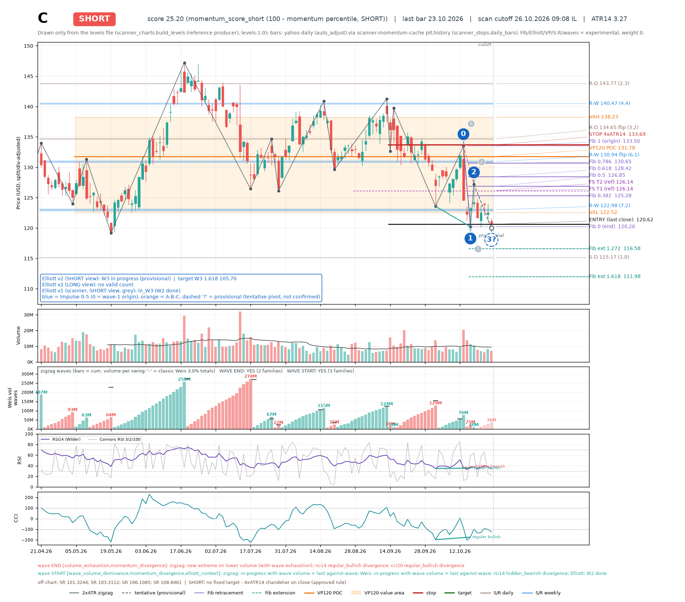

- **Jev (typesafe/jev-1.13):** 10 כותרות · 0 בביטחון ≥0.8 (סומכים על Jev) · 6 הועברו ל-Claude לשיפוט (ביטחון נמוך או חשד למניפולציה; 0 חשודות, 2 הודעות חברה) · סנטימנט — · קטליזטור — · הסכמה עם Claude 5/6
- **Grok (grok-4.3, חיפוש X של Grok):** ⛔ וטו · סנטימנט ‎+1 · ביטחון low · 1 פוסטים · חדשות חיוביות על הרחבת פעילות בסין · חשבונות מאומתים: @mconomicsX
- **Perplexity (perplexity/sonar-pro):** ✅ אישור · הדוחות האחרונים כבר מאחור, לא זוהה אירוע בינארי מאומת בקרוב, ואין במידע שנאסף סיבה מהותית להטיל וטו על השורט. · קטליזטור: weak
  - החברה פרסמה תוצאות רבעון שלישי ב-13 באוקטובר, עם רווח למניה של 2.85 דולר מעל הקונצנזוס. לא נמצא אירוע חברה ספציפי מאומת ב-30 הימים הקרובים; תאריך הרווחים הבא מופיע כהערכה בלבד. · דוח הבא: — · דגלים: קיצוצי יעדי מחיר מרוכזים לאחר הדוחות עשויים לשקף זהירות לגבי הביצוע האסטרטגי. / קיימת אי-ודאות לגבי מועד הדוחות הבא, והמקור שמציין 14 בינואר 2027 מגדיר אותו כהערכה בלבד. / לא נמצא במידע שנאסף דגל אדום מאומת בתחום החשבונאות, הליטיגציה, הדילול, החוב או הרגולציה.
- **Claude, אנליסט (anthropic/claude-sonnet-4.5):** ביטחון **58/100** · תומך · סיכון: היעדר קטליסט שלילי והמרחק הגדול לסטופ (10.8%)
  - תזה: הטכני תומך בשורט: מגמה ירידה ברורה, מומנטום חלש, ספירה אליוטית בתחילת גל 3 ירידה, ונפח דומיננטי בכיוון הירידה. עם זאת, אין קטליסט שלילי מזוהה, והורדות יעדי מחיר של אנליסטים כבר מתומחרות. · טכני (מהגרף): המניה נמצאת בירידה חדה מתחת לכל הממוצעים (SMA20/50/200), עם RSI נמוך (34.9) ו-CCI שלילי עמוק (-125.1). הספירה האליוטית מציעה תחילת גל 3 ירידה עם יעד 105.70, והמחיר נמצא מתחת ל-VA של VP120, מה שתומך בהמשך לחץ מכירה.
- **GPT, פרקליט השטן (openai/gpt-5.6-sol):** ⚠️ דגל · הסיכון הגדול: היפוך שורי לאחר מיצוי וסטיות חיוביות · המגמה יורדת, אך תזמון השורט פגיע לתיקון בהיעדר קטליסט שלילי ובנוכחות אותות היפוך.
  - נגד התזה של Claude: החולשה המרכזית היא הסתמכות על גל 3 זמני למרות אותות מובהקים לסיום גל ותיקון נגדי.
- **האם הגרף נראה נכון? (ניסיוני):** Grok: n/a · Perplexity: no: הספירה, עוגן פיבונאצ'י ורמות התמיכה/התנגדות נראים סבירים ביחס לפיבוטים ולמבנה הירידה המוצג. · Claude: no: הספירה האליוטית והעיגון הפיבונאצ'י נראים סבירים; השיא ב-133.5 והשפל ב-120.2 מזוהים נכון על הגרף · GPT: yes: סימון גל 3 עדיין זמני ואינו משכנע מול השפל החוזר, הסטיות השוריות ואותות מיצוי הגל. · קלט: grok=txt pplx=img claude=img gpt=img
- **אתגור הדדי:** Claude 58 (supports) מול GPT flag: מעורב

### 24. COST – לונג · דירוג 24.3
- **רמות (קובץ הרמות, נר אחרון 2026-10-23, hash fa03979ce73fd833):** כניסה 1,003.32 · סטופ 938.68 (chandelier_close 4.0xATR14, ATR14=16.16) · יעד: 1,004.60 – חצי ב-Fib 1.618 (סגירה), השאר בשנדלייר 4xATR
- **טכני:** SMA20 958.15 · SMA50 938.86 · SMA200 967.64 · מומנטום 12-1 ‎-0.045 · RSI14 69.2 · CCI20 116
- **ניסיוני (משקל 0):** אליוט v2: no valid count · אליוט v1: no valid count · פיבו v2 840.35→988.64 (1.618=1,080.28) · VP120 POC 948.71 (VAH 980.46, VAL 900.03) · תמיכה 982.98 · התנגדות 1,012.01 · סוף גל: 1 משפחות (wave_volume_dominance) · תחילת גל: 2 (wave_volume_dominance,momentum_divergence)
- **דוח:** מותר - דוח בעוד 33 ימי מסחר · מקורות: 2026-12-10 (Yahoo calendar)
- **סוויפ נזילות (ייחוס בלבד, משקל 0):** לא · **עבר בדיקה, שביר, משקל 0**

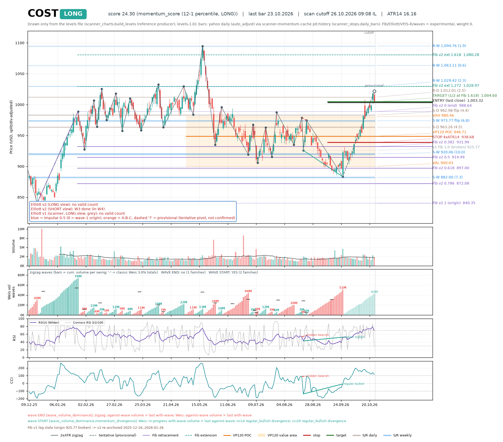

- **Jev (typesafe/jev-1.13):** 13 כותרות · 0 בביטחון ≥0.8 (סומכים על Jev) · 5 הועברו ל-Claude לשיפוט (ביטחון נמוך או חשד למניפולציה; 0 חשודות, 6 הודעות חברה) · סנטימנט — · קטליזטור — · הסכמה עם Claude 4/5
- **Grok (grok-4.3, חיפוש X של Grok):** ✅ אישור · סנטימנט ‎+1 · ביטחון high · 8 פוסטים · סנטימנט X חיובי ומחזק LONG ללא התנגדות · חשבונות מאומתים: @qualityequities, @optimumtennis1, @IntrinsicBrief
- **Perplexity (perplexity/sonar-pro):** ⚠️ דגל · האירוע הקרוב של פרסום מכירות ב-2026-11-04 נמצא בתוך אופק ההחזקה, והתוצאות הבאות צפויות ב-2026-12-10 לפי הערכה שאינה מאושרת רשמית. · קטליזטור: moderate (2026-11-04 https://investor.costco.com/events-and-presentations/default.aspx)
  - מכירות ספטמבר פורסמו ב-2026-10-07 והציגו מכירות נטו של 30.02 מיליארד דולר, עלייה של 13.0%, אך זהו אירוע שכבר חלף. במהלך 30 הימים הקרובים לא נמצא מקור לאירוע חברה בינארי מאושר; פרסום תוצאות אוקטובר מתוזמן ל-2026-11-04. · דוח הבא: 2026-12-10 (לא מאושר) · דגלים: תוצאות הרבעון הרביעי הצביעו על צמיחת חברות מועדון שנחלשה, והטבה חד-פעמית השפיעה על ההשוואה ב-EPS. / הערכת הרווח הבאה מבוססת על צפי שוק ולא על מועד דיווח רשמי שאושר על ידי החברה. / גורמי סיכון שהחברה מציינת כוללים אינפלציה, תחרות ורגולציה, תנודות מטבע, הוצאות צרכנים ואירועי אבטחת מידע.
- **Claude, אנליסט (anthropic/claude-sonnet-4.5):** ביטחון **15/100** · מתנגד · סיכון: יחס סיכון-תשואה קיצוני (64 דולר סיכון ל-1.28 דולר רווח ראשוני)
  - תזה: הסטאפ נמצא בלבד 6.4% מתחת לכניסה (938.68 מול 1003.32) והיעד הראשון ב-1004.60 מציע יחס סיכון-תשואה גרוע מאוד (כמעט 1:50). המומנטום חלש, המניה בקניית יתר, ואין קטליסט קרוב. · טכני (מהגרף): המניה עלתה 9% ב-15 ימים האחרונים אך מציגה מומנטום חלש (ציון 24.3, מומנטום 12-1 שלילי). RSI 69.2 ו-CCI 115.69 מצביעים על קניית יתר לטווח קצר, והכניסה ב-1003.32 נמצאת מעל ה-VAH של 980.46 ומעל כל הממוצעים הנעים.
- **GPT, פרקליט השטן (openai/gpt-5.6-sol):** ⛔ וטו · הסיכון הגדול: אסימטריית סיכון־תגמול קיצונית לאחר מהלך חד · המומנטום הבינוני חלש, המחיר מורחב והתגמול הראשון זניח ביחס לסיכון ללא קטליזטור מאומת.
  - נגד התזה של Claude: החולשה בתזה היא שכינתה RSI של 69.2 קניית יתר אף שהוא נמוך מ־70, והתעלמה מכך שרק מחצית נסגרת ביעד הראשון.
- **האם הגרף נראה נכון? (ניסיוני):** Grok: no: null · Perplexity: yes: התרשים עצמו מציין שאין ספירת Elliott תקפה בגרסה הראשית ובגרסת הייחוס, ולכן אין בסיס לאשר את הספירה; עוגן הפיבוט ורמות התמיכה וההתנגדות נראים סבירים אך לא מאומתים. · Claude: n/a: אין ספירת אליוט תקפה מוצגת (no valid count) · GPT: no: אין ספירת Elliott תקפה, ועיגון Fib v2 ורמות התמיכה וההתנגדות נראים עקביים עם הצירים המצוירים. · קלט: grok=img pplx=img claude=img gpt=img
- **אתגור הדדי:** Claude 15 (opposes) מול GPT veto: הסכמה שלילית: Claude חלש, GPT וטו

### 25. DIS – לונג · דירוג 23.4
- **רמות (קובץ הרמות, נר אחרון 2026-10-23, hash 0b8c2bf8541296c4):** כניסה 112.52 · סטופ 104.47 (chandelier_close 4.0xATR14, ATR14=2.0129) · יעד: 113.39 – חצי ב-Fib 1.618 (סגירה), השאר בשנדלייר 4xATR
- **טכני:** SMA20 107.65 · SMA50 106.90 · SMA200 103.08 · מומנטום 12-1 ‎-0.053 · RSI14 66.5 · CCI20 109
- **ניסיוני (משקל 0):** אליוט v2: W4 correction zigzag: C done -> W5 may start · אליוט v1: no valid count · פיבו v2 94.46→111.87 (1.618=122.63) · VP120 POC 103.56 (VAH 108.37, VAL 97.92) · תמיכה 111.27 · התנגדות 114.71 · סוף גל: 1 משפחות (wave_volume_dominance) · תחילת גל: 2 (volume_exhaustion,wave_volume_dominance)
- **דוח:** מותר - דוח בעוד 17 ימי מסחר · מקורות: 2026-11-17 (Yahoo calendar); 2026-11-17 (Perplexity (מאושר, עם מקורות))
- **סוויפ נזילות (ייחוס בלבד, משקל 0):** לא · **עבר בדיקה, שביר, משקל 0**

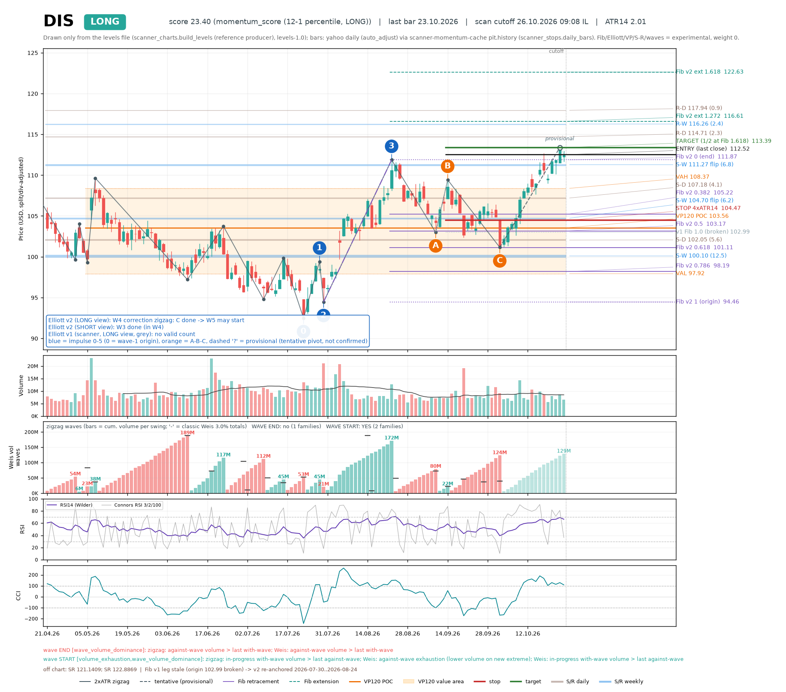

- **Jev (typesafe/jev-1.13):** 12 כותרות · 0 בביטחון ≥0.8 (סומכים על Jev) · 8 הועברו ל-Claude לשיפוט (ביטחון נמוך או חשד למניפולציה; 0 חשודות, 1 הודעות חברה) · סנטימנט — · קטליזטור — · הסכמה עם Claude 5/8
- **Grok (grok-4.3, חיפוש X של Grok):** ✅ אישור · סנטימנט ‎+1 · ביטחון medium · 5 פוסטים · אין חדשות שליליות ב-X נגד ה-LONG · חשבונות מאומתים: @MarketMovesMatt, @optimumtennis1, @accrued_int
- **Perplexity (perplexity/sonar-pro):** ⚠️ דגל · הדוח ב-17 בנובמבר נמצא בתוך אופק ההחזקה הקרוב ומהווה אירוע בינארי משמעותי, ולכן העסקה מסומנת. · קטליזטור: strong (2026-11-17 https://investors.thewaltdisneycompany.com/news/news-details/2026/The-Walt-Disney-Company-Executives-to-Discuss-Fiscal-Full-Year-and-Fourth-Quarter-2026-Financial-Results-via-Webcast/default.aspx)
  - הדוח לרבעון הרביעי ולשנת הכספים 2026 צפוי ב-17 בנובמבר, והוא אירוע בינארי משמעותי לטווח ההחזקה. ב-26 באוקטובר דיסני+ משדרת משחק NFL חי, וב-30 הימים הקרובים צפויים גם עדכונים לקראת הדוח ולתחזית שנת הכספים 2027. · דוח הבא: 2026-11-17 · דגלים: הדוח הקרוב עלול לחשוף פער מול תחזית רווח תפעולי של 4.9 מיליארד דולר ברבעון הרביעי ותחזית הצמיחה הדו-ספרתית לשנת 2027. / הכנסות הרבעון האחרון היו מעט מתחת לקונצנזוס, והחולשה בפארקים באסיה ובסין הוזכרה כסיכון. / קיימת מחלוקת בין האנליסטים: לצד העלאות יעדים, Arete הורידה את היעד ל-86 דולר ו-Raymond James הורידה ל-119 דולר.
- **Claude, אנליסט (anthropic/claude-sonnet-4.5):** ביטחון **45/100** · ניטרלי · סיכון: דוח רבעוני ב-17 בנובמבר עם פער פוטנציאלי מול תחזיות ומחלוקת אנליסטים
  - תזה: התזה התומכת: המניה פרצה מעל אזור ערך והשלימה תיקון אליוטי, עם תמיכה שבועית ב-111.27 ויעד קרוב ב-113.39 (Fib 1.618). התזה המתנגדת: המומנטום חלש (ציון 23.4, מומנטום 12-1 שלילי), הנרות מראים היסוס, היעד קרוב מאוד (0.8% בלבד), והדוח הקרוב מהווה סיכון בינארי עם תחזיות סותרות. · טכני (מהגרף): המניה סיימה בסגירה של 112.52 דולר, מעל כל הממוצעים הנעים (SMA20: 107.65, SMA50: 106.90, SMA200: 103.08) לאחר עלייה של 10.1% ב-15 ימים. הגרף מראה תיקון זיגזג שהושלם (גל C) עם פריצה מעל אזור ה-POC (103.56) וה-VAH (108.37), אך הנרות האחרונים מראים היסוס (harami bearish, spinning top, inside bar) ו-RSI14 ב-66.49 מצביע על קניית יתר קלה.
- **GPT, פרקליט השטן (openai/gpt-5.6-sol):** ⛔ וטו · הסיכון הגדול: תוחלת שלילית עקב יעד קרוב מול סיכון גדול · המומנטום החלש, סימני ההיסוס ותוחלת המחיר הבלתי־אטרקטיבית סותרים עסקת LONG משכנעת.
  - נגד התזה של Claude: החולשה המרכזית היא ההסתמכות על השלמת גל C ופריצת ערך אף שספירת אליוט אינה מאומתת והפיבונאצ'י שמגדיר את היעד מיושן.
- **האם הגרף נראה נכון? (ניסיוני):** Grok: n/a: אין דיון על ספירת אליוט או פיב ב-X · Perplexity: no: הספירה, עוגן פיבונאצ'י ורמות התמיכה/התנגדות נראים סבירים על הגרף, אף שהשיא האחרון מסומן כפרוביזורי. · Claude: no: ספירת האליוט v2 (תיקון זיגזג ABC שהושלם) נראית סבירה על הגרף, עם גל C שהסתיים ב-101 דולר והתחלת גל 5 פוטנציאלי · GPT: yes: גל 5 עדיין מסומן כזמני, ספירת v1 אינה תקפה, והיעד נלקח מעוגן פיבונאצ'י מיושן במקום מהעוגן המחודש. · קלט: grok=img pplx=img claude=img gpt=img
- **אתגור הדדי:** Claude 45 (neutral) מול GPT veto: מעורב

### 26. CRM – לונג · דירוג 20.6
- **רמות (קובץ הרמות, נר אחרון 2026-10-23, hash aefc07c3058646a6):** כניסה 248.57 · סטופ 213.46 (chandelier_close 4.0xATR14, ATR14=8.7787) · יעד: 250.74 – חצי ב-Fib 1.618 (סגירה), השאר בשנדלייר 4xATR
- **טכני:** SMA20 235.53 · SMA50 234.80 · SMA200 197.95 · מומנטום 12-1 ‎-0.064 · RSI14 60.8 · CCI20 119
- **ניסיוני (משקל 0):** אליוט v2: no valid count · אליוט v1: no valid count · פיבו v2 154.88→267.80 (1.618=337.58) · VP120 POC 164.32 (VAH 226.41, VAL 146.06) · תמיכה 231.86 · התנגדות 250.41 · סוף גל: 1 משפחות (wave_volume_dominance) · תחילת גל: 3 (volume_exhaustion,wave_volume_dominance,momentum_divergence)
- **דוח:** מותר - דוח בעוד 27 ימי מסחר · מקורות: 2026-12-02 (Yahoo calendar); 2026-12-02 (Perplexity (מאושר, עם מקורות))
- **סוויפ נזילות (ייחוס בלבד, משקל 0):** לא · **עבר בדיקה, שביר, משקל 0**

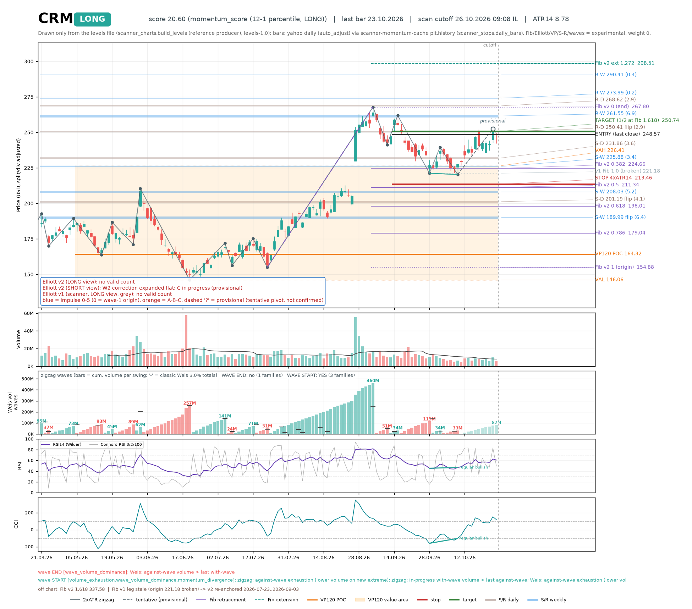

- **Jev (typesafe/jev-1.13):** 15 כותרות · 0 בביטחון ≥0.8 (סומכים על Jev) · 8 הועברו ל-Claude לשיפוט (ביטחון נמוך או חשד למניפולציה; 0 חשודות, 1 הודעות חברה) · סנטימנט — · קטליזטור — · הסכמה עם Claude 7/8
- **Grok (grok-4.3, חיפוש X של Grok):** ✅ אישור · סנטימנט ‎+1 · ביטחון medium · 8 פוסטים · אין חדשות שליליות או סנטימנט דובי חזק ב-X · חשבונות מאומתים: @KOCtrades, @enrichtrades
- **Perplexity (perplexity/sonar-pro):** ⚠️ דגל · הדוח הבא צפוי ב־2 בדצמבר, בתוך אופק ההחזקה הקצר, ולכן יש אירוע בינארי קרוב למרות שדרוגי האנליסטים והעלאת התחזית. · קטליזטור: moderate (2026-10-12 https://markets.businessinsider.com/news/stocks/salesforce-upgraded-to-buy-from-underperform-at-bofa-1036617387)
  - ב-12 באוקטובר Bank of America שדרג את CRM מ־Underperform ל־Buy והעלה את יעד המחיר מ־160 ל־285 דולר, על רקע התחזקות השקפתו לגבי אסטרטגיית ה-AI של Salesforce. החברה העלתה קודם לכן את תחזית ההכנסות השנתית בכ־300 מיליון דולר, והדוח הבא צפוי ב־2 בדצמבר, בתוך אופק ההחזקה.[1][2][3] · דוח הבא: 2026-12-02 · דגלים: דוח הרווחים הבא צפוי ב־2 בדצמבר, בתוך כ־15 ימי המסחר הקרובים, ולכן קיימת חשיפה לאירוע בינארי קרוב.[4] / הצמיחה עדיין תלויה בהוכחה שמוצרי ה-AI וה-Agentforce מייצרים האצה מתמשכת בהכנסות; הדוח הבא צפוי לבחון זאת.[5] / המקורות שנבדקו לא הצביעו על ליטיגציה, בעיית חשבונאות, דילול חריג, חוב או סיכון רגולטורי מהותי חדש בתקופה האחרונה.
- **Claude, אנליסט (anthropic/claude-sonnet-4.5):** ביטחון **35/100** · ניטרלי · סיכון: יחס סיכון-תגמול גרוע (1:15) ומומנטום חלש בכניסה
  - תזה: המניה נמצאת בטרנד עליה ארוך טווח עם תמיכת אנליסטים חזקה, אך הכניסה כאן סובלת ממומנטום חלש מאוד (ציון 20.6), יחס R:R גרוע ליעד הראשון וקרבה לדוח רווחים בינארי. הסטופ ב-213.45 (35 דולר מתחת) גדול מדי ביחס ליעד הראשון של 2.17 דולר בלבד. · טכני (מהגרף): המניה סגרה ב-248.57 מעל כל הממוצעים הנעים (SMA20/50/200), אך המומנטום חלש (ציון 20.6, momentum_12_1 שלילי -0.064) והנר האחרון הראה harami דובי ודוג'י. הכניסה ב-248.57 קרובה מאוד למחיר הסגירה האחרון, והיעד הראשון ב-250.74 (Fib 1.618 מהספירה הישנה) נותן יחס סיכון-תגמול גרוע מאוד (R:R כ-1:15 בלבד עד היעד הראשון).
- **GPT, פרקליט השטן (openai/gpt-5.6-sol):** ⛔ וטו · הסיכון הגדול: אפסייד זעום ליעד הראשון מול סיכון ירידה גדול · המומנטום החלש, ההתנגדות הצמודה והיעד הראשון המבוסס על Fib מיושן סותרים כניסת לונג איכותית.
  - נגד התזה של Claude: חולשת התזה היא אי־יישוב הסתירה בין 27 ימי מסחר לדוח לבין הטענה לכ־15 ימים.
- **האם הגרף נראה נכון? (ניסיוני):** Grok: no: הספירה והעוגנים תואמים למגמה העולה · Perplexity: yes: הספירה הראשית מסומנת provisional וללא ספירת Elliott תקפה, ולכן איני מאשר את הספירה, עוגן הפיבוט ורמות התמיכה/התנגדות כוודאיים. · Claude: n/a: אין ספירת אליוט תקפה מסומנת (no valid count), ולכן אין על מה לחלוק · GPT: yes: ההתנגדות נראית סבירה, אך יעד Fib הישן אינו משכנע לאחר שהעוגן סומן מיושן והספירה אינה תקפה. · קלט: grok=img pplx=img claude=img gpt=img
- **אתגור הדדי:** Claude 35 (neutral) מול GPT veto: הסכמה שלילית: Claude חלש, GPT וטו

### 27. SHOP – לונג · דירוג 16.8
- **רמות (קובץ הרמות, נר אחרון 2026-10-23, hash 17dd248762a7b619):** כניסה 168.68 · סטופ 138.67 (chandelier_close 4.0xATR14, ATR14=7.5019) · יעד: 208.31 – חצי ב-Fib 1.618 (סגירה), השאר בשנדלייר 4xATR
- **טכני:** SMA20 164.96 · SMA50 151.11 · SMA200 129.88 · מומנטום 12-1 ‎-0.104 · RSI14 57.6 · CCI20 27
- **ניסיוני (משקל 0):** אליוט v2: W4 correction flat: B in progress (provisional) · אליוט v1: in_W5 (W4 done) · פיבו v2 136.49→180.88 (1.618=208.31) · VP120 POC 108.77 (VAH 146.13, VAL 94.00) · תמיכה 157.68 · התנגדות 171.36 · סוף גל: 2 משפחות (volume_exhaustion,wave_volume_dominance) · תחילת גל: 1 (wave_volume_dominance)
- **דוח:** מותר - דוח בעוד 7 ימי מסחר · מקורות: 2026-11-03 (Yahoo calendar); 2026-11-03 (Perplexity (מאושר, עם מקורות))
- **סוויפ נזילות (ייחוס בלבד, משקל 0):** לא · **עבר בדיקה, שביר, משקל 0**

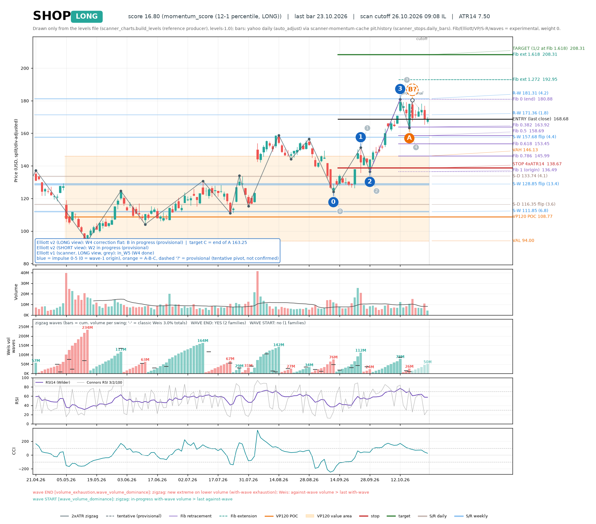

- **Jev (typesafe/jev-1.13):** 10 כותרות · 0 בביטחון ≥0.8 (סומכים על Jev) · 8 הועברו ל-Claude לשיפוט (ביטחון נמוך או חשד למניפולציה; 0 חשודות, 5 הודעות חברה) · סנטימנט — · קטליזטור — · הסכמה עם Claude 6/8
- **Grok (grok-4.3, חיפוש X של Grok):** ✅ אישור · סנטימנט ‎+1 · ביטחון medium · 5 פוסטים · סנטימנט חיובי ללא חדשות שליליות · חשבונות מאומתים: @SRxTrades, @investingluc, @Venu_7_
- **Perplexity (perplexity/sonar-pro):** ⚠️ דגל · הדוחות מתפרסמים בתוך כ־15 ימי מסחר ולכן קיימת חשיפה לאירוע בינארי קרוב, למרות מומנטום חיובי והעלאות יעדי מחיר. · קטליזטור: strong (2026-11-03 https://www.shopify.com/news/shopify-q3-2026-financial-advisory)
  - החברה צפויה לפרסם את תוצאות הרבעון השלישי לפני פתיחת המסחר ב־3 בנובמבר 2026, ולכן האירוע נמצא בטווח ההחזקה הקרוב. ב־14 הימים האחרונים פורסמו העלאות יעד מחיר מצד כמה אנליסטים, על רקע ציפיות לצמיחת הכנסות דו־ספרתית גבוהה ולשיפור ב־GMV ובהנחיות לרבעון הרביעי. · דוח הבא: 2026-11-03 · דגלים: פרסום הדוחות בעוד כשבוע יוצר סיכון בינארי משמעותי לפוזיציית LONG קצרה. / העלאות היעדים נשענות בחלקן על ציפיות שהחברה תכה את תחזיות הרבעון השלישי ותשפר את הנחיות הרבעון הרביעי; אכזבה עלולה לגרום לתגובה חדה. / המקורות שנבדקו לא מצביעים על ליטיגציה, חוב, דילול, בעיית חשבונאות או פעולה רגולטורית מהותית בתקופה האחרונה.
- **Claude, אנליסט (anthropic/claude-sonnet-4.5):** ביטחון **45/100** · ניטרלי · סיכון: דוח רבעוני בעוד 7 ימים עם פוטנציאל לאכזבה מול ציפיות גבוהות
  - תזה: הסטאפ מהמר על המשך העלייה לקראת דוח רבעוני, נתמך בהעלאות יעד אנליסטים ובמבנה טכני מעל ממוצעים. עם זאת, המומנטום חלש, הערכת השווי גבוהה מאוד, והדוח בעוד שבוע יוצר סיכון בינארי משמעותי לפוזיציה זו. · טכני (מהגרף): המניה נסגרה ב-168.68 דולר, מעל כל הממוצעים הנעים (SMA20/50/200), אך המומנטום חלש (ציון 16.8, תשואה 12-חודשים שלילית -0.1%). הגרף מראה תיקון פנימי (inside bar) לאחר עלייה חדה, עם RSI ניטרלי (57.6) ואותות תשישות נפח בקצה הגל האחרון.
- **GPT, פרקליט השטן (openai/gpt-5.6-sol):** ⚠️ דגל · הסיכון הגדול: אכזבה בדוח מול ציפיות גבוהות בעוד 7 ימי מסחר · המגמה מעל הממוצעים חיובית, אך תשישות, התנגדות קרובה ודוח בינארי הופכים את יחס הוודאות לחלש.
  - נגד התזה של Claude: התזה נשענת מדי על העלאות יעדי מחיר שאינן מוכיחות אפסייד ליעד 208.313 ועלולות כבר להיות מגולמות.
- **האם הגרף נראה נכון? (ניסיוני):** Grok: no: ספירה אליוט ורמות פיב נראות תקינות · Perplexity: no: הספירה, עוגן הפיבונאצ׳י ורמות התמיכה וההתנגדות נראים סבירים ביחס למבנה העלייה והנסיגה האחרונות, אף שהספירה כוללת רכיב B זמני. · Claude: no: ספירת האליוט (תיקון W4 שטוח, גל B זמני) והעיגון הפיבונאצ'י (136.49-180.88) נראים סבירים על הגרף; רמות S/R תואמות את המבנה. · GPT: yes: ספירת W4-B זמנית ומתחרה בספירת W5, ולכן אינה בסיס אמין להמשך ישיר ליעד ההרחבה. · קלט: grok=img pplx=img claude=img gpt=img
- **אתגור הדדי:** Claude 45 (neutral) מול GPT flag: מעורב

### 28. ISRG – לונג · דירוג 8.4
- **רמות (קובץ הרמות, נר אחרון 2026-10-23, hash e0c0b8ff89a438ee):** כניסה 452.29 · סטופ 399.39 (chandelier_close 4.0xATR14, ATR14=13.22) · יעד: 472.10 – חצי ב-Fib 1.618 (סגירה), השאר בשנדלייר 4xATR
- **טכני:** SMA20 420.59 · SMA50 396.06 · SMA200 436.21 · מומנטום 12-1 ‎-0.242 · RSI14 70.8 · CCI20 190
- **ניסיוני (משקל 0):** אליוט v2: W3 in progress (provisional) · אליוט v1: in_W3 (W2 done) · פיבו v2 389.11→440.40 (1.618=472.10) · VP120 POC 402.18 (VAH 443.66, VAL 371.40) · תמיכה 447.82 · התנגדות 462.87 · סוף גל: 1 משפחות (volume_exhaustion) · תחילת גל: 3 (wave_volume_dominance,momentum_divergence,elliott_context)
- **דוח:** מותר - דוח בעוד 60 ימי מסחר · מקורות: 2027-01-21 (Yahoo calendar); 2027-01-21 (Perplexity (מאושר, עם מקורות))
- **סוויפ נזילות (ייחוס בלבד, משקל 0):** לא · **עבר בדיקה, שביר, משקל 0**

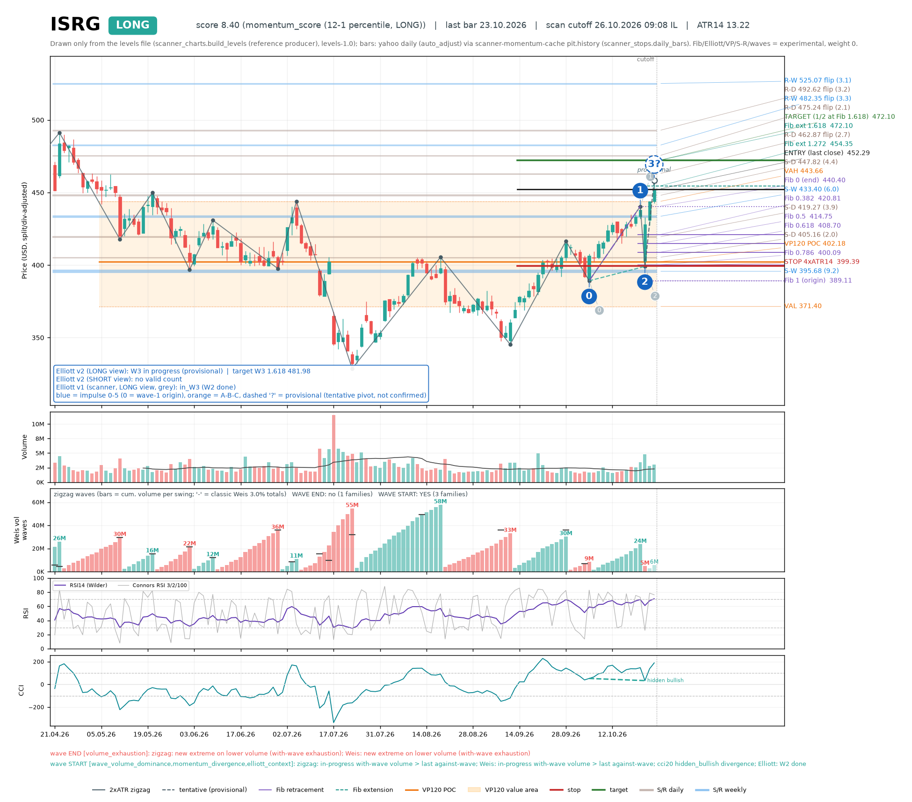

- **Jev (typesafe/jev-1.13):** 15 כותרות · 4 בביטחון ≥0.8 (סומכים על Jev) · 8 הועברו ל-Claude לשיפוט (ביטחון נמוך או חשד למניפולציה; 0 חשודות, 0 הודעות חברה) · סנטימנט ניטרלי/מעורב (-0.07) · קטליזטור analyst · הסכמה עם Claude 6/8
- **Grok (grok-4.3, חיפוש X של Grok):** ✅ אישור · סנטימנט ‎+2 · ביטחון medium · 3 פוסטים · סנטימנט חיובי חזק ללא חדשות שליליות · חשבונות מאומתים: @Venu_7_, @investlust_com
- **Perplexity (perplexity/sonar-pro):** ⚠️ דגל · הדוחות והסדר המשפטי פורסמו זה עתה, והדוח הבא הצפוי ב-21 בינואר 2027 אינו קרוב מספיק לבדו אך קיימת אי-ודאות מהותית סביב ההסדר והמחירים. · קטליזטור: moderate (2026-10-20 https://isrg.intuitive.com/news-releases/news-release-details/intuitive-announces-third-quarter-earnings-6)
  - החברה פרסמה ב-20 באוקטובר 2026 תוצאות רבעון שלישי עם הכנסות של 3.05 מיליארד דולר, עלייה של 22%, ורווח מתואם למניה של 3.00 דולר. מנגד, הוכרז על הסדר antitrust בסך 450 מיליון דולר ועל הפחתות מתוכננות במחירי חלק מהמכשירים והאביזרים, מה שעלול להכביד על המניה בטווח הקרוב. · דוח הבא: 2027-01-21 · דגלים: הסדר antitrust בסך 450 מיליון דולר הפחית את הרווח הנקי ואת הרווח למניה ברבעון, והוא כפוף לאישור בית המשפט. / הרווח הנקי לפי GAAP ירד ל-523 מיליון דולר לעומת 704 מיליון דולר בשנה הקודמת. / החברה מתכננת הפחתות מחירים בחלק מהמכשירים והאביזרים, והתחזית מתונה יותר.
- **Claude, אנליסט (anthropic/claude-sonnet-4.5):** ביטחון **62/100** · תומך · סיכון: הפחתות מחירים מתוכננות עלולות ללחוץ על מרווחים ב-2027
  - תזה: הפריצה מעל 200 יום עם ספירת אליוט תומכת ויעדי אנליסטים של 500-550 דולר מצדיקים לונג. עם זאת, הקנייה המוגזמת הטכנית והחששות מהפחתות מחירים עלולים להגביל את הפוטנציאל בטווח הקרוב. · טכני (מהגרף): המניה פרצה מעל ממוצע 200 יום ונמצאת בגל 3 אליוטי פרובזיונלי עם יעד 481.98 דולר. RSI ב-70.84 ו-CCI ב-189.76 מצביעים על קנייה מוגזמת לטווח קצר, אך המומנטום חזק עם נפח תומך.
- **GPT, פרקליט השטן (openai/gpt-5.6-sol):** ⚠️ דגל · הסיכון הגדול: שחיקת מרווחים עקב הפחתות מחירים ב-2027 · הפריצה אפשרית, אך מיצוי טכני, התנגדויות קרובות וסיכונים יסודיים הופכים את הלונג לפגיע.
  - נגד התזה של Claude: התזה נשענת מדי על ספירת אליוט פרוביזורית ויעדי אנליסטים, ומתעלמת מאיכות יחס הסיכוי־סיכון ומהתנגדויות קרובות.
- **האם הגרף נראה נכון? (ניסיוני):** Grok: no: ספירת אליוט ו-Fib תואמות למגמה העליונה · Perplexity: no: הספירה, עוגן פיבונאצ׳י ורמות התמיכה וההתנגדות נראים סבירים ביחס למבנה המחיר המוצג. · Claude: no: ספירת אליוט נראית סבירה עם גל 2 שהסתיים ב-389 דולר וגל 3 בהתפתחות, עיגון פיבונאצ'י הגיוני · GPT: yes: ספירת גל 3 עדיין פרוביזורית ולא מאושרת, בעוד עוגן ה-Fib ורמות התמיכה וההתנגדות נראים סבירים. · קלט: grok=img pplx=img claude=img gpt=img
- **אתגור הדדי:** Claude 62 (supports) מול GPT flag: מעורב

### 29. AMAT – שורט · דירוג 4.7
- **רמות (קובץ הרמות, נר אחרון 2026-10-23, hash b6562af9e1612665):** כניסה 377.24 · סטופ 456.62 (chandelier_close 4.0xATR14, ATR14=19.84) · יעד: אין – ללא יעד קבוע - שנדלייר 4xATR14 על סגירה (כלל מאושר)
- **טכני:** SMA20 470.84 · SMA50 468.37 · SMA200 441.31 · מומנטום 12-1 1.162 · RSI14 26.1 · CCI20 ‎-126
- **ניסיוני (משקל 0):** אליוט v2: W2 correction expanded flat: C done -> W3 may start · אליוט v1: no valid count · פיבו v2 563.16→426.13 (1.618=341.45) · VP120 POC 427.71 (VAH 563.16, VAL 409.41) · תמיכה 336.84 · התנגדות 377.27 · סוף גל: 2 משפחות (volume_exhaustion,wave_volume_dominance) · תחילת גל: 1 (wave_volume_dominance)
- **דוח:** מותר - דוח בעוד 14 ימי מסחר · מקורות: 2026-11-12 (Yahoo calendar); 2026-11-12 (Perplexity (מאושר, עם מקורות))
- **סוויפ נזילות (ייחוס בלבד, משקל 0):** לא
- **ספירלת פיבו – יעדי ייחוס בלבד (משקל 0, לא משנה סטופ/יעד; השורט נשאר עם סטופ נגרר 4×ATR בלי יעד):** T1 — (—) · T2 — (—) · מצב: none

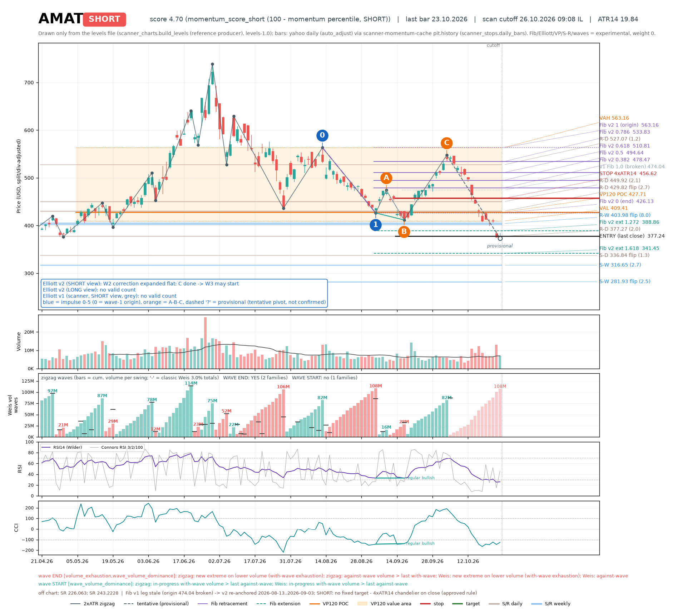

- **Jev (typesafe/jev-1.13):** 10 כותרות · 0 בביטחון ≥0.8 (סומכים על Jev) · 3 הועברו ל-Claude לשיפוט (ביטחון נמוך או חשד למניפולציה; 0 חשודות, 3 הודעות חברה) · סנטימנט — · קטליזטור — · הסכמה עם Claude 2/3
- **Grok (grok-4.3, חיפוש X של Grok):** ✅ אישור · סנטימנט ‎+0 · ביטחון low · 2 פוסטים · אין חדשות שליליות ב-X נגד השורט · חשבונות מאומתים: @Patel19901
- **Perplexity (perplexity/sonar-pro):** ⚠️ דגל · הדוחות המתוכננים ל-12 בנובמבר נמצאים בתוך חלון ההחזקה ומהווים אירוע בינארי קרוב, ולכן יש לסמן את השורט. · קטליזטור: strong (2026-11-12 https://ir.appliedmaterials.com/events)
  - הקטליזטור המרכזי הוא פרסום דוחות הרבעון ב-12 בנובמבר, בתוך חלון ההחזקה הצפוי, ולכן הוא עלול להגדיל תנודתיות. ב-13 באוקטובר נפתח מרכז EPIC של החברה, אירוע חיובי אסטרטגי אך אינו בהכרח קטליזטור מיידי למניה. · דוח הבא: 2026-11-12 · דגלים: פרסום הדוחות הקרוב הוא אירוע בינארי בתוך כ-15 ימי מסחר, ולכן הסיכון לשורט גבוה. / Needham הורידה את יעד המחיר מ-740 ל-580, מה שמעיד על היחלשות בתפיסת האפסייד של אנליסט מרכזי. / המניה נסחרת מתחת לממוצעים הנעים ל-50 ול-200 יום, בעוד שדווחו מגבלות אספקה וחולשה בסקטור ציוד השבבים.
- **Claude, אנליסט (anthropic/claude-sonnet-4.5):** ביטחון **25/100** · מתנגד · סיכון: דוח רבעוני בעוד 14 ימים עם פוטנציאל היפוך חד
  - תזה: השורט מתבסס על מומנטום שלילי קיצוני (ציון 95.3) ומיקום מתחת ל-VA, אך הטכני מראה סימני exhaustion ברמת RSI נמוכה מאוד, והדוח הקרוב יכול להפוך את הכיוון במהירות. הסיכון-תגמול לא אטרקטיבי כאן. · טכני (מהגרף): המניה בירידה חדה של 30% ב-15 ימים, נסחרת מתחת לכל הממוצעים הנעים (SMA20/50/200) ומתחת ל-VA של VP120. RSI בהיפר-סולד (26), נרות אחרונים מראים היסוס (inverted hammer, spinning top), וגלי הנפח מצביעים על exhaustion של הירידה.
- **GPT, פרקליט השטן (openai/gpt-5.6-sol):** ⛔ וטו · הסיכון הגדול: ריבאונד חד ממצב מכירות־יתר סביב הדוח · המומנטום השלילי קיצוני אך הכניסה מגיעה לאחר נפילה חדה ובנקודה שבה הראיות מצביעות על מיצוי וסיכון להיפוך.
  - נגד התזה של Claude: חולשת התזה היא שהדוח הבינארי מוצג כסיכון לשורט אף שהוא עשוי גם להאיץ את הירידה.
- **האם הגרף נראה נכון? (ניסיוני):** Grok: no: ספירת אליוט ורמות פיב/SR נראות תקינות · Perplexity: yes: הספירה הראשית עצמה מציינת שאין ספירה תקפה בגרסת v1 והפיבוט האחרון מסומן זמני, לכן איני מאשר את עוגני אליוט וה-S/R כוודאיים. · Claude: no: ספירת אליוט v2 (W2 expanded flat הושלמה) והעיגון של פיבונאצ'י נראים סבירים על הגרף · GPT: yes: ספירת תחילת W3 אינה משכנעת כל עוד השפל האחרון מסומן כזמני וסימני מיצוי הירידה בולטים. · קלט: grok=img pplx=img claude=img gpt=img
- **אתגור הדדי:** Claude 25 (opposes) מול GPT veto: הסכמה שלילית: Claude חלש, GPT וטו

### 30. LRCX – שורט · דירוג 3.7
- **🔴 חסר קרדיט - OpenRouter (GPT)**
- **רמות (קובץ הרמות, נר אחרון 2026-10-23, hash 508d87c3150e450b):** כניסה 230.10 · סטופ 290.21 (chandelier_close 4.0xATR14, ATR14=15.03) · יעד: אין – ללא יעד קבוע - שנדלייר 4xATR14 על סגירה (כלל מאושר)
- **טכני:** SMA20 299.94 · SMA50 302.22 · SMA200 283.02 · מומנטום 12-1 1.185 · RSI14 24.6 · CCI20 ‎-153
- **ניסיוני (משקל 0):** אליוט v2: no valid count · אליוט v1: no valid count · פיבו v2 369.56→250.23 (1.618=176.49) · VP120 POC 316.68 (VAH 344.36, VAL 267.72) · תמיכה 218.55 · התנגדות 254.20 · סוף גל: 2 משפחות (volume_exhaustion,wave_volume_dominance) · תחילת גל: 1 (wave_volume_dominance)
- **דוח:** מותר - דוח בעוד 64 ימי מסחר · מקורות: 2027-01-27 (Perplexity (מאושר, עם מקורות))
- **סוויפ נזילות (ייחוס בלבד, משקל 0):** לא
- **ספירלת פיבו – יעדי ייחוס בלבד (משקל 0, לא משנה סטופ/יעד; השורט נשאר עם סטופ נגרר 4×ATR בלי יעד):** T1 — (—) · T2 — (—) · מצב: broken_below_A

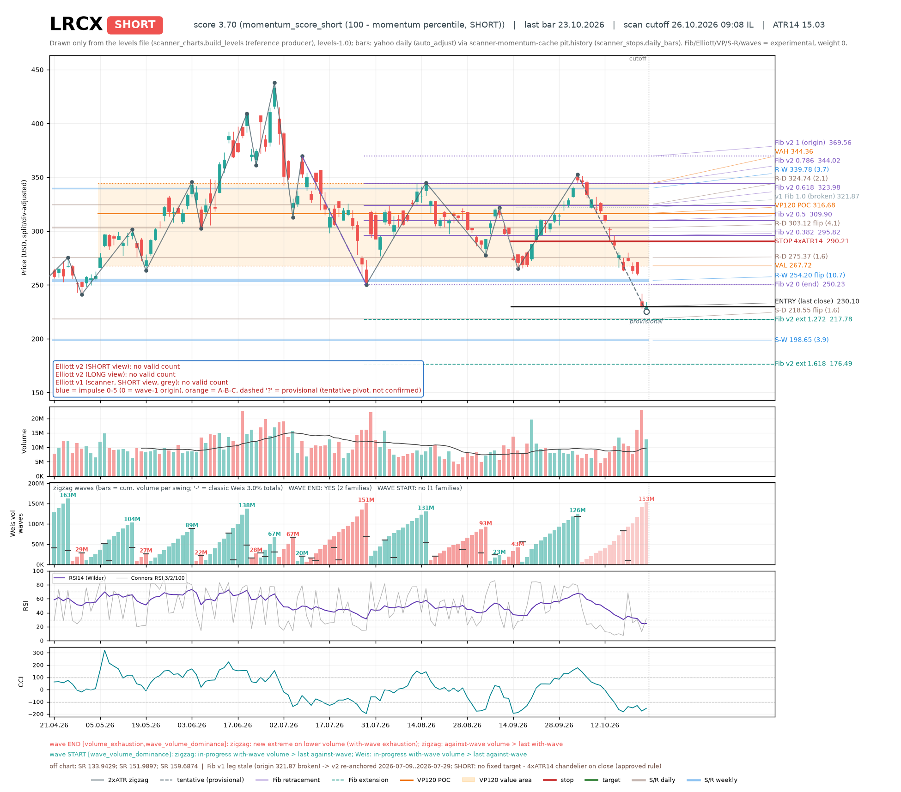

- **Jev (typesafe/jev-1.13):** 15 כותרות · 0 בביטחון ≥0.8 (סומכים על Jev) · 7 הועברו ל-Claude לשיפוט (ביטחון נמוך או חשד למניפולציה; 0 חשודות, 0 הודעות חברה) · סנטימנט — · קטליזטור — · הסכמה עם Claude 4/7
- **Grok (grok-4.3, חיפוש X של Grok):** ✅ אישור · סנטימנט ‎+0 · ביטחון low · 1 פוסטים · אין סנטימנט שלילי ברור ב-X נגד השורט · חשבונות מאומתים: @SRxTrades
- **Perplexity (perplexity/sonar-pro):** ⚠️ דגל · מועד הדוחות הבא אינו בתוך כ-15 ימי המסחר, אך ירידות יעדי המחיר וחששות האספקה יוצרים סיכון מהותי לשורט קצר. · קטליזטור: moderate (2026-10-21 https://www.marketbeat.com/instant-alerts/analyst-mizuho-has-lowered-expectations-for-lam-research-nasdaq-lrcx-stock-price-2026-10-22/)
  - החברה פרסמה תוצאות ב-21 באוקטובר 2026, עם הכנסות של 8.22 מיליארד דולר ו-EPS של 2.20 דולר, מעט מעל התחזיות. במהלך 30 הימים הקרובים לא זוהה אירוע חברה מתוארך נוסף, אך שינויי תחזיות האנליסטים לאחר הדוח עשויים להגביר תנודתיות. · דוח הבא: 2027-01-27 · דגלים: חששות מעיכובי אספקה, ירידה בהכנסות מסין והנחיה קדימה שנתפסה כחולשה יחסית. / מספר בתי השקעות הורידו יעדי מחיר לאחר הדוח, כולל Needham מ-390 ל-290 דולר ו-Morgan Stanley מ-385 ל-339 דולר. / דיווחים על מכירות מניות של insiders ועל סיכון להיחלשות הוצאות ציוד השבבים ב-2027.
- **Claude, אנליסט (anthropic/claude-sonnet-4.5):** ביטחון **45/100** · ניטרלי · סיכון: ריבאונד טכני חד מרמת oversold קיצונית
  - תזה: המומנטום השלילי חזק (ציון 96.3) והמניה מתחת ל-VA120, אך oversold קיצוני (RSI 24.56) מגביר סיכון לריבאונד טכני חד. הכניסה ב-230.10 עם סטופ ב-290.21 (60 נקודות, 26%) רחבה מאוד אך מתאימה ל-4xATR14; הסיכון הוא שהמניה כבר ספגה את מכת הדוח והאנליסטים עדיין bullish (Buy/Overweight). · טכני (מהגרף): המניה בירידה חדה של 33.8% ב-15 ימים, נסגרה על 230.10 מתחת לכל הממוצעים (SMA20: 299.94, SMA50: 302.22, SMA200: 283.02). RSI14 ב-24.56 וCCI ב-152.97- מצביעים על oversold קיצוני, אך הזיגזג מזהה תום גל עם volume exhaustion ודומיננטיות נפח.
- **GPT:** לא התקבל (חסר קרדיט - OpenRouter (GPT))
- **האם הגרף נראה נכון? (ניסיוני):** Grok: n/a: אין דיון ב-X על הספירה · Perplexity: no · Claude: n/a: אין ספירת אליוט תקפה מוצגת, הזיגזג והפיבונאצ'י נראים סבירים · קלט: grok=img pplx=img claude=img

### 31. BA – שורט · דירוג 80.4 · ⛔ נחסם (דוח)
- **🔴 חסר קרדיט - OpenRouter (GPT)**
- **רמות (קובץ הרמות, נר אחרון 2026-10-23, hash 88bc601212760ed2):** כניסה 188.35 · סטופ 208.59 (chandelier_close 4.0xATR14, ATR14=5.0599) · יעד: אין – ללא יעד קבוע - שנדלייר 4xATR14 על סגירה (כלל מאושר)
- **טכני:** SMA20 189.13 · SMA50 201.13 · SMA200 218.59 · מומנטום 12-1 ‎-0.091 · RSI14 42.4 · CCI20 ‎-90
- **ניסיוני (משקל 0):** אליוט v2: W3 in progress (provisional) · אליוט v1: in_W3 (W2 done) · פיבו v2 215.29→183.38 (1.618=163.66) · VP120 POC 217.55 (VAH 241.60, VAL 204.60) · תמיכה 187.65 · התנגדות 191.98 · סוף גל: 1 משפחות (momentum_divergence) · תחילת גל: 2 (momentum_divergence,elliott_context)
- **דוח:** נחסם - דוח בתוך 5 ימי מסחר · מקורות: 2026-10-27 (Yahoo calendar); 2026-10-27 (Perplexity (מאושר, עם מקורות))
- **סוויפ נזילות (ייחוס בלבד, משקל 0):** כן (לונג, רמה 183.38 pivot)
- **ספירלת פיבו – יעדי ייחוס בלבד (משקל 0, לא משנה סטופ/יעד; השורט נשאר עם סטופ נגרר 4×ATR בלי יעד):** T1 — (—) · T2 — (—) · מצב: none

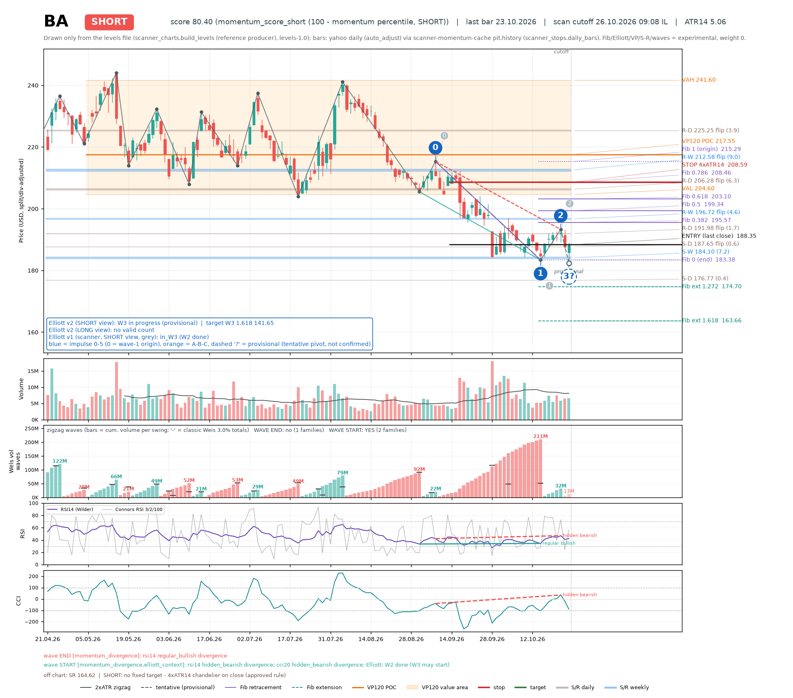

- **Jev (typesafe/jev-1.13):** 15 כותרות · 2 בביטחון ≥0.8 (סומכים על Jev) · 8 הועברו ל-Claude לשיפוט (ביטחון נמוך או חשד למניפולציה; 0 חשודות, 2 הודעות חברה) · סנטימנט חיובי (+1.00) · קטליזטור regulatory · הסכמה עם Claude 7/8
- **Grok (grok-4.3, חיפוש X של Grok):** ✅ אישור · סנטימנט ‎-1 · ביטחון medium · 10 פוסטים · חדשות שליליות על ייצור תומכות ב-SHORT · חשבונות מאומתים: —
- **Perplexity (perplexity/sonar-pro):** ⚠️ דגל · לשורט שנכנס כעת הדוח המתוכנן למחר הוא אירוע בינארי בתוך חלון המסחר הקרוב ולכן מצדיק דגל. · קטליזטור: strong (2026-10-27 https://investors.boeing.com/investors/news/press-release-details/2026/Boeing-to-Release-Third-Quarter-Results-on-October-27/default.aspx)
  - הדוח לרבעון השלישי ושיחת הוועידה מתוכננים ל-27 באוקטובר, ולכן מדובר באירוע בינארי מיידי. לאחרונה דווח על אישור FAA ל-737 MAX 10, הזמנות מטוסים וחוזי ביטחון, אך חלק מההזמנות כפופות לאישור. · דוח הבא: 2026-10-27 · דגלים: הדוח מתפרסם מחר, ולכן קיימת חשיפה גבוהה לתנודתיות ולפער מחיר במהלך תקופת ההחזקה. / אנליסטים הורידו יעדי מחיר וציינו אי-ודאות לגבי תזרים המזומנים, עיכובי הגדלת המסירות ותקציב הביטחון. / החברה דיווחה ברבעון הקודם על הפסד GAAP של 444 מיליון דולר; קיימת גם אי-ודאות סביב הזמנות וחוזים הכפופים לאישורים.
- **Claude, אנליסט (anthropic/claude-sonnet-4.5):** ביטחון **45/100** · ניטרלי · סיכון: דוח רווחים מחר עם פוטנציאל לפער חיובי מפתיע
  - תזה: המבנה הטכני תומך בשורט עם מומנטום חלש, מיקום מתחת לממוצעים ודיברגנציות דוביות, אך הדוח מחר יוצר סיכון בינארי משמעותי. אישור FAA ל-737 MAX 10 לאחרונה עשוי לספק תמיכה בלתי צפויה. · טכני (מהגרף): המניה נסחרת מתחת לכל הממוצעים (SMA20/50/200) עם מומנטום חלש (ציון 19.6) ומתחת ל-VA של VP120. התרשים מציג ספירת אליוט W3 פרובזיונלית עם יעד 141.65, דיברגנציה שורית רגילה ב-RSI אך גם דיברגנציה דובית נסתרת ב-RSI ו-CCI התומכת בהמשך ירידה.
- **GPT:** לא התקבל (חסר קרדיט - OpenRouter (GPT))
- **האם הגרף נראה נכון? (ניסיוני):** Grok: no: ספירת אליוט ורמות פיב תואמות את המגמה היורדת · Perplexity: no: הספירה, עוגן פיבונאצ'י ורמות התמיכה וההתנגדות נראים עקביים עם הירידה האחרונה והמבנה המוצג בגרף. · Claude: no: ספירת האליוט W3 פרובזיונלית נראית סבירה עם W2 שהושלם ליד 195, והפיבונאצ'י מעוגן נכון מהשיא 215.29 · קלט: grok=img pplx=img claude=img

### 32. LLY – לונג · דירוג 80.4 · ⛔ נחסם (דוח)
- **🔴 חסר קרדיט - OpenRouter (Claude) ; חסר קרדיט - OpenRouter (GPT)**
- **רמות (קובץ הרמות, נר אחרון 2026-10-23, hash 7223cb82bfb5e167):** כניסה 1,273.46 · סטופ 1,120.57 (chandelier_close 4.0xATR14, ATR14=38.22) · יעד: 1,319.84 – חצי ב-Fib 1.618 (סגירה), השאר בשנדלייר 4xATR
- **טכני:** SMA20 1,204.94 · SMA50 1,186.60 · SMA200 1,082.85 · מומנטום 12-1 0.464 · RSI14 62.2 · CCI20 108
- **ניסיוני (משקל 0):** אליוט v2: W2 correction zigzag: C done -> W3 may start · אליוט v1: no valid count · פיבו v2 1,113.29→1,215.00 (1.618=1,277.86) · VP120 POC 1,149.80 (VAH 1,237.41, VAL 1,100.28) · תמיכה 1,225.28 · התנגדות 1,292.65 · סוף גל: 1 משפחות (momentum_divergence) · תחילת גל: 3 (volume_exhaustion,wave_volume_dominance,momentum_divergence)
- **דוח:** נחסם - דוח בתוך 5 ימי מסחר · מקורות: 2026-10-29 (Yahoo calendar); 2026-10-29 (Perplexity (מאושר, עם מקורות))
- **סוויפ נזילות (ייחוס בלבד, משקל 0):** לא · **עבר בדיקה, שביר, משקל 0**

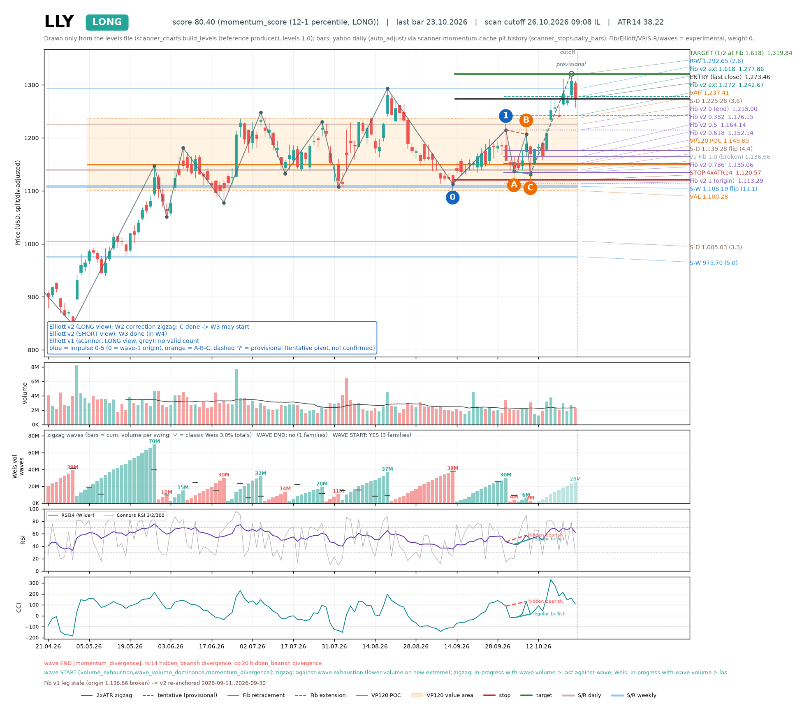

- **Jev (typesafe/jev-1.13):** 15 כותרות · 0 בביטחון ≥0.8 (סומכים על Jev) · 8 הועברו ל-Claude לשיפוט (ביטחון נמוך או חשד למניפולציה; 0 חשודות, 3 הודעות חברה) · סנטימנט — · קטליזטור —
- **Grok (grok-4.3, חיפוש X של Grok):** ✅ אישור · סנטימנט ‎+1 · ביטחון low · 7 פוסטים · חדשות חיוביות תומכות ב-LONG ללא התנגדות · חשבונות מאומתים: @55Markets
- **Perplexity (perplexity/sonar-pro):** ⚠️ דגל · הדוח ב־29 באוקטובר נמצא בתוך חלון הסיכון של כ־15 ימי מסחר, ולכן העסקה מסומנת למרות הקטליזטורים החיוביים. · קטליזטור: strong (2026-10-29 https://stockanalysis.com/stocks/lly/)
  - הדוח לרבעון השלישי צפוי ב־29 באוקטובר ומהווה קטליזטור בינארי קרוב. ב־14 הימים האחרונים נרשמו העלאות יעדי מחיר מצד אנליסטים, אך לא נמצא מקור לחדשות חברה ספציפיות נוספות ב־30 הימים הקרובים. · דוח הבא: 2026-10-29 · דגלים: הדוח מתפרסם בתוך כ־15 ימי מסחר, ולכן קיים סיכון בינארי משמעותי לעסקת LONG. / הערכת השווי גבוהה, לצד סיכוני תחרות, לחץ תמחורי וסיכונים משפטיים. / הגרף מציג סטייה דובית חבויה ב־RSI וב־CCI, המצביעה על חולשה אפשרית במומנטום.
- **Claude:** לא התקבל (חסר קרדיט - OpenRouter (Claude))
- **GPT:** לא התקבל (חסר קרדיט - OpenRouter (GPT))
- **האם הגרף נראה נכון? (ניסיוני):** Grok: no: ספירה אליוט ורמות Fib נראות תקינות · Perplexity: yes: ספירת Elliott הראשית והעוגן החדש של Fibonacci נראים סבירים, אך רמות התמיכה וההתנגדות הקרובות חופפות וצפופות מדי ולכן אינן חד־משמעיות. · קלט: grok=img pplx=img

### 33. KO – לונג · דירוג 68.2 · ⛔ נחסם (דוח)
- **🔴 חסר קרדיט - OpenRouter (Claude) ; חסר קרדיט - OpenRouter (GPT) ; חסר קרדיט - OpenRouter (Perplexity)**
- **רמות (קובץ הרמות, נר אחרון 2026-10-23, hash ae2f956b1d3de68c):** כניסה 92.71 · סטופ 86.42 (chandelier_close 4.0xATR14, ATR14=1.5723) · יעד: 94.57 – חצי ב-Fib 1.618 (סגירה), השאר בשנדלייר 4xATR
- **טכני:** SMA20 89.57 · SMA50 88.88 · SMA200 80.80 · מומנטום 12-1 0.277 · RSI14 60.0 · CCI20 88
- **ניסיוני (משקל 0):** אליוט v2: W2 correction zigzag: C done -> W3 may start · אליוט v1: no valid count · פיבו v2 84.65→91.94 (1.618=96.44) · VP120 POC 87.76 (VAH 91.86, VAL 80.16) · תמיכה 90.72 · התנגדות 94.10 · סוף גל: 1 משפחות (wave_volume_dominance) · תחילת גל: 0 (—)
- **דוח:** נחסם - דוח בתוך 5 ימי מסחר · מקורות: 2026-10-27 (Yahoo calendar)
- **סוויפ נזילות (ייחוס בלבד, משקל 0):** לא · **עבר בדיקה, שביר, משקל 0**

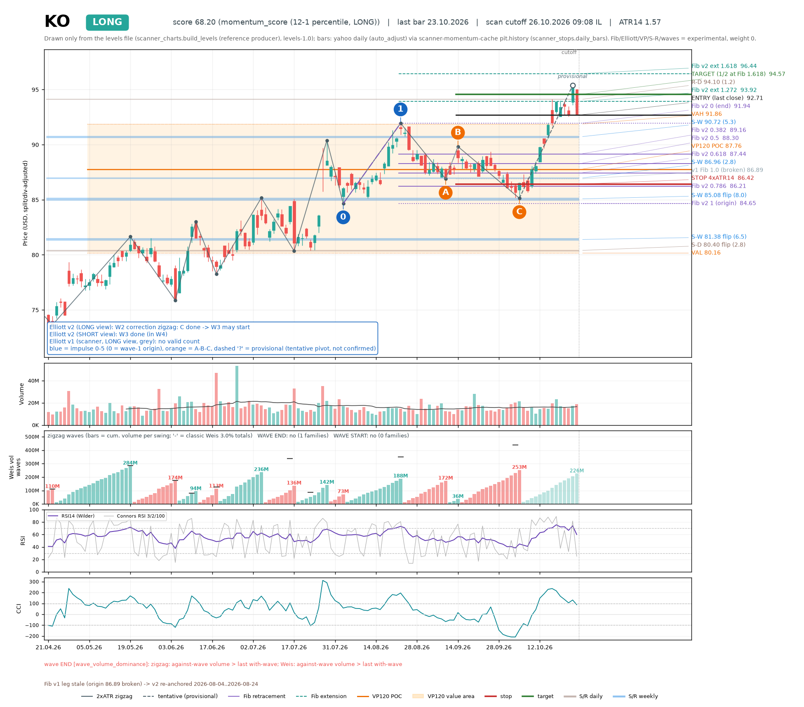

- **Jev (typesafe/jev-1.13):** 15 כותרות · 0 בביטחון ≥0.8 (סומכים על Jev) · 8 הועברו ל-Claude לשיפוט (ביטחון נמוך או חשד למניפולציה; 0 חשודות, 2 הודעות חברה) · סנטימנט — · קטליזטור —
- **Grok (grok-4.3, חיפוש X של Grok):** ✅ אישור · סנטימנט ‎+0 · ביטחון low · 0 פוסטים · אין חדשות שליליות ב-X נגד הלונג · חשבונות מאומתים: —
- **Perplexity:** לא התקבל (חסר קרדיט - OpenRouter (Perplexity))
- **Claude:** לא התקבל (חסר קרדיט - OpenRouter (Claude))
- **GPT:** לא התקבל (חסר קרדיט - OpenRouter (GPT))
- **האם הגרף נראה נכון? (ניסיוני):** Grok: n/a: אין מידע חדש מ-X לשנות ספירה · קלט: grok=img

## 9. סטטיסטיקת כלים (tool_stats, משקל 0)
### אמינות המודלים באזהרות על שורטים (v3-shortveto-cred (2026-10-16))
| מודל | אזהרות שנמדדו | צדקו | שיעור מכווץ | משקל | קנס לאזהרה | רמות שנספרות | % שורטים עם אזהרה |
|---|---|---|---|---|---|---|---|
| gpt | 2 | 2 | 0.531 | 0.062 | -0.62 | strong | 0.939 |
| grok | 2 | 1 | 0.500 | 0.000 | -0.00 | strong,weak | 0.182 |
| pplx | 0 | 0 | 0.500 | 0.000 | -0.00 | strong | 0.818 |
| claude | 0 | 0 | 0.500 | 0.000 | -0.00 | strong,weak | 0.303 |
| jev | 2 | 2 | 0.531 | 0.062 | -0.62 | strong,weak | 0.152 |

### כלים ניסיוניים (משקל 0) — סטטיסטיקה קדימה מ-12.10.2026

מדד עיקרי: תשואה עודפת ביום 20 מול SPY (מניות) / BTC (קריפטו), מותאמת כיוון. כלל: 15 תוצאות = בדיקת ביניים, 30 = החלטה (ולפחות 5 ימי כניסה שונים). FDR ‏(BH, q<0.10) על כל הכלים יחד, רק בדיקות עם 20+ תוצאות בכל צד. קביעות מודלים (Grok, Perplexity, Claude, GPT, Jev) נמדדות רק מ-12.10. שורות במעקב: 11.

| כלי | עמודות נבדקות | שורות מתועדות | תוצאות מסומנות (מקס׳) | ימי כניסה | הבדיקה החזקה | הפרש עודף (נק׳ %) [95% CI] | q | סטטוס |
|---|---|---|---|---|---|---|---|---|
| claude | 2 | 11 | 0 | 0 | llm_claude_conviction >= median (45) (stock LONG) | — | — | איסוף (0/15) |
| gpt | 2 | 11 | 0 | 0 | llm_gpt_flag_or_veto == True (ALL) | — | — | איסוף (0/15) |
| grok | 3 | 11 | 0 | 0 | llm_grok_approve == True (ALL) | — | — | איסוף (0/15) |
| jev | 1 | 4 | 0 | 0 | llm_jev_sentiment sign agrees with direction (ALL) | — | — | איסוף (0/15) |
| pplx | 2 | 11 | 0 | 0 | llm_pplx_approve == True (ALL) | — | — | איסוף (0/15) |

**בדיקות מובילות (לפי p, עד 15):**

| עמודה | בדיקה | מקטע | מסומן/לא | הצלחה | ממוצע עודף מסומן | חציון | הפרש [CI] | p | q | מתאם למומנטום | סטטוס |
|---|---|---|---|---|---|---|---|---|---|---|---|

שורדי FDR: 0 מתוך 0 בדיקות שעמדו בסף. אף כלי לא עבר את הסף — כולם נשארים במשקל 0.

## 10. עלויות ותקינות
- **עלות המודלים בריצה:** $4.670 מתוך תקרה $8.00. פירוט ב-`platform_costs.json`.
- **ממוצע למועמד:** כ-$0.147 (Grok 0.054, Perplexity 0.027, Jev 0.0004, Claude 0.028, GPT 0.037) · הערכה שבועית: כ-$5.31.
- **Grok:** 33 מתוך 33 הצליחו
- **Perplexity:** 32 מתוך 33 הצליחו
- **Claude:** 31 מתוך 33 הצליחו
- **GPT:** 29 מתוך 33 הצליחו
- **עמודות מחקר (research_columns):** {"talib": {"ok": 125, "failed": 0, "errors": {}, "sec_mean": 0.033, "sec_total": 4.1}, "pta": {"ok": 125, "failed": 0, "errors": {}, "sec_mean": 0.133, "sec_total": 16.7}, "smc": {"ok": 125, "failed":
- **קבצים:** `candidates_full.csv`, ‏`levels/`, ‏`charts/` + `chart_index.json`, ‏`tracker_rows.csv`, ‏`reconciliation.json`, ‏`platform_enrichment.csv`, ‏`platform_raw.json`, ‏`research_columns.csv`.
