# דוח סורק מאוחד – סריקה שבועית (יום שני)
**זמן הסריקה:** 2026-11-02 09:09 (שעון ישראל) · **תיקייה:** `/home/runner/work/stock-scanner/stock-scanner/runtime/scan-runs/2026-11-02_09092` · **הופק:** 02.11.2026 09:41 (שעון ישראל)

> **בדיקת התאמה (קובץ הרמות מול הדוח, שורות הטראקר ואינדקס הגרפים, סבולת 1e-6 יחסית):** 44 מתוך 44 תואמים · אין אי-התאמות.

> ## 🔴 חסר קרדיט
> - **חסר קרדיט - OpenRouter (Claude)**: העמודות של הפלטפורמה הזו ריקות בדוח. צריך לטעון קרדיט ולהריץ שוב.
> - **חסר קרדיט - OpenRouter (GPT)**: העמודות של הפלטפורמה הזו ריקות בדוח. צריך לטעון קרדיט ולהריץ שוב.
> - **חסר קרדיט - OpenRouter (Perplexity)**: העמודות של הפלטפורמה הזו ריקות בדוח. צריך לטעון קרדיט ולהריץ שוב.

> **חשוב:** עמודות המודלים (Jev, ‏Grok, ‏Perplexity, ‏Claude אנליסט, ‏GPT פרקליט השטן) נכנסות לציון לפי critic_score v4 (מ-29.10.2026): **Grok, ‏Perplexity, ‏Claude, ‏GPT במשקל 1.0, Jev במשקל 0**, וציון כל מודל נשמר בעמודה נפרדת. הכניסה, הסטופ והיעד מגיעים רק מכללי הבוט, דרך קובץ הרמות של הריצה, ואף מודל לא שינה אותם. פסקי הדין נמדדים **רק קדימה, מ-12.10.2026**, בלי בקטסט היסטורי. כלל הדוחות (אין כניסה חדשה בתוך 5 ימי מסחר לפני דוח) הוא **כלל פעיל**. זה לא ייעוץ השקעות.

## 1. מצב השוק
- **נקודת חיתוך לנתונים (PIT):** 2026-11-02 07:09:00+00:00 UTC
- **תשואת 10 שנים:** 4.929% (שינוי 20 יום: ‎-34.8 נ"ב) · **30 שנים:** 5.309% · **מרווח 2-10:** 0.37
- **VIX:** 19.42 · **AAII שוורים פחות דובים:** — (סקר מ-—)

| מדד | סגירה | 5 ימים % | 15 ימים % | 60 ימים % | RSI | מבנה ממוצעים | שיפוע SMA50 |
|---|---|---|---|---|---|---|---|
| SPY | 755.72 | ‎-0.56 | ‎-2.93 | ‎-1.43 | 34.3 | mixed | down |
| QQQ | 690.49 | ‎-1.97 | ‎-8.09 | ‎-3.28 | 28.7 | bear | down |
| IWM | 279.33 | 1.30 | 0.14 | ‎-6.10 | 52.0 | mixed | down |
| SMH | 522.49 | ‎-0.89 | ‎-13.40 | ‎-8.57 | 32.5 | bear | down |
| ^VIX | 19.42 | ‎-0.15 | 30.86 | 30.34 | 62.6 | mixed | up |

## 2. איך נבחרו המועמדים
- **47 שמות עברו את הכללים** (הרשימה המלאה ב-`candidates_full.csv`, עם ציוני הכללים, הרמות מקובץ הרמות, כניסה/סטופ/יעד ודגל הדוח). מתוכם נבחרו עד **50** לדוח.
- **מניות לונג:** סגירה מעל SMA50 ו-SMA200, שיפוע SMA50 עולה, עד 3 ATR מעל SMA20, שווי ≥ $1.5B, מחזור > $14M, מחיר ≥ $5.
- **מניות שורט:** רק מי שעובר את כלל השורט המאושר (ck_score≥3 וסגירה מתחת ל-SMA200).
- **קריפטו (לונג בלבד):** BTC, ‏ETH, ‏SOL ומטבעות גדולים, נרות יומיים של Alpaca. אותו מסנן מגמה, סטופ קבוע 3×ATR14 על סגירה יומית, בלי יעד. שורט קריפטו מוקפא. Grok הוא פלטפורמת הסנטימנט הראשית.
- **דירוג אחד לכולם (אין חלוקה קבועה לונג/שורט):** ציון אחיד 0–100 = אחוזון המומנטום 12-1 בתוך קבוצת הנכס, ובשורט הפוך (100 פחות האחוזון). ככל שהציון גבוה יותר המומנטום מצביע לכיוון העסקה, ושורט מדורג מעל לונג רק כשהמומנטום שלו חזק יותר. נבחרים עד 50 בעלי הציון הגבוה ביותר - יכולים להיות 20 לונג ו-0 שורט. **סף כניסה: 60** (דגל `--min-score`); מתחתיו שם לא נכנס גם אם נשארו פחות מ-50 מקומות. ברירת המחדל 60 נקבעה לפי מדגם מאומת (139 סטאפי מניות עם תוצאה ליום 20, 15 ימי כניסה שונים): מציון 60 ומעלה שיעור הפגיעה בתשואה מכוונת ליום 20 היה 58.9% מול 51.8% מתחת, בלי יתרון בממוצע. מדגם קטן - הסף עצמו נמדד קדימה.
- **גיוון:** מגבלת הסקטור כבויה בריצה הזו.
- **כלל הדוחות (פעיל):** אין כניסה חדשה במניה אם הדוח הבא בתוך 5 ימי מסחר מיום הכניסה. מקורות התאריך: לוח Yahoo, ‏OpenBB/Nasdaq ו-Perplexity (רק כשהוא מאשר עם מקור). אם יש מחלוקת, לוקחים את התאריך **המוקדם**. אין תאריך מאומת: מסומן "תאריך דוח לא מאומת". חריגה רק בקטליזטור חזק מאוד: Perplexity מדרג "חזק" עם מקור מתוארך, Claude בביטחון 70 ומעלה בעד, ו-GPT לא הטיל וטו. מניה שנחסמה מוחלפת בשם הבא בדירוג, והיא עדיין נרשמת ביומן למדידה.
- **מקור אמת יחיד:** לכל שם נבנה קובץ `levels/<TICKER>.json` (נרות מהמטמון של הסריקה, hash של הנרות, פיבוטים, ספירת אליוט v1 ו-v2, פיבו, VP120, תמיכה/התנגדות, גלי נפח, RSI/CCI, כניסה/סטופ/יעד, סטטוס דוח). הגרף, הדוח, שורות הטראקר והמודלים קוראים רק ממנו.
- **המודלים רואים את הגרף:** Claude, ‏GPT, ‏Grok ו-Perplexity מקבלים את תמונת הגרף (1280 פיקסלים) כקלט הראשי לקריאה הטכנית, וכל מספר בטקסט מגיע מקובץ הרמות. כל מודל אומר אם הוא חולק על ספירת האליוט, הפיבו או התמיכה/התנגדות שצוירו (עמודה ניסיונית `chart_count_disagree`).

## 3. המלצות – מניות (19)
| # | טיקר | כיוון | כניסה (ייחוס) | סטופ | יעד | דירוג | דוח | Jev | Grok | Perplexity | Claude | GPT | חולקים על הגרף |
|---|---|---|---|---|---|---|---|---|---|---|---|---|---|
| 1 | **NFLX** | שורט | 62.08 | 69.89 | אין | 95.3 | 2027-01-19 (53 י"מ) | — | ✅ אישור (‎+0) | חסר קרדיט | חסר קרדיט | חסר קרדיט | 0/4 |
| 2 | **CRWD** | לונג | 250.43 | 197.47 | 303.76 | 94.4 | 2026-12-01 (21 י"מ) | חיובי (+1.00) | ✅ אישור (‎+0) | חסר קרדיט | חסר קרדיט | חסר קרדיט | 0/4 |
| 3 | **ISRG** | שורט | 432.01 | 484.01 | אין | 92.5 | 2027-01-21 (55 י"מ) | שלילי (-1.00) | ✅ אישור (‎+0) | חסר קרדיט | חסר קרדיט | חסר קרדיט | 0/4 |
| 4 | **TXN** | לונג | 300.84 | 262.10 | 328.43 | 92.5 | 2027-01-26 (58 י"מ) | ניטרלי/מעורב (+0.06) | ✅ אישור (‎+0) | חסר קרדיט | חסר קרדיט | חסר קרדיט | 0/4 |
| 5 | **ADI** | לונג | 417.11 | 359.97 | 468.82 | 91.6 | 2026-11-24 (17 י"מ) | — | ✅ אישור (‎+0) | חסר קרדיט | חסר קרדיט | חסר קרדיט | 0/4 |
| 6 | **NOW** | שורט | 105.12 | 138.68 | אין | 90.7 | 2027-01-27 (59 י"מ) | שלילי (-1.00) | ⚠️ דגל (‎+1) | חסר קרדיט | חסר קרדיט | חסר קרדיט | 0/4 |
| 7 | **MRK** | לונג | 149.52 | 131.11 | 160.50 | 89.7 | תאריך דוח לא מאומת | שלילי (-0.27) | ✅ אישור (‎+1) | חסר קרדיט | חסר קרדיט | חסר קרדיט | 0/4 |
| 8 | **OXY** | לונג | 64.00 | 57.97 | 67.78 | 83.2 | 2026-11-09 (6 י"מ) | ניטרלי/מעורב (+0.00) | ✅ אישור (‎+0) | חסר קרדיט | חסר קרדיט | חסר קרדיט | 0/4 |
| 9 | **BA** | שורט | 171.55 | 195.31 | אין | 82.2 | 2027-01-26 (58 י"מ) | שלילי (-1.00) | ✅ אישור (‎-1) | חסר קרדיט | חסר קרדיט | חסר קרדיט | 0/4 |
| 10 | **XOM** | לונג | 187.25 | 171.38 | 192.81 | 82.2 | 2027-01-29 (61 י"מ) | חיובי (+1.00) | ✅ אישור (‎+1) | חסר קרדיט | חסר קרדיט | חסר קרדיט | 0/4 |
| 11 | **DE** | לונג | 675.48 | 600.72 | 722.97 | 80.4 | 2026-11-25 (18 י"מ) | ניטרלי/מעורב (+0.00) | ✅ אישור (‎+0) | חסר קרדיט | חסר קרדיט | חסר קרדיט | 0/4 |
| 12 | **JNJ** | לונג | 273.20 | 246.37 | 285.78 | 77.6 | 2027-01-26 (58 י"מ) | ניטרלי/מעורב (+0.00) | ✅ אישור (‎+1) | חסר קרדיט | חסר קרדיט | חסר קרדיט | 0/4 |
| 13 | **CVX** | לונג | 235.52 | 217.21 | 250.08 | 75.7 | 2027-01-29 (61 י"מ) | חיובי (+1.00) | ✅ אישור (‎+1) | חסר קרדיט | חסר קרדיט | חסר קרדיט | 0/4 |
| 14 | **SLB** | לונג | 53.74 | 47.42 | 67.62 | 73.8 | 2027-01-22 (56 י"מ) | שלילי (-0.36) | ✅ אישור (‎+0) | חסר קרדיט | חסר קרדיט | חסר קרדיט | 0/4 |
| 15 | **KO** | לונג | 94.08 | 87.59 | 101.70 | 71.0 | תאריך דוח לא מאומת | חיובי (+1.00) | ✅ אישור (‎+1) | חסר קרדיט | חסר קרדיט | חסר קרדיט | 0/4 |
| 16 | **META** | שורט | 614.99 | 708.15 | אין | 71.0 | 2027-01-27 (59 י"מ) | שלילי (-1.00) | ✅ אישור (‎+0) | חסר קרדיט | חסר קרדיט | חסר קרדיט | 0/4 |
| 17 | **URI** | לונג | 1,170.05 | 1,015.53 | 1,186.86 | 64.5 | 2027-01-27 (59 י"מ) | — | ✅ אישור (‎+1) | חסר קרדיט | חסר קרדיט | חסר קרדיט | 0/4 |
| 18 | **ABBV** | לונג | 294.89 | 269.22 | 313.09 | 63.6 | תאריך דוח לא מאומת | חיובי (+1.00) | ✅ אישור (‎+2) | חסר קרדיט | חסר קרדיט | חסר קרדיט | 0/4 |
| 19 | **TMO** | לונג | 697.00 | 618.26 | 749.34 | 61.7 | 2027-01-28 (60 י"מ) | — | ✅ אישור (‎+0) | חסר קרדיט | חסר קרדיט | חסר קרדיט | 0/4 |

_דירוג: הציון האחיד 0–100 (אחוזון מומנטום 12-1, הפוך בשורט). Grok בסוגריים: סנטימנט 2- עד 2+. Claude: ביטחון 0–100 ועמדה. "חולקים על הגרף": כמה מודלים אמרו שספירת האליוט/פיבו/תמיכה שצוירו לא נראית נכונה. הכל במשקל 0._

## 4. קריפטו – לונג בלבד (0)
הקריפטו הוצא מהסורק הזה (החלטת אילן, 01.11.2026). נתוני העבר בארכיון archive/crypto/.

## 5. חריגה: קטליזטור חזק (0)
אין.

## 6. נחסם - דוח בתוך 5 ימי מסחר (5)
| טיקר | כיוון | דוח הבא | ימי מסחר עד הדוח | מקורות | Perplexity קטליזטור | Claude | GPT |
|---|---|---|---|---|---|---|---|
| UBER | שורט | 2026-11-04 | 3 | 2026-11-04 (Yahoo calendar) | — | — | חסר קרדיט |
| AMGN | לונג | 2026-11-03 | 2 | 2026-11-03 (Yahoo calendar) | — | — | חסר קרדיט |
| EOG | לונג | 2026-11-05 | 4 | 2026-11-05 (Yahoo calendar) | — | — | חסר קרדיט |
| PFE | לונג | 2026-11-03 | 2 | 2026-11-03 (Yahoo calendar) | — | — | חסר קרדיט |
| AAPL | לונג | 2026-11-02 | 1 | 2026-11-02 (Yahoo calendar) | — | — | חסר קרדיט |

_השמות האלה לא בהמלצות, אבל פסקי הדין שלהם נרשמו ביומן למדידה._

## 7. לא תואם (0)
אין. כל המספרים בדוח, בשורות הטראקר ובאינדקס הגרפים זהים לקובץ הרמות.

## 8. פירוט לכל מועמד
### 1. NFLX – שורט · דירוג 95.3
- **🔴 חסר קרדיט - OpenRouter (Claude) ; חסר קרדיט - OpenRouter (GPT) ; חסר קרדיט - OpenRouter (Perplexity)**
- **רמות (קובץ הרמות, נר אחרון 2026-10-30, hash f8e78ac8c50b8fee):** כניסה 62.08 · סטופ 69.89 (chandelier_close 4.0xATR14, ATR14=1.9537) · יעד: אין – ללא יעד קבוע - שנדלייר 4xATR14 על סגירה (כלל מאושר)
- **טכני:** SMA20 67.58 · SMA50 72.67 · SMA200 81.60 · מומנטום 12-1 ‎-0.383 · RSI14 30.6 · CCI20 ‎-121
- **ניסיוני (משקל 0):** אליוט v2: W3 in progress (provisional) · אליוט v1: in_W3 (W2 done) · פיבו v2 81.02→66.54 (1.618=57.59) · VP120 POC 73.13 (VAH 80.05, VAL 65.00) · תמיכה — · התנגדות 65.08 · סוף גל: 2 משפחות (volume_exhaustion,momentum_divergence) · תחילת גל: 3 (wave_volume_dominance,momentum_divergence,elliott_context)
- **דוח:** מותר - דוח בעוד 53 ימי מסחר · מקורות: 2027-01-19 (Yahoo calendar)
- **סוויפ נזילות (ייחוס בלבד, משקל 0):** לא
- **ספירלת פיבו – יעדי ייחוס בלבד (משקל 0, לא משנה סטופ/יעד; השורט נשאר עם סטופ נגרר 4×ATR בלי יעד):** T1 — (—) · T2 — (—) · מצב: none

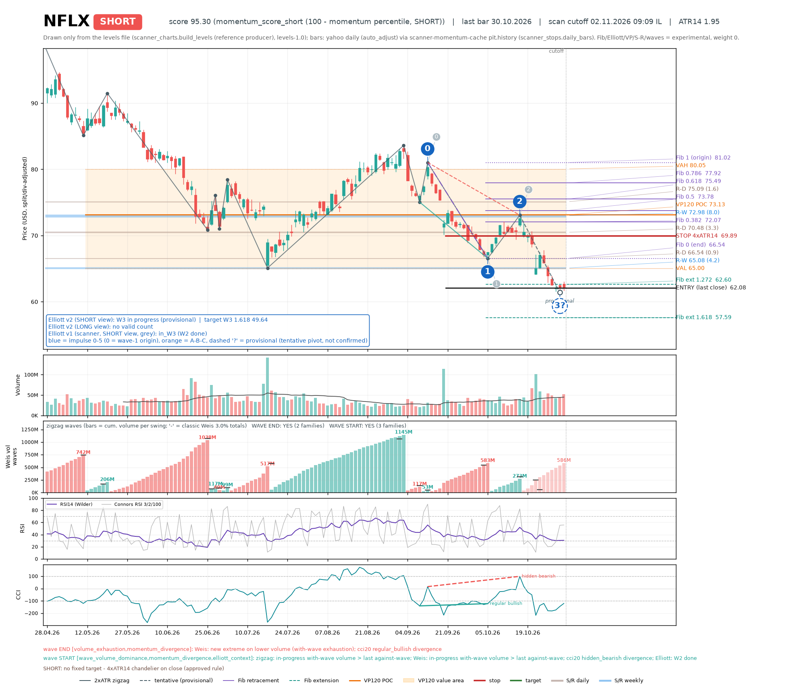

- **Jev (typesafe/jev-1.13):** 15 כותרות · 0 בביטחון ≥0.8 (סומכים על Jev) · 8 הועברו ל-Claude לשיפוט (ביטחון נמוך או חשד למניפולציה; 0 חשודות, 2 הודעות חברה) · סנטימנט — · קטליזטור —
- **Grok (grok-4.3, חיפוש X של Grok):** ✅ אישור · סנטימנט ‎+0 · ביטחון medium · 5 פוסטים · דעות מעורבות ללא חדשות שליליות ברורות נגד השורט · חשבונות מאומתים: @BlueMoonTrades, @ba0495, @PebbySandhu
- **Perplexity:** לא התקבל (חסר קרדיט - OpenRouter (Perplexity))
- **Claude:** לא התקבל (חסר קרדיט - OpenRouter (Claude))
- **GPT:** לא התקבל (חסר קרדיט - OpenRouter (GPT))
- **האם הגרף נראה נכון? (ניסיוני):** Grok: no: ספירת אליוט ורמות פיב נראות תואמות למגמה היורדת · קלט: grok=img

### 2. CRWD – לונג · דירוג 94.4
- **🔴 חסר קרדיט - OpenRouter (Claude) ; חסר קרדיט - OpenRouter (GPT) ; חסר קרדיט - OpenRouter (Perplexity)**
- **רמות (קובץ הרמות, נר אחרון 2026-10-30, hash 8344a5df4042a339):** כניסה 250.43 · סטופ 197.47 (chandelier_close 4.0xATR14, ATR14=13.24) · יעד: 303.76 – חצי ב-Fib 1.618 (סגירה), השאר בשנדלייר 4xATR
- **טכני:** SMA20 254.94 · SMA50 240.25 · SMA200 167.24 · מומנטום 12-1 0.951 · RSI14 49.9 · CCI20 ‎-9
- **ניסיוני (משקל 0):** אליוט v2: W2 in progress (provisional) · אליוט v1: no valid count · פיבו v2 221.36→272.29 (1.618=303.76) · VP120 POC 168.61 (VAH 234.72, VAL 154.77) · תמיכה 232.37 · התנגדות 286.99 · סוף גל: 0 משפחות (—) · תחילת גל: 1 (momentum_divergence)
- **דוח:** מותר - דוח בעוד 21 ימי מסחר · מקורות: 2026-12-01 (Yahoo calendar)
- **סוויפ נזילות (ייחוס בלבד, משקל 0):** לא · **עבר בדיקה, שביר, משקל 0**

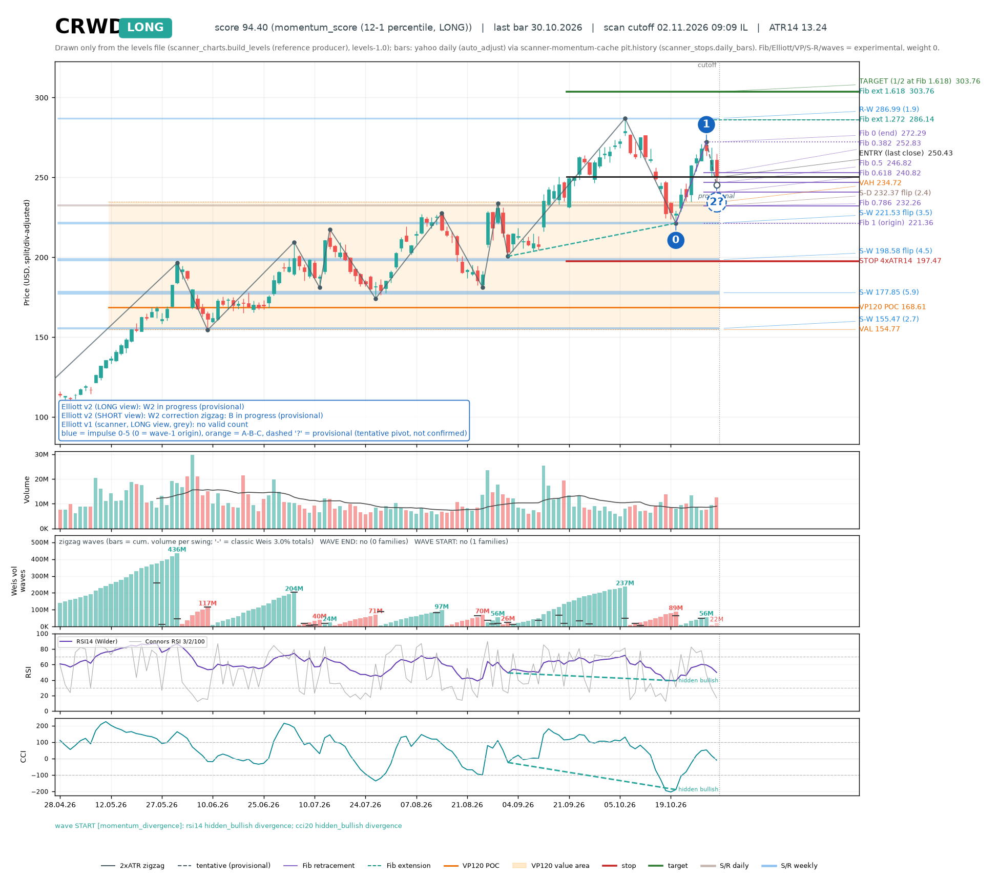

- **Jev (typesafe/jev-1.13):** 15 כותרות · 1 בביטחון ≥0.8 (סומכים על Jev) · 6 הועברו ל-Claude לשיפוט (ביטחון נמוך או חשד למניפולציה; 0 חשודות, 2 הודעות חברה) · סנטימנט חיובי (+1.00) · קטליזטור product
- **Grok (grok-4.3, חיפוש X של Grok):** ✅ אישור · סנטימנט ‎+0 · ביטחון low · 0 פוסטים · אין סנטימנט שלילי או חדשות נגד ב-X · חשבונות מאומתים: —
- **Perplexity:** לא התקבל (חסר קרדיט - OpenRouter (Perplexity))
- **Claude:** לא התקבל (חסר קרדיט - OpenRouter (Claude))
- **GPT:** לא התקבל (חסר קרדיט - OpenRouter (GPT))
- **האם הגרף נראה נכון? (ניסיוני):** Grok: no: ספירת אליוט ופיב נראות תקינות · קלט: grok=img

### 3. ISRG – שורט · דירוג 92.5
- **🔴 חסר קרדיט - OpenRouter (Claude) ; חסר קרדיט - OpenRouter (GPT) ; חסר קרדיט - OpenRouter (Perplexity)**
- **רמות (קובץ הרמות, נר אחרון 2026-10-30, hash 6a4d84729a528ccf):** כניסה 432.01 · סטופ 484.01 (chandelier_close 4.0xATR14, ATR14=13.00) · יעד: אין – ללא יעד קבוע - שנדלייר 4xATR14 על סגירה (כלל מאושר)
- **טכני:** SMA20 430.38 · SMA50 401.54 · SMA200 433.06 · מומנטום 12-1 ‎-0.254 · RSI14 54.1 · CCI20 52
- **ניסיוני (משקל 0):** אליוט v2: no valid count · אליוט v1: no valid count · פיבו v2 491.15→417.74 (1.618=372.37) · VP120 POC 402.85 (VAH 445.85, VAL 372.88) · תמיכה 419.27 · התנגדות 433.39 · סוף גל: 2 משפחות (wave_volume_dominance,momentum_divergence) · תחילת גל: 2 (volume_exhaustion,wave_volume_dominance)
- **דוח:** מותר - דוח בעוד 55 ימי מסחר · מקורות: 2027-01-21 (Yahoo calendar)
- **סוויפ נזילות (ייחוס בלבד, משקל 0):** לא
- **ספירלת פיבו – יעדי ייחוס בלבד (משקל 0, לא משנה סטופ/יעד; השורט נשאר עם סטופ נגרר 4×ATR בלי יעד):** T1 — (—) · T2 — (—) · מצב: expired

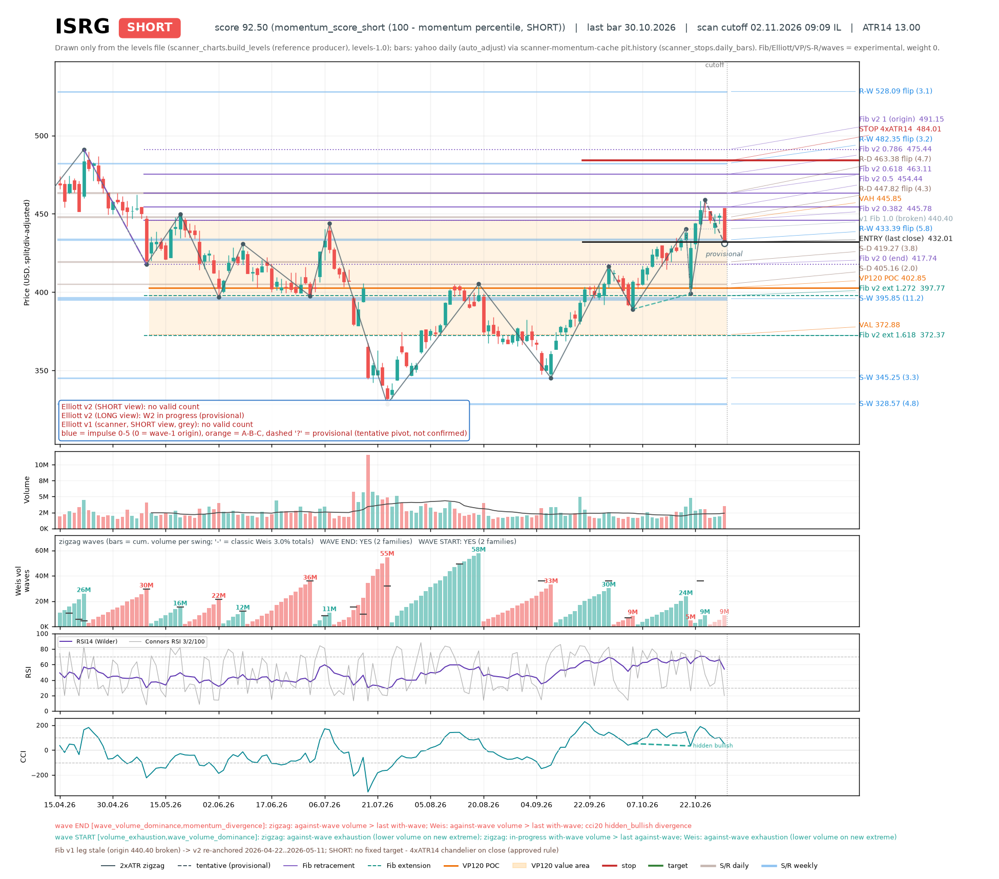

- **Jev (typesafe/jev-1.13):** 6 כותרות · 2 בביטחון ≥0.8 (סומכים על Jev) · 4 הועברו ל-Claude לשיפוט (ביטחון נמוך או חשד למניפולציה; 0 חשודות, 1 הודעות חברה) · סנטימנט שלילי (-1.00) · קטליזטור other
- **Grok (grok-4.3, חיפוש X של Grok):** ✅ אישור · סנטימנט ‎+0 · ביטחון medium · 4 פוסטים · אין חדשות או סנטימנט X חזק נגד ה-SHORT · חשבונות מאומתים: @BeaverCapHQ, @Morpheu5Watcher
- **Perplexity:** לא התקבל (חסר קרדיט - OpenRouter (Perplexity))
- **Claude:** לא התקבל (חסר קרדיט - OpenRouter (Claude))
- **GPT:** לא התקבל (חסר קרדיט - OpenRouter (GPT))
- **האם הגרף נראה נכון? (ניסיוני):** Grok: no: הספירה וה-Fib נראים תקינים · קלט: grok=img

### 4. TXN – לונג · דירוג 92.5
- **🔴 חסר קרדיט - OpenRouter (Claude) ; חסר קרדיט - OpenRouter (GPT) ; חסר קרדיט - OpenRouter (Perplexity)**
- **רמות (קובץ הרמות, נר אחרון 2026-10-30, hash 2ed69b32a5ff1e08):** כניסה 300.84 · סטופ 262.10 (chandelier_close 4.0xATR14, ATR14=9.6838) · יעד: 328.43 – חצי ב-Fib 1.618 (סגירה), השאר בשנדלייר 4xATR
- **טכני:** SMA20 288.28 · SMA50 274.35 · SMA200 257.08 · מומנטום 12-1 0.801 · RSI14 61.0 · CCI20 103
- **ניסיוני (משקל 0):** אליוט v2: W3 in progress (provisional) · אליוט v1: in_W3 (W2 done) · פיבו v2 246.92→297.30 (1.618=328.43) · VP120 POC 279.60 (VAH 308.93, VAL 272.06) · תמיכה 294.03 · התנגדות 309.71 · סוף גל: 1 משפחות (volume_exhaustion) · תחילת גל: 2 (wave_volume_dominance,elliott_context)
- **דוח:** מותר - דוח בעוד 58 ימי מסחר · מקורות: 2027-01-26 (Yahoo calendar)
- **סוויפ נזילות (ייחוס בלבד, משקל 0):** לא · **עבר בדיקה, שביר, משקל 0**

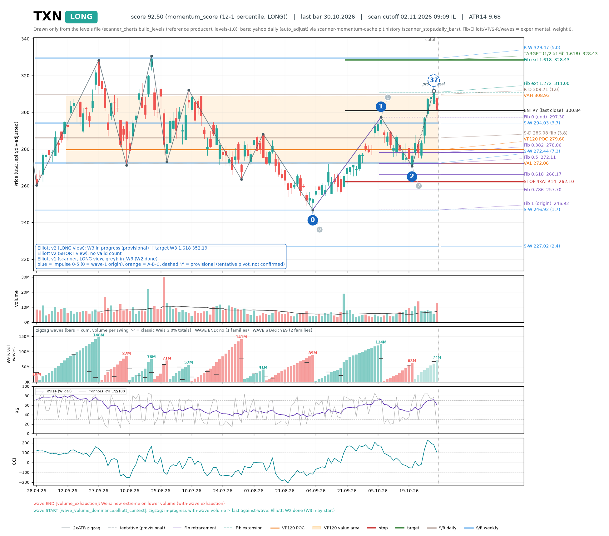

- **Jev (typesafe/jev-1.13):** 10 כותרות · 2 בביטחון ≥0.8 (סומכים על Jev) · 7 הועברו ל-Claude לשיפוט (ביטחון נמוך או חשד למניפולציה; 0 חשודות, 3 הודעות חברה) · סנטימנט ניטרלי/מעורב (+0.06) · קטליזטור analyst
- **Grok (grok-4.3, חיפוש X של Grok):** ✅ אישור · סנטימנט ‎+0 · ביטחון low · 0 פוסטים · אין סיבה מ-X לבטל את ה-LONG · חשבונות מאומתים: —
- **Perplexity:** לא התקבל (חסר קרדיט - OpenRouter (Perplexity))
- **Claude:** לא התקבל (חסר קרדיט - OpenRouter (Claude))
- **GPT:** לא התקבל (חסר קרדיט - OpenRouter (GPT))
- **האם הגרף נראה נכון? (ניסיוני):** Grok: n/a: אין מידע מ-X · קלט: grok=img

### 5. ADI – לונג · דירוג 91.6
- **🔴 חסר קרדיט - OpenRouter (Claude) ; חסר קרדיט - OpenRouter (GPT) ; חסר קרדיט - OpenRouter (Perplexity)**
- **רמות (קובץ הרמות, נר אחרון 2026-10-30, hash b0657073a3efa1ee):** כניסה 417.11 · סטופ 359.97 (chandelier_close 4.0xATR14, ATR14=14.29) · יעד: 468.82 – חצי ב-Fib 1.618 (סגירה), השאר בשנדלייר 4xATR
- **טכני:** SMA20 408.59 · SMA50 388.38 · SMA200 370.65 · מומנטום 12-1 0.743 · RSI14 56.5 · CCI20 72
- **ניסיוני (משקל 0):** אליוט v2: W3 in progress (provisional) · אליוט v1: in_W3 (W2 done) · פיבו v2 348.00→422.67 (1.618=468.82) · VP120 POC 393.38 (VAH 419.45, VAL 369.24) · תמיכה 415.18 · התנגדות 422.67 · סוף גל: 1 משפחות (volume_exhaustion) · תחילת גל: 2 (momentum_divergence,elliott_context)
- **דוח:** מותר - דוח בעוד 17 ימי מסחר · מקורות: 2026-11-24 (Yahoo calendar)
- **סוויפ נזילות (ייחוס בלבד, משקל 0):** לא · **עבר בדיקה, שביר, משקל 0**

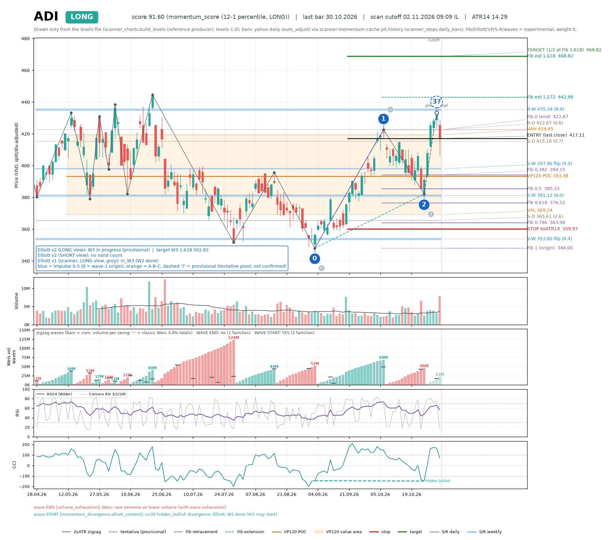

- **Jev (typesafe/jev-1.13):** 3 כותרות · 0 בביטחון ≥0.8 (סומכים על Jev) · 3 הועברו ל-Claude לשיפוט (ביטחון נמוך או חשד למניפולציה; 0 חשודות, 0 הודעות חברה) · סנטימנט — · קטליזטור —
- **Grok (grok-4.3, חיפוש X של Grok):** ✅ אישור · סנטימנט ‎+0 · ביטחון low · 0 פוסטים · אין סנטימנט שלילי ב-X · חשבונות מאומתים: —
- **Perplexity:** לא התקבל (חסר קרדיט - OpenRouter (Perplexity))
- **Claude:** לא התקבל (חסר קרדיט - OpenRouter (Claude))
- **GPT:** לא התקבל (חסר קרדיט - OpenRouter (GPT))
- **האם הגרף נראה נכון? (ניסיוני):** Grok: no: הספירה והעוגנים נראים תקינים · קלט: grok=img

### 6. NOW – שורט · דירוג 90.7
- **🔴 חסר קרדיט - OpenRouter (Claude) ; חסר קרדיט - OpenRouter (GPT) ; חסר קרדיט - OpenRouter (Perplexity)**
- **רמות (קובץ הרמות, נר אחרון 2026-10-30, hash d150b7d5ef5b72f3):** כניסה 105.12 · סטופ 138.68 (chandelier_close 4.0xATR14, ATR14=8.3901) · יעד: אין – ללא יעד קבוע - שנדלייר 4xATR14 על סגירה (כלל מאושר)
- **טכני:** SMA20 142.19 · SMA50 138.68 · SMA200 114.99 · מומנטום 12-1 ‎-0.244 · RSI14 26.9 · CCI20 ‎-274
- **ניסיוני (משקל 0):** אליוט v2: no valid count · אליוט v1: no valid count · פיבו v2 175.00→123.78 (1.618=92.13) · VP120 POC 103.95 (VAH 129.88, VAL 91.36) · תמיכה 98.37 · התנגדות 108.99 · סוף גל: 1 משפחות (wave_volume_dominance) · תחילת גל: 2 (volume_exhaustion,wave_volume_dominance)
- **דוח:** מותר - דוח בעוד 59 ימי מסחר · מקורות: 2027-01-27 (Yahoo calendar)
- **סוויפ נזילות (ייחוס בלבד, משקל 0):** לא
- **ספירלת פיבו – יעדי ייחוס בלבד (משקל 0, לא משנה סטופ/יעד; השורט נשאר עם סטופ נגרר 4×ATR בלי יעד):** T1 106.08 (fan:8@fib0.786) · T2 106.08 (circle:0.618@fib0.786) · מצב: triggered_earlier

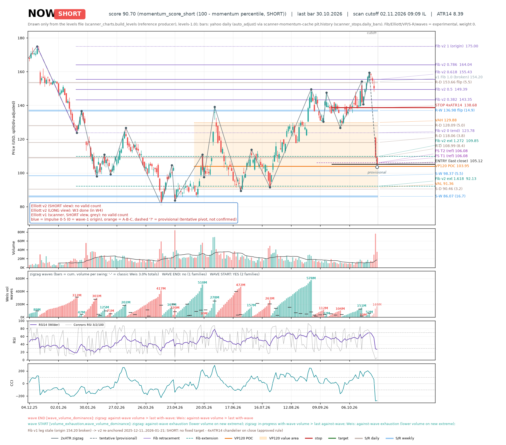

- **Jev (typesafe/jev-1.13):** 15 כותרות · 1 בביטחון ≥0.8 (סומכים על Jev) · 8 הועברו ל-Claude לשיפוט (ביטחון נמוך או חשד למניפולציה; 0 חשודות, 1 הודעות חברה) · סנטימנט שלילי (-1.00) · קטליזטור analyst
- **Grok (grok-4.3, חיפוש X של Grok):** ⚠️ דגל · סנטימנט ‎+1 · ביטחון low · 8 פוסטים · סנטימנט קל חיובי מהרכישה ללא סיבה לביטול השורט · חשבונות מאומתים: @roeljonath97670
- **Perplexity:** לא התקבל (חסר קרדיט - OpenRouter (Perplexity))
- **Claude:** לא התקבל (חסר קרדיט - OpenRouter (Claude))
- **GPT:** לא התקבל (חסר קרדיט - OpenRouter (GPT))
- **האם הגרף נראה נכון? (ניסיוני):** Grok: no: ספירה ופיבונצ'י נראים תקינים · קלט: grok=img

### 7. MRK – לונג · דירוג 89.7
- **🔴 חסר קרדיט - OpenRouter (Claude) ; חסר קרדיט - OpenRouter (GPT) ; חסר קרדיט - OpenRouter (Perplexity)**
- **רמות (קובץ הרמות, נר אחרון 2026-10-30, hash e29030cab6dd2235):** כניסה 149.52 · סטופ 131.11 (chandelier_close 4.0xATR14, ATR14=4.6013) · יעד: 160.50 – חצי ב-Fib 1.618 (סגירה), השאר בשנדלייר 4xATR
- **טכני:** SMA20 144.59 · SMA50 146.58 · SMA200 125.51 · מומנטום 12-1 0.710 · RSI14 57.0 · CCI20 130
- **ניסיוני (משקל 0):** אליוט v2: W2 correction expanded flat: C done -> W3 may start · אליוט v1: no valid count · פיבו v2 138.80→152.34 (1.618=160.71) · VP120 POC 147.16 (VAH 156.00, VAL 123.45) · תמיכה 140.50 · התנגדות 154.00 · סוף גל: 2 משפחות (volume_exhaustion,wave_volume_dominance) · תחילת גל: 1 (wave_volume_dominance)
- **דוח:** תאריך דוח לא מאומת
- **סוויפ נזילות (ייחוס בלבד, משקל 0):** לא · **עבר בדיקה, שביר, משקל 0**

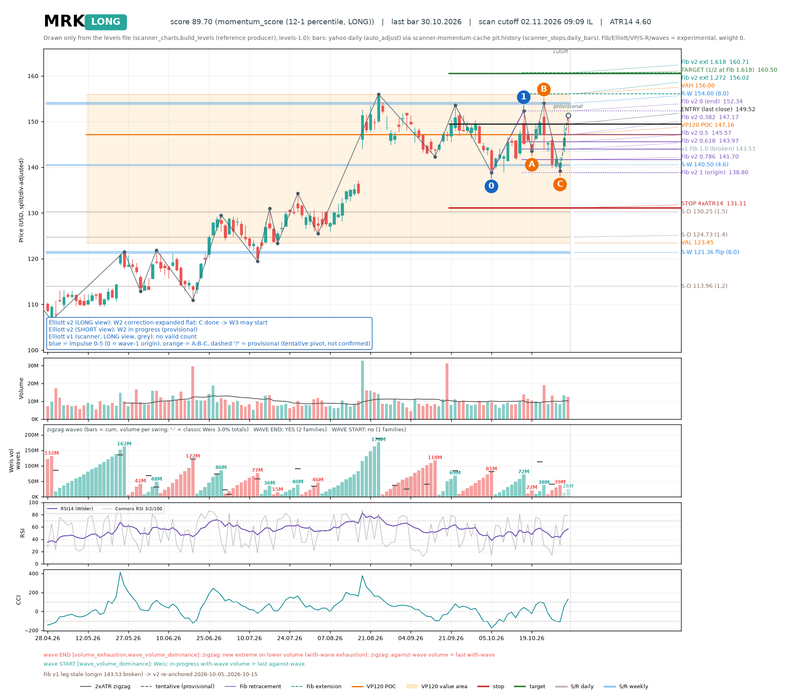

- **Jev (typesafe/jev-1.13):** 15 כותרות · 4 בביטחון ≥0.8 (סומכים על Jev) · 7 הועברו ל-Claude לשיפוט (ביטחון נמוך או חשד למניפולציה; 0 חשודות, 1 הודעות חברה) · סנטימנט שלילי (-0.27) · קטליזטור analyst
- **Grok (grok-4.3, חיפוש X של Grok):** ✅ אישור · סנטימנט ‎+1 · ביטחון medium · 1 פוסטים · סנטימנט X שורי קל תומך ב-LONG · חשבונות מאומתים: @StockTraderHub
- **Perplexity:** לא התקבל (חסר קרדיט - OpenRouter (Perplexity))
- **Claude:** לא התקבל (חסר קרדיט - OpenRouter (Claude))
- **GPT:** לא התקבל (חסר קרדיט - OpenRouter (GPT))
- **האם הגרף נראה נכון? (ניסיוני):** Grok: no · קלט: grok=img

### 8. OXY – לונג · דירוג 83.2
- **🔴 חסר קרדיט - OpenRouter (Claude) ; חסר קרדיט - OpenRouter (GPT) ; חסר קרדיט - OpenRouter (Perplexity)**
- **רמות (קובץ הרמות, נר אחרון 2026-10-30, hash a898e503ec180e60):** כניסה 64.00 · סטופ 57.97 (chandelier_close 4.0xATR14, ATR14=1.5081) · יעד: 67.78 – חצי ב-Fib 1.618 (סגירה), השאר בשנדלייר 4xATR
- **טכני:** SMA20 61.71 · SMA50 60.11 · SMA200 55.70 · מומנטום 12-1 0.454 · RSI14 64.5 · CCI20 96
- **ניסיוני (משקל 0):** אליוט v2: no valid count · אליוט v1: no valid count · פיבו v2 53.41→61.87 (1.618=67.09) · VP120 POC 57.47 (VAH 61.83, VAL 54.17) · תמיכה 63.77 · התנגדות 64.96 · סוף גל: 1 משפחות (wave_volume_dominance) · תחילת גל: 2 (volume_exhaustion,wave_volume_dominance)
- **דוח:** מותר - דוח בעוד 6 ימי מסחר · מקורות: 2026-11-09 (Yahoo calendar)
- **סוויפ נזילות (ייחוס בלבד, משקל 0):** לא · **עבר בדיקה, שביר, משקל 0**

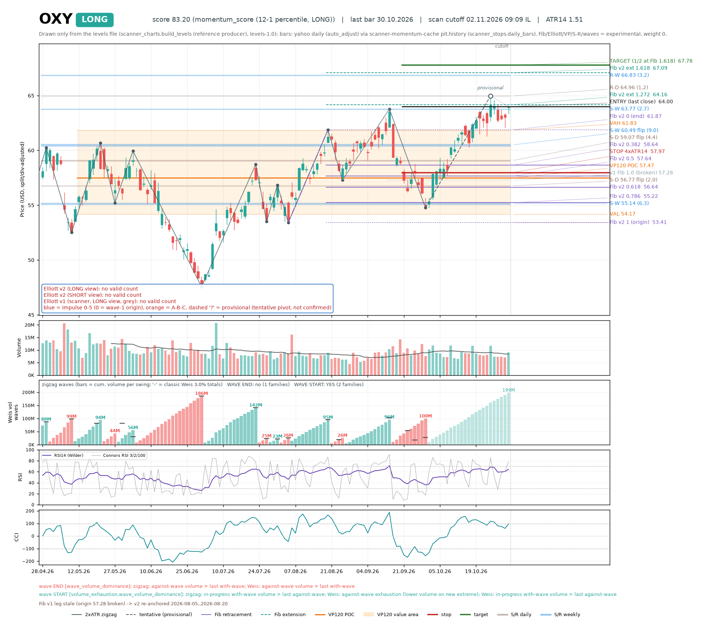

- **Jev (typesafe/jev-1.13):** 7 כותרות · 1 בביטחון ≥0.8 (סומכים על Jev) · 5 הועברו ל-Claude לשיפוט (ביטחון נמוך או חשד למניפולציה; 0 חשודות, 2 הודעות חברה) · סנטימנט ניטרלי/מעורב (+0.00) · קטליזטור analyst
- **Grok (grok-4.3, חיפוש X של Grok):** ✅ אישור · סנטימנט ‎+0 · ביטחון low · 0 פוסטים · אין פוסטים רלוונטיים ב-X · חשבונות מאומתים: —
- **Perplexity:** לא התקבל (חסר קרדיט - OpenRouter (Perplexity))
- **Claude:** לא התקבל (חסר קרדיט - OpenRouter (Claude))
- **GPT:** לא התקבל (חסר קרדיט - OpenRouter (GPT))
- **האם הגרף נראה נכון? (ניסיוני):** Grok: n/a: null · קלט: grok=img

### 9. BA – שורט · דירוג 82.2
- **🔴 חסר קרדיט - OpenRouter (Claude) ; חסר קרדיט - OpenRouter (GPT) ; חסר קרדיט - OpenRouter (Perplexity)**
- **רמות (קובץ הרמות, נר אחרון 2026-10-30, hash 67538ab532f4de81):** כניסה 171.55 · סטופ 195.31 (chandelier_close 4.0xATR14, ATR14=5.9394) · יעד: אין – ללא יעד קבוע - שנדלייר 4xATR14 על סגירה (כלל מאושר)
- **טכני:** SMA20 185.32 · SMA50 196.12 · SMA200 216.99 · מומנטום 12-1 ‎-0.100 · RSI14 32.3 · CCI20 ‎-159
- **ניסיוני (משקל 0):** אליוט v2: W3 in progress (provisional) · אליוט v1: in_W3 (W2 done) · פיבו v2 215.29→183.38 (1.618=163.66) · VP120 POC 217.98 (VAH 240.91, VAL 191.89) · תמיכה 164.62 · התנגדות 184.10 · סוף גל: 1 משפחות (momentum_divergence) · תחילת גל: 3 (wave_volume_dominance,momentum_divergence,elliott_context)
- **דוח:** מותר - דוח בעוד 58 ימי מסחר · מקורות: 2027-01-26 (Yahoo calendar)
- **סוויפ נזילות (ייחוס בלבד, משקל 0):** לא
- **ספירלת פיבו – יעדי ייחוס בלבד (משקל 0, לא משנה סטופ/יעד; השורט נשאר עם סטופ נגרר 4×ATR בלי יעד):** T1 — (—) · T2 — (—) · מצב: none

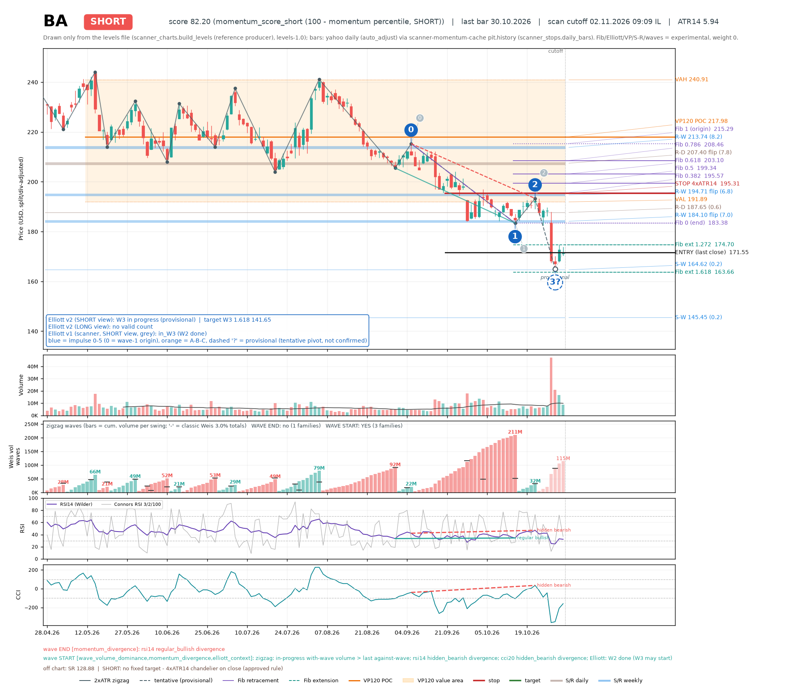

- **Jev (typesafe/jev-1.13):** 15 כותרות · 1 בביטחון ≥0.8 (סומכים על Jev) · 8 הועברו ל-Claude לשיפוט (ביטחון נמוך או חשד למניפולציה; 0 חשודות, 1 הודעות חברה) · סנטימנט שלילי (-1.00) · קטליזטור guidance
- **Grok (grok-4.3, חיפוש X של Grok):** ✅ אישור · סנטימנט ‎-1 · ביטחון low · 1 פוסטים · חדשות שליליות על הפסדים תומכות ב-short · חשבונות מאומתים: @AviationIntelHQ
- **Perplexity:** לא התקבל (חסר קרדיט - OpenRouter (Perplexity))
- **Claude:** לא התקבל (חסר קרדיט - OpenRouter (Claude))
- **GPT:** לא התקבל (חסר קרדיט - OpenRouter (GPT))
- **האם הגרף נראה נכון? (ניסיוני):** Grok: no: ספירת אליוט ו-Fib נראות תקינות על הגרף · קלט: grok=img

### 10. XOM – לונג · דירוג 82.2
- **🔴 חסר קרדיט - OpenRouter (Claude) ; חסר קרדיט - OpenRouter (GPT) ; חסר קרדיט - OpenRouter (Perplexity)**
- **רמות (קובץ הרמות, נר אחרון 2026-10-30, hash 2d895dfae9dd007d):** כניסה 187.25 · סטופ 171.38 (chandelier_close 4.0xATR14, ATR14=3.9687) · יעד: 192.81 – חצי ב-Fib 1.618 (סגירה), השאר בשנדלייר 4xATR
- **טכני:** SMA20 175.98 · SMA50 167.76 · SMA200 153.39 · מומנטום 12-1 0.448 · RSI14 73.0 · CCI20 134
- **ניסיוני (משקל 0):** אליוט v2: W3 in progress (provisional) / beyond target · אליוט v1: in_W3 (W2 done) · פיבו v2 155.32→169.64 (1.618=178.49) · VP120 POC 135.71 (VAH 162.38, VAL 134.08) · תמיכה 174.23 · התנגדות — · סוף גל: 1 משפחות (volume_exhaustion) · תחילת גל: 2 (wave_volume_dominance,elliott_context)
- **דוח:** מותר - דוח בעוד 61 ימי מסחר · מקורות: 2027-01-29 (Yahoo calendar)
- **סוויפ נזילות (ייחוס בלבד, משקל 0):** לא · **עבר בדיקה, שביר, משקל 0**

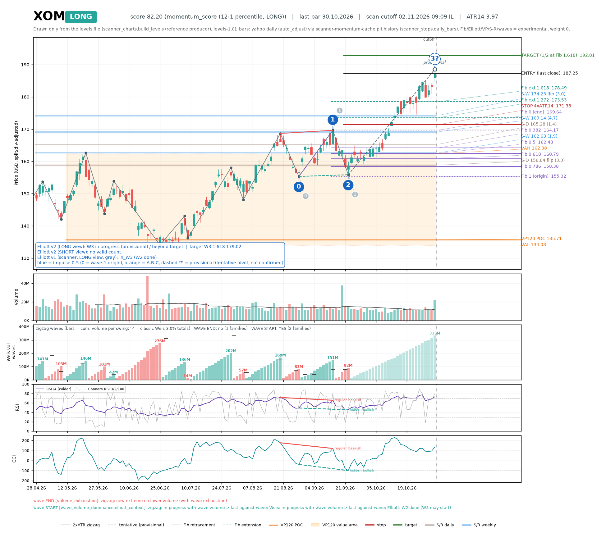

- **Jev (typesafe/jev-1.13):** 15 כותרות · 1 בביטחון ≥0.8 (סומכים על Jev) · 8 הועברו ל-Claude לשיפוט (ביטחון נמוך או חשד למניפולציה; 0 חשודות, 1 הודעות חברה) · סנטימנט חיובי (+1.00) · קטליזטור earnings
- **Grok (grok-4.3, חיפוש X של Grok):** ✅ אישור · סנטימנט ‎+1 · ביטחון medium · 1 פוסטים · סנטימנט חיובי ל-LONG דרך חוזק אנרגיה ותזרים · חשבונות מאומתים: @xalpha168
- **Perplexity:** לא התקבל (חסר קרדיט - OpenRouter (Perplexity))
- **Claude:** לא התקבל (חסר קרדיט - OpenRouter (Claude))
- **GPT:** לא התקבל (חסר קרדיט - OpenRouter (GPT))
- **האם הגרף נראה נכון? (ניסיוני):** Grok: no: ספירת אליוט ופיב נראים תקינים · קלט: grok=img

### 11. DE – לונג · דירוג 80.4
- **🔴 חסר קרדיט - OpenRouter (Claude) ; חסר קרדיט - OpenRouter (GPT) ; חסר קרדיט - OpenRouter (Perplexity)**
- **רמות (קובץ הרמות, נר אחרון 2026-10-30, hash 2bd47fa747c9172a):** כניסה 675.48 · סטופ 600.72 (chandelier_close 4.0xATR14, ATR14=18.69) · יעד: 722.97 – חצי ב-Fib 1.618 (סגירה), השאר בשנדלייר 4xATR
- **טכני:** SMA20 648.17 · SMA50 662.93 · SMA200 602.29 · מומנטום 12-1 0.425 · RSI14 59.8 · CCI20 128
- **ניסיוני (משקל 0):** אליוט v2: post-W5 correction zigzag: C done -> new impulse may start · אליוט v1: no valid count · פיבו v2 615.74→704.20 (1.618=758.87) · VP120 POC 589.15 (VAH 669.85, VAL 553.98) · תמיכה 665.00 · התנגדות 691.94 · סוף גל: 1 משפחות (wave_volume_dominance) · תחילת גל: 2 (volume_exhaustion,wave_volume_dominance)
- **דוח:** מותר - דוח בעוד 18 ימי מסחר · מקורות: 2026-11-25 (Yahoo calendar)
- **סוויפ נזילות (ייחוס בלבד, משקל 0):** לא · **עבר בדיקה, שביר, משקל 0**

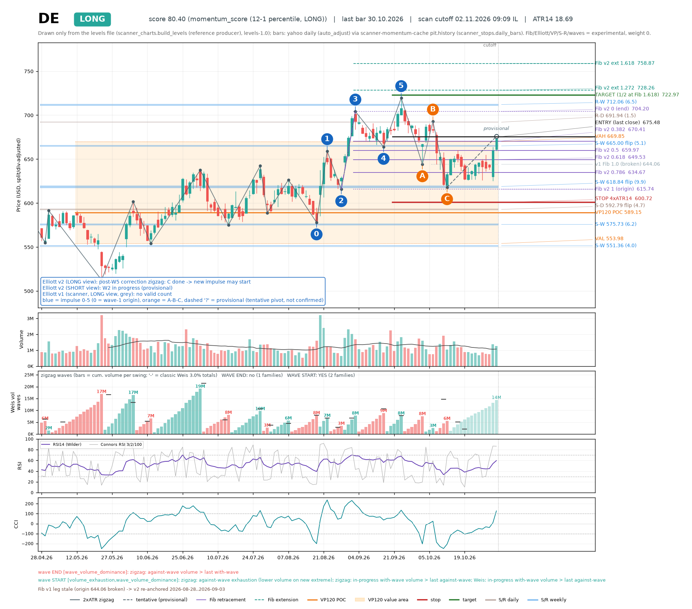

- **Jev (typesafe/jev-1.13):** 1 כותרות · 1 בביטחון ≥0.8 (סומכים על Jev) · 0 הועברו ל-Claude לשיפוט (ביטחון נמוך או חשד למניפולציה; 0 חשודות, 1 הודעות חברה) · סנטימנט ניטרלי/מעורב (+0.00) · קטליזטור other
- **Grok (grok-4.3, חיפוש X של Grok):** ✅ אישור · סנטימנט ‎+0 · ביטחון medium · 3 פוסטים · אין חדשות שליליות ב-X נגד הלונג · חשבונות מאומתים: @BayStreetWhales, @BayStreetWhales, @BeaverCapHQ
- **Perplexity:** לא התקבל (חסר קרדיט - OpenRouter (Perplexity))
- **Claude:** לא התקבל (חסר קרדיט - OpenRouter (Claude))
- **GPT:** לא התקבל (חסר קרדיט - OpenRouter (GPT))
- **האם הגרף נראה נכון? (ניסיוני):** Grok: n/a: אין התייחסות לספירה ב-X · קלט: grok=img

### 12. JNJ – לונג · דירוג 77.6
- **🔴 חסר קרדיט - OpenRouter (Claude) ; חסר קרדיט - OpenRouter (GPT) ; חסר קרדיט - OpenRouter (Perplexity)**
- **רמות (קובץ הרמות, נר אחרון 2026-10-30, hash 9054f136d6a4657d):** כניסה 273.20 · סטופ 246.37 (chandelier_close 4.0xATR14, ATR14=6.7082) · יעד: 285.78 – חצי ב-Fib 1.618 (סגירה), השאר בשנדלייר 4xATR
- **טכני:** SMA20 260.80 · SMA50 265.55 · SMA200 245.33 · מומנטום 12-1 0.417 · RSI14 60.4 · CCI20 162
- **ניסיוני (משקל 0):** אליוט v2: no valid count · אליוט v1: no valid count · פיבו v2 244.29→273.55 (1.618=291.64) · VP120 POC 267.59 (VAH 278.26, VAL 245.64) · תמיכה 268.11 · התנגדות 274.23 · סוף גל: 0 משפחות (—) · תחילת גל: 4 (volume_exhaustion,wave_volume_dominance,climax,momentum_divergence)
- **דוח:** מותר - דוח בעוד 58 ימי מסחר · מקורות: 2027-01-26 (Yahoo calendar)
- **סוויפ נזילות (ייחוס בלבד, משקל 0):** כן (שורט, רמה 281.07 pivot) · **עבר בדיקה, שביר, משקל 0**

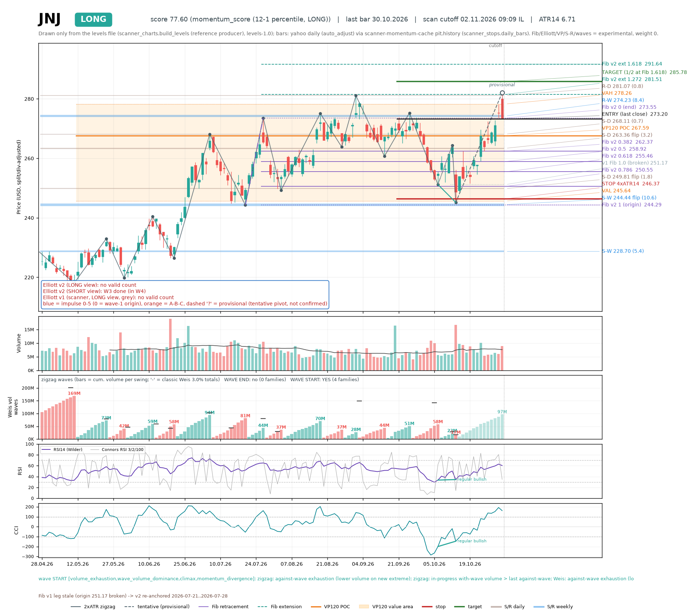

- **Jev (typesafe/jev-1.13):** 15 כותרות · 1 בביטחון ≥0.8 (סומכים על Jev) · 8 הועברו ל-Claude לשיפוט (ביטחון נמוך או חשד למניפולציה; 0 חשודות, 7 הודעות חברה) · סנטימנט ניטרלי/מעורב (+0.00) · קטליזטור other
- **Grok (grok-4.3, חיפוש X של Grok):** ✅ אישור · סנטימנט ‎+1 · ביטחון low · 1 פוסטים · חדשות חיוביות תומכות ב-LONG ללא התנגדות · חשבונות מאומתים: @TraderTimes_en
- **Perplexity:** לא התקבל (חסר קרדיט - OpenRouter (Perplexity))
- **Claude:** לא התקבל (חסר קרדיט - OpenRouter (Claude))
- **GPT:** לא התקבל (חסר קרדיט - OpenRouter (GPT))
- **האם הגרף נראה נכון? (ניסיוני):** Grok: n/a: אין מידע מספיק לבדיקה · קלט: grok=img

### 13. CVX – לונג · דירוג 75.7
- **🔴 חסר קרדיט - OpenRouter (Claude) ; חסר קרדיט - OpenRouter (GPT) ; חסר קרדיט - OpenRouter (Perplexity)**
- **רמות (קובץ הרמות, נר אחרון 2026-10-30, hash 9ae6c72d80de9ac4):** כניסה 235.52 · סטופ 217.21 (chandelier_close 4.0xATR14, ATR14=4.5782) · יעד: 250.08 – חצי ב-Fib 1.618 (סגירה), השאר בשנדלייר 4xATR
- **טכני:** SMA20 221.75 · SMA50 213.15 · SMA200 191.25 · מומנטום 12-1 0.388 · RSI14 72.9 · CCI20 116
- **ניסיוני (משקל 0):** אליוט v2: W3 in progress (provisional) / beyond target · אליוט v1: in_W3 (W2 done) · פיבו v2 197.82→217.78 (1.618=230.12) · VP120 POC 187.49 (VAH 207.23, VAL 163.35) · תמיכה 234.08 · התנגדות — · סוף גל: 0 משפחות (—) · תחילת גל: 3 (wave_volume_dominance,momentum_divergence,elliott_context)
- **דוח:** מותר - דוח בעוד 61 ימי מסחר · מקורות: 2027-01-29 (Yahoo calendar)
- **סוויפ נזילות (ייחוס בלבד, משקל 0):** לא · **עבר בדיקה, שביר, משקל 0**

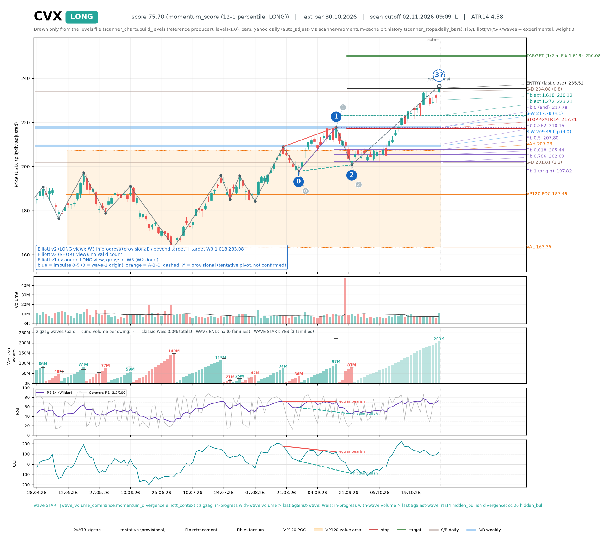

- **Jev (typesafe/jev-1.13):** 15 כותרות · 1 בביטחון ≥0.8 (סומכים על Jev) · 8 הועברו ל-Claude לשיפוט (ביטחון נמוך או חשד למניפולציה; 0 חשודות, 1 הודעות חברה) · סנטימנט חיובי (+1.00) · קטליזטור earnings
- **Grok (grok-4.3, חיפוש X של Grok):** ✅ אישור · סנטימנט ‎+1 · ביטחון medium · 4 פוסטים · סנטימנט מעורב אך חיובי באנרגיה ללא חדשות שליליות ברורות · חשבונות מאומתים: @cfromhertz, @FakeTrading, @oratnek_ill, @currencyheatmap
- **Perplexity:** לא התקבל (חסר קרדיט - OpenRouter (Perplexity))
- **Claude:** לא התקבל (חסר קרדיט - OpenRouter (Claude))
- **GPT:** לא התקבל (חסר קרדיט - OpenRouter (GPT))
- **האם הגרף נראה נכון? (ניסיוני):** Grok: no: ספירה אליוט ו-Fib נראים תקינים על הגרף · קלט: grok=img

### 14. SLB – לונג · דירוג 73.8
- **🔴 חסר קרדיט - OpenRouter (Claude) ; חסר קרדיט - OpenRouter (GPT) ; חסר קרדיט - OpenRouter (Perplexity)**
- **רמות (קובץ הרמות, נר אחרון 2026-10-30, hash b6632b98425b1131):** כניסה 53.74 · סטופ 47.42 (chandelier_close 4.0xATR14, ATR14=1.5810) · יעד: 67.62 – חצי ב-Fib 1.618 (סגירה), השאר בשנדלייר 4xATR
- **טכני:** SMA20 50.57 · SMA50 52.44 · SMA200 51.10 · מומנטום 12-1 0.354 · RSI14 61.5 · CCI20 123
- **ניסיוני (משקל 0):** אליוט v2: no valid count · אליוט v1: no valid count · פיבו v2 44.95→52.93 (1.618=57.86) · VP120 POC 47.04 (VAH 54.78, VAL 46.25) · תמיכה 52.35 · התנגדות 54.04 · סוף גל: 1 משפחות (wave_volume_dominance) · תחילת גל: 1 (wave_volume_dominance)
- **דוח:** מותר - דוח בעוד 56 ימי מסחר · מקורות: 2027-01-22 (Yahoo calendar)
- **סוויפ נזילות (ייחוס בלבד, משקל 0):** לא · **עבר בדיקה, שביר, משקל 0**

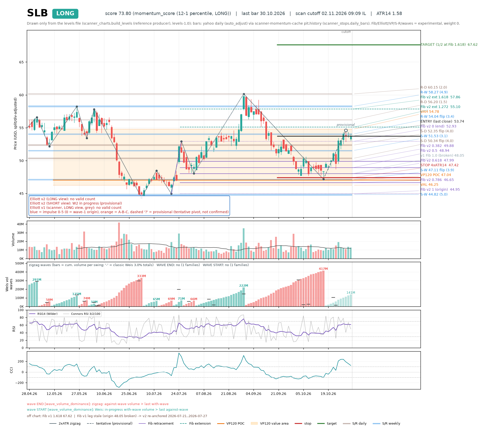

- **Jev (typesafe/jev-1.13):** 15 כותרות · 5 בביטחון ≥0.8 (סומכים על Jev) · 5 הועברו ל-Claude לשיפוט (ביטחון נמוך או חשד למניפולציה; 0 חשודות, 0 הודעות חברה) · סנטימנט שלילי (-0.36) · קטליזטור analyst
- **Grok (grok-4.3, חיפוש X של Grok):** ✅ אישור · סנטימנט ‎+0 · ביטחון low · 0 פוסטים · אין סנטימנט שלילי ב-X · חשבונות מאומתים: —
- **Perplexity:** לא התקבל (חסר קרדיט - OpenRouter (Perplexity))
- **Claude:** לא התקבל (חסר קרדיט - OpenRouter (Claude))
- **GPT:** לא התקבל (חסר קרדיט - OpenRouter (GPT))
- **האם הגרף נראה נכון? (ניסיוני):** Grok: n/a: אין פוסטים אמיתיים · קלט: grok=img

### 15. KO – לונג · דירוג 71.0
- **🔴 חסר קרדיט - OpenRouter (Claude) ; חסר קרדיט - OpenRouter (GPT) ; חסר קרדיט - OpenRouter (Perplexity)**
- **רמות (קובץ הרמות, נר אחרון 2026-10-30, hash 86d59d0b2d958617):** כניסה 94.08 · סטופ 87.59 (chandelier_close 4.0xATR14, ATR14=1.6236) · יעד: 101.70 – חצי ב-Fib 1.618 (סגירה), השאר בשנדלייר 4xATR
- **טכני:** SMA20 91.10 · SMA50 89.30 · SMA200 81.38 · מומנטום 12-1 0.293 · RSI14 62.7 · CCI20 91
- **ניסיוני (משקל 0):** אליוט v2: W2 correction flat: B in progress (provisional) · אליוט v1: in_W3 (W2 done) · פיבו v2 85.13→95.37 (1.618=101.70) · VP120 POC 87.76 (VAH 94.98, VAL 80.94) · תמיכה 90.72 · התנגדות 94.10 · סוף גל: 1 משפחות (volume_exhaustion) · תחילת גל: 1 (elliott_context)
- **דוח:** תאריך דוח לא מאומת
- **סוויפ נזילות (ייחוס בלבד, משקל 0):** לא · **עבר בדיקה, שביר, משקל 0**

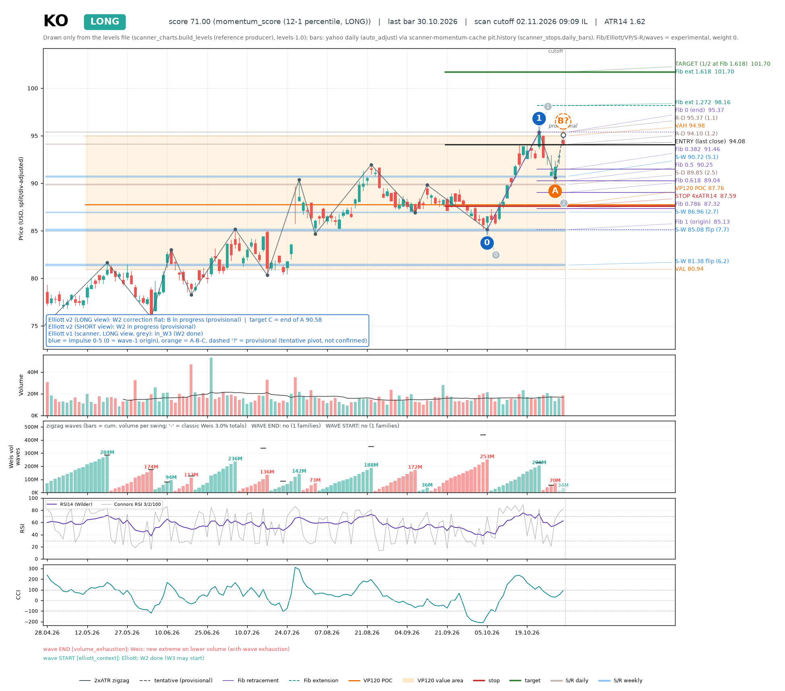

- **Jev (typesafe/jev-1.13):** 15 כותרות · 5 בביטחון ≥0.8 (סומכים על Jev) · 8 הועברו ל-Claude לשיפוט (ביטחון נמוך או חשד למניפולציה; 0 חשודות, 3 הודעות חברה) · סנטימנט חיובי (+1.00) · קטליזטור analyst
- **Grok (grok-4.3, חיפוש X של Grok):** ✅ אישור · סנטימנט ‎+1 · ביטחון low · 9 פוסטים · אין סיבה ברורה לבטל את ה-LONG מה-X · חשבונות מאומתים: @KaydenTrades, @JonathanMaietta, @reynosismo_
- **Perplexity:** לא התקבל (חסר קרדיט - OpenRouter (Perplexity))
- **Claude:** לא התקבל (חסר קרדיט - OpenRouter (Claude))
- **GPT:** לא התקבל (חסר קרדיט - OpenRouter (GPT))
- **האם הגרף נראה נכון? (ניסיוני):** Grok: no: ספירת אליוט תקינה עם W2 בתיקון · קלט: grok=img

### 16. META – שורט · דירוג 71.0
- **🔴 חסר קרדיט - OpenRouter (Claude) ; חסר קרדיט - OpenRouter (GPT) ; חסר קרדיט - OpenRouter (Perplexity)**
- **רמות (קובץ הרמות, נר אחרון 2026-10-30, hash 906cfb7b7482b708):** כניסה 614.99 · סטופ 708.15 (chandelier_close 4.0xATR14, ATR14=23.29) · יעד: אין – ללא יעד קבוע - שנדלייר 4xATR14 על סגירה (כלל מאושר)
- **טכני:** SMA20 691.11 · SMA50 669.79 · SMA200 631.28 · מומנטום 12-1 ‎-0.031 · RSI14 33.2 · CCI20 ‎-115
- **ניסיוני (משקל 0):** אליוט v2: W3 in progress (provisional) / beyond target · אליוט v1: in_W3 (W2 done) · פיבו v2 779.82→711.68 (1.618=669.57) · VP120 POC 608.47 (VAH 677.52, VAL 549.65) · תמיכה 609.74 · התנגדות 635.41 · סוף גל: 0 משפחות (—) · תחילת גל: 3 (volume_exhaustion,wave_volume_dominance,elliott_context)
- **דוח:** מותר - דוח בעוד 59 ימי מסחר · מקורות: 2027-01-27 (Yahoo calendar)
- **סוויפ נזילות (ייחוס בלבד, משקל 0):** לא
- **ספירלת פיבו – יעדי ייחוס בלבד (משקל 0, לא משנה סטופ/יעד; השורט נשאר עם סטופ נגרר 4×ATR בלי יעד):** T1 682.13 (circle:0.5@fib0.382) · T2 682.13 (circle:0.786@fib0.382) · מצב: triggered_earlier

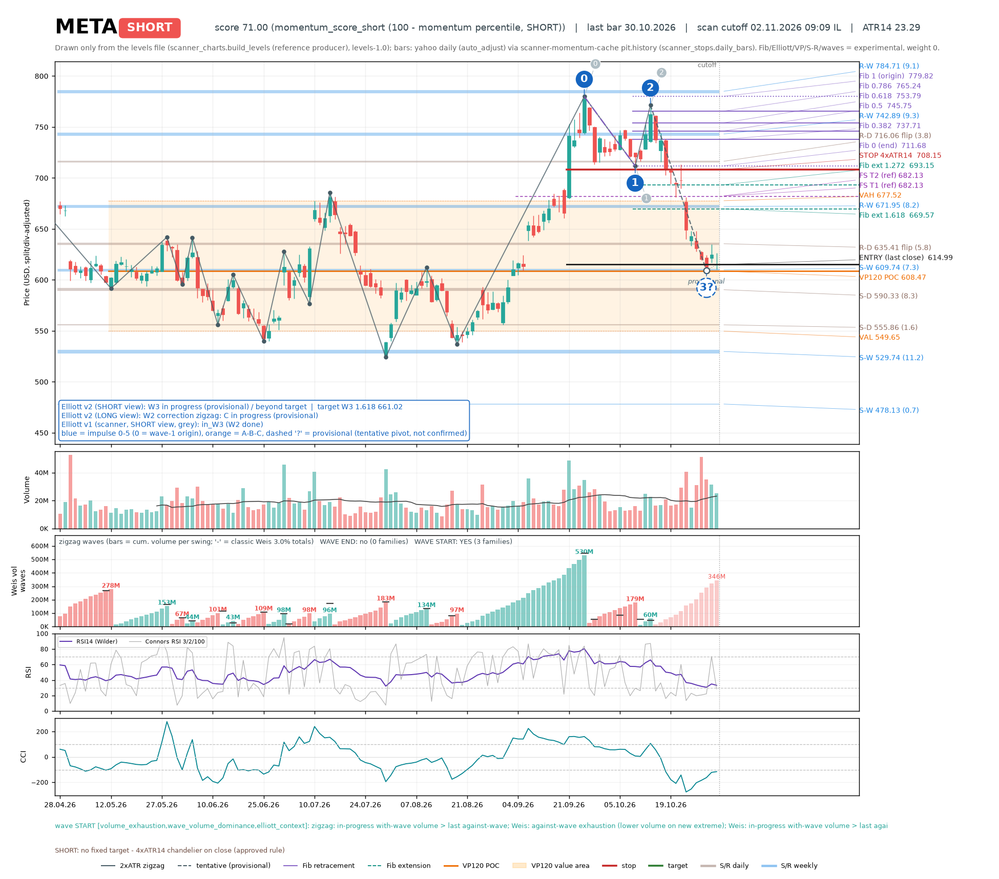

- **Jev (typesafe/jev-1.13):** 15 כותרות · 1 בביטחון ≥0.8 (סומכים על Jev) · 7 הועברו ל-Claude לשיפוט (ביטחון נמוך או חשד למניפולציה; 0 חשודות, 1 הודעות חברה) · סנטימנט שלילי (-1.00) · קטליזטור analyst
- **Grok (grok-4.3, חיפוש X של Grok):** ✅ אישור · סנטימנט ‎+0 · ביטחון medium · 3 פוסטים · סנטימנט מעורב אך S&P שלילי תומך בשורט · חשבונות מאומתים: @bulioscom, @SupBagholder, @esper1971
- **Perplexity:** לא התקבל (חסר קרדיט - OpenRouter (Perplexity))
- **Claude:** לא התקבל (חסר קרדיט - OpenRouter (Claude))
- **GPT:** לא התקבל (חסר קרדיט - OpenRouter (GPT))
- **האם הגרף נראה נכון? (ניסיוני):** Grok: no: ספירת אליוט ורמות נראות תקינות · קלט: grok=img

### 17. URI – לונג · דירוג 64.5
- **🔴 חסר קרדיט - OpenRouter (Claude) ; חסר קרדיט - OpenRouter (GPT) ; חסר קרדיט - OpenRouter (Perplexity)**
- **רמות (קובץ הרמות, נר אחרון 2026-10-30, hash 151322d60b273744):** כניסה 1,170.05 · סטופ 1,015.53 (chandelier_close 4.0xATR14, ATR14=38.63) · יעד: 1,186.86 – חצי ב-Fib 1.618 (סגירה), השאר בשנדלייר 4xATR
- **טכני:** SMA20 1,085.17 · SMA50 1,049.03 · SMA200 968.66 · מומנטום 12-1 0.197 · RSI14 65.8 · CCI20 153
- **ניסיוני (משקל 0):** אליוט v2: W3 in progress (provisional) · אליוט v1: in_W3 (W2 done) · פיבו v2 1,005.64→1,117.64 (1.618=1,186.86) · VP120 POC 1,064.63 (VAH 1,120.21, VAL 985.64) · תמיכה 1,048.65 · התנגדות 1,176.41 · סוף גל: 3 משפחות (volume_exhaustion,wave_volume_dominance,momentum_divergence) · תחילת גל: 2 (wave_volume_dominance,elliott_context)
- **דוח:** מותר - דוח בעוד 59 ימי מסחר · מקורות: 2027-01-27 (Yahoo calendar)
- **סוויפ נזילות (ייחוס בלבד, משקל 0):** לא · **עבר בדיקה, שביר, משקל 0**

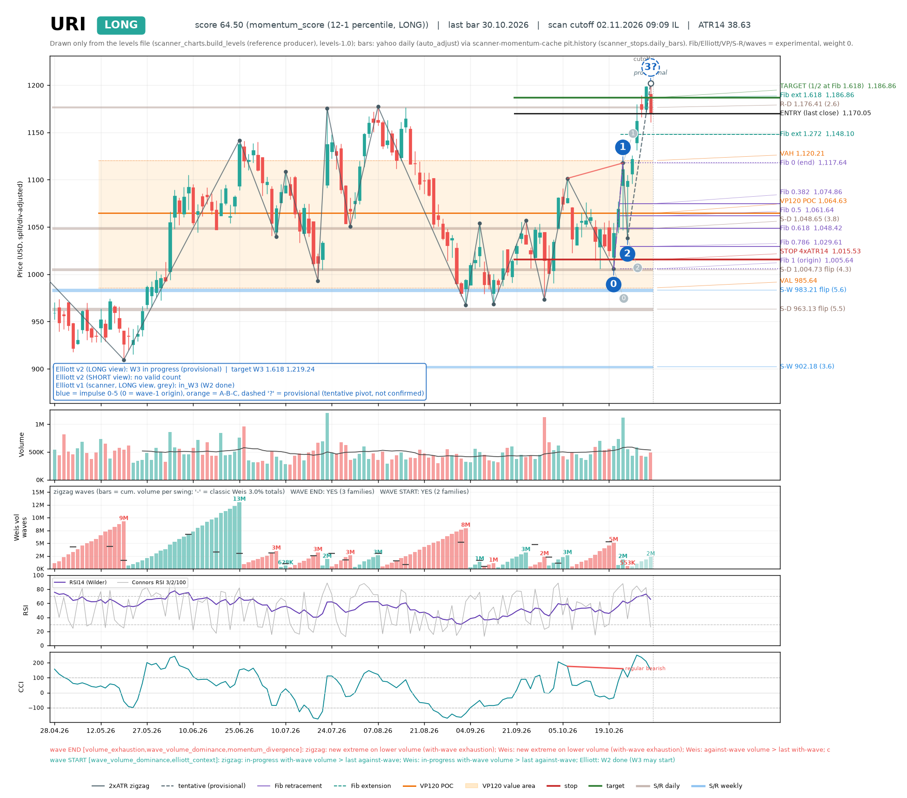

- **Jev (typesafe/jev-1.13):** 3 כותרות · 0 בביטחון ≥0.8 (סומכים על Jev) · 3 הועברו ל-Claude לשיפוט (ביטחון נמוך או חשד למניפולציה; 0 חשודות, 2 הודעות חברה) · סנטימנט — · קטליזטור —
- **Grok (grok-4.3, חיפוש X של Grok):** ✅ אישור · סנטימנט ‎+1 · ביטחון low · 9 פוסטים · אין סיבות שליליות בולטות ב-X נגד ה-LONG · חשבונות מאומתים: @trading_alerts_, @sicikal_01, @UMorgaan
- **Perplexity:** לא התקבל (חסר קרדיט - OpenRouter (Perplexity))
- **Claude:** לא התקבל (חסר קרדיט - OpenRouter (Claude))
- **GPT:** לא התקבל (חסר קרדיט - OpenRouter (GPT))
- **האם הגרף נראה נכון? (ניסיוני):** Grok: no: ספירת אליוט ורמות פיב נראות תקינות · קלט: grok=img

### 18. ABBV – לונג · דירוג 63.6
- **🔴 חסר קרדיט - OpenRouter (Claude) ; חסר קרדיט - OpenRouter (GPT) ; חסר קרדיט - OpenRouter (Perplexity)**
- **רמות (קובץ הרמות, נר אחרון 2026-10-30, hash 1a9e1bc0a811c639):** כניסה 294.89 · סטופ 269.22 (chandelier_close 4.0xATR14, ATR14=6.4166) · יעד: 313.09 – חצי ב-Fib 1.618 (סגירה), השאר בשנדלייר 4xATR
- **טכני:** SMA20 280.96 · SMA50 268.07 · SMA200 234.25 · מומנטום 12-1 0.182 · RSI14 73.4 · CCI20 130
- **ניסיוני (משקל 0):** אליוט v2: W5 in progress (provisional) · אליוט v1: in_W5 (W4 done) · פיבו v2 256.30→291.40 (1.618=313.09) · VP120 POC 246.85 (VAH 288.95, VAL 240.00) · תמיכה 291.40 · התנגדות — · סוף גל: 2 משפחות (volume_exhaustion,wave_volume_dominance) · תחילת גל: 1 (wave_volume_dominance)
- **דוח:** תאריך דוח לא מאומת
- **סוויפ נזילות (ייחוס בלבד, משקל 0):** לא · **עבר בדיקה, שביר, משקל 0**

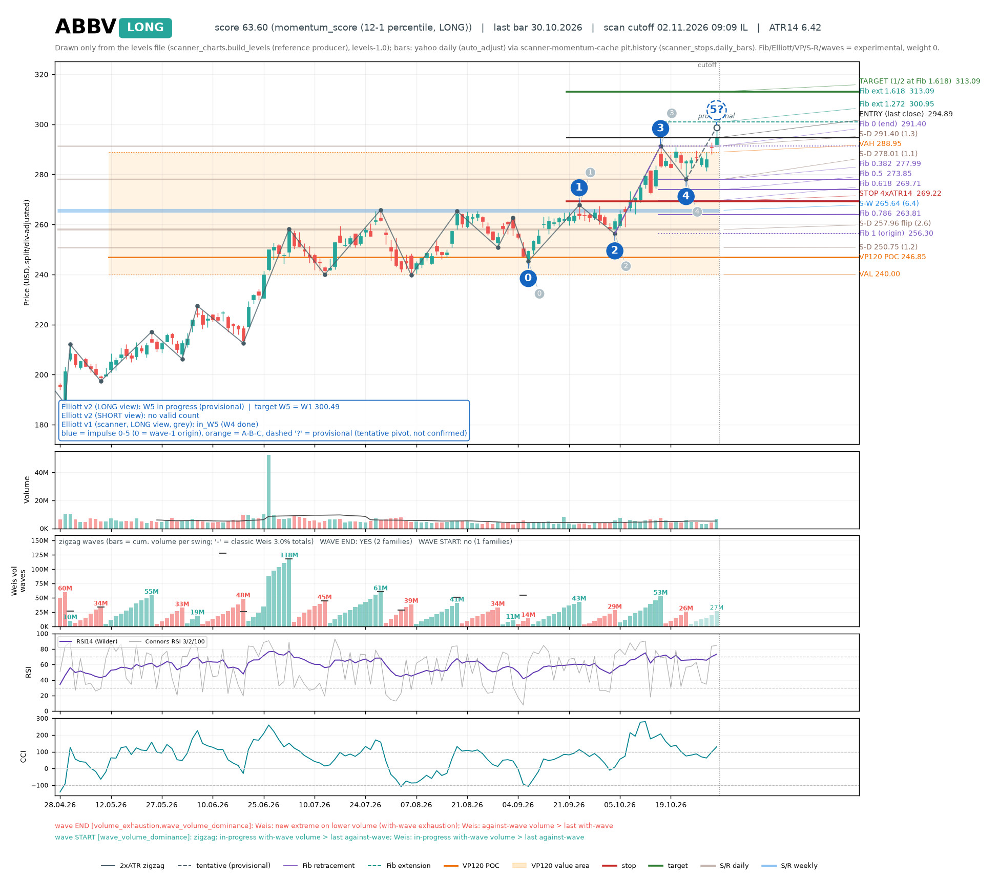

- **Jev (typesafe/jev-1.13):** 15 כותרות · 1 בביטחון ≥0.8 (סומכים על Jev) · 8 הועברו ל-Claude לשיפוט (ביטחון נמוך או חשד למניפולציה; 0 חשודות, 2 הודעות חברה) · סנטימנט חיובי (+1.00) · קטליזטור earnings
- **Grok (grok-4.3, חיפוש X של Grok):** ✅ אישור · סנטימנט ‎+2 · ביטחון high · 7 פוסטים · סנטימנט חיובי חזק ב-X תומך ב-long ללא סיבות נגד · חשבונות מאומתים: —
- **Perplexity:** לא התקבל (חסר קרדיט - OpenRouter (Perplexity))
- **Claude:** לא התקבל (חסר קרדיט - OpenRouter (Claude))
- **GPT:** לא התקבל (חסר קרדיט - OpenRouter (GPT))
- **האם הגרף נראה נכון? (ניסיוני):** Grok: no: הספירה האליוטית וה-fib נראים תקינים ומתאימים ל-long · קלט: grok=img

### 19. TMO – לונג · דירוג 61.7
- **🔴 חסר קרדיט - OpenRouter (Claude) ; חסר קרדיט - OpenRouter (GPT) ; חסר קרדיט - OpenRouter (Perplexity)**
- **רמות (קובץ הרמות, נר אחרון 2026-10-30, hash 6b992d1712f84c21):** כניסה 697.00 · סטופ 618.26 (chandelier_close 4.0xATR14, ATR14=19.69) · יעד: 749.34 – חצי ב-Fib 1.618 (סגירה), השאר בשנדלייר 4xATR
- **טכני:** SMA20 679.49 · SMA50 654.49 · SMA200 550.67 · מומנטום 12-1 0.173 · RSI14 59.2 · CCI20 103
- **ניסיוני (משקל 0):** אליוט v2: W3 in progress (provisional) · אליוט v1: in_W3 (W2 done) · פיבו v2 635.32→705.79 (1.618=749.34) · VP120 POC 659.15 (VAH 711.85, VAL 501.06) · תמיכה 683.30 · התנגדות 701.37 · סוף גל: 1 משפחות (wave_volume_dominance) · תחילת גל: 2 (wave_volume_dominance,elliott_context)
- **דוח:** מותר - דוח בעוד 60 ימי מסחר · מקורות: 2027-01-28 (Yahoo calendar)
- **סוויפ נזילות (ייחוס בלבד, משקל 0):** לא · **עבר בדיקה, שביר, משקל 0**

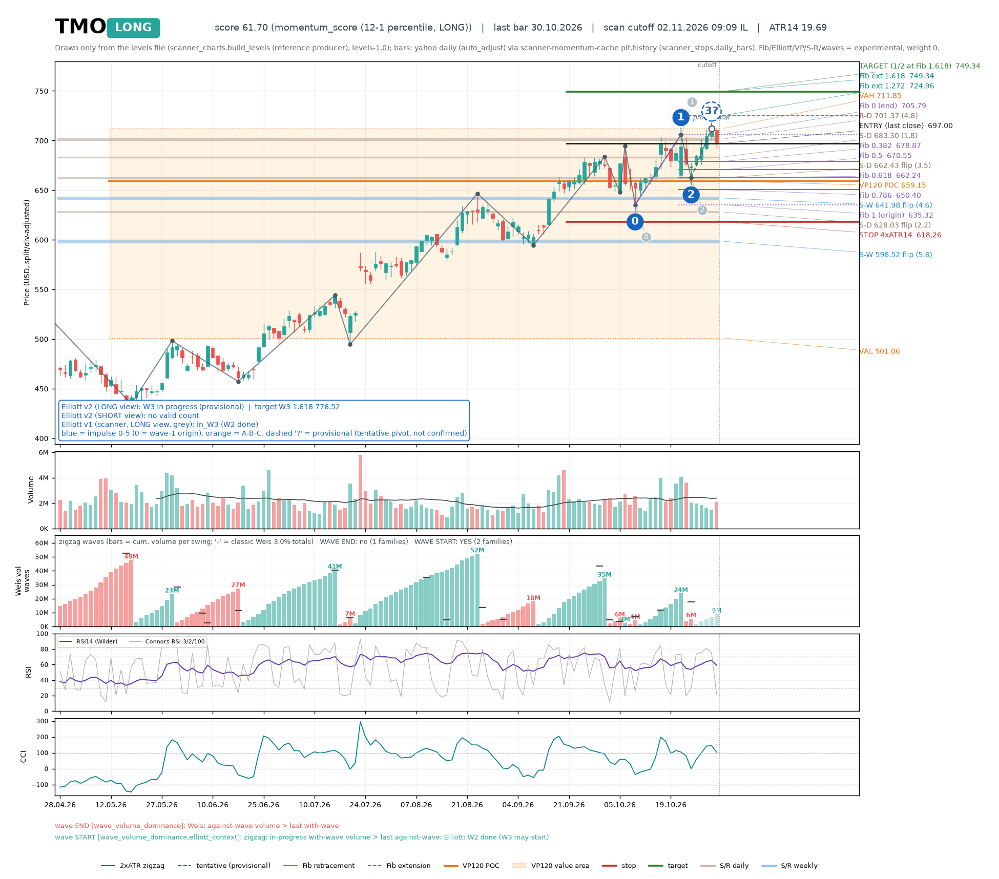

- **Jev (typesafe/jev-1.13):** 8 כותרות · 0 בביטחון ≥0.8 (סומכים על Jev) · 7 הועברו ל-Claude לשיפוט (ביטחון נמוך או חשד למניפולציה; 0 חשודות, 2 הודעות חברה) · סנטימנט — · קטליזטור —
- **Grok (grok-4.3, חיפוש X של Grok):** ✅ אישור · סנטימנט ‎+0 · ביטחון low · 1 פוסטים · אין סיבה ברורה נגד ה-LONG מהצד של X · חשבונות מאומתים: @ValyeAI
- **Perplexity:** לא התקבל (חסר קרדיט - OpenRouter (Perplexity))
- **Claude:** לא התקבל (חסר קרדיט - OpenRouter (Claude))
- **GPT:** לא התקבל (חסר קרדיט - OpenRouter (GPT))
- **האם הגרף נראה נכון? (ניסיוני):** Grok: n/a: אין התייחסות ל-Elliott או Fib בפוסטים · קלט: grok=img

### 20. BAC – שורט · דירוג 57.0
- **🔴 חסר קרדיט - OpenRouter (Claude) ; חסר קרדיט - OpenRouter (GPT) ; חסר קרדיט - OpenRouter (Perplexity)**
- **רמות (קובץ הרמות, נר אחרון 2026-10-30, hash d6fa8c2b728505dc):** כניסה 50.01 · סטופ 54.65 (chandelier_close 4.0xATR14, ATR14=1.1590) · יעד: אין – ללא יעד קבוע - שנדלייר 4xATR14 על סגירה (כלל מאושר)
- **טכני:** SMA20 51.95 · SMA50 56.37 · SMA200 54.55 · מומנטום 12-1 0.044 · RSI14 27.7 · CCI20 ‎-78
- **ניסיוני (משקל 0):** אליוט v2: W2 correction zigzag: B in progress (provisional) · אליוט v1: in_W3 (W2 done) · פיבו v2 54.93→49.26 (1.618=45.76) · VP120 POC 50.89 (VAH 60.71, VAL 49.12) · תמיכה 49.27 · התנגדות 50.46 · סוף גל: 1 משפחות (volume_exhaustion) · תחילת גל: 2 (wave_volume_dominance,elliott_context)
- **דוח:** מותר - דוח בעוד 52 ימי מסחר · מקורות: 2027-01-15 (Yahoo calendar)
- **סוויפ נזילות (ייחוס בלבד, משקל 0):** לא
- **ספירלת פיבו – יעדי ייחוס בלבד (משקל 0, לא משנה סטופ/יעד; השורט נשאר עם סטופ נגרר 4×ATR בלי יעד):** T1 57.55 (fan:2@fib0.382) · T2 57.55 (fan:1@fib0.382) · מצב: triggered_earlier

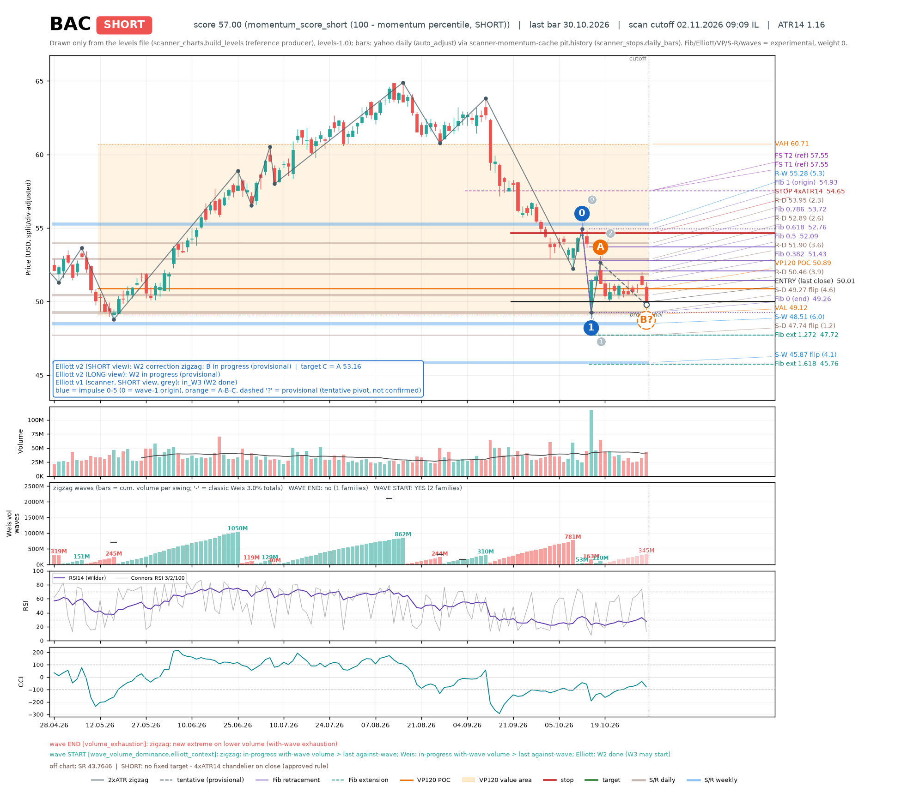

- **Jev (typesafe/jev-1.13):** 15 כותרות · 1 בביטחון ≥0.8 (סומכים על Jev) · 8 הועברו ל-Claude לשיפוט (ביטחון נמוך או חשד למניפולציה; 0 חשודות, 2 הודעות חברה) · סנטימנט שלילי (-1.00) · קטליזטור analyst
- **Grok (grok-4.3, חיפוש X של Grok):** ✅ אישור · סנטימנט ‎+0 · ביטחון low · 9 פוסטים · סנטימנט ניטרלי ב-X, אין סיבה לווטו על SHORT · חשבונות מאומתים: —
- **Perplexity:** לא התקבל (חסר קרדיט - OpenRouter (Perplexity))
- **Claude:** לא התקבל (חסר קרדיט - OpenRouter (Claude))
- **GPT:** לא התקבל (חסר קרדיט - OpenRouter (GPT))
- **האם הגרף נראה נכון? (ניסיוני):** Grok: no: ספירת גלים ורמות פיב נראות תואמות לירידה · קלט: grok=img

### 21. SCHW – שורט · דירוג 56.1
- **🔴 חסר קרדיט - OpenRouter (Claude) ; חסר קרדיט - OpenRouter (GPT) ; חסר קרדיט - OpenRouter (Perplexity)**
- **רמות (קובץ הרמות, נר אחרון 2026-10-30, hash 4a595688e4e47d9f):** כניסה 88.05 · סטופ 95.86 (chandelier_close 4.0xATR14, ATR14=1.9520) · יעד: אין – ללא יעד קבוע - שנדלייר 4xATR14 על סגירה (כלל מאושר)
- **טכני:** SMA20 92.96 · SMA50 100.49 · SMA200 97.19 · מומנטום 12-1 0.053 · RSI14 27.7 · CCI20 ‎-105
- **ניסיוני (משקל 0):** אליוט v2: no valid count · אליוט v1: no valid count · פיבו v2 —→— (1.618=—) · VP120 POC 91.42 (VAH 102.82, VAL 84.33) · תמיכה 85.83 · התנגדות 88.42 · סוף גל: 1 משפחות (wave_volume_dominance) · תחילת גל: 1 (wave_volume_dominance)
- **דוח:** מותר - דוח בעוד 55 ימי מסחר · מקורות: 2027-01-21 (Yahoo calendar)
- **סוויפ נזילות (ייחוס בלבד, משקל 0):** כן (לונג, רמה 87.38 pivot)
- **ספירלת פיבו – יעדי ייחוס בלבד (משקל 0, לא משנה סטופ/יעד; השורט נשאר עם סטופ נגרר 4×ATR בלי יעד):** T1 107.26 (fan:2@fib0.236) · T2 102.76 (fan:1@fib0.382) · מצב: triggered_earlier

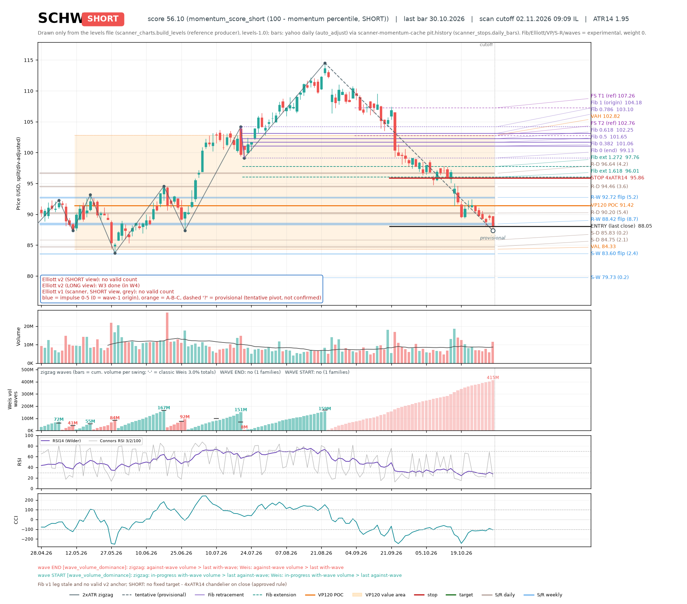

- **Jev (typesafe/jev-1.13):** 10 כותרות · 2 בביטחון ≥0.8 (סומכים על Jev) · 6 הועברו ל-Claude לשיפוט (ביטחון נמוך או חשד למניפולציה; 0 חשודות, 0 הודעות חברה) · סנטימנט שלילי (-1.00) · קטליזטור analyst
- **Grok (grok-4.3, חיפוש X של Grok):** ✅ אישור · סנטימנט ‎+0 · ביטחון medium · 8 פוסטים · סנטימנט מעורב ללא סיבה ברורה נגד SHORT · חשבונות מאומתים: @__jc1da__, @TheTranscript_
- **Perplexity:** לא התקבל (חסר קרדיט - OpenRouter (Perplexity))
- **Claude:** לא התקבל (חסר קרדיט - OpenRouter (Claude))
- **GPT:** לא התקבל (חסר קרדיט - OpenRouter (GPT))
- **האם הגרף נראה נכון? (ניסיוני):** Grok: no: ספירה אליוט ורמות פיב תואמות למגמה יורדת · קלט: grok=img

### 22. AMZN – שורט · דירוג 48.6
- **🔴 חסר קרדיט - OpenRouter (Claude) ; חסר קרדיט - OpenRouter (GPT) ; חסר קרדיט - OpenRouter (Perplexity)**
- **רמות (קובץ הרמות, נר אחרון 2026-10-30, hash e82b22e25adb2607):** כניסה 240.35 · סטופ 269.37 (chandelier_close 4.0xATR14, ATR14=7.2557) · יעד: אין – ללא יעד קבוע - שנדלייר 4xATR14 על סגירה (כלל מאושר)
- **טכני:** SMA20 254.39 · SMA50 254.28 · SMA200 243.40 · מומנטום 12-1 0.078 · RSI14 38.3 · CCI20 ‎-237
- **ניסיוני (משקל 0):** אליוט v2: no valid count · אליוט v1: no valid count · פיבו v2 287.20→244.30 (1.618=217.79) · VP120 POC 248.36 (VAH 265.01, VAL 235.41) · תמיכה 234.04 · התנגדות 247.08 · סוף גל: 1 משפחות (climax) · תחילת גל: 3 (volume_exhaustion,wave_volume_dominance,momentum_divergence)
- **דוח:** תאריך דוח לא מאומת
- **סוויפ נזילות (ייחוס בלבד, משקל 0):** לא
- **ספירלת פיבו – יעדי ייחוס בלבד (משקל 0, לא משנה סטופ/יעד; השורט נשאר עם סטופ נגרר 4×ATR בלי יעד):** T1 — (—) · T2 — (—) · מצב: none

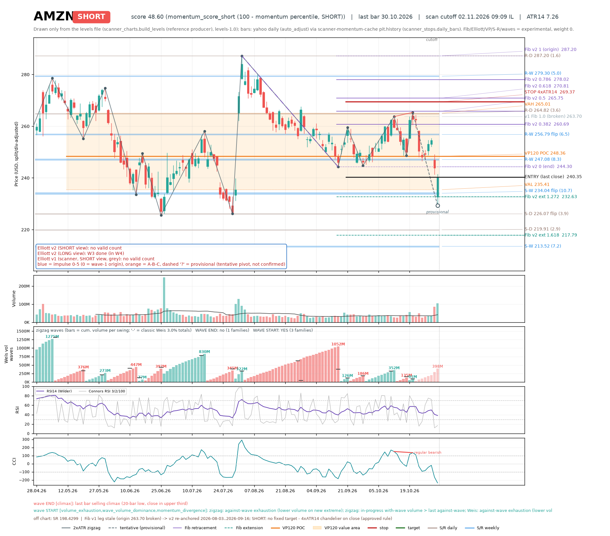

- **Jev (typesafe/jev-1.13):** 15 כותרות · 0 בביטחון ≥0.8 (סומכים על Jev) · 6 הועברו ל-Claude לשיפוט (ביטחון נמוך או חשד למניפולציה; 0 חשודות, 1 הודעות חברה) · סנטימנט — · קטליזטור —
- **Grok (grok-4.3, חיפוש X של Grok):** ✅ אישור · סנטימנט ‎+0 · ביטחון low · 3 פוסטים · סנטימנט מעורב ללא חדשות שליליות ברורות · חשבונות מאומתים: @Know_Christ_jp, @AnessHusseinAli, @reynosismo_
- **Perplexity:** לא התקבל (חסר קרדיט - OpenRouter (Perplexity))
- **Claude:** לא התקבל (חסר קרדיט - OpenRouter (Claude))
- **GPT:** לא התקבל (חסר קרדיט - OpenRouter (GPT))
- **האם הגרף נראה נכון? (ניסיוני):** Grok: no: ספירת אליוט ורמות פיב תקינות · קלט: grok=img

### 23. V – לונג · דירוג 46.7
- **🔴 חסר קרדיט - OpenRouter (Claude) ; חסר קרדיט - OpenRouter (GPT) ; חסר קרדיט - OpenRouter (Perplexity)**
- **רמות (קובץ הרמות, נר אחרון 2026-10-30, hash 5a3e880b2fabb2ca):** כניסה 413.59 · סטופ 384.69 (chandelier_close 4.0xATR14, ATR14=7.2248) · יעד: 450.35 – חצי ב-Fib 1.618 (סגירה), השאר בשנדלייר 4xATR
- **טכני:** SMA20 396.12 · SMA50 381.31 · SMA200 341.45 · מומנטום 12-1 0.063 · RSI14 69.4 · CCI20 103
- **ניסיוני (משקל 0):** אליוט v2: W3 in progress (provisional) · אליוט v1: in_W3 (W2 done) · פיבו v2 356.75→414.60 (1.618=450.35) · VP120 POC 368.14 (VAH 384.43, VAL 327.97) · תמיכה 385.57 · התנגדות 414.60 · סוף גל: 2 משפחות (volume_exhaustion,momentum_divergence) · תחילת גל: 1 (elliott_context)
- **דוח:** מותר - דוח בעוד 58 ימי מסחר · מקורות: 2027-01-26 (Yahoo calendar)
- **סוויפ נזילות (ייחוס בלבד, משקל 0):** כן (שורט, רמה 414.60 pivot) · **עבר בדיקה, שביר, משקל 0**

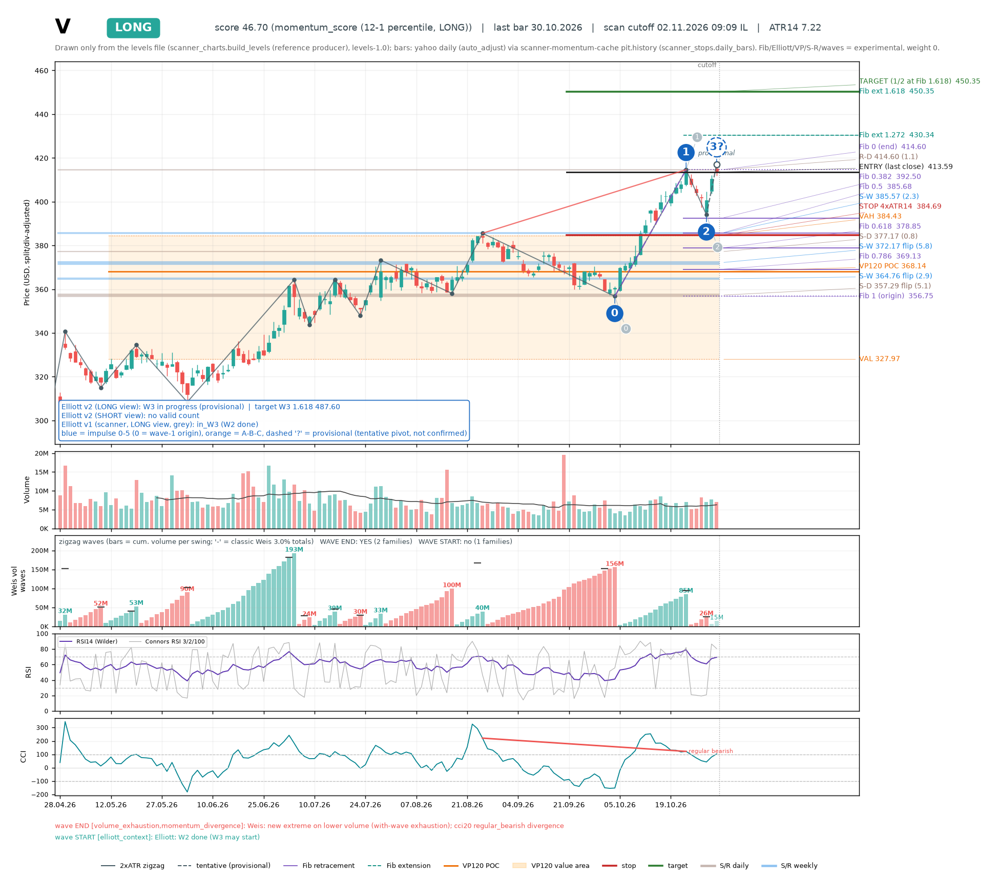

- **Jev (typesafe/jev-1.13):** 15 כותרות · 3 בביטחון ≥0.8 (סומכים על Jev) · 8 הועברו ל-Claude לשיפוט (ביטחון נמוך או חשד למניפולציה; 0 חשודות, 1 הודעות חברה) · סנטימנט חיובי (+0.66) · קטליזטור analyst
- **Grok (grok-4.3, חיפוש X של Grok):** ✅ אישור · סנטימנט ‎+0 · ביטחון low · 0 פוסטים · אין סנטימנט שלילי ב-X · חשבונות מאומתים: —
- **Perplexity:** לא התקבל (חסר קרדיט - OpenRouter (Perplexity))
- **Claude:** לא התקבל (חסר קרדיט - OpenRouter (Claude))
- **GPT:** לא התקבל (חסר קרדיט - OpenRouter (GPT))
- **האם הגרף נראה נכון? (ניסיוני):** Grok: no: הספירה נראית נכונה · קלט: grok=img

### 24. UNH – לונג · דירוג 45.8
- **🔴 חסר קרדיט - OpenRouter (Claude) ; חסר קרדיט - OpenRouter (GPT) ; חסר קרדיט - OpenRouter (Perplexity)**
- **רמות (קובץ הרמות, נר אחרון 2026-10-30, hash 0c7748a7d4052d72):** כניסה 406.97 · סטופ 363.13 (chandelier_close 4.0xATR14, ATR14=10.96) · יעד: 466.07 – חצי ב-Fib 1.618 (סגירה), השאר בשנדלייר 4xATR
- **טכני:** SMA20 398.67 · SMA50 389.47 · SMA200 359.62 · מומנטום 12-1 0.055 · RSI14 56.2 · CCI20 45
- **ניסיוני (משקל 0):** אליוט v2: W2 in progress (provisional) · אליוט v1: no valid count · פיבו v2 362.60→426.55 (1.618=466.07) · VP120 POC 377.03 (VAH 412.62, VAL 372.22) · תמיכה 400.66 · התנגדות 411.73 · סוף גל: 0 משפחות (—) · תחילת גל: 0 (—)
- **דוח:** מותר - דוח בעוד 49 ימי מסחר · מקורות: 2027-01-12 (Yahoo calendar)
- **סוויפ נזילות (ייחוס בלבד, משקל 0):** לא · **עבר בדיקה, שביר, משקל 0**

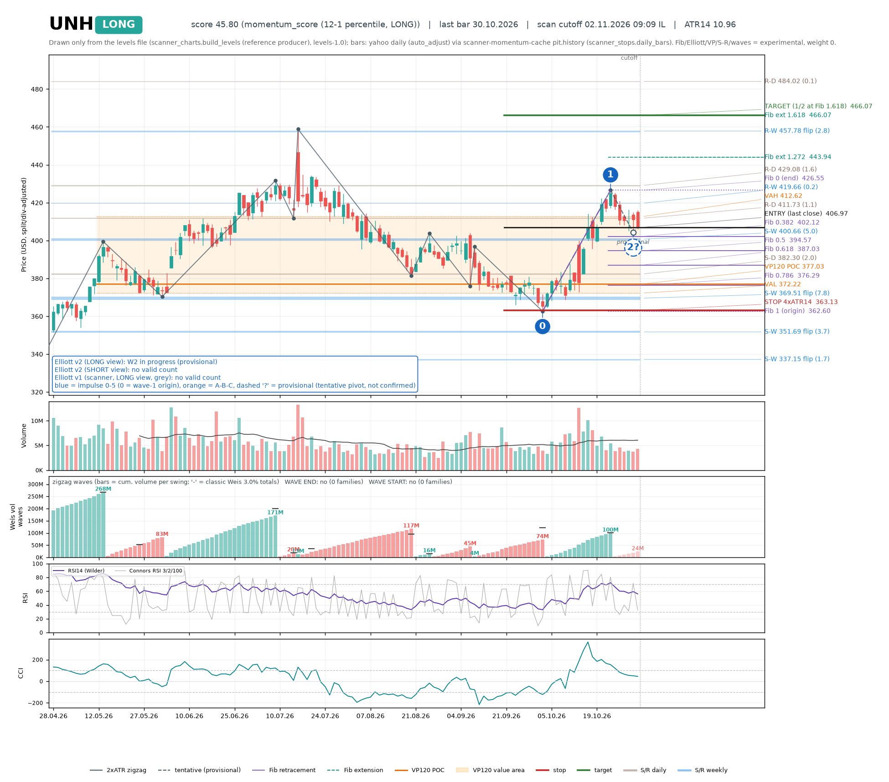

- **Jev (typesafe/jev-1.13):** 15 כותרות · 1 בביטחון ≥0.8 (סומכים על Jev) · 7 הועברו ל-Claude לשיפוט (ביטחון נמוך או חשד למניפולציה; 0 חשודות, 2 הודעות חברה) · סנטימנט ניטרלי/מעורב (+0.00) · קטליזטור other
- **Grok (grok-4.3, חיפוש X של Grok):** ✅ אישור · סנטימנט ‎+0 · ביטחון low · 6 פוסטים · אין חדשות שליליות ב-X נגד הסווינג הלונג · חשבונות מאומתים: —
- **Perplexity:** לא התקבל (חסר קרדיט - OpenRouter (Perplexity))
- **Claude:** לא התקבל (חסר קרדיט - OpenRouter (Claude))
- **GPT:** לא התקבל (חסר קרדיט - OpenRouter (GPT))
- **האם הגרף נראה נכון? (ניסיוני):** Grok: no: הספירה והרמות נראות סבירות · קלט: grok=img

### 25. MS – שורט · דירוג 40.2
- **🔴 חסר קרדיט - OpenRouter (Claude) ; חסר קרדיט - OpenRouter (GPT) ; חסר קרדיט - OpenRouter (Perplexity)**
- **רמות (קובץ הרמות, נר אחרון 2026-10-30, hash 1fea2be3e7c0819d):** כניסה 184.30 · סטופ 204.58 (chandelier_close 4.0xATR14, ATR14=5.0692) · יעד: אין – ללא יעד קבוע - שנדלייר 4xATR14 על סגירה (כלל מאושר)
- **טכני:** SMA20 184.60 · SMA50 196.89 · SMA200 192.08 · מומנטום 12-1 0.172 · RSI14 44.6 · CCI20 ‎-2
- **ניסיוני (משקל 0):** אליוט v2: W2 in progress (provisional) · אליוט v1: W5_done (correction next) · פיבו v2 192.13→175.37 (1.618=165.02) · VP120 POC 213.86 (VAH 225.24, VAL 192.72) · תמיכה 183.70 · התנגדות 189.02 · סוף גל: 4 משפחות (volume_exhaustion,wave_volume_dominance,momentum_divergence,elliott_context) · תחילת גל: 0 (—)
- **דוח:** מותר - דוח בעוד 51 ימי מסחר · מקורות: 2027-01-14 (Yahoo calendar)
- **סוויפ נזילות (ייחוס בלבד, משקל 0):** לא
- **ספירלת פיבו – יעדי ייחוס בלבד (משקל 0, לא משנה סטופ/יעד; השורט נשאר עם סטופ נגרר 4×ATR בלי יעד):** T1 — (—) · T2 — (—) · מצב: none

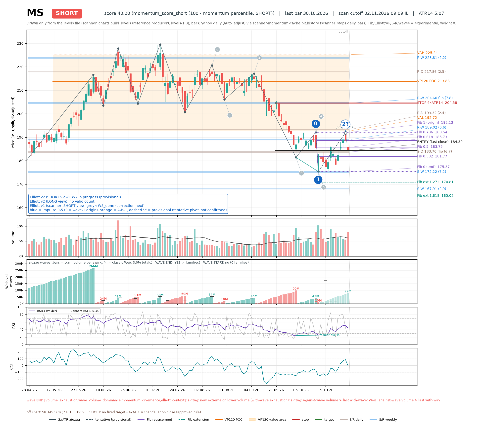

- **Jev (typesafe/jev-1.13):** 15 כותרות · 0 בביטחון ≥0.8 (סומכים על Jev) · 7 הועברו ל-Claude לשיפוט (ביטחון נמוך או חשד למניפולציה; 0 חשודות, 1 הודעות חברה) · סנטימנט — · קטליזטור —
- **Grok (grok-4.3, חיפוש X של Grok):** ✅ אישור · סנטימנט ‎+0 · ביטחון low · 8 פוסטים · סנטימנט ניטרלי ב-X ללא סיבה ברורה נגד SHORT · חשבונות מאומתים: —
- **Perplexity:** לא התקבל (חסר קרדיט - OpenRouter (Perplexity))
- **Claude:** לא התקבל (חסר קרדיט - OpenRouter (Claude))
- **GPT:** לא התקבל (חסר קרדיט - OpenRouter (GPT))
- **האם הגרף נראה נכון? (ניסיוני):** Grok: no: ספירה ו-Fib נראים תקינים עם המגמה היורדת · קלט: grok=img

### 26. WMT – לונג · דירוג 38.3
- **🔴 חסר קרדיט - OpenRouter (Claude) ; חסר קרדיט - OpenRouter (GPT) ; חסר קרדיט - OpenRouter (Perplexity)**
- **רמות (קובץ הרמות, נר אחרון 2026-10-30, hash 23505bacf5f6182b):** כניסה 123.51 · סטופ 113.82 (chandelier_close 4.0xATR14, ATR14=2.4228) · יעד: 132.50 – חצי ב-Fib 1.618 (סגירה), השאר בשנדלייר 4xATR
- **טכני:** SMA20 115.95 · SMA50 110.23 · SMA200 118.14 · מומנטום 12-1 0.026 · RSI14 72.7 · CCI20 112
- **ניסיוני (משקל 0):** אליוט v2: W3 in progress (provisional) · אליוט v1: in_W3 (W2 done) · פיבו v2 103.39→121.38 (1.618=132.50) · VP120 POC 106.40 (VAH 117.84, VAL 102.80) · תמיכה 121.08 · התנגדות 125.86 · סוף גל: 1 משפחות (volume_exhaustion) · תחילת גל: 2 (wave_volume_dominance,elliott_context)
- **דוח:** מותר - דוח בעוד 14 ימי מסחר · מקורות: 2026-11-19 (Yahoo calendar)
- **סוויפ נזילות (ייחוס בלבד, משקל 0):** לא · **עבר בדיקה, שביר, משקל 0**

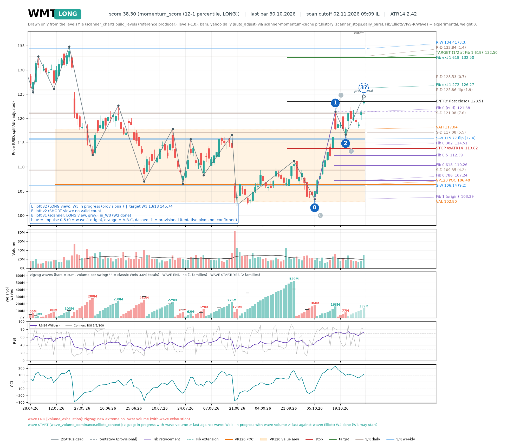

- **Jev (typesafe/jev-1.13):** 15 כותרות · 0 בביטחון ≥0.8 (סומכים על Jev) · 8 הועברו ל-Claude לשיפוט (ביטחון נמוך או חשד למניפולציה; 0 חשודות, 5 הודעות חברה) · סנטימנט — · קטליזטור —
- **Grok (grok-4.3, חיפוש X של Grok):** ✅ אישור · סנטימנט ‎+0 · ביטחון low · 2 פוסטים · אין סנטימנט שלילי ברור ב-X נגד ה-LONG · חשבונות מאומתים: @balance0014, @Interngobull
- **Perplexity:** לא התקבל (חסר קרדיט - OpenRouter (Perplexity))
- **Claude:** לא התקבל (חסר קרדיט - OpenRouter (Claude))
- **GPT:** לא התקבל (חסר קרדיט - OpenRouter (GPT))
- **האם הגרף נראה נכון? (ניסיוני):** Grok: n/a: אין מידע מספיק לשפוט · קלט: grok=img

### 27. AEP – לונג · דירוג 37.4
- **🔴 חסר קרדיט - OpenRouter (Claude) ; חסר קרדיט - OpenRouter (GPT) ; חסר קרדיט - OpenRouter (Perplexity)**
- **רמות (קובץ הרמות, נר אחרון 2026-10-30, hash 5479c0328e69df9e):** כניסה 130.21 · סטופ 120.84 (chandelier_close 4.0xATR14, ATR14=2.3415) · יעד: 130.22 – חצי ב-Fib 1.618 (סגירה), השאר בשנדלייר 4xATR
- **טכני:** SMA20 126.15 · SMA50 123.35 · SMA200 126.98 · מומנטום 12-1 0.011 · RSI14 63.2 · CCI20 109
- **ניסיוני (משקל 0):** אליוט v2: no valid count · אליוט v1: no valid count · פיבו v2 112.97→130.83 (1.618=141.86) · VP120 POC 126.52 (VAH 130.85, VAL 119.90) · תמיכה 128.15 · התנגדות 130.90 · סוף גל: 1 משפחות (wave_volume_dominance) · תחילת גל: 2 (wave_volume_dominance,momentum_divergence)
- **דוח:** תאריך דוח לא מאומת
- **סוויפ נזילות (ייחוס בלבד, משקל 0):** כן (שורט, רמה 131.04 pivot) · **עבר בדיקה, שביר, משקל 0**

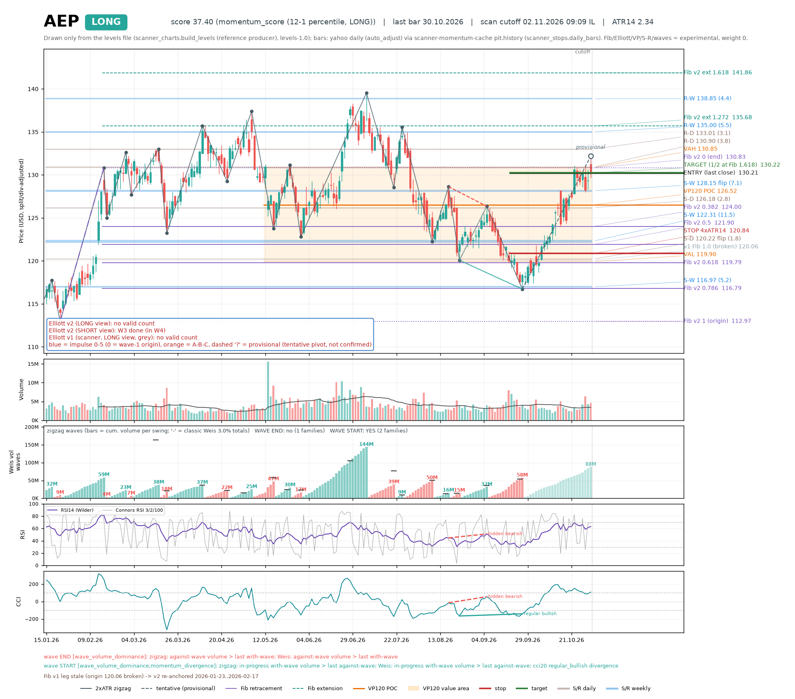

- **Jev (typesafe/jev-1.13):** 15 כותרות · 3 בביטחון ≥0.8 (סומכים על Jev) · 8 הועברו ל-Claude לשיפוט (ביטחון נמוך או חשד למניפולציה; 0 חשודות, 3 הודעות חברה) · סנטימנט חיובי (+1.00) · קטליזטור analyst
- **Grok (grok-4.3, חיפוש X של Grok):** ✅ אישור · סנטימנט ‎+1 · ביטחון high · 2 פוסטים · חדשות חיוביות על AEP תומכות ב-LONG · חשבונות מאומתים: @bullishchart, @Filecrux
- **Perplexity:** לא התקבל (חסר קרדיט - OpenRouter (Perplexity))
- **Claude:** לא התקבל (חסר קרדיט - OpenRouter (Claude))
- **GPT:** לא התקבל (חסר קרדיט - OpenRouter (GPT))
- **האם הגרף נראה נכון? (ניסיוני):** Grok: no: הספירה והעוגנים נראים תקינים · קלט: grok=img

### 28. COST – לונג · דירוג 36.4
- **🔴 חסר קרדיט - OpenRouter (Claude) ; חסר קרדיט - OpenRouter (GPT) ; חסר קרדיט - OpenRouter (Perplexity)**
- **רמות (קובץ הרמות, נר אחרון 2026-10-30, hash a939175f5da3a396):** כניסה 1,012.28 · סטופ 946.47 (chandelier_close 4.0xATR14, ATR14=16.45) · יעד: 1,105.32 – חצי ב-Fib 1.618 (סגירה), השאר בשנדלייר 4xATR
- **טכני:** SMA20 976.52 · SMA50 941.94 · SMA200 967.88 · מומנטום 12-1 0.009 · RSI14 66.9 · CCI20 102
- **ניסיוני (משקל 0):** אליוט v2: W3 in progress (provisional) · אליוט v1: in_W3 (W2 done) · פיבו v2 881.80→1,019.94 (1.618=1,105.32) · VP120 POC 947.31 (VAH 983.24, VAL 902.93) · תמיכה 972.33 · התנגדות 1,027.90 · סוף גל: 0 משפחות (—) · תחילת גל: 1 (elliott_context)
- **דוח:** מותר - דוח בעוד 28 ימי מסחר · מקורות: 2026-12-10 (Yahoo calendar)
- **סוויפ נזילות (ייחוס בלבד, משקל 0):** לא · **עבר בדיקה, שביר, משקל 0**

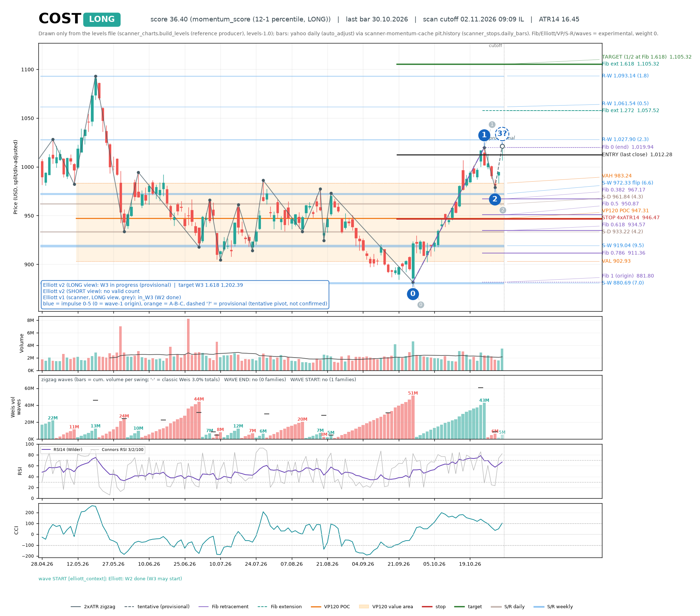

- **Jev (typesafe/jev-1.13):** 8 כותרות · 0 בביטחון ≥0.8 (סומכים על Jev) · 3 הועברו ל-Claude לשיפוט (ביטחון נמוך או חשד למניפולציה; 0 חשודות, 1 הודעות חברה) · סנטימנט — · קטליזטור —
- **Grok (grok-4.3, חיפוש X של Grok):** ✅ אישור · סנטימנט ‎+1 · ביטחון medium · 6 פוסטים · אין חדשות שליליות ברורות נגד ה-LONG · חשבונות מאומתים: @Mustard6900, @Mustard6900, @Interngobull
- **Perplexity:** לא התקבל (חסר קרדיט - OpenRouter (Perplexity))
- **Claude:** לא התקבל (חסר קרדיט - OpenRouter (Claude))
- **GPT:** לא התקבל (חסר קרדיט - OpenRouter (GPT))
- **האם הגרף נראה נכון? (ניסיוני):** Grok: no: הספירה והעוגנים נראים תקינים · קלט: grok=img

### 29. GOOGL – שורט · דירוג 32.7
- **🔴 חסר קרדיט - OpenRouter (Claude) ; חסר קרדיט - OpenRouter (GPT) ; חסר קרדיט - OpenRouter (Perplexity)**
- **רמות (קובץ הרמות, נר אחרון 2026-10-30, hash 01ba5347d44be36e):** כניסה 279.84 · סטופ 321.46 (chandelier_close 4.0xATR14, ATR14=10.41) · יעד: אין – ללא יעד קבוע - שנדלייר 4xATR14 על סגירה (כלל מאושר)
- **טכני:** SMA20 333.91 · SMA50 339.03 · SMA200 340.34 · מומנטום 12-1 0.235 · RSI14 21.4 · CCI20 ‎-219
- **ניסיוני (משקל 0):** אליוט v2: W3 in progress (provisional) / beyond target · אליוט v1: in_W3 (W2 done) · פיבו v2 364.17→335.51 (1.618=317.80) · VP120 POC 343.82 (VAH 371.37, VAL 332.02) · תמיכה 271.95 · התנגדות 311.08 · סוף גל: 1 משפחות (wave_volume_dominance) · תחילת גל: 2 (wave_volume_dominance,elliott_context)
- **דוח:** תאריך דוח לא מאומת
- **סוויפ נזילות (ייחוס בלבד, משקל 0):** לא
- **ספירלת פיבו – יעדי ייחוס בלבד (משקל 0, לא משנה סטופ/יעד; השורט נשאר עם סטופ נגרר 4×ATR בלי יעד):** T1 — (—) · T2 — (—) · מצב: none

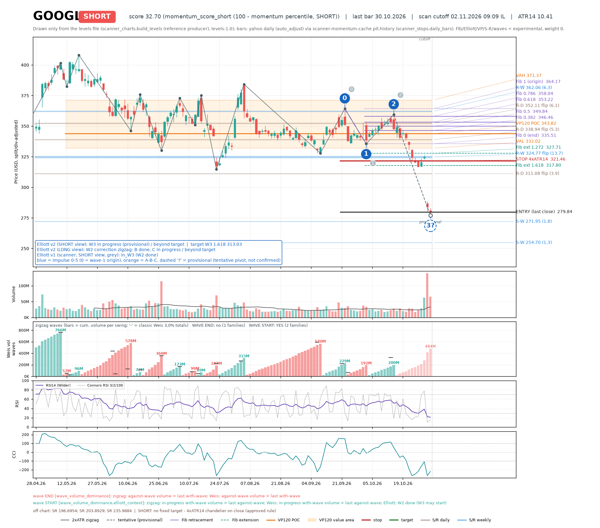

- **Jev (typesafe/jev-1.13):** 15 כותרות · 0 בביטחון ≥0.8 (סומכים על Jev) · 4 הועברו ל-Claude לשיפוט (ביטחון נמוך או חשד למניפולציה; 0 חשודות, 0 הודעות חברה) · סנטימנט — · קטליזטור —
- **Grok (grok-4.3, חיפוש X של Grok):** ✅ אישור · סנטימנט ‎-1 · ביטחון medium · 6 פוסטים · סנטימנט X שורטי תומך ב-SHORT · חשבונות מאומתים: —
- **Perplexity:** לא התקבל (חסר קרדיט - OpenRouter (Perplexity))
- **Claude:** לא התקבל (חסר קרדיט - OpenRouter (Claude))
- **GPT:** לא התקבל (חסר קרדיט - OpenRouter (GPT))
- **האם הגרף נראה נכון? (ניסיוני):** Grok: no: ספירה אליוט ופיב נראות תקינות על הגרף · קלט: grok=img

### 30. MA – לונג · דירוג 31.8
- **🔴 חסר קרדיט - OpenRouter (Claude) ; חסר קרדיט - OpenRouter (GPT) ; חסר קרדיט - OpenRouter (Perplexity)**
- **רמות (קובץ הרמות, נר אחרון 2026-10-30, hash 30b73470474004bc):** כניסה 638.01 · סטופ 591.43 (chandelier_close 4.0xATR14, ATR14=11.64) · יעד: 688.11 – חצי ב-Fib 1.618 (סגירה), השאר בשנדלייר 4xATR
- **טכני:** SMA20 606.11 · SMA50 586.14 · SMA200 534.24 · מומנטום 12-1 ‎-0.003 · RSI14 70.7 · CCI20 119
- **ניסיוני (משקל 0):** אליוט v2: W3 in progress (provisional) · אליוט v1: in_W3 (W2 done) · פיבו v2 544.58→633.29 (1.618=688.11) · VP120 POC 490.22 (VAH 571.76, VAL 477.54) · תמיכה 592.35 · התנגדות — · סוף גל: 1 משפחות (momentum_divergence) · תחילת גל: 2 (wave_volume_dominance,elliott_context)
- **דוח:** מותר - דוח בעוד 60 ימי מסחר · מקורות: 2027-01-28 (Yahoo calendar)
- **סוויפ נזילות (ייחוס בלבד, משקל 0):** לא · **עבר בדיקה, שביר, משקל 0**

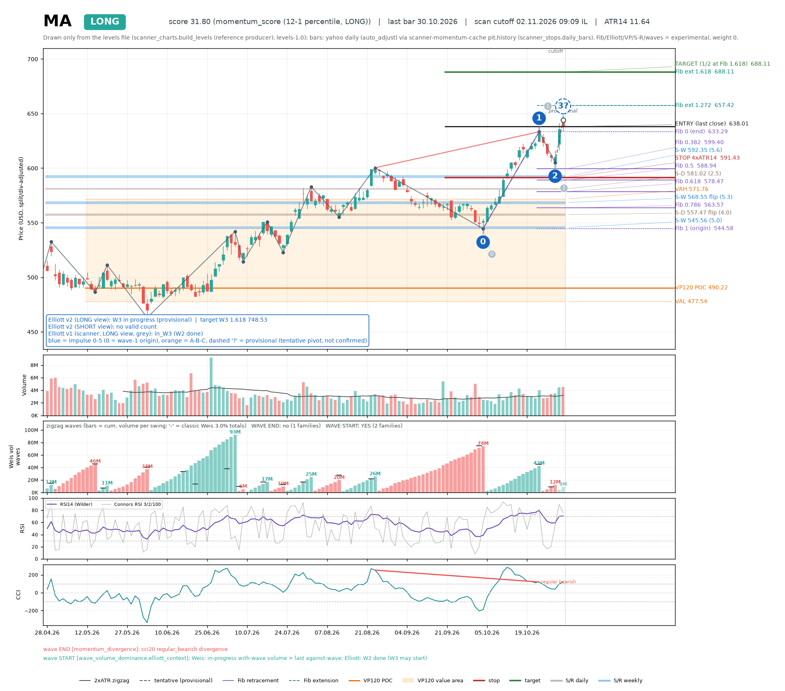

- **Jev (typesafe/jev-1.13):** 15 כותרות · 2 בביטחון ≥0.8 (סומכים על Jev) · 8 הועברו ל-Claude לשיפוט (ביטחון נמוך או חשד למניפולציה; 0 חשודות, 0 הודעות חברה) · סנטימנט חיובי (+1.00) · קטליזטור analyst
- **Grok (grok-4.3, חיפוש X של Grok):** ✅ אישור · סנטימנט ‎+1 · ביטחון medium · 3 פוסטים · אין חדשות שליליות ב-X נגד המסחר · חשבונות מאומתים: @Gilibertiario, @YieldCurveBalI
- **Perplexity:** לא התקבל (חסר קרדיט - OpenRouter (Perplexity))
- **Claude:** לא התקבל (חסר קרדיט - OpenRouter (Claude))
- **GPT:** לא התקבל (חסר קרדיט - OpenRouter (GPT))
- **האם הגרף נראה נכון? (ניסיוני):** Grok: no: ספירת אליוט ורמות פיב נראות תקינות על הגרף · קלט: grok=img

### 31. BLK – לונג · דירוג 30.8
- **🔴 חסר קרדיט - OpenRouter (Claude) ; חסר קרדיט - OpenRouter (GPT) ; חסר קרדיט - OpenRouter (Perplexity)**
- **רמות (קובץ הרמות, נר אחרון 2026-10-30, hash 63e9d2f78d1542c1):** כניסה 1,147.54 · סטופ 1,042.57 (chandelier_close 4.0xATR14, ATR14=26.24) · יעד: 1,233.88 – חצי ב-Fib 1.618 (סגירה), השאר בשנדלייר 4xATR
- **טכני:** SMA20 1,112.30 · SMA50 1,102.51 · SMA200 1,055.47 · מומנטום 12-1 ‎-0.010 · RSI14 58.3 · CCI20 84
- **ניסיוני (משקל 0):** אליוט v2: W5 in progress (provisional) · אליוט v1: in_W5 (W4 done) · פיבו v2 1,040.42→1,159.99 (1.618=1,233.88) · VP120 POC 1,069.70 (VAH 1,153.78, VAL 1,019.25) · תמיכה 1,112.24 · התנגדות 1,169.01 · סוף גל: 1 משפחות (wave_volume_dominance) · תחילת גל: 1 (wave_volume_dominance)
- **דוח:** מותר - דוח בעוד 51 ימי מסחר · מקורות: 2027-01-14 (Yahoo calendar)
- **סוויפ נזילות (ייחוס בלבד, משקל 0):** לא · **עבר בדיקה, שביר, משקל 0**

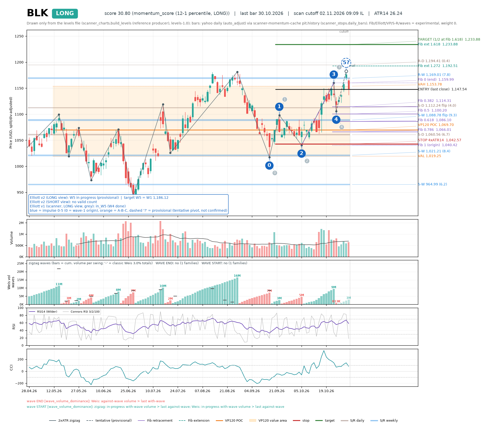

- **Jev (typesafe/jev-1.13):** 15 כותרות · 1 בביטחון ≥0.8 (סומכים על Jev) · 8 הועברו ל-Claude לשיפוט (ביטחון נמוך או חשד למניפולציה; 0 חשודות, 5 הודעות חברה) · סנטימנט חיובי (+1.00) · קטליזטור analyst
- **Grok (grok-4.3, חיפוש X של Grok):** ✅ אישור · סנטימנט ‎+1 · ביטחון medium · 3 פוסטים · אין סיבה ברורה נגד מהפוסטים · חשבונות מאומתים: @USAnt_IDEA
- **Perplexity:** לא התקבל (חסר קרדיט - OpenRouter (Perplexity))
- **Claude:** לא התקבל (חסר קרדיט - OpenRouter (Claude))
- **GPT:** לא התקבל (חסר קרדיט - OpenRouter (GPT))
- **האם הגרף נראה נכון? (ניסיוני):** Grok: n/a · קלט: grok=img

### 32. PG – לונג · דירוג 29.9
- **🔴 חסר קרדיט - OpenRouter (Claude) ; חסר קרדיט - OpenRouter (GPT) ; חסר קרדיט - OpenRouter (Perplexity)**
- **רמות (קובץ הרמות, נר אחרון 2026-10-30, hash 020e452dadfebb41):** כניסה 161.57 · סטופ 149.49 (chandelier_close 4.0xATR14, ATR14=3.0199) · יעד: 180.15 – חצי ב-Fib 1.618 (סגירה), השאר בשנדלייר 4xATR
- **טכני:** SMA20 155.45 · SMA50 149.13 · SMA200 146.86 · מומנטום 12-1 ‎-0.011 · RSI14 64.4 · CCI20 103
- **ניסיוני (משקל 0):** אליוט v2: W2 correction flat: B in progress (provisional) · אליוט v1: in_W3 (W2 done) · פיבו v2 142.46→165.75 (1.618=180.15) · VP120 POC 144.71 (VAH 149.03, VAL 140.96) · תמיכה 150.34 · התנגדות 164.29 · סוף גל: 0 משפחות (—) · תחילת גל: 1 (elliott_context)
- **דוח:** מותר - דוח בעוד 55 ימי מסחר · מקורות: 2027-01-21 (Yahoo calendar)
- **סוויפ נזילות (ייחוס בלבד, משקל 0):** לא · **עבר בדיקה, שביר, משקל 0**

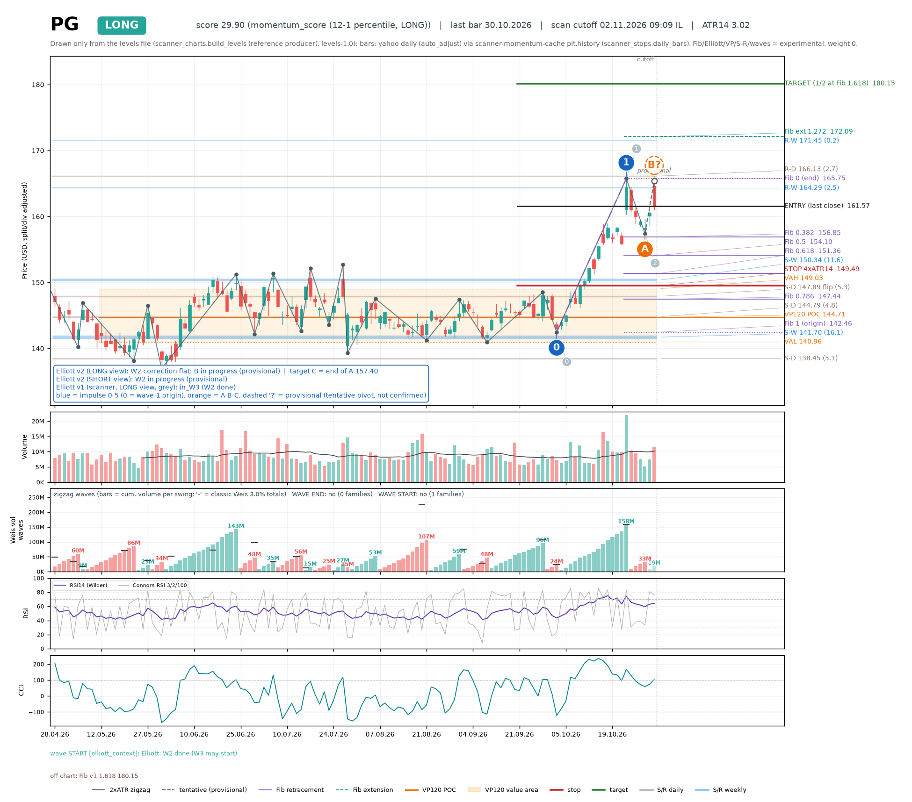

- **Jev (typesafe/jev-1.13):** 15 כותרות · 4 בביטחון ≥0.8 (סומכים על Jev) · 8 הועברו ל-Claude לשיפוט (ביטחון נמוך או חשד למניפולציה; 0 חשודות, 2 הודעות חברה) · סנטימנט חיובי (+0.31) · קטליזטור analyst
- **Grok (grok-4.3, חיפוש X של Grok):** ✅ אישור · סנטימנט ‎+0 · ביטחון low · 1 פוסטים · אין חדשות שליליות ב-X נגד הלונג · חשבונות מאומתים: @techdamentals
- **Perplexity:** לא התקבל (חסר קרדיט - OpenRouter (Perplexity))
- **Claude:** לא התקבל (חסר קרדיט - OpenRouter (Claude))
- **GPT:** לא התקבל (חסר קרדיט - OpenRouter (GPT))
- **האם הגרף נראה נכון? (ניסיוני):** Grok: no: הספירה והעוגנים נראים תקינים · קלט: grok=img

### 33. MSFT – לונג · דירוג 26.2
- **🔴 חסר קרדיט - OpenRouter (Claude) ; חסר קרדיט - OpenRouter (GPT) ; חסר קרדיט - OpenRouter (Perplexity)**
- **רמות (קובץ הרמות, נר אחרון 2026-10-30, hash 7a5d3893f36084f5):** כניסה 521.91 · סטופ 474.40 (chandelier_close 4.0xATR14, ATR14=11.88) · יעד: 557.10 – חצי ב-Fib 1.618 (סגירה), השאר בשנדלייר 4xATR
- **טכני:** SMA20 530.98 · SMA50 512.91 · SMA200 436.85 · מומנטום 12-1 ‎-0.045 · RSI14 49.0 · CCI20 ‎-163
- **ניסיוני (משקל 0):** אליוט v2: W2 correction zigzag: C in progress (provisional) · אליוט v1: no valid count · פיבו v2 487.23→551.15 (1.618=590.65) · VP120 POC 391.09 (VAH 494.42, VAL 348.54) · תמיכה 513.18 · התנגדות 523.89 · סוף גל: 0 משפחות (—) · תחילת גל: 1 (momentum_divergence)
- **דוח:** מותר - דוח בעוד 59 ימי מסחר · מקורות: 2027-01-27 (Yahoo calendar)
- **סוויפ נזילות (ייחוס בלבד, משקל 0):** לא · **עבר בדיקה, שביר, משקל 0**

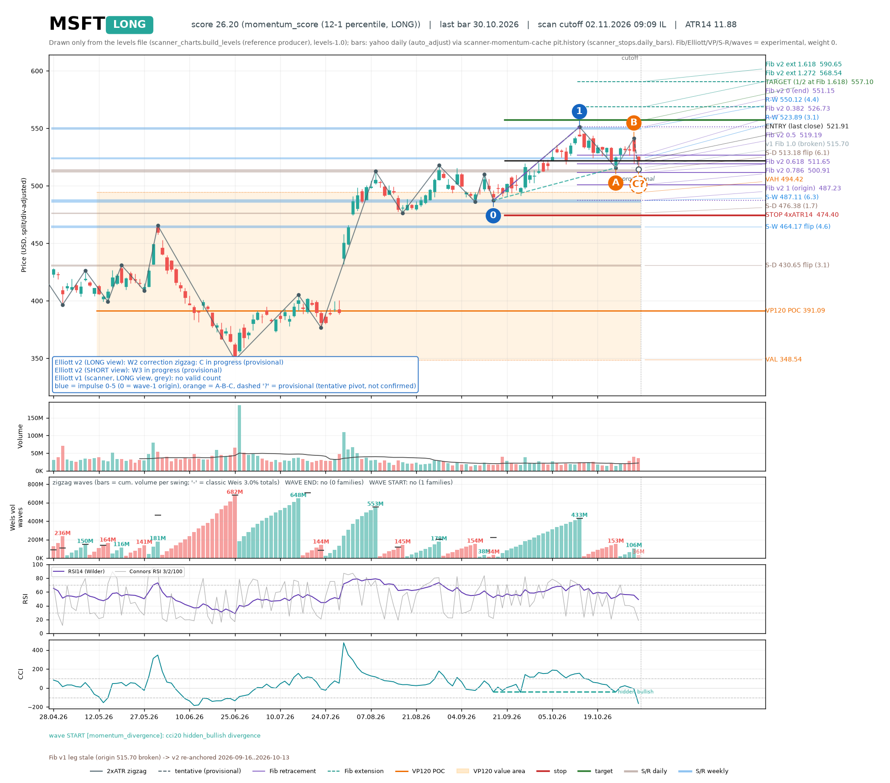

- **Jev (typesafe/jev-1.13):** 15 כותרות · 0 בביטחון ≥0.8 (סומכים על Jev) · 3 הועברו ל-Claude לשיפוט (ביטחון נמוך או חשד למניפולציה; 0 חשודות, 2 הודעות חברה) · סנטימנט — · קטליזטור —
- **Grok (grok-4.3, חיפוש X של Grok):** ✅ אישור · סנטימנט ‎+1 · ביטחון low · 5 פוסטים · אין חדשות שליליות ברורות ב-X · חשבונות מאומתים: @EmmanuelInvest, @AnessHusseinAli
- **Perplexity:** לא התקבל (חסר קרדיט - OpenRouter (Perplexity))
- **Claude:** לא התקבל (חסר קרדיט - OpenRouter (Claude))
- **GPT:** לא התקבל (חסר קרדיט - OpenRouter (GPT))
- **האם הגרף נראה נכון? (ניסיוני):** Grok: no: ספירה תואמת את הגרף · קלט: grok=img

### 34. CAT – שורט · דירוג 21.5
- **🔴 חסר קרדיט - OpenRouter (Claude) ; חסר קרדיט - OpenRouter (GPT) ; חסר קרדיט - OpenRouter (Perplexity)**
- **רמות (קובץ הרמות, נר אחרון 2026-10-30, hash 16ce5fd261327988):** כניסה 622.75 · סטופ 744.00 (chandelier_close 4.0xATR14, ATR14=30.31) · יעד: אין – ללא יעד קבוע - שנדלייר 4xATR14 על סגירה (כלל מאושר)
- **טכני:** SMA20 742.68 · SMA50 781.61 · SMA200 806.63 · מומנטום 12-1 0.420 · RSI14 24.0 · CCI20 ‎-158
- **ניסיוני (משקל 0):** אליוט v2: W3 in progress (provisional) · אליוט v1: in_W3 (W2 done) · פיבו v2 874.87→679.50 (1.618=558.76) · VP120 POC 811.14 (VAH 951.34, VAL 770.43) · תמיכה 578.69 · התנגדות 629.17 · סוף גל: 1 משפחות (momentum_divergence) · תחילת גל: 3 (wave_volume_dominance,climax,elliott_context)
- **דוח:** מותר - דוח בעוד 60 ימי מסחר · מקורות: 2027-01-28 (Yahoo calendar)
- **סוויפ נזילות (ייחוס בלבד, משקל 0):** לא
- **ספירלת פיבו – יעדי ייחוס בלבד (משקל 0, לא משנה סטופ/יעד; השורט נשאר עם סטופ נגרר 4×ATR בלי יעד):** T1 — (—) · T2 — (—) · מצב: none

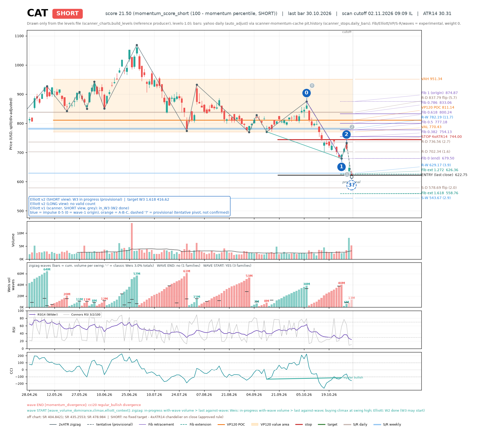

- **Jev (typesafe/jev-1.13):** 15 כותרות · 4 בביטחון ≥0.8 (סומכים על Jev) · 8 הועברו ל-Claude לשיפוט (ביטחון נמוך או חשד למניפולציה; 0 חשודות, 0 הודעות חברה) · סנטימנט שלילי (-0.76) · קטליזטור analyst
- **Grok (grok-4.3, חיפוש X של Grok):** ✅ אישור · סנטימנט ‎+0 · ביטחון medium · 3 פוסטים · סנטימנט מעורב ללא חדשות נגד השורט · חשבונות מאומתים: —
- **Perplexity:** לא התקבל (חסר קרדיט - OpenRouter (Perplexity))
- **Claude:** לא התקבל (חסר קרדיט - OpenRouter (Claude))
- **GPT:** לא התקבל (חסר קרדיט - OpenRouter (GPT))
- **האם הגרף נראה נכון? (ניסיוני):** Grok: no: ספירת Elliott ו-Fib נראות תואמות לירידה האחרונה · קלט: grok=img

### 35. DIS – לונג · דירוג 21.5
- **🔴 חסר קרדיט - OpenRouter (Claude) ; חסר קרדיט - OpenRouter (GPT) ; חסר קרדיט - OpenRouter (Perplexity)**
- **רמות (קובץ הרמות, נר אחרון 2026-10-30, hash 8e59671ae76a01d9):** כניסה 110.94 · סטופ 103.23 (chandelier_close 4.0xATR14, ATR14=1.9278) · יעד: 120.94 – חצי ב-Fib 1.618 (סגירה), השאר בשנדלייר 4xATR
- **טכני:** SMA20 109.25 · SMA50 107.35 · SMA200 103.01 · מומנטום 12-1 ‎-0.068 · RSI14 58.0 · CCI20 70
- **ניסיוני (משקל 0):** אליוט v2: W2 in progress (provisional) · אליוט v1: no valid count · פיבו v2 101.15→113.38 (1.618=120.94) · VP120 POC 103.56 (VAH 108.37, VAL 97.50) · תמיכה 109.77 · התנגדות 111.27 · סוף גל: 0 משפחות (—) · תחילת גל: 1 (volume_exhaustion)
- **דוח:** מותר - דוח בעוד 12 ימי מסחר · מקורות: 2026-11-17 (Yahoo calendar)
- **סוויפ נזילות (ייחוס בלבד, משקל 0):** לא · **עבר בדיקה, שביר, משקל 0**

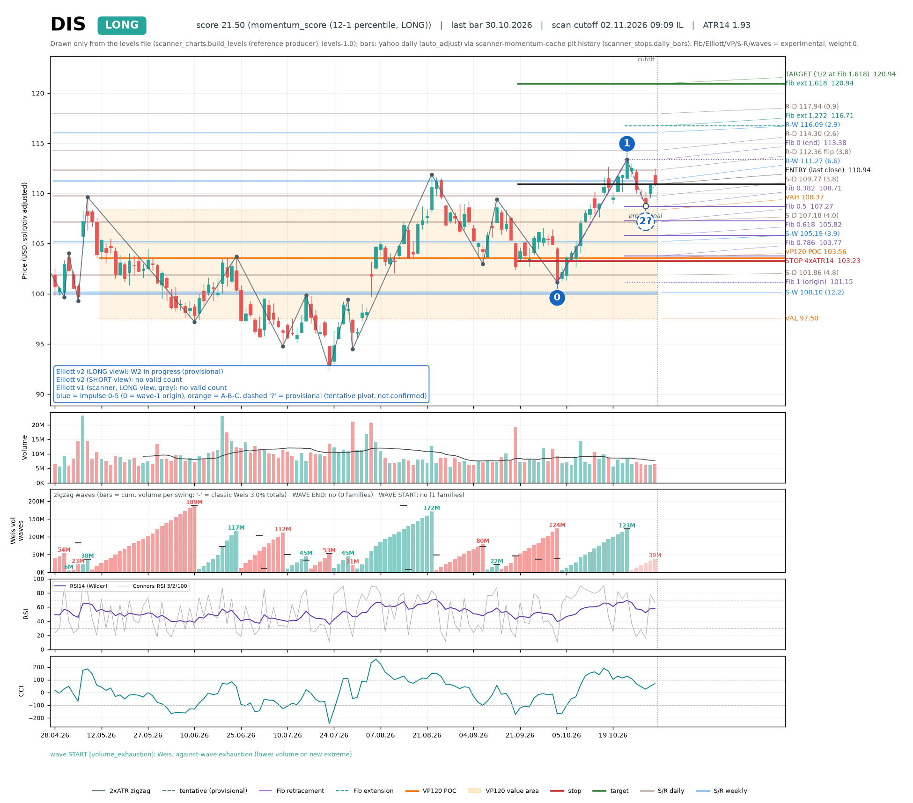

- **Jev (typesafe/jev-1.13):** 11 כותרות · 2 בביטחון ≥0.8 (סומכים על Jev) · 5 הועברו ל-Claude לשיפוט (ביטחון נמוך או חשד למניפולציה; 0 חשודות, 4 הודעות חברה) · סנטימנט ניטרלי/מעורב (+0.00) · קטליזטור other
- **Grok (grok-4.3, חיפוש X של Grok):** ✅ אישור · סנטימנט ‎+0 · ביטחון low · 1 פוסטים · אין חדשות שליליות או סנטימנט דובי ב-X · חשבונות מאומתים: —
- **Perplexity:** לא התקבל (חסר קרדיט - OpenRouter (Perplexity))
- **Claude:** לא התקבל (חסר קרדיט - OpenRouter (Claude))
- **GPT:** לא התקבל (חסר קרדיט - OpenRouter (GPT))
- **האם הגרף נראה נכון? (ניסיוני):** Grok: no: אין דיון על הספירה או הרמות · קלט: grok=img

### 36. ASML – שורט · דירוג 11.2
- **🔴 חסר קרדיט - OpenRouter (Claude) ; חסר קרדיט - OpenRouter (GPT) ; חסר קרדיט - OpenRouter (Perplexity)**
- **רמות (קובץ הרמות, נר אחרון 2026-10-30, hash d1752ab75a503940):** כניסה 1,565.90 · סטופ 1,801.01 (chandelier_close 4.0xATR14, ATR14=58.78) · יעד: אין – ללא יעד קבוע - שנדלייר 4xATR14 על סגירה (כלל מאושר)
- **טכני:** SMA20 1,682.41 · SMA50 1,702.63 · SMA200 1,592.65 · מומנטום 12-1 0.697 · RSI14 38.7 · CCI20 ‎-106
- **ניסיוני (משקל 0):** אליוט v2: W3 in progress (provisional) · אליוט v1: in_W3 (W2 done) · פיבו v2 1,871.03→1,547.96 (1.618=1,348.30) · VP120 POC 1,788.58 (VAH 1,827.59, VAL 1,593.57) · תמיכה 1,536.02 · התנגדות 1,618.35 · סוף גל: 1 משפחות (momentum_divergence) · תחילת גל: 1 (elliott_context)
- **דוח:** מותר - דוח בעוד 59 ימי מסחר · מקורות: 2027-01-27 (Yahoo calendar)
- **סוויפ נזילות (ייחוס בלבד, משקל 0):** לא
- **ספירלת פיבו – יעדי ייחוס בלבד (משקל 0, לא משנה סטופ/יעד; השורט נשאר עם סטופ נגרר 4×ATR בלי יעד):** T1 — (—) · T2 — (—) · מצב: none

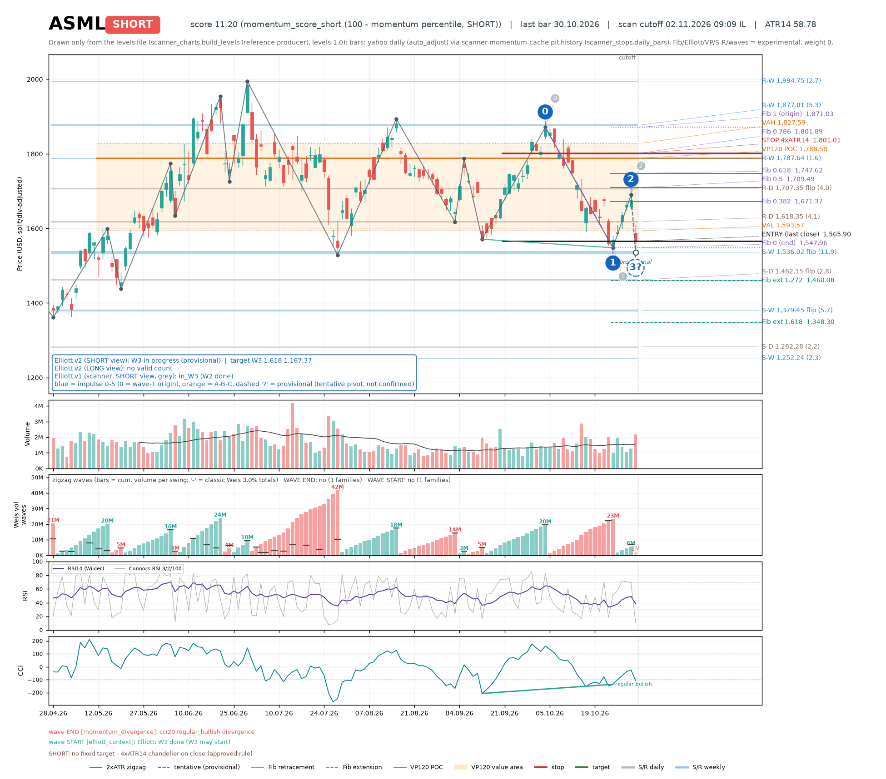

- **Jev (typesafe/jev-1.13):** 5 כותרות · 0 בביטחון ≥0.8 (סומכים על Jev) · 3 הועברו ל-Claude לשיפוט (ביטחון נמוך או חשד למניפולציה; 0 חשודות, 0 הודעות חברה) · סנטימנט — · קטליזטור —
- **Grok (grok-4.3, חיפוש X של Grok):** ⚠️ דגל · סנטימנט ‎+1 · ביטחון medium · 5 פוסטים · סנטימנט חיובי ב-X מנוגד ל-SHORT · חשבונות מאומתים: @Barkworth17, @SnowballlNotes, @CarsonTalkMoney
- **Perplexity:** לא התקבל (חסר קרדיט - OpenRouter (Perplexity))
- **Claude:** לא התקבל (חסר קרדיט - OpenRouter (Claude))
- **GPT:** לא התקבל (חסר קרדיט - OpenRouter (GPT))
- **האם הגרף נראה נכון? (ניסיוני):** Grok: no: אין מידע על ספירה שגויה · קלט: grok=img

### 37. TSLA – לונג · דירוג 10.3
- **🔴 חסר קרדיט - OpenRouter (Claude) ; חסר קרדיט - OpenRouter (GPT) ; חסר קרדיט - OpenRouter (Perplexity)**
- **רמות (קובץ הרמות, נר אחרון 2026-10-30, hash 79bffd32418ea671):** כניסה 399.81 · סטופ 346.05 (chandelier_close 4.0xATR14, ATR14=13.44) · יעד: 414.94 – חצי ב-Fib 1.618 (סגירה), השאר בשנדלייר 4xATR
- **טכני:** SMA20 380.70 · SMA50 369.60 · SMA200 385.30 · מומנטום 12-1 ‎-0.233 · RSI14 60.9 · CCI20 105
- **ניסיוני (משקל 0):** אליוט v2: W3 in progress (provisional) · אליוט v1: in_W3 (W2 done) · פיבו v2 345.88→388.56 (1.618=414.94) · VP120 POC 380.07 (VAH 425.32, VAL 350.43) · תמיכה 384.87 · התנגדות 414.23 · סוף גל: 1 משפחות (volume_exhaustion) · תחילת גל: 3 (wave_volume_dominance,momentum_divergence,elliott_context)
- **דוח:** מותר - דוח בעוד 59 ימי מסחר · מקורות: 2027-01-27 (Yahoo calendar)
- **סוויפ נזילות (ייחוס בלבד, משקל 0):** לא · **עבר בדיקה, שביר, משקל 0**

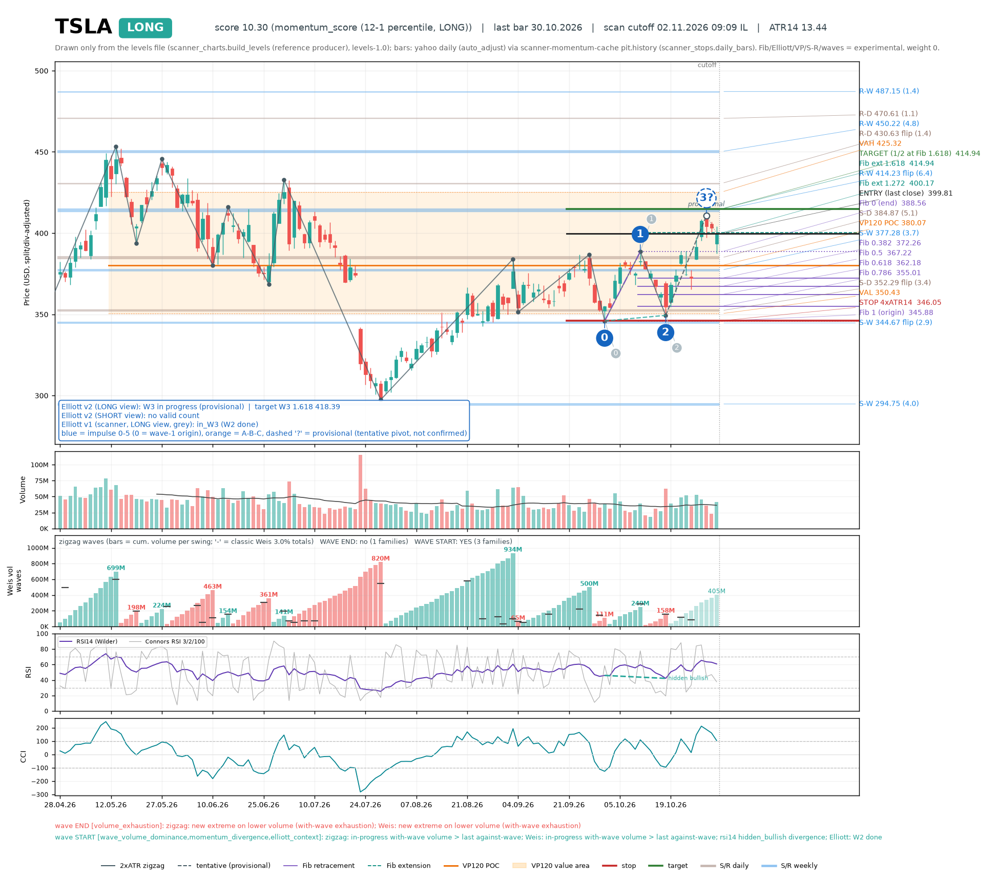

- **Jev (typesafe/jev-1.13):** 15 כותרות · 1 בביטחון ≥0.8 (סומכים על Jev) · 6 הועברו ל-Claude לשיפוט (ביטחון נמוך או חשד למניפולציה; 0 חשודות, 0 הודעות חברה) · סנטימנט שלילי (-1.00) · קטליזטור other
- **Grok (grok-4.3, חיפוש X של Grok):** ✅ אישור · סנטימנט ‎+1 · ביטחון medium · 7 פוסטים · סנטימנט חיובי ב-X תומך ב-LONG · חשבונות מאומתים: @MarcusWallStX, @Gfilche, @Gfilche, @Memeaiai00
- **Perplexity:** לא התקבל (חסר קרדיט - OpenRouter (Perplexity))
- **Claude:** לא התקבל (חסר קרדיט - OpenRouter (Claude))
- **GPT:** לא התקבל (חסר קרדיט - OpenRouter (GPT))
- **האם הגרף נראה נכון? (ניסיוני):** Grok: no: ספירה ו-Fib תואמים לגרף · קלט: grok=img

### 38. IBM – לונג · דירוג 8.4
- **🔴 חסר קרדיט - OpenRouter (Claude) ; חסר קרדיט - OpenRouter (GPT) ; חסר קרדיט - OpenRouter (Perplexity)**
- **רמות (קובץ הרמות, נר אחרון 2026-10-30, hash 43a434426a8c2aaf):** כניסה 257.81 · סטופ 229.25 (chandelier_close 4.0xATR14, ATR14=7.1398) · יעד: 259.62 – חצי ב-Fib 1.618 (סגירה), השאר בשנדלייר 4xATR
- **טכני:** SMA20 238.88 · SMA50 235.17 · SMA200 247.01 · מומנטום 12-1 ‎-0.249 · RSI14 70.9 · CCI20 112
- **ניסיוני (משקל 0):** אליוט v2: no valid count · אליוט v1: no valid count · פיבו v2 197.77→251.82 (1.618=285.22) · VP120 POC 233.50 (VAH 261.29, VAL 208.36) · תמיכה 255.19 · התנגדות 268.32 · סוף גל: 1 משפחות (wave_volume_dominance) · תחילת גל: 3 (volume_exhaustion,wave_volume_dominance,momentum_divergence)
- **דוח:** מותר - דוח בעוד 59 ימי מסחר · מקורות: 2027-01-27 (Yahoo calendar)
- **סוויפ נזילות (ייחוס בלבד, משקל 0):** לא · **עבר בדיקה, שביר, משקל 0**

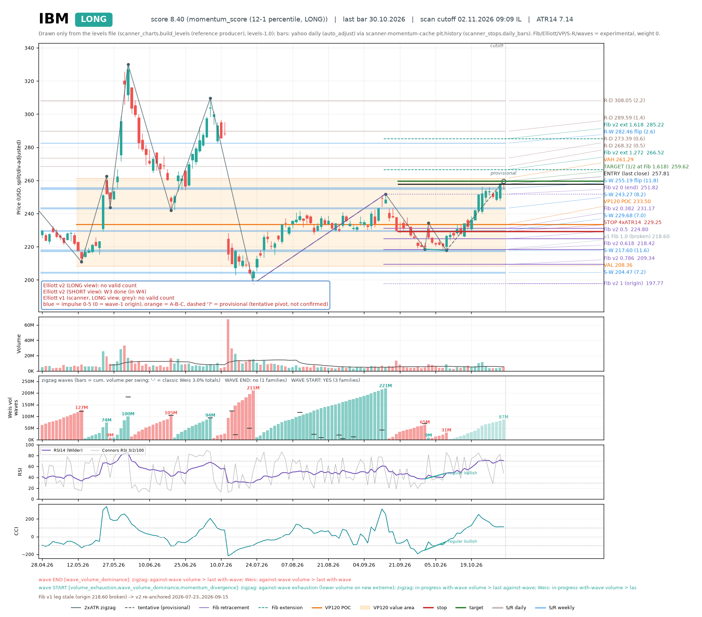

- **Jev (typesafe/jev-1.13):** 10 כותרות · 0 בביטחון ≥0.8 (סומכים על Jev) · 7 הועברו ל-Claude לשיפוט (ביטחון נמוך או חשד למניפולציה; 0 חשודות, 3 הודעות חברה) · סנטימנט — · קטליזטור —
- **Grok (grok-4.3, חיפוש X של Grok):** ✅ אישור · סנטימנט ‎+1 · ביטחון low · 2 פוסטים · אין חדשות שליליות בולטות נגד הלונג · חשבונות מאומתים: @Barkworth17, @jcomfin
- **Perplexity:** לא התקבל (חסר קרדיט - OpenRouter (Perplexity))
- **Claude:** לא התקבל (חסר קרדיט - OpenRouter (Claude))
- **GPT:** לא התקבל (חסר קרדיט - OpenRouter (GPT))
- **האם הגרף נראה נכון? (ניסיוני):** Grok: no: הספירה והעוגנים נראים תקינים · קלט: grok=img

### 39. INTC – שורט · דירוג 1.9
- **🔴 חסר קרדיט - OpenRouter (Claude) ; חסר קרדיט - OpenRouter (GPT) ; חסר קרדיט - OpenRouter (Perplexity)**
- **רמות (קובץ הרמות, נר אחרון 2026-10-30, hash 0fca64163847b363):** כניסה 65.76 · סטופ 93.64 (chandelier_close 4.0xATR14, ATR14=6.9703) · יעד: אין – ללא יעד קבוע - שנדלייר 4xATR14 על סגירה (כלל מאושר)
- **טכני:** SMA20 96.39 · SMA50 101.11 · SMA200 86.86 · מומנטום 12-1 1.903 · RSI14 25.1 · CCI20 ‎-234
- **ניסיוני (משקל 0):** אליוט v2: W3 in progress (provisional) · אליוט v1: in_W3 (W2 done) · פיבו v2 127.44→84.65 (1.618=58.21) · VP120 POC 101.98 (VAH 118.61, VAL 85.36) · תמיכה 53.99 · התנגדות 84.58 · סוף גל: 2 משפחות (volume_exhaustion,wave_volume_dominance) · תחילת גל: 2 (wave_volume_dominance,elliott_context)
- **דוח:** מותר - דוח בעוד 60 ימי מסחר · מקורות: 2027-01-28 (Yahoo calendar)
- **סוויפ נזילות (ייחוס בלבד, משקל 0):** לא
- **ספירלת פיבו – יעדי ייחוס בלבד (משקל 0, לא משנה סטופ/יעד; השורט נשאר עם סטופ נגרר 4×ATR בלי יעד):** T1 81.79 (circle:0.786@fib1.0) · T2 81.79 (fan:1@fib1.0) · מצב: triggered_earlier

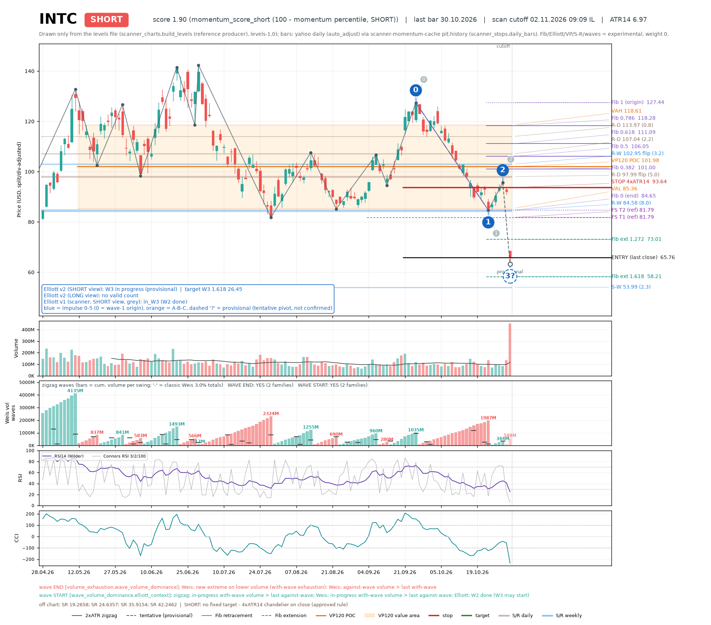

- **Jev (typesafe/jev-1.13):** 15 כותרות · 2 בביטחון ≥0.8 (סומכים על Jev) · 2 הועברו ל-Claude לשיפוט (ביטחון נמוך או חשד למניפולציה; 0 חשודות, 1 הודעות חברה) · סנטימנט שלילי (-1.00) · קטליזטור macro
- **Grok (grok-4.3, חיפוש X של Grok):** ✅ אישור · סנטימנט ‎+0 · ביטחון medium · 4 פוסטים · סנטימנט מעורב ללא סיבה לבטל SHORT · חשבונות מאומתים: @insidegadsmind, @YieldfieldUS
- **Perplexity:** לא התקבל (חסר קרדיט - OpenRouter (Perplexity))
- **Claude:** לא התקבל (חסר קרדיט - OpenRouter (Claude))
- **GPT:** לא התקבל (חסר קרדיט - OpenRouter (GPT))
- **האם הגרף נראה נכון? (ניסיוני):** Grok: no: ספירה ו-Fib נראים תקינים · קלט: grok=img

### 40. UBER – שורט · דירוג 94.4 · ⛔ נחסם (דוח)
- **🔴 חסר קרדיט - OpenRouter (Claude) ; חסר קרדיט - OpenRouter (GPT) ; חסר קרדיט - OpenRouter (Perplexity)**
- **רמות (קובץ הרמות, נר אחרון 2026-10-30, hash e976c777a38a6c21):** כניסה 65.25 · סטופ 72.00 (chandelier_close 4.0xATR14, ATR14=1.6872) · יעד: אין – ללא יעד קבוע - שנדלייר 4xATR14 על סגירה (כלל מאושר)
- **טכני:** SMA20 68.65 · SMA50 71.21 · SMA200 73.34 · מומנטום 12-1 ‎-0.291 · RSI14 35.8 · CCI20 ‎-132
- **ניסיוני (משקל 0):** אליוט v2: W3 in progress (provisional) · אליוט v1: in_W3 (W2 done) · פיבו v2 82.36→67.22 (1.618=57.86) · VP120 POC 71.55 (VAH 75.40, VAL 68.44) · תמיכה 60.15 · התנגדות 66.34 · סוף גל: 1 משפחות (momentum_divergence) · תחילת גל: 2 (wave_volume_dominance,elliott_context)
- **דוח:** נחסם - דוח בתוך 5 ימי מסחר · מקורות: 2026-11-04 (Yahoo calendar)
- **סוויפ נזילות (ייחוס בלבד, משקל 0):** לא
- **ספירלת פיבו – יעדי ייחוס בלבד (משקל 0, לא משנה סטופ/יעד; השורט נשאר עם סטופ נגרר 4×ATR בלי יעד):** T1 — (—) · T2 — (—) · מצב: none

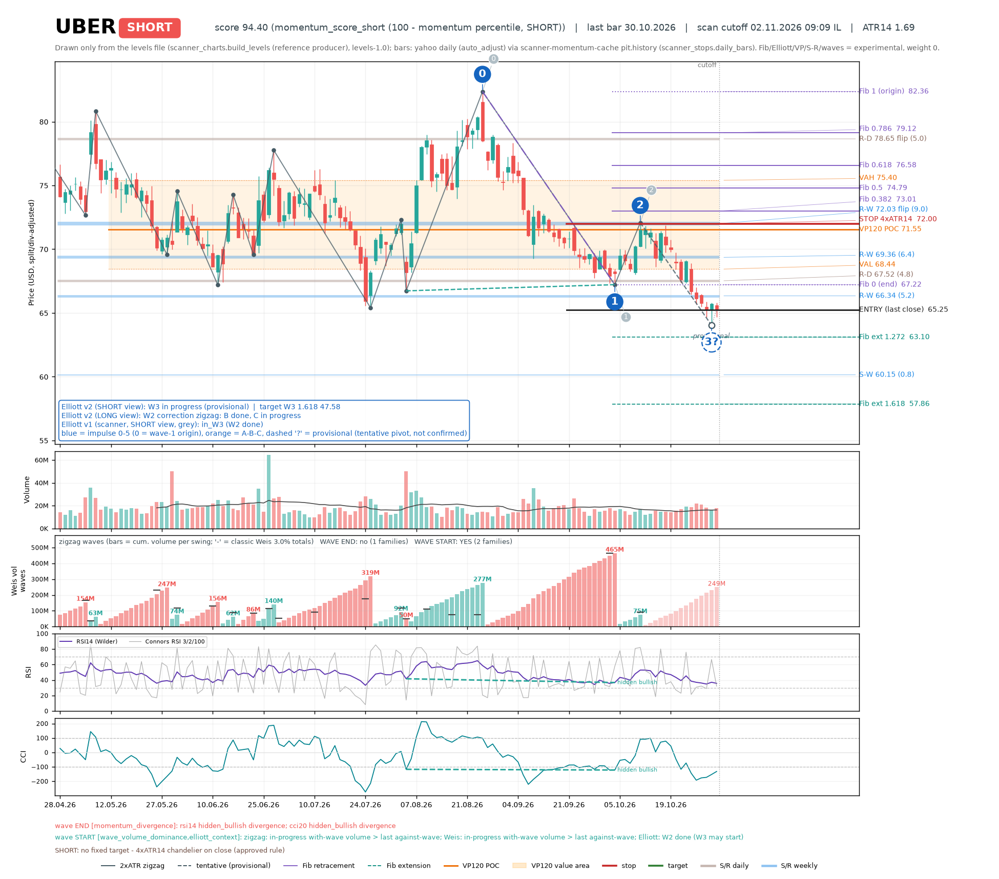

- **Jev (typesafe/jev-1.13):** 15 כותרות · 0 בביטחון ≥0.8 (סומכים על Jev) · 8 הועברו ל-Claude לשיפוט (ביטחון נמוך או חשד למניפולציה; 0 חשודות, 3 הודעות חברה) · סנטימנט — · קטליזטור —
- **Grok (grok-4.3, חיפוש X של Grok):** ✅ אישור · סנטימנט ‎+0 · ביטחון medium · 6 פוסטים · אין חדשות שליליות חזקות נגד השורט ב-X · חשבונות מאומתים: @PajamaTrader, @Gfilche, @takayanagiissei
- **Perplexity:** לא התקבל (חסר קרדיט - OpenRouter (Perplexity))
- **Claude:** לא התקבל (חסר קרדיט - OpenRouter (Claude))
- **GPT:** לא התקבל (חסר קרדיט - OpenRouter (GPT))
- **האם הגרף נראה נכון? (ניסיוני):** Grok: no: ספירה אליוט ורמות פיב תואמות את המגמה השלילית בפוסטים · קלט: grok=img

### 41. AMGN – לונג · דירוג 81.3 · ⛔ נחסם (דוח)
- **🔴 חסר קרדיט - OpenRouter (Claude) ; חסר קרדיט - OpenRouter (GPT) ; חסר קרדיט - OpenRouter (Perplexity)**
- **רמות (קובץ הרמות, נר אחרון 2026-10-30, hash 5199176d1839d5fe):** כניסה 466.01 · סטופ 420.08 (chandelier_close 4.0xATR14, ATR14=11.48) · יעד: 510.94 – חצי ב-Fib 1.618 (סגירה), השאר בשנדלייר 4xATR
- **טכני:** SMA20 431.20 · SMA50 419.96 · SMA200 371.89 · מומנטום 12-1 0.435 · RSI14 71.5 · CCI20 158
- **ניסיוני (משקל 0):** אליוט v2: W3 in progress (provisional) · אליוט v1: in_W3 (W2 done) · פיבו v2 374.46→426.59 (1.618=458.81) · VP120 POC 380.16 (VAH 447.47, VAL 353.55) · תמיכה 446.54 · התנגדות — · סוף גל: 0 משפחות (—) · תחילת גל: 2 (wave_volume_dominance,elliott_context)
- **דוח:** נחסם - דוח בתוך 5 ימי מסחר · מקורות: 2026-11-03 (Yahoo calendar)
- **סוויפ נזילות (ייחוס בלבד, משקל 0):** לא · **עבר בדיקה, שביר, משקל 0**

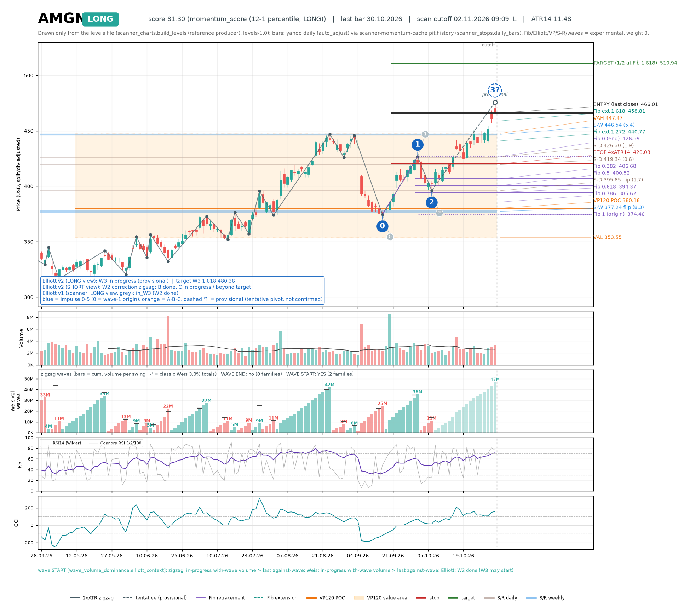

- **Jev (typesafe/jev-1.13):** 13 כותרות · 3 בביטחון ≥0.8 (סומכים על Jev) · 8 הועברו ל-Claude לשיפוט (ביטחון נמוך או חשד למניפולציה; 0 חשודות, 4 הודעות חברה) · סנטימנט חיובי (+1.00) · קטליזטור product
- **Grok (grok-4.3, חיפוש X של Grok):** ✅ אישור · סנטימנט ‎+1 · ביטחון low · 1 פוסטים · אין חדשות שליליות ב-X, רק חדשות חיוביות על מריטייד · חשבונות מאומתים: @doepke_michel
- **Perplexity:** לא התקבל (חסר קרדיט - OpenRouter (Perplexity))
- **Claude:** לא התקבל (חסר קרדיט - OpenRouter (Claude))
- **GPT:** לא התקבל (חסר קרדיט - OpenRouter (GPT))
- **האם הגרף נראה נכון? (ניסיוני):** Grok: no: ספירת אליוט ורמות פיב נראות תקינות · קלט: grok=img

### 42. EOG – לונג · דירוג 74.8 · ⛔ נחסם (דוח)
- **🔴 חסר קרדיט - OpenRouter (Claude) ; חסר קרדיט - OpenRouter (GPT) ; חסר קרדיט - OpenRouter (Perplexity)**
- **רמות (קובץ הרמות, נר אחרון 2026-10-30, hash f73c8e2c5727560b):** כניסה 165.54 · סטופ 150.87 (chandelier_close 4.0xATR14, ATR14=3.6682) · יעד: 171.45 – חצי ב-Fib 1.618 (סגירה), השאר בשנדלייר 4xATR
- **טכני:** SMA20 154.83 · SMA50 148.29 · SMA200 135.30 · מומנטום 12-1 0.366 · RSI14 74.3 · CCI20 110
- **ניסיוני (משקל 0):** אליוט v2: W2 correction expanded flat: C done -> W3 may start · אליוט v1: no valid count · פיבו v2 132.56→152.64 (1.618=165.06) · VP120 POC 130.77 (VAH 144.92, VAL 127.94) · תמיכה 152.89 · התנגדות — · סוף גל: 1 משפחות (wave_volume_dominance) · תחילת גל: 1 (wave_volume_dominance)
- **דוח:** נחסם - דוח בתוך 5 ימי מסחר · מקורות: 2026-11-05 (Yahoo calendar)
- **סוויפ נזילות (ייחוס בלבד, משקל 0):** לא · **עבר בדיקה, שביר, משקל 0**

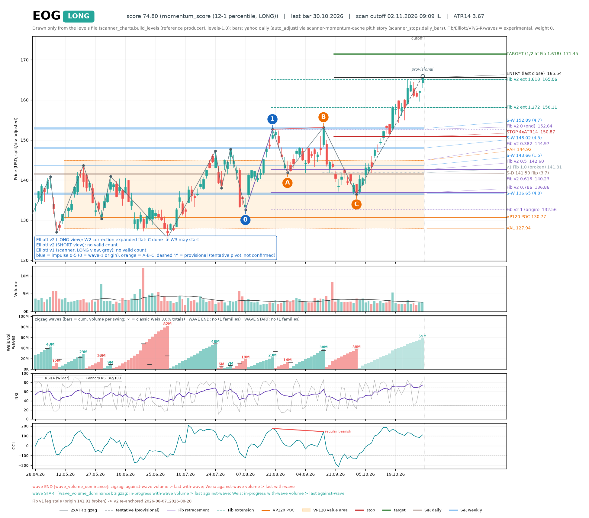

- **Jev (typesafe/jev-1.13):** 8 כותרות · 1 בביטחון ≥0.8 (סומכים על Jev) · 3 הועברו ל-Claude לשיפוט (ביטחון נמוך או חשד למניפולציה; 0 חשודות, 0 הודעות חברה) · סנטימנט ניטרלי/מעורב (+0.00) · קטליזטור earnings
- **Grok (grok-4.3, חיפוש X של Grok):** ✅ אישור · סנטימנט ‎+0 · ביטחון low · 0 פוסטים · אין סנטימנט שלילי ב-X · חשבונות מאומתים: —
- **Perplexity:** לא התקבל (חסר קרדיט - OpenRouter (Perplexity))
- **Claude:** לא התקבל (חסר קרדיט - OpenRouter (Claude))
- **GPT:** לא התקבל (חסר קרדיט - OpenRouter (GPT))
- **האם הגרף נראה נכון? (ניסיוני):** Grok: n/a: אין פוסטים אמיתיים לקרוא · קלט: grok=img

### 43. PFE – לונג · דירוג 68.2 · ⛔ נחסם (דוח)
- **🔴 חסר קרדיט - OpenRouter (Claude) ; חסר קרדיט - OpenRouter (GPT) ; חסר קרדיט - OpenRouter (Perplexity)**
- **רמות (קובץ הרמות, נר אחרון 2026-10-30, hash bb54ec8a0743f6f1):** כניסה 30.52 · סטופ 28.22 (chandelier_close 4.0xATR14, ATR14=0.5745) · יעד: 32.49 – חצי ב-Fib 1.618 (סגירה), השאר בשנדלייר 4xATR
- **טכני:** SMA20 29.17 · SMA50 28.55 · SMA200 26.33 · מומנטום 12-1 0.239 · RSI14 66.6 · CCI20 101
- **ניסיוני (משקל 0):** אליוט v2: W3 in progress (provisional) · אליוט v1: in_W3 (W2 done) · פיבו v2 27.12→30.44 (1.618=32.49) · VP120 POC 25.38 (VAH 27.69, VAL 23.21) · תמיכה 29.15 · התנגדות — · סוף גל: 0 משפחות (—) · תחילת גל: 1 (elliott_context)
- **דוח:** נחסם - דוח בתוך 5 ימי מסחר · מקורות: 2026-11-03 (Yahoo calendar)
- **סוויפ נזילות (ייחוס בלבד, משקל 0):** לא · **עבר בדיקה, שביר, משקל 0**

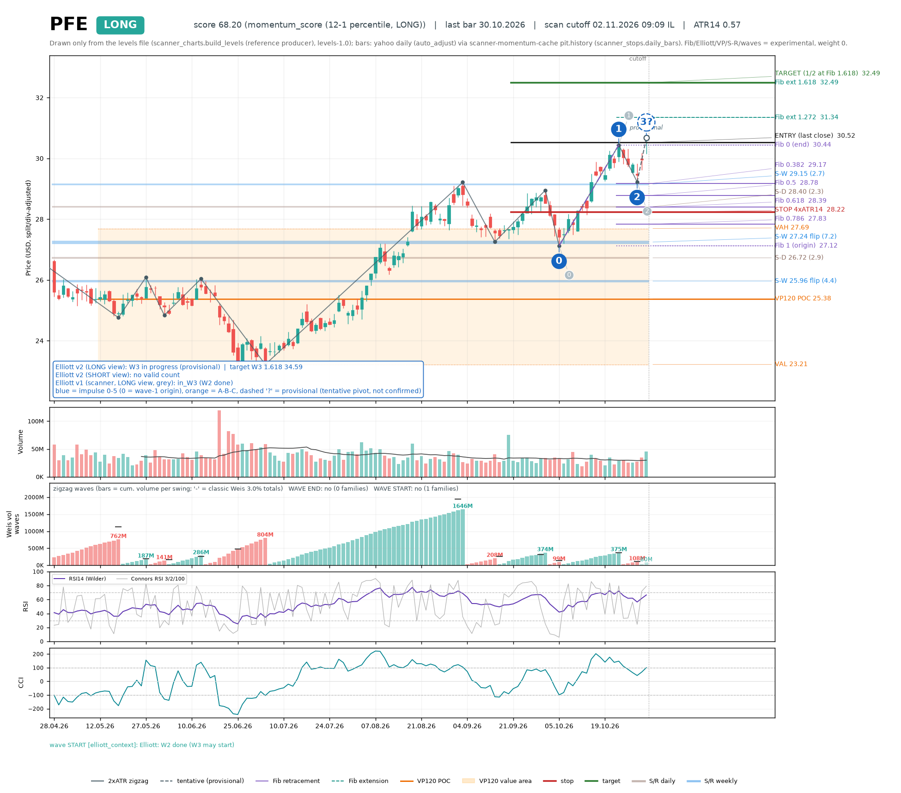

- **Jev (typesafe/jev-1.13):** 13 כותרות · 2 בביטחון ≥0.8 (סומכים על Jev) · 8 הועברו ל-Claude לשיפוט (ביטחון נמוך או חשד למניפולציה; 0 חשודות, 6 הודעות חברה) · סנטימנט חיובי (+0.56) · קטליזטור analyst
- **Grok (grok-4.3, חיפוש X של Grok):** ✅ אישור · סנטימנט ‎+0 · ביטחון low · 0 פוסטים · אין פוסטים רלוונטיים ב-X על PFE · חשבונות מאומתים: —
- **Perplexity:** לא התקבל (חסר קרדיט - OpenRouter (Perplexity))
- **Claude:** לא התקבל (חסר קרדיט - OpenRouter (Claude))
- **GPT:** לא התקבל (חסר קרדיט - OpenRouter (GPT))
- **האם הגרף נראה נכון? (ניסיוני):** Grok: no: הספירה של אליוט נראית נכונה על הגרף · קלט: grok=img

### 44. AAPL – לונג · דירוג 66.4 · ⛔ נחסם (דוח)
- **🔴 חסר קרדיט - OpenRouter (Claude) ; חסר קרדיט - OpenRouter (GPT) ; חסר קרדיט - OpenRouter (Perplexity)**
- **רמות (קובץ הרמות, נר אחרון 2026-10-30, hash c4c37ee54d19da65):** כניסה 344.63 · סטופ 317.11 (chandelier_close 4.0xATR14, ATR14=6.8796) · יעד: 367.75 – חצי ב-Fib 1.618 (סגירה), השאר בשנדלייר 4xATR
- **טכני:** SMA20 342.08 · SMA50 333.04 · SMA200 296.27 · מומנטום 12-1 0.229 · RSI14 55.4 · CCI20 13
- **ניסיוני (משקל 0):** אליוט v2: W2 in progress (provisional) · אליוט v1: in_W4 (W3 done) · פיבו v2 325.81→351.73 (1.618=367.75) · VP120 POC 310.28 (VAH 336.09, VAL 292.29) · תמיכה 336.54 · התנגדות 344.99 · סוף גל: 2 משפחות (volume_exhaustion,momentum_divergence) · תחילת גל: 2 (wave_volume_dominance,momentum_divergence)
- **דוח:** נחסם - דוח בתוך 5 ימי מסחר · מקורות: 2026-11-02 (Yahoo calendar)
- **סוויפ נזילות (ייחוס בלבד, משקל 0):** כן (לונג, רמה 338.70 pivot) · **עבר בדיקה, שביר, משקל 0**

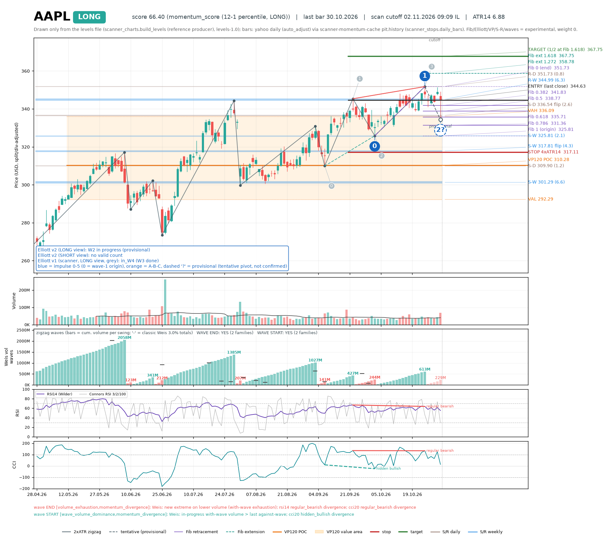

- **Jev (typesafe/jev-1.13):** 15 כותרות · 0 בביטחון ≥0.8 (סומכים על Jev) · 8 הועברו ל-Claude לשיפוט (ביטחון נמוך או חשד למניפולציה; 0 חשודות, 0 הודעות חברה) · סנטימנט — · קטליזטור —
- **Grok (grok-4.3, חיפוש X של Grok):** ✅ אישור · סנטימנט ‎+0 · ביטחון medium · 9 פוסטים · אין סיבה ברורה ב-X נגד ה-LONG · חשבונות מאומתים: @sellsidesheriff, @CelsmarAI
- **Perplexity:** לא התקבל (חסר קרדיט - OpenRouter (Perplexity))
- **Claude:** לא התקבל (חסר קרדיט - OpenRouter (Claude))
- **GPT:** לא התקבל (חסר קרדיט - OpenRouter (GPT))
- **האם הגרף נראה נכון? (ניסיוני):** Grok: n/a: אין דיון ב-X על הספירה · קלט: grok=img

## 9. סטטיסטיקת כלים (tool_stats, משקל 0)
### אמינות המודלים באזהרות על שורטים (v3-shortveto-cred (2026-10-16))
| מודל | אזהרות שנמדדו | צדקו | שיעור מכווץ | משקל | קנס לאזהרה | רמות שנספרות | % שורטים עם אזהרה |
|---|---|---|---|---|---|---|---|
| gpt | 20 | 12 | 0.540 | 0.080 | -0.80 | strong,weak | 0.66 |
| grok | 3 | 1 | 0.485 | 0.000 | -0.00 | strong,weak | 0.17 |
| pplx | 18 | 11 | 0.542 | 0.083 | -0.83 | strong,weak | 0.574 |
| claude | 7 | 3 | 0.486 | 0.000 | -0.00 | strong,weak | 0.213 |
| jev | 4 | 2 | 0.500 | 0.000 | -0.00 | strong,weak | 0.106 |

### כלים ניסיוניים (משקל 0) — סטטיסטיקה קדימה מ-12.10.2026

מדד עיקרי: תשואה עודפת ביום 20 מול SPY (מניות) / BTC (קריפטו), מותאמת כיוון. כלל: 15 תוצאות = בדיקת ביניים, 30 = החלטה (ולפחות 5 ימי כניסה שונים). FDR ‏(BH, q<0.10) על כל הכלים יחד, רק בדיקות עם 20+ תוצאות בכל צד. קביעות מודלים (Grok, Perplexity, Claude, GPT, Jev) נמדדות רק מ-12.10. שורות במעקב: 11.

| כלי | עמודות נבדקות | שורות מתועדות | תוצאות מסומנות (מקס׳) | ימי כניסה | הבדיקה החזקה | הפרש עודף (נק׳ %) [95% CI] | q | סטטוס |
|---|---|---|---|---|---|---|---|---|
| claude | 2 | 11 | 0 | 0 | llm_claude_conviction >= median (45) (stock LONG) | — | — | איסוף (0/15) |
| gpt | 2 | 11 | 0 | 0 | llm_gpt_flag_or_veto == True (ALL) | — | — | איסוף (0/15) |
| grok | 3 | 11 | 0 | 0 | llm_grok_approve == True (ALL) | — | — | איסוף (0/15) |
| jev | 1 | 4 | 0 | 0 | llm_jev_sentiment sign agrees with direction (ALL) | — | — | איסוף (0/15) |
| pplx | 2 | 11 | 0 | 0 | llm_pplx_approve == True (ALL) | — | — | איסוף (0/15) |

**בדיקות מובילות (לפי p, עד 15):**

| עמודה | בדיקה | מקטע | מסומן/לא | הצלחה | ממוצע עודף מסומן | חציון | הפרש [CI] | p | q | מתאם למומנטום | סטטוס |
|---|---|---|---|---|---|---|---|---|---|---|---|

שורדי FDR: 0 מתוך 0 בדיקות שעמדו בסף. אף כלי לא עבר את הסף — כולם נשארים במשקל 0.

## 10. עלויות ותקינות
- **עלות המודלים בריצה:** $2.456 מתוך תקרה $8.00. פירוט ב-`platform_costs.json`.
- **ממוצע למועמד:** כ-$0.056 (Grok 0.055, Perplexity —, Jev 0.0004, Claude —, GPT —) · הערכה שבועית: כ-$2.63.
- **Grok:** 44 מתוך 44 הצליחו
- **Perplexity:** 0 מתוך 44 הצליחו
- **Claude:** 0 מתוך 44 הצליחו
- **GPT:** 0 מתוך 44 הצליחו
- **עמודות מחקר (research_columns):** {"talib": {"ok": 123, "failed": 0, "errors": {}, "sec_mean": 0.04, "sec_total": 4.9}, "pta": {"ok": 123, "failed": 0, "errors": {}, "sec_mean": 0.12, "sec_total": 14.8}, "smc": {"ok": 123, "failed": 0
- **קבצים:** `candidates_full.csv`, ‏`levels/`, ‏`charts/` + `chart_index.json`, ‏`tracker_rows.csv`, ‏`reconciliation.json`, ‏`platform_enrichment.csv`, ‏`platform_raw.json`, ‏`research_columns.csv`.
