# דוח סורק מאוחד – סריקה שבועית (יום שני)
**זמן הסריקה:** 2026-11-09 09:09 (שעון ישראל) · **תיקייה:** `/home/runner/work/stock-scanner/stock-scanner/runtime/scan-runs/2026-11-09_09092` · **הופק:** 09.11.2026 09:30 (שעון ישראל)

> **בדיקת התאמה (קובץ הרמות מול הדוח, שורות הטראקר ואינדקס הגרפים, סבולת 1e-6 יחסית):** 50 מתוך 50 תואמים · אין אי-התאמות.

> ## 🔴 חסר קרדיט
> - **חסר קרדיט - OpenRouter (Claude)**: העמודות של הפלטפורמה הזו ריקות בדוח. צריך לטעון קרדיט ולהריץ שוב.
> - **חסר קרדיט - OpenRouter (GPT)**: העמודות של הפלטפורמה הזו ריקות בדוח. צריך לטעון קרדיט ולהריץ שוב.
> - **חסר קרדיט - OpenRouter (Perplexity)**: העמודות של הפלטפורמה הזו ריקות בדוח. צריך לטעון קרדיט ולהריץ שוב.

> **חשוב:** עמודות המודלים (Jev, ‏Grok, ‏Perplexity, ‏Claude אנליסט, ‏GPT פרקליט השטן) נכנסות לציון לפי critic_score v4 (מ-29.10.2026): **Grok, ‏Perplexity, ‏Claude, ‏GPT במשקל 1.0, Jev במשקל 0**, וציון כל מודל נשמר בעמודה נפרדת. הכניסה, הסטופ והיעד מגיעים רק מכללי הבוט, דרך קובץ הרמות של הריצה, ואף מודל לא שינה אותם. פסקי הדין נמדדים **רק קדימה, מ-12.10.2026**, בלי בקטסט היסטורי. כלל הדוחות (אין כניסה חדשה בתוך 5 ימי מסחר לפני דוח) הוא **כלל פעיל**. זה לא ייעוץ השקעות.

## 1. מצב השוק
- **נקודת חיתוך לנתונים (PIT):** 2026-11-09 07:09:00+00:00 UTC
- **תשואת 10 שנים:** 4.859% (שינוי 20 יום: ‎-38.5 נ"ב) · **30 שנים:** 5.260% · **מרווח 2-10:** 0.38
- **VIX:** 25.64 · **AAII שוורים פחות דובים:** — (סקר מ-—)

| מדד | סגירה | 5 ימים % | 15 ימים % | 60 ימים % | RSI | מבנה ממוצעים | שיפוע SMA50 |
|---|---|---|---|---|---|---|---|
| SPY | 735.29 | ‎-2.70 | ‎-3.66 | ‎-5.24 | 34.9 | bear | down |
| QQQ | 656.10 | ‎-4.98 | ‎-7.57 | ‎-10.28 | 30.5 | bear | down |
| IWM | 273.67 | ‎-2.03 | 1.19 | ‎-9.59 | 53.0 | bear | down |
| SMH | 463.96 | ‎-11.20 | ‎-14.05 | ‎-21.25 | 32.9 | bear | down |
| ^VIX | 25.64 | 32.03 | 28.26 | 79.93 | 62.0 | mixed | up |

## 2. איך נבחרו המועמדים
- **51 שמות עברו את הכללים** (הרשימה המלאה ב-`candidates_full.csv`, עם ציוני הכללים, הרמות מקובץ הרמות, כניסה/סטופ/יעד ודגל הדוח). מתוכם נבחרו עד **50** לדוח.
- **מניות לונג:** סגירה מעל SMA50 ו-SMA200, שיפוע SMA50 עולה, עד 3 ATR מעל SMA20, שווי ≥ $1.5B, מחזור > $14M, מחיר ≥ $5.
- **מניות שורט:** רק מי שעובר את כלל השורט המאושר (ck_score≥3 וסגירה מתחת ל-SMA200).
- **קריפטו (לונג בלבד):** BTC, ‏ETH, ‏SOL ומטבעות גדולים, נרות יומיים של Alpaca. אותו מסנן מגמה, סטופ קבוע 3×ATR14 על סגירה יומית, בלי יעד. שורט קריפטו מוקפא. Grok הוא פלטפורמת הסנטימנט הראשית.
- **דירוג אחד לכולם (אין חלוקה קבועה לונג/שורט):** ציון אחיד 0–100 = אחוזון המומנטום 12-1 בתוך קבוצת הנכס, ובשורט הפוך (100 פחות האחוזון). ככל שהציון גבוה יותר המומנטום מצביע לכיוון העסקה, ושורט מדורג מעל לונג רק כשהמומנטום שלו חזק יותר. נבחרים עד 50 בעלי הציון הגבוה ביותר - יכולים להיות 20 לונג ו-0 שורט. **סף כניסה: 60** (דגל `--min-score`); מתחתיו שם לא נכנס גם אם נשארו פחות מ-50 מקומות. ברירת המחדל 60 נקבעה לפי מדגם מאומת (139 סטאפי מניות עם תוצאה ליום 20, 15 ימי כניסה שונים): מציון 60 ומעלה שיעור הפגיעה בתשואה מכוונת ליום 20 היה 58.9% מול 51.8% מתחת, בלי יתרון בממוצע. מדגם קטן - הסף עצמו נמדד קדימה.
- **גיוון:** מגבלת הסקטור כבויה בריצה הזו.
- **כלל הדוחות (פעיל):** אין כניסה חדשה במניה אם הדוח הבא בתוך 5 ימי מסחר מיום הכניסה. מקורות התאריך: לוח Yahoo, ‏OpenBB/Nasdaq ו-Perplexity (רק כשהוא מאשר עם מקור). אם יש מחלוקת, לוקחים את התאריך **המוקדם**. אין תאריך מאומת: מסומן "תאריך דוח לא מאומת". חריגה רק בקטליזטור חזק מאוד: Perplexity מדרג "חזק" עם מקור מתוארך, Claude בביטחון 70 ומעלה בעד, ו-GPT לא הטיל וטו. מניה שנחסמה מוחלפת בשם הבא בדירוג, והיא עדיין נרשמת ביומן למדידה.
- **מקור אמת יחיד:** לכל שם נבנה קובץ `levels/<TICKER>.json` (נרות מהמטמון של הסריקה, hash של הנרות, פיבוטים, ספירת אליוט v1 ו-v2, פיבו, VP120, תמיכה/התנגדות, גלי נפח, RSI/CCI, כניסה/סטופ/יעד, סטטוס דוח). הגרף, הדוח, שורות הטראקר והמודלים קוראים רק ממנו.
- **המודלים רואים את הגרף:** Claude, ‏GPT, ‏Grok ו-Perplexity מקבלים את תמונת הגרף (1280 פיקסלים) כקלט הראשי לקריאה הטכנית, וכל מספר בטקסט מגיע מקובץ הרמות. כל מודל אומר אם הוא חולק על ספירת האליוט, הפיבו או התמיכה/התנגדות שצוירו (עמודה ניסיונית `chart_count_disagree`).

## 3. המלצות – מניות (15)
| # | טיקר | כיוון | כניסה (ייחוס) | סטופ | יעד | דירוג | דוח | Jev | Grok | Perplexity | Claude | GPT | חולקים על הגרף |
|---|---|---|---|---|---|---|---|---|---|---|---|---|---|
| 1 | **ORCL** | שורט | 116.10 | 150.16 | אין | 97.2 | 2026-12-14 (25 י"מ) | חיובי (+0.92) | ⚠️ דגל (‎+1) | חסר קרדיט | חסר קרדיט | חסר קרדיט | 0/4 |
| 2 | **NOW** | שורט | 101.97 | 131.26 | אין | 90.7 | 2027-01-27 (54 י"מ) | חיובי (+1.00) | ✅ אישור (‎+0) | חסר קרדיט | חסר קרדיט | חסר קרדיט | 0/4 |
| 3 | **TSLA** | שורט | 358.22 | 425.05 | אין | 88.8 | 2027-01-27 (54 י"מ) | — | ✅ אישור (‎+0) | חסר קרדיט | חסר קרדיט | חסר קרדיט | 0/4 |
| 4 | **SRE** | שורט | 78.17 | 85.26 | אין | 86.0 | תאריך דוח לא מאומת | חיובי (+1.00) | ✅ אישור (‎+0) | חסר קרדיט | חסר קרדיט | חסר קרדיט | 0/4 |
| 5 | **JNJ** | לונג | 276.22 | 246.56 | 292.20 | 79.4 | 2027-01-26 (53 י"מ) | חיובי (+0.67) | ✅ אישור (‎+0) | חסר קרדיט | חסר קרדיט | חסר קרדיט | 0/4 |
| 6 | **DE** | לונג | 671.65 | 594.20 | 722.97 | 77.6 | 2026-11-25 (13 י"מ) | חיובי (+1.00) | ✅ אישור (‎+1) | חסר קרדיט | חסר קרדיט | חסר קרדיט | 0/4 |
| 7 | **KO** | לונג | 95.67 | 88.35 | 101.60 | 72.9 | תאריך דוח לא מאומת | — | ✅ אישור (‎+2) | חסר קרדיט | חסר קרדיט | חסר קרדיט | 0/4 |
| 8 | **AMGN** | לונג | 460.42 | 409.22 | 538.36 | 72.0 | 2027-02-02 (58 י"מ) | חיובי (+1.00) | ✅ אישור (‎+0) | חסר קרדיט | חסר קרדיט | חסר קרדיט | 0/4 |
| 9 | **AVGO** | שורט | 293.69 | 352.67 | אין | 72.0 | 2026-12-09 (22 י"מ) | — | ✅ אישור (‎-1) | חסר קרדיט | חסר קרדיט | חסר קרדיט | 0/4 |
| 10 | **ABBV** | לונג | 291.31 | 260.16 | 315.05 | 70.1 | תאריך דוח לא מאומת | — | ✅ אישור (‎+1) | חסר קרדיט | חסר קרדיט | חסר קרדיט | 0/4 |
| 11 | **LLY** | לונג | 1,354.00 | 1,164.60 | 1,651.87 | 68.2 | תאריך דוח לא מאומת | חיובי (+1.00) | ✅ אישור (‎+0) | חסר קרדיט | חסר קרדיט | חסר קרדיט | 0/4 |
| 12 | **AAPL** | לונג | 342.37 | 307.29 | 367.75 | 67.3 | 2027-01-28 (55 י"מ) | חיובי (+1.00) | ⚠️ דגל (‎+0) | חסר קרדיט | חסר קרדיט | חסר קרדיט | 0/4 |
| 13 | **URI** | לונג | 1,055.57 | 876.94 | 1,303.53 | 66.4 | 2027-01-27 (54 י"מ) | חיובי (+1.00) | ✅ אישור (‎+1) | חסר קרדיט | חסר קרדיט | חסר קרדיט | 0/4 |
| 14 | **PFE** | לונג | 29.39 | 26.49 | 32.34 | 63.6 | 2027-02-02 (58 י"מ) | חיובי (+0.52) | ✅ אישור (‎+1) | חסר קרדיט | חסר קרדיט | חסר קרדיט | 0/4 |
| 15 | **BAC** | שורט | 49.42 | 54.75 | אין | 61.7 | 2027-01-15 (47 י"מ) | שלילי (-1.00) | ✅ אישור (‎+0) | חסר קרדיט | חסר קרדיט | חסר קרדיט | 0/4 |

_דירוג: הציון האחיד 0–100 (אחוזון מומנטום 12-1, הפוך בשורט). Grok בסוגריים: סנטימנט 2- עד 2+. Claude: ביטחון 0–100 ועמדה. "חולקים על הגרף": כמה מודלים אמרו שספירת האליוט/פיבו/תמיכה שצוירו לא נראית נכונה. הכל במשקל 0._

## 4. קריפטו – לונג בלבד (0)
הקריפטו הוצא מהסורק הזה (החלטת אילן, 01.11.2026). נתוני העבר בארכיון archive/crypto/.

## 5. חריגה: קטליזטור חזק (0)
אין.

## 6. נחסם - דוח בתוך 5 ימי מסחר (0)
אין.

## 7. לא תואם (0)
אין. כל המספרים בדוח, בשורות הטראקר ובאינדקס הגרפים זהים לקובץ הרמות.

## 8. פירוט לכל מועמד
### 1. ORCL – שורט · דירוג 97.2
- **🔴 חסר קרדיט - OpenRouter (Claude) ; חסר קרדיט - OpenRouter (GPT) ; חסר קרדיט - OpenRouter (Perplexity)**
- **רמות (קובץ הרמות, נר אחרון 2026-11-06, hash 1b471b0c07f18d2e):** כניסה 116.10 · סטופ 150.16 (chandelier_close 4.0xATR14, ATR14=8.5149) · יעד: אין – ללא יעד קבוע - שנדלייר 4xATR14 על סגירה (כלל מאושר)
- **טכני:** SMA20 129.36 · SMA50 138.80 · SMA200 154.41 · מומנטום 12-1 ‎-0.453 · RSI14 38.7 · CCI20 ‎-177
- **ניסיוני (משקל 0):** אליוט v2: no valid count · אליוט v1: no valid count · פיבו v2 153.03→131.10 (1.618=117.54) · VP120 POC 144.02 (VAH 153.77, VAL 120.35) · תמיכה 114.91 · התנגדות 135.72 · סוף גל: 2 משפחות (volume_exhaustion,momentum_divergence) · תחילת גל: 3 (volume_exhaustion,wave_volume_dominance,climax)
- **דוח:** מותר - דוח בעוד 25 ימי מסחר · מקורות: 2026-12-14 (Yahoo calendar)
- **סוויפ נזילות (ייחוס בלבד, משקל 0):** לא
- **ספירלת פיבו – יעדי ייחוס בלבד (משקל 0, לא משנה סטופ/יעד; השורט נשאר עם סטופ נגרר 4×ATR בלי יעד):** T1 — (—) · T2 — (—) · מצב: none

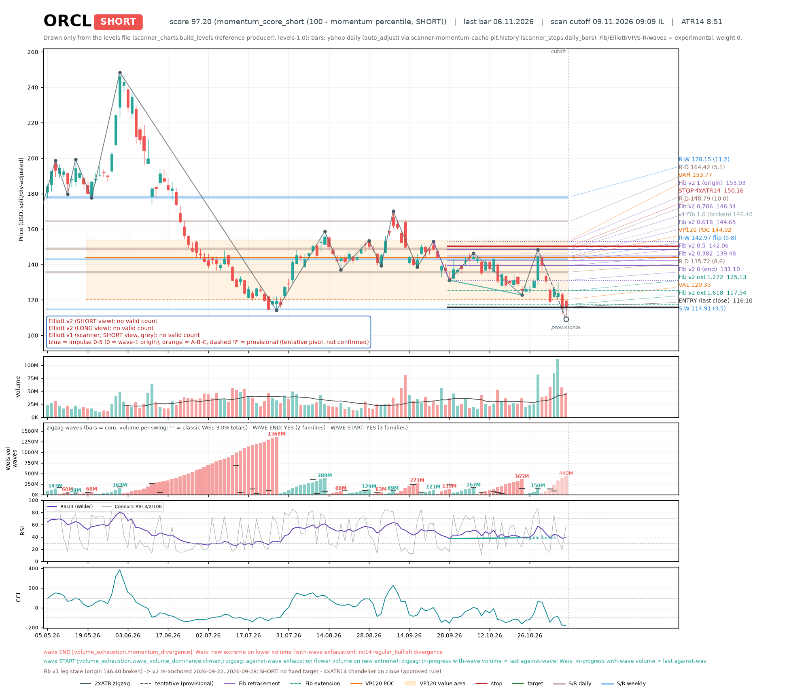

- **Jev (typesafe/jev-1.13):** 15 כותרות · 2 בביטחון ≥0.8 (סומכים על Jev) · 6 הועברו ל-Claude לשיפוט (ביטחון נמוך או חשד למניפולציה; 0 חשודות, 2 הודעות חברה) · סנטימנט חיובי (+0.92) · קטליזטור guidance
- **Grok (grok-4.3, חיפוש X של Grok):** ⚠️ דגל · סנטימנט ‎+1 · ביטחון medium · 8 פוסטים · חדשות חיוביות על שותפות TPU עם Google נוגדות את השורט · חשבונות מאומתים: @hamzik53911, @VoxVex000, @VantaSignals, @pyy_invest
- **Perplexity:** לא התקבל (חסר קרדיט - OpenRouter (Perplexity))
- **Claude:** לא התקבל (חסר קרדיט - OpenRouter (Claude))
- **GPT:** לא התקבל (חסר קרדיט - OpenRouter (GPT))
- **האם הגרף נראה נכון? (ניסיוני):** Grok: n/a: null · קלט: grok=img

### 2. NOW – שורט · דירוג 90.7
- **🔴 חסר קרדיט - OpenRouter (Claude) ; חסר קרדיט - OpenRouter (GPT) ; חסר קרדיט - OpenRouter (Perplexity)**
- **רמות (קובץ הרמות, נר אחרון 2026-11-06, hash 3d5e49b26693fa50):** כניסה 101.97 · סטופ 131.26 (chandelier_close 4.0xATR14, ATR14=7.3222) · יעד: אין – ללא יעד קבוע - שנדלייר 4xATR14 על סגירה (כלל מאושר)
- **טכני:** SMA20 133.98 · SMA50 136.29 · SMA200 114.44 · מומנטום 12-1 ‎-0.206 · RSI14 27.7 · CCI20 ‎-113
- **ניסיוני (משקל 0):** אליוט v2: no valid count · אליוט v1: no valid count · פיבו v2 175.00→123.78 (1.618=92.13) · VP120 POC 104.11 (VAH 130.05, VAL 93.60) · תמיכה 98.37 · התנגדות 105.24 · סוף גל: 1 משפחות (wave_volume_dominance) · תחילת גל: 2 (volume_exhaustion,wave_volume_dominance)
- **דוח:** מותר - דוח בעוד 54 ימי מסחר · מקורות: 2027-01-27 (Yahoo calendar)
- **סוויפ נזילות (ייחוס בלבד, משקל 0):** לא
- **ספירלת פיבו – יעדי ייחוס בלבד (משקל 0, לא משנה סטופ/יעד; השורט נשאר עם סטופ נגרר 4×ATR בלי יעד):** T1 106.08 (fan:8@fib0.786) · T2 106.08 (circle:0.618@fib0.786) · מצב: triggered_earlier

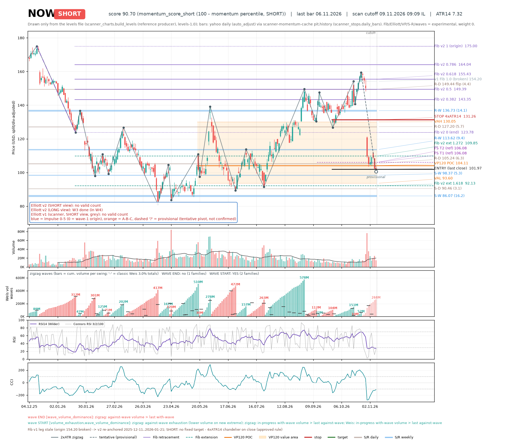

- **Jev (typesafe/jev-1.13):** 15 כותרות · 1 בביטחון ≥0.8 (סומכים על Jev) · 8 הועברו ל-Claude לשיפוט (ביטחון נמוך או חשד למניפולציה; 0 חשודות, 6 הודעות חברה) · סנטימנט חיובי (+1.00) · קטליזטור earnings
- **Grok (grok-4.3, חיפוש X של Grok):** ✅ אישור · סנטימנט ‎+0 · ביטחון low · 0 פוסטים · אין סנטימנט שלילי ב-X · חשבונות מאומתים: —
- **Perplexity:** לא התקבל (חסר קרדיט - OpenRouter (Perplexity))
- **Claude:** לא התקבל (חסר קרדיט - OpenRouter (Claude))
- **GPT:** לא התקבל (חסר קרדיט - OpenRouter (GPT))
- **האם הגרף נראה נכון? (ניסיוני):** Grok: n/a: אין נתונים · קלט: grok=img

### 3. TSLA – שורט · דירוג 88.8
- **🔴 חסר קרדיט - OpenRouter (Claude) ; חסר קרדיט - OpenRouter (GPT) ; חסר קרדיט - OpenRouter (Perplexity)**
- **רמות (קובץ הרמות, נר אחרון 2026-11-06, hash 8e69152585ccd840):** כניסה 358.22 · סטופ 425.05 (chandelier_close 4.0xATR14, ATR14=16.71) · יעד: אין – ללא יעד קבוע - שנדלייר 4xATR14 על סגירה (כלל מאושר)
- **טכני:** SMA20 380.42 · SMA50 372.14 · SMA200 383.87 · מומנטום 12-1 ‎-0.188 · RSI14 42.4 · CCI20 ‎-106
- **ניסיוני (משקל 0):** אליוט v2: no valid count · אליוט v1: no valid count · פיבו v2 432.86→297.38 (1.618=213.65) · VP120 POC 381.87 (VAH 415.96, VAL 347.77) · תמיכה 353.41 · התנגדות 366.26 · סוף גל: 2 משפחות (wave_volume_dominance,momentum_divergence) · תחילת גל: 1 (volume_exhaustion)
- **דוח:** מותר - דוח בעוד 54 ימי מסחר · מקורות: 2027-01-27 (Yahoo calendar)
- **סוויפ נזילות (ייחוס בלבד, משקל 0):** כן (לונג, רמה 345.88 pivot)
- **ספירלת פיבו – יעדי ייחוס בלבד (משקל 0, לא משנה סטופ/יעד; השורט נשאר עם סטופ נגרר 4×ATR בלי יעד):** T1 — (—) · T2 — (—) · מצב: broken_below_A

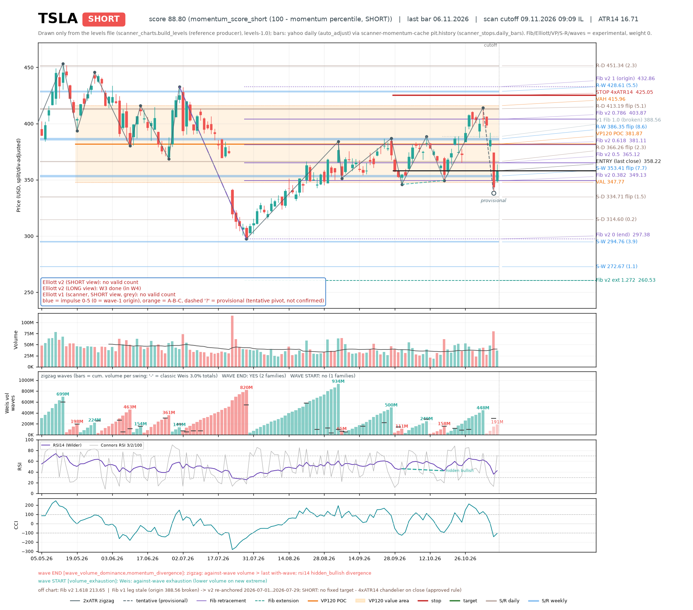

- **Jev (typesafe/jev-1.13):** 15 כותרות · 0 בביטחון ≥0.8 (סומכים על Jev) · 8 הועברו ל-Claude לשיפוט (ביטחון נמוך או חשד למניפולציה; 0 חשודות, 0 הודעות חברה) · סנטימנט — · קטליזטור —
- **Grok (grok-4.3, חיפוש X של Grok):** ✅ אישור · סנטימנט ‎+0 · ביטחון medium · 5 פוסטים · סנטימנט מעורב ללא חדשות שליליות ברורות נגד SHORT · חשבונות מאומתים: —
- **Perplexity:** לא התקבל (חסר קרדיט - OpenRouter (Perplexity))
- **Claude:** לא התקבל (חסר קרדיט - OpenRouter (Claude))
- **GPT:** לא התקבל (חסר קרדיט - OpenRouter (GPT))
- **האם הגרף נראה נכון? (ניסיוני):** Grok: no: ספירת אליוט ו-Fib נראים תקינים על הגרף · קלט: grok=img

### 4. SRE – שורט · דירוג 86.0
- **🔴 חסר קרדיט - OpenRouter (Claude) ; חסר קרדיט - OpenRouter (GPT) ; חסר קרדיט - OpenRouter (Perplexity)**
- **רמות (קובץ הרמות, נר אחרון 2026-11-06, hash 9971f0a020d109b8):** כניסה 78.17 · סטופ 85.26 (chandelier_close 4.0xATR14, ATR14=1.7714) · יעד: אין – ללא יעד קבוע - שנדלייר 4xATR14 על סגירה (כלל מאושר)
- **טכני:** SMA20 83.33 · SMA50 81.79 · SMA200 88.21 · מומנטום 12-1 ‎-0.107 · RSI14 33.2 · CCI20 ‎-198
- **ניסיוני (משקל 0):** אליוט v2: no valid count · אליוט v1: no valid count · פיבו v2 87.41→81.98 (1.618=78.63) · VP120 POC 83.62 (VAH 89.14, VAL 76.97) · תמיכה 78.07 · התנגדות 80.91 · סוף גל: 1 משפחות (wave_volume_dominance) · תחילת גל: 0 (—)
- **דוח:** תאריך דוח לא מאומת
- **סוויפ נזילות (ייחוס בלבד, משקל 0):** לא
- **ספירלת פיבו – יעדי ייחוס בלבד (משקל 0, לא משנה סטופ/יעד; השורט נשאר עם סטופ נגרר 4×ATR בלי יעד):** T1 — (—) · T2 — (—) · מצב: none

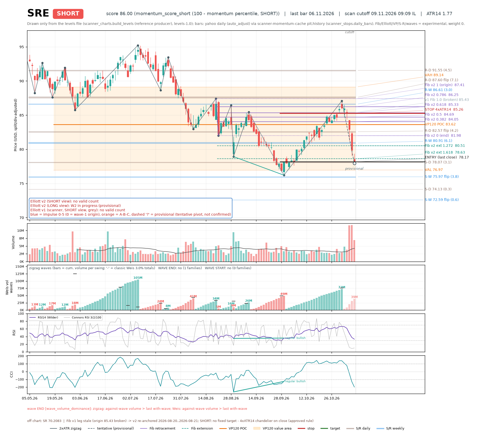

- **Jev (typesafe/jev-1.13):** 8 כותרות · 1 בביטחון ≥0.8 (סומכים על Jev) · 6 הועברו ל-Claude לשיפוט (ביטחון נמוך או חשד למניפולציה; 0 חשודות, 1 הודעות חברה) · סנטימנט חיובי (+1.00) · קטליזטור guidance
- **Grok (grok-4.3, חיפוש X של Grok):** ✅ אישור · סנטימנט ‎+0 · ביטחון low · 0 פוסטים · אין פוסטים משמעותיים ב-X · חשבונות מאומתים: —
- **Perplexity:** לא התקבל (חסר קרדיט - OpenRouter (Perplexity))
- **Claude:** לא התקבל (חסר קרדיט - OpenRouter (Claude))
- **GPT:** לא התקבל (חסר קרדיט - OpenRouter (GPT))
- **האם הגרף נראה נכון? (ניסיוני):** Grok: n/a: אין מידע · קלט: grok=img

### 5. JNJ – לונג · דירוג 79.4
- **🔴 חסר קרדיט - OpenRouter (Claude) ; חסר קרדיט - OpenRouter (GPT) ; חסר קרדיט - OpenRouter (Perplexity)**
- **רמות (קובץ הרמות, נר אחרון 2026-11-06, hash 47ce266861543f33):** כניסה 276.22 · סטופ 246.56 (chandelier_close 4.0xATR14, ATR14=7.4142) · יעד: 292.20 – חצי ב-Fib 1.618 (סגירה), השאר בשנדלייר 4xATR
- **טכני:** SMA20 264.68 · SMA50 265.79 · SMA200 246.76 · מומנטום 12-1 0.410 · RSI14 59.4 · CCI20 76
- **ניסיוני (משקל 0):** אליוט v2: W2 in progress (provisional) · אליוט v1: no valid count · פיבו v2 265.28→281.92 (1.618=292.20) · VP120 POC 267.70 (VAH 275.79, VAL 248.40) · תמיכה 273.77 · התנגדות 281.55 · סוף גל: 0 משפחות (—) · תחילת גל: 1 (wave_volume_dominance)
- **דוח:** מותר - דוח בעוד 53 ימי מסחר · מקורות: 2027-01-26 (Yahoo calendar)
- **סוויפ נזילות (ייחוס בלבד, משקל 0):** לא · **עבר בדיקה, שביר, משקל 0**

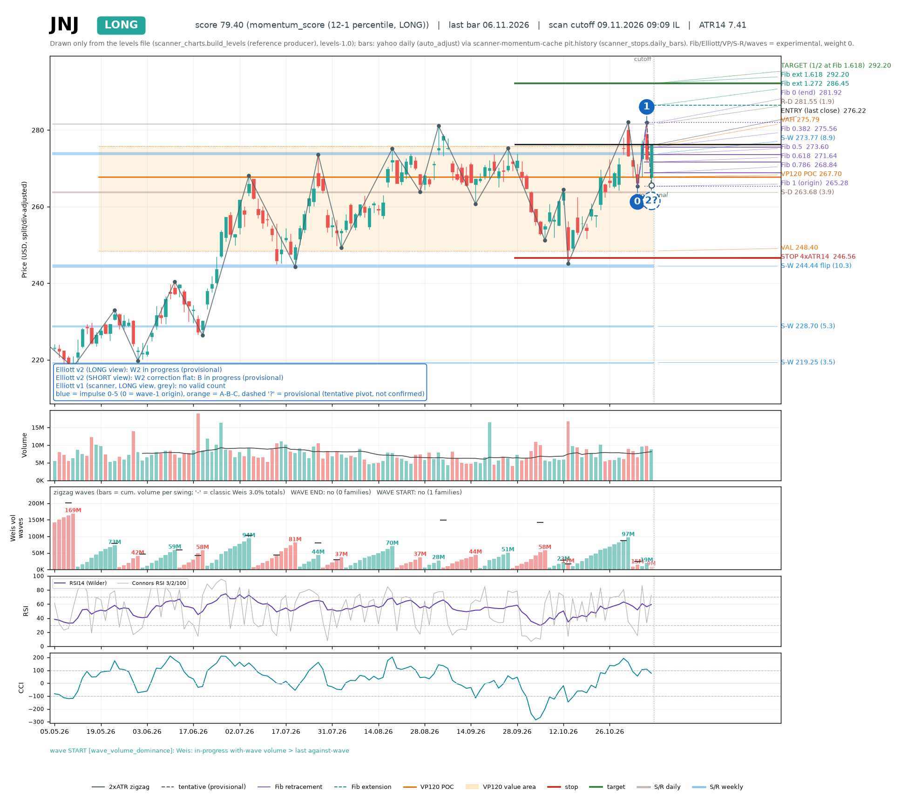

- **Jev (typesafe/jev-1.13):** 15 כותרות · 2 בביטחון ≥0.8 (סומכים על Jev) · 8 הועברו ל-Claude לשיפוט (ביטחון נמוך או חשד למניפולציה; 0 חשודות, 7 הודעות חברה) · סנטימנט חיובי (+0.67) · קטליזטור product
- **Grok (grok-4.3, חיפוש X של Grok):** ✅ אישור · סנטימנט ‎+0 · ביטחון low · 2 פוסטים · אין סנטימנט שלילי ברור ב-X נגד ה-LONG · חשבונות מאומתים: —
- **Perplexity:** לא התקבל (חסר קרדיט - OpenRouter (Perplexity))
- **Claude:** לא התקבל (חסר קרדיט - OpenRouter (Claude))
- **GPT:** לא התקבל (חסר קרדיט - OpenRouter (GPT))
- **האם הגרף נראה נכון? (ניסיוני):** Grok: no: הספירה וה-Fib נראים תקינים · קלט: grok=img

### 6. DE – לונג · דירוג 77.6
- **🔴 חסר קרדיט - OpenRouter (Claude) ; חסר קרדיט - OpenRouter (GPT) ; חסר קרדיט - OpenRouter (Perplexity)**
- **רמות (קובץ הרמות, נר אחרון 2026-11-06, hash 842c82a274833065):** כניסה 671.65 · סטופ 594.20 (chandelier_close 4.0xATR14, ATR14=19.36) · יעד: 722.97 – חצי ב-Fib 1.618 (סגירה), השאר בשנדלייר 4xATR
- **טכני:** SMA20 650.64 · SMA50 666.30 · SMA200 606.17 · מומנטום 12-1 0.393 · RSI14 56.0 · CCI20 109
- **ניסיוני (משקל 0):** אליוט v2: post-W5 correction zigzag: C done -> new impulse may start · אליוט v1: no valid count · פיבו v2 615.74→704.20 (1.618=758.87) · VP120 POC 684.33 (VAH 690.54, VAL 587.08) · תמיכה 664.99 · התנגדות 691.94 · סוף גל: 1 משפחות (wave_volume_dominance) · תחילת גל: 2 (volume_exhaustion,wave_volume_dominance)
- **דוח:** מותר - דוח בעוד 13 ימי מסחר · מקורות: 2026-11-25 (Yahoo calendar)
- **סוויפ נזילות (ייחוס בלבד, משקל 0):** לא · **עבר בדיקה, שביר, משקל 0**

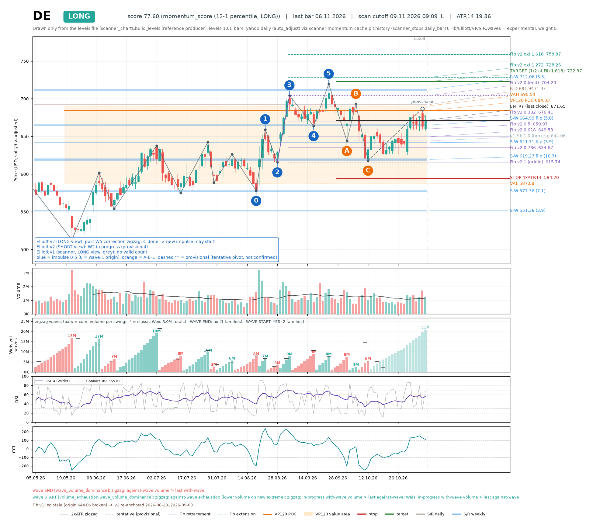

- **Jev (typesafe/jev-1.13):** 9 כותרות · 2 בביטחון ≥0.8 (סומכים על Jev) · 7 הועברו ל-Claude לשיפוט (ביטחון נמוך או חשד למניפולציה; 0 חשודות, 3 הודעות חברה) · סנטימנט חיובי (+1.00) · קטליזטור earnings
- **Grok (grok-4.3, חיפוש X של Grok):** ✅ אישור · סנטימנט ‎+1 · ביטחון low · 3 פוסטים · אין חדשות שליליות ברורות נגד LONG · חשבונות מאומתים: @swingsonly
- **Perplexity:** לא התקבל (חסר קרדיט - OpenRouter (Perplexity))
- **Claude:** לא התקבל (חסר קרדיט - OpenRouter (Claude))
- **GPT:** לא התקבל (חסר קרדיט - OpenRouter (GPT))
- **האם הגרף נראה נכון? (ניסיוני):** Grok: n/a: אין דיון בגרף ב-X · קלט: grok=img

### 7. KO – לונג · דירוג 72.9
- **🔴 חסר קרדיט - OpenRouter (Claude) ; חסר קרדיט - OpenRouter (GPT) ; חסר קרדיט - OpenRouter (Perplexity)**
- **רמות (קובץ הרמות, נר אחרון 2026-11-06, hash 96e0d5e8238ac81e):** כניסה 95.67 · סטופ 88.35 (chandelier_close 4.0xATR14, ATR14=1.8309) · יעד: 101.60 – חצי ב-Fib 1.618 (סגירה), השאר בשנדלייר 4xATR
- **טכני:** SMA20 93.28 · SMA50 89.83 · SMA200 82.02 · מומנטום 12-1 0.315 · RSI14 64.4 · CCI20 82
- **ניסיוני (משקל 0):** אליוט v2: W2 in progress (provisional) · אליוט v1: in_W4 (W3 done) · פיבו v2 90.58→97.39 (1.618=101.60) · VP120 POC 87.70 (VAH 96.53, VAL 81.46) · תמיכה 94.10 · התנגדות — · סוף גל: 2 משפחות (volume_exhaustion,momentum_divergence) · תחילת גל: 1 (wave_volume_dominance)
- **דוח:** תאריך דוח לא מאומת
- **סוויפ נזילות (ייחוס בלבד, משקל 0):** לא · **עבר בדיקה, שביר, משקל 0**

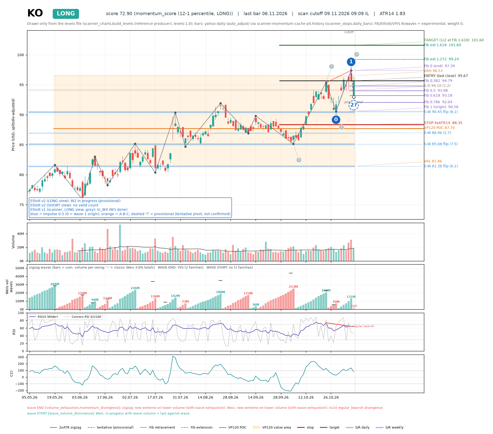

- **Jev (typesafe/jev-1.13):** 8 כותרות · 0 בביטחון ≥0.8 (סומכים על Jev) · 6 הועברו ל-Claude לשיפוט (ביטחון נמוך או חשד למניפולציה; 0 חשודות, 3 הודעות חברה) · סנטימנט — · קטליזטור —
- **Grok (grok-4.3, חיפוש X של Grok):** ✅ אישור · סנטימנט ‎+2 · ביטחון high · 1 פוסטים · סנטימנט X חיובי מאוד תומך ב-LONG · חשבונות מאומתים: @HKIStrategies
- **Perplexity:** לא התקבל (חסר קרדיט - OpenRouter (Perplexity))
- **Claude:** לא התקבל (חסר קרדיט - OpenRouter (Claude))
- **GPT:** לא התקבל (חסר קרדיט - OpenRouter (GPT))
- **האם הגרף נראה נכון? (ניסיוני):** Grok: n/a: אין התייחסות לטבלת Elliott/Fib ב-X · קלט: grok=img

### 8. AMGN – לונג · דירוג 72.0
- **🔴 חסר קרדיט - OpenRouter (Claude) ; חסר קרדיט - OpenRouter (GPT) ; חסר קרדיט - OpenRouter (Perplexity)**
- **רמות (קובץ הרמות, נר אחרון 2026-11-06, hash ee8665350ebe4f44):** כניסה 460.42 · סטופ 409.22 (chandelier_close 4.0xATR14, ATR14=12.80) · יעד: 538.36 – חצי ב-Fib 1.618 (סגירה), השאר בשנדלייר 4xATR
- **טכני:** SMA20 445.44 · SMA50 422.43 · SMA200 375.27 · מומנטום 12-1 0.309 · RSI14 60.5 · CCI20 53
- **ניסיוני (משקל 0):** אליוט v2: W4 in progress (provisional) · אליוט v1: in_W4 (W3 done) · פיבו v2 396.01→483.99 (1.618=538.36) · VP120 POC 380.11 (VAH 418.04, VAL 325.70) · תמיכה 446.54 · התנגדות — · סוף גל: 0 משפחות (—) · תחילת גל: 0 (—)
- **דוח:** מותר - דוח בעוד 58 ימי מסחר · מקורות: 2027-02-02 (Yahoo calendar)
- **סוויפ נזילות (ייחוס בלבד, משקל 0):** לא · **עבר בדיקה, שביר, משקל 0**

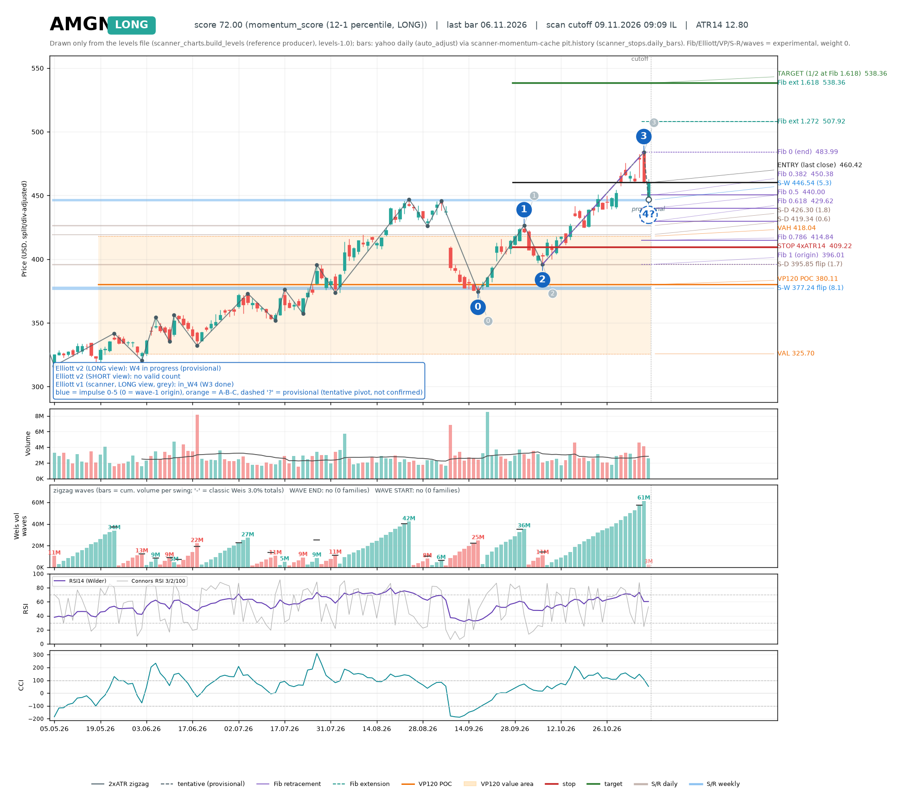

- **Jev (typesafe/jev-1.13):** 15 כותרות · 1 בביטחון ≥0.8 (סומכים על Jev) · 8 הועברו ל-Claude לשיפוט (ביטחון נמוך או חשד למניפולציה; 0 חשודות, 2 הודעות חברה) · סנטימנט חיובי (+1.00) · קטליזטור analyst
- **Grok (grok-4.3, חיפוש X של Grok):** ✅ אישור · סנטימנט ‎+0 · ביטחון low · 1 פוסטים · אין סיבות נגדיות ב-X · חשבונות מאומתים: @BitrueOfficial
- **Perplexity:** לא התקבל (חסר קרדיט - OpenRouter (Perplexity))
- **Claude:** לא התקבל (חסר קרדיט - OpenRouter (Claude))
- **GPT:** לא התקבל (חסר קרדיט - OpenRouter (GPT))
- **האם הגרף נראה נכון? (ניסיוני):** Grok: n/a · קלט: grok=img

### 9. AVGO – שורט · דירוג 72.0
- **🔴 חסר קרדיט - OpenRouter (Claude) ; חסר קרדיט - OpenRouter (GPT) ; חסר קרדיט - OpenRouter (Perplexity)**
- **רמות (קובץ הרמות, נר אחרון 2026-11-06, hash 66b55d14effd8057):** כניסה 293.69 · סטופ 352.67 (chandelier_close 4.0xATR14, ATR14=14.74) · יעד: אין – ללא יעד קבוע - שנדלייר 4xATR14 על סגירה (כלל מאושר)
- **טכני:** SMA20 332.12 · SMA50 347.69 · SMA200 366.10 · מומנטום 12-1 0.011 · RSI14 32.6 · CCI20 ‎-203
- **ניסיוני (משקל 0):** אליוט v2: W3 in progress (provisional) · אליוט v1: in_W3 (W2 done) · פיבו v2 380.84→320.23 (1.618=282.77) · VP120 POC 365.08 (VAH 399.69, VAL 334.55) · תמיכה 277.73 · התנגדות 295.04 · סוף גל: 0 משפחות (—) · תחילת גל: 2 (wave_volume_dominance,elliott_context)
- **דוח:** מותר - דוח בעוד 22 ימי מסחר · מקורות: 2026-12-09 (Yahoo calendar)
- **סוויפ נזילות (ייחוס בלבד, משקל 0):** לא
- **ספירלת פיבו – יעדי ייחוס בלבד (משקל 0, לא משנה סטופ/יעד; השורט נשאר עם סטופ נגרר 4×ATR בלי יעד):** T1 — (—) · T2 — (—) · מצב: none

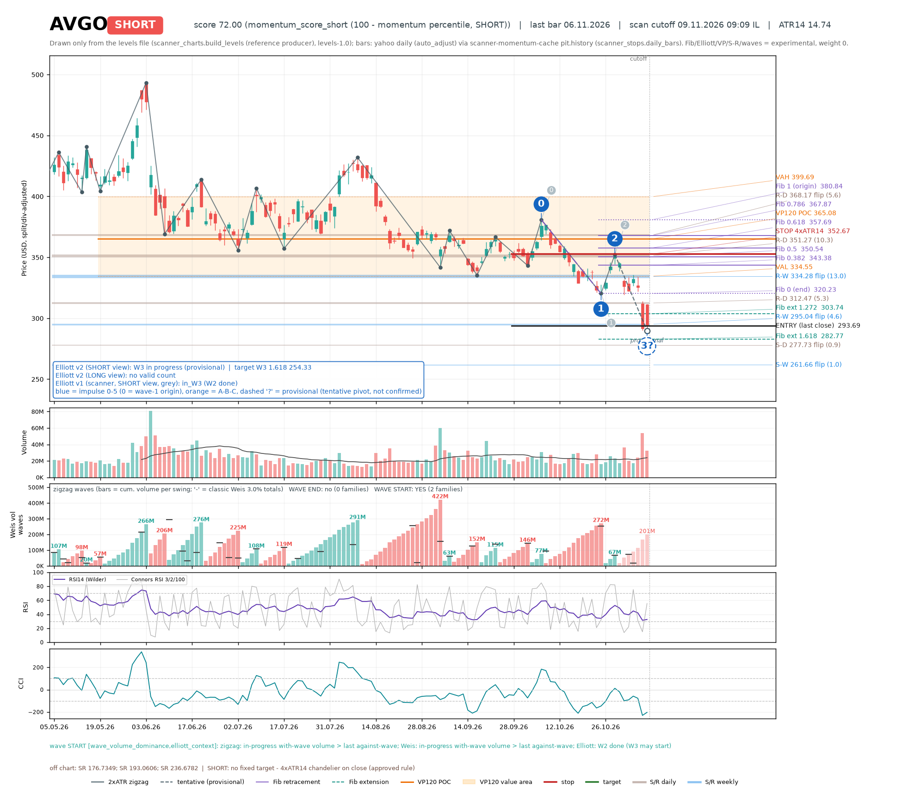

- **Jev (typesafe/jev-1.13):** 15 כותרות · 0 בביטחון ≥0.8 (סומכים על Jev) · 1 הועברו ל-Claude לשיפוט (ביטחון נמוך או חשד למניפולציה; 0 חשודות, 0 הודעות חברה) · סנטימנט — · קטליזטור —
- **Grok (grok-4.3, חיפוש X של Grok):** ✅ אישור · סנטימנט ‎-1 · ביטחון medium · 4 פוסטים · סנטימנט X תומך ב-SHORT · חשבונות מאומתים: @Mrajalen, @Zer0T3ace00, @kindcorp
- **Perplexity:** לא התקבל (חסר קרדיט - OpenRouter (Perplexity))
- **Claude:** לא התקבל (חסר קרדיט - OpenRouter (Claude))
- **GPT:** לא התקבל (חסר קרדיט - OpenRouter (GPT))
- **האם הגרף נראה נכון? (ניסיוני):** Grok: no: ספירה אליוט ו-Fib נראים תקינים · קלט: grok=img

### 10. ABBV – לונג · דירוג 70.1
- **🔴 חסר קרדיט - OpenRouter (Claude) ; חסר קרדיט - OpenRouter (GPT) ; חסר קרדיט - OpenRouter (Perplexity)**
- **רמות (קובץ הרמות, נר אחרון 2026-11-06, hash 056216f9c7d1e343):** כניסה 291.31 · סטופ 260.16 (chandelier_close 4.0xATR14, ATR14=7.7880) · יעד: 315.05 – חצי ב-Fib 1.618 (סגירה), השאר בשנדלייר 4xATR
- **טכני:** SMA20 286.20 · SMA50 270.89 · SMA200 236.22 · מומנטום 12-1 0.286 · RSI14 60.1 · CCI20 36
- **ניסיוני (משקל 0):** אליוט v2: post-W5 correction expanded flat: C in progress (provisional) · אליוט v1: in_W4 (W3 done) · פיבו v2 278.01→298.74 (1.618=311.55) · VP120 POC 247.67 (VAH 287.42, VAL 238.95) · תמיכה 279.62 · התנגדות 291.40 · סוף גל: 2 משפחות (volume_exhaustion,momentum_divergence) · תחילת גל: 1 (wave_volume_dominance)
- **דוח:** תאריך דוח לא מאומת
- **סוויפ נזילות (ייחוס בלבד, משקל 0):** לא · **עבר בדיקה, שביר, משקל 0**

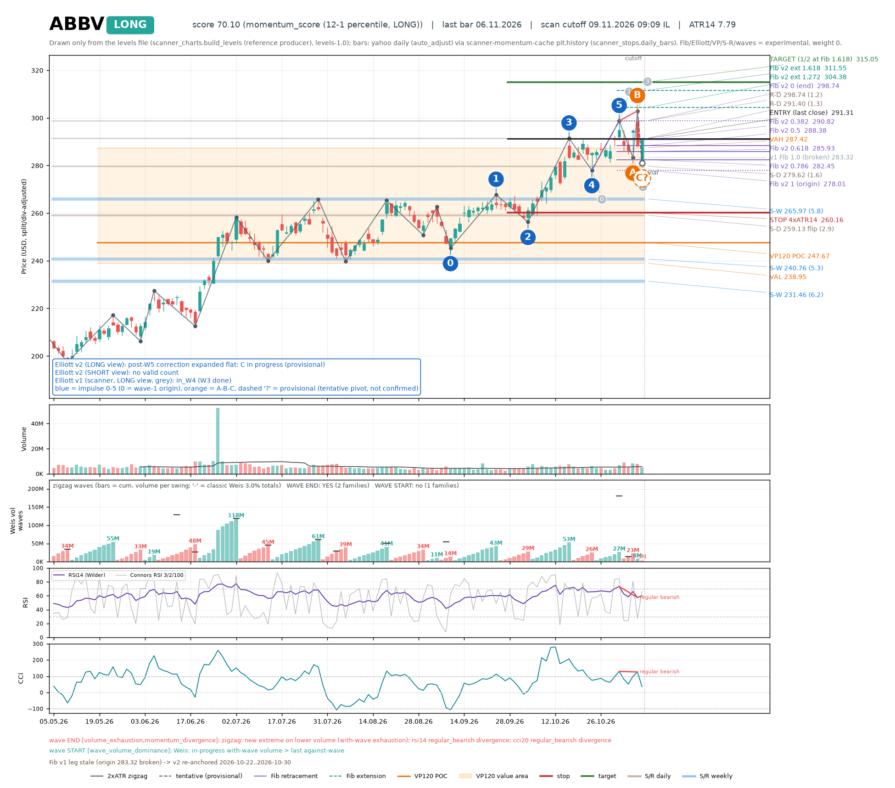

- **Jev (typesafe/jev-1.13):** 15 כותרות · 0 בביטחון ≥0.8 (סומכים על Jev) · 8 הועברו ל-Claude לשיפוט (ביטחון נמוך או חשד למניפולציה; 0 חשודות, 5 הודעות חברה) · סנטימנט — · קטליזטור —
- **Grok (grok-4.3, חיפוש X של Grok):** ✅ אישור · סנטימנט ‎+1 · ביטחון medium · 8 פוסטים · סנטימנט חיובי כללי ללא חדשות שליליות · חשבונות מאומתים: @singhlosophy, @GNG_Research, @dividend_data, @Stock_Opine
- **Perplexity:** לא התקבל (חסר קרדיט - OpenRouter (Perplexity))
- **Claude:** לא התקבל (חסר קרדיט - OpenRouter (Claude))
- **GPT:** לא התקבל (חסר קרדיט - OpenRouter (GPT))
- **האם הגרף נראה נכון? (ניסיוני):** Grok: n/a: אין דיון בגרף או באליוט בפוסטים · קלט: grok=img

### 11. LLY – לונג · דירוג 68.2
- **🔴 חסר קרדיט - OpenRouter (Claude) ; חסר קרדיט - OpenRouter (GPT) ; חסר קרדיט - OpenRouter (Perplexity)**
- **רמות (קובץ הרמות, נר אחרון 2026-11-06, hash 6291178e7e9be619):** כניסה 1,354.00 · סטופ 1,164.60 (chandelier_close 4.0xATR14, ATR14=47.35) · יעד: 1,651.87 – חצי ב-Fib 1.618 (סגירה), השאר בשנדלייר 4xATR
- **טכני:** SMA20 1,301.95 · SMA50 1,214.25 · SMA200 1,097.80 · מומנטום 12-1 0.271 · RSI14 61.1 · CCI20 51
- **ניסיוני (משקל 0):** אליוט v2: W2 in progress (provisional) · אליוט v1: no valid count · פיבו v2 1,131.21→1,453.00 (1.618=1,651.87) · VP120 POC 1,157.02 (VAH 1,236.89, VAL 1,095.95) · תמיכה 1,243.36 · התנגדות 1,449.68 · סוף גל: 1 משפחות (momentum_divergence) · תחילת גל: 2 (volume_exhaustion,momentum_divergence)
- **דוח:** תאריך דוח לא מאומת
- **סוויפ נזילות (ייחוס בלבד, משקל 0):** לא · **עבר בדיקה, שביר, משקל 0**

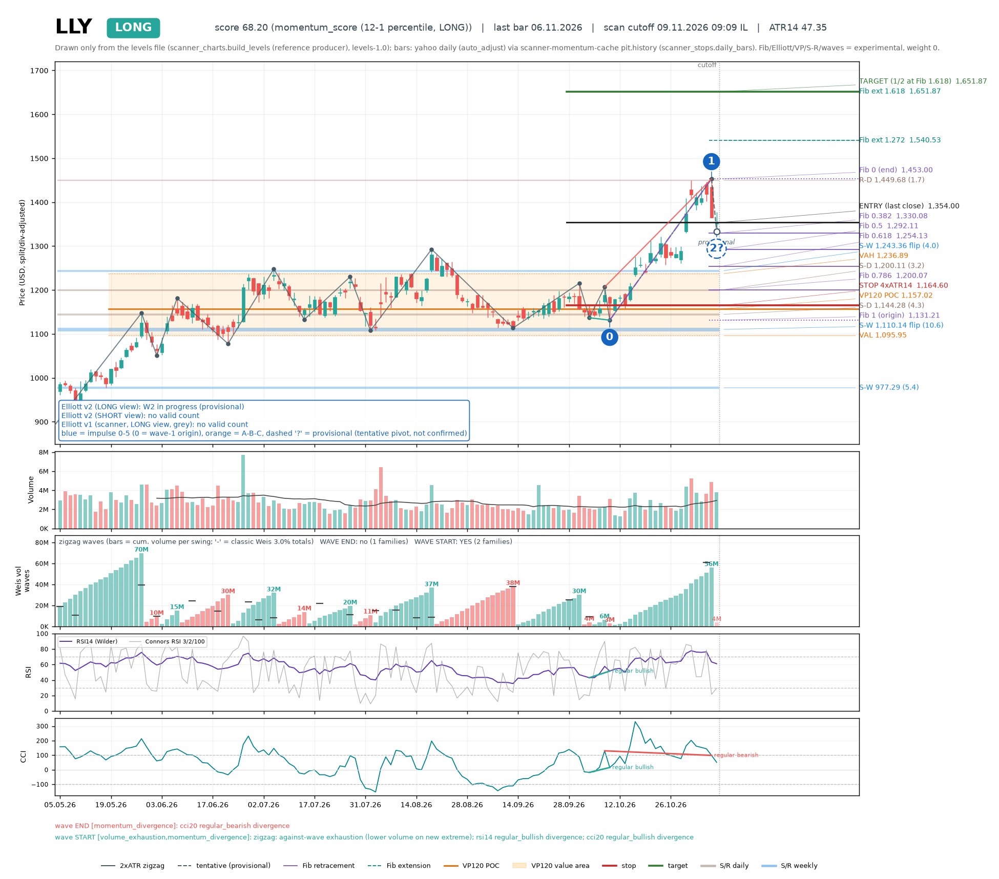

- **Jev (typesafe/jev-1.13):** 15 כותרות · 1 בביטחון ≥0.8 (סומכים על Jev) · 8 הועברו ל-Claude לשיפוט (ביטחון נמוך או חשד למניפולציה; 0 חשודות, 7 הודעות חברה) · סנטימנט חיובי (+1.00) · קטליזטור analyst
- **Grok (grok-4.3, חיפוש X של Grok):** ✅ אישור · סנטימנט ‎+0 · ביטחון low · 1 פוסטים · אין סנטימנט שלילי ברור ב-X נגד ה-LONG · חשבונות מאומתים: @JovieOnandon
- **Perplexity:** לא התקבל (חסר קרדיט - OpenRouter (Perplexity))
- **Claude:** לא התקבל (חסר קרדיט - OpenRouter (Claude))
- **GPT:** לא התקבל (חסר קרדיט - OpenRouter (GPT))
- **האם הגרף נראה נכון? (ניסיוני):** Grok: no: ספירת Elliott ו-Fib נראים תקינים על הגרף · קלט: grok=img

### 12. AAPL – לונג · דירוג 67.3
- **🔴 חסר קרדיט - OpenRouter (Claude) ; חסר קרדיט - OpenRouter (GPT) ; חסר קרדיט - OpenRouter (Perplexity)**
- **רמות (קובץ הרמות, נר אחרון 2026-11-06, hash c46009708fcfb649):** כניסה 342.37 · סטופ 307.29 (chandelier_close 4.0xATR14, ATR14=8.7706) · יעד: 367.75 – חצי ב-Fib 1.618 (סגירה), השאר בשנדלייר 4xATR
- **טכני:** SMA20 343.38 · SMA50 336.01 · SMA200 298.54 · מומנטום 12-1 0.265 · RSI14 51.5 · CCI20 ‎-34
- **ניסיוני (משקל 0):** אליוט v2: W2 correction expanded flat: C done -> W3 may start · אליוט v1: no valid count · פיבו v2 309.90→345.34 (1.618=367.24) · VP120 POC 310.35 (VAH 339.01, VAL 293.16) · תמיכה 335.11 · התנגדות 346.28 · סוף גל: 1 משפחות (momentum_divergence) · תחילת גל: 1 (wave_volume_dominance)
- **דוח:** מותר - דוח בעוד 55 ימי מסחר · מקורות: 2027-01-28 (Yahoo calendar)
- **סוויפ נזילות (ייחוס בלבד, משקל 0):** לא · **עבר בדיקה, שביר, משקל 0**

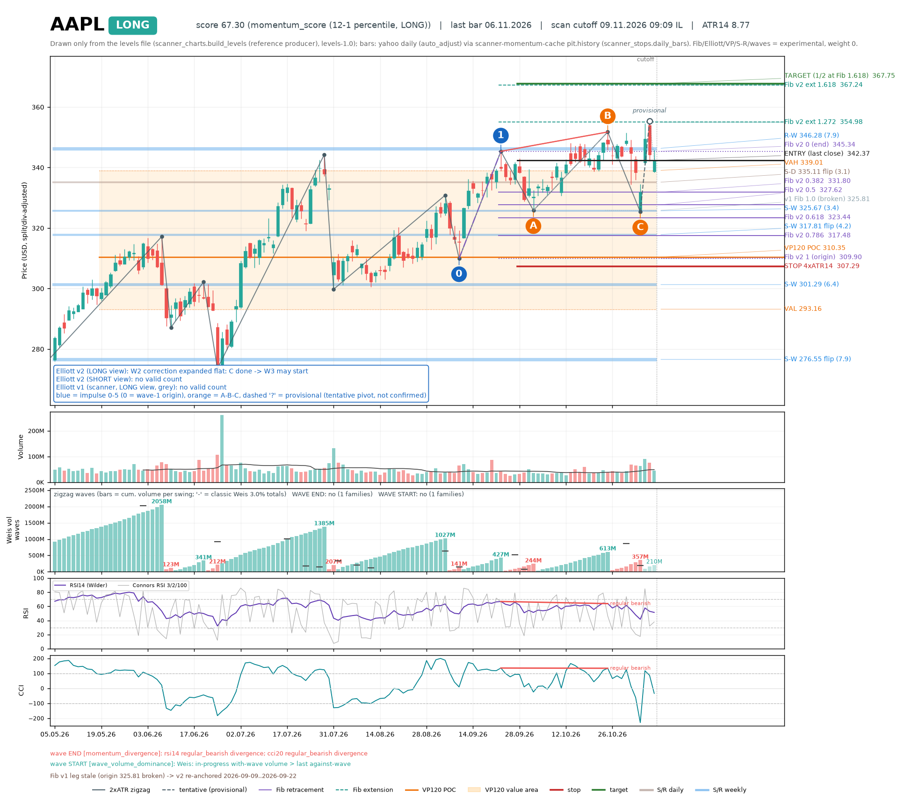

- **Jev (typesafe/jev-1.13):** 15 כותרות · 1 בביטחון ≥0.8 (סומכים על Jev) · 6 הועברו ל-Claude לשיפוט (ביטחון נמוך או חשד למניפולציה; 0 חשודות, 2 הודעות חברה) · סנטימנט חיובי (+1.00) · קטליזטור analyst
- **Grok (grok-4.3, חיפוש X של Grok):** ⚠️ דגל · סנטימנט ‎+0 · ביטחון medium · 6 פוסטים · סנטימנט מעורב עם חששות שוליים, אין סיבה ברורה לווטו · חשבונות מאומתים: @kirkpaper, @ddw88523, @BullSyndicate
- **Perplexity:** לא התקבל (חסר קרדיט - OpenRouter (Perplexity))
- **Claude:** לא התקבל (חסר קרדיט - OpenRouter (Claude))
- **GPT:** לא התקבל (חסר קרדיט - OpenRouter (GPT))
- **האם הגרף נראה נכון? (ניסיוני):** Grok: no: ספירת אליוט ו-Fib נראים תקינים · קלט: grok=img

### 13. URI – לונג · דירוג 66.4
- **🔴 חסר קרדיט - OpenRouter (Claude) ; חסר קרדיט - OpenRouter (GPT) ; חסר קרדיט - OpenRouter (Perplexity)**
- **רמות (קובץ הרמות, נר אחרון 2026-11-06, hash d598f71dfa44e8ab):** כניסה 1,055.57 · סטופ 876.94 (chandelier_close 4.0xATR14, ATR14=44.66) · יעד: 1,303.53 – חצי ב-Fib 1.618 (סגירה), השאר בשנדלייר 4xATR
- **טכני:** SMA20 1,098.91 · SMA50 1,053.90 · SMA200 973.40 · מומנטום 12-1 0.254 · RSI14 43.6 · CCI20 ‎-59
- **ניסיוני (משקל 0):** אליוט v2: W3 done (in W4) · אליוט v1: in_W4 (W3 done) · פיבו v2 1,005.64→1,117.64 (1.618=1,186.86) · VP120 POC 1,064.63 (VAH 1,114.36, VAL 985.64) · תמיכה 1,040.92 · התנגדות 1,076.10 · סוף גל: 2 משפחות (wave_volume_dominance,momentum_divergence) · תחילת גל: 0 (—)
- **דוח:** מותר - דוח בעוד 54 ימי מסחר · מקורות: 2027-01-27 (Yahoo calendar)
- **סוויפ נזילות (ייחוס בלבד, משקל 0):** לא · **עבר בדיקה, שביר, משקל 0**

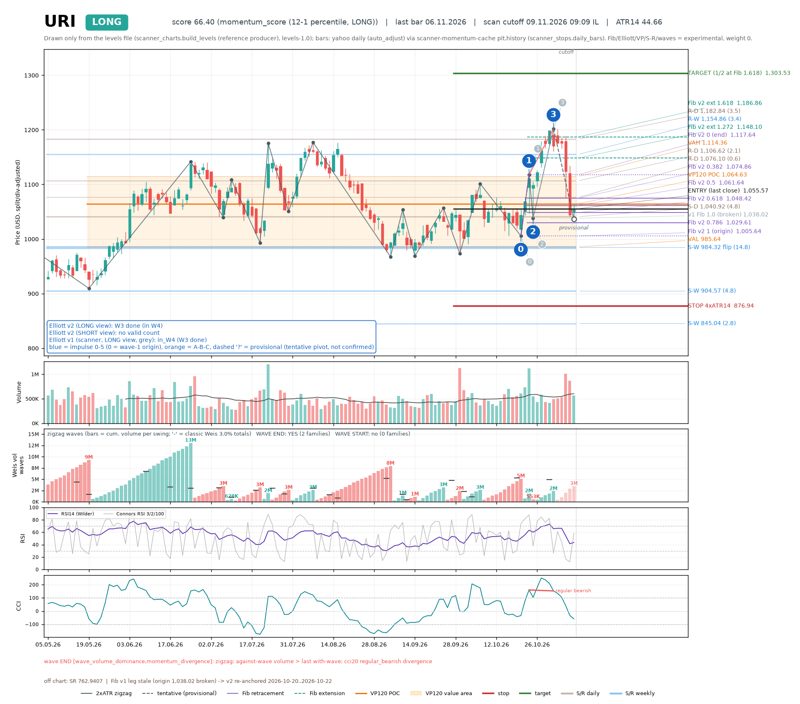

- **Jev (typesafe/jev-1.13):** 1 כותרות · 1 בביטחון ≥0.8 (סומכים על Jev) · 0 הועברו ל-Claude לשיפוט (ביטחון נמוך או חשד למניפולציה; 0 חשודות, 0 הודעות חברה) · סנטימנט חיובי (+1.00) · קטליזטור analyst
- **Grok (grok-4.3, חיפוש X של Grok):** ✅ אישור · סנטימנט ‎+1 · ביטחון low · 2 פוסטים · אין סיבות ברורות נגד LONG מהפוסטים ב-X · חשבונות מאומתים: @Tickeron, @moneywithlena
- **Perplexity:** לא התקבל (חסר קרדיט - OpenRouter (Perplexity))
- **Claude:** לא התקבל (חסר קרדיט - OpenRouter (Claude))
- **GPT:** לא התקבל (חסר קרדיט - OpenRouter (GPT))
- **האם הגרף נראה נכון? (ניסיוני):** Grok: n/a: אין אזכורים בגרף ב-X · קלט: grok=img

### 14. PFE – לונג · דירוג 63.6
- **🔴 חסר קרדיט - OpenRouter (Claude) ; חסר קרדיט - OpenRouter (GPT) ; חסר קרדיט - OpenRouter (Perplexity)**
- **רמות (קובץ הרמות, נר אחרון 2026-11-06, hash be940fc285a7563c):** כניסה 29.39 · סטופ 26.49 (chandelier_close 4.0xATR14, ATR14=0.7244) · יעד: 32.34 – חצי ב-Fib 1.618 (סגירה), השאר בשנדלייר 4xATR
- **טכני:** SMA20 29.35 · SMA50 28.34 · SMA200 26.09 · מומנטום 12-1 0.210 · RSI14 53.5 · CCI20 ‎-33
- **ניסיוני (משקל 0):** אליוט v2: W3 done (in W4) · אליוט v1: in_W4 (W3 done) · פיבו v2 26.73→30.00 (1.618=32.02) · VP120 POC 24.26 (VAH 27.58, VAL 22.88) · תמיכה 28.74 · התנגדות 30.00 · סוף גל: 2 משפחות (volume_exhaustion,momentum_divergence) · תחילת גל: 0 (—)
- **דוח:** מותר - דוח בעוד 58 ימי מסחר · מקורות: 2027-02-02 (Yahoo calendar)
- **סוויפ נזילות (ייחוס בלבד, משקל 0):** כן (לונג, רמה 28.80 pivot) · **עבר בדיקה, שביר, משקל 0**

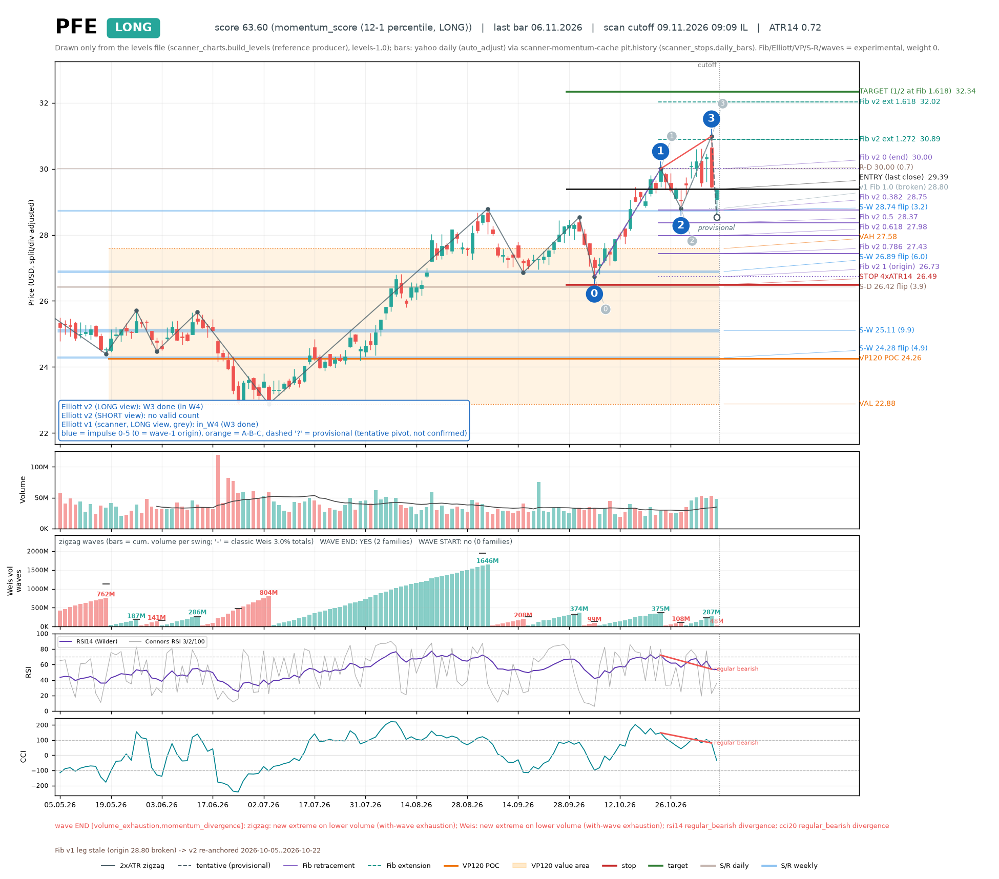

- **Jev (typesafe/jev-1.13):** 15 כותרות · 6 בביטחון ≥0.8 (סומכים על Jev) · 8 הועברו ל-Claude לשיפוט (ביטחון נמוך או חשד למניפולציה; 0 חשודות, 2 הודעות חברה) · סנטימנט חיובי (+0.52) · קטליזטור analyst
- **Grok (grok-4.3, חיפוש X של Grok):** ✅ אישור · סנטימנט ‎+1 · ביטחון medium · 7 פוסטים · סנטימנט חיובי כללי ללא חדשות שליליות ברורות · חשבונות מאומתים: —
- **Perplexity:** לא התקבל (חסר קרדיט - OpenRouter (Perplexity))
- **Claude:** לא התקבל (חסר קרדיט - OpenRouter (Claude))
- **GPT:** לא התקבל (חסר קרדיט - OpenRouter (GPT))
- **האם הגרף נראה נכון? (ניסיוני):** Grok: no: ספירת אליוט ו-Fib נראים תקינים · קלט: grok=img

### 15. BAC – שורט · דירוג 61.7
- **🔴 חסר קרדיט - OpenRouter (Claude) ; חסר קרדיט - OpenRouter (GPT) ; חסר קרדיט - OpenRouter (Perplexity)**
- **רמות (קובץ הרמות, נר אחרון 2026-11-06, hash 80fb3ca76b7c6686):** כניסה 49.42 · סטופ 54.75 (chandelier_close 4.0xATR14, ATR14=1.3334) · יעד: אין – ללא יעד קבוע - שנדלייר 4xATR14 על סגירה (כלל מאושר)
- **טכני:** SMA20 50.98 · SMA50 55.21 · SMA200 54.51 · מומנטום 12-1 0.044 · RSI14 34.5 · CCI20 ‎-113
- **ניסיוני (משקל 0):** אליוט v2: W2 correction regular flat: C done -> W3 may start · אליוט v1: no valid count · פיבו v2 54.93→49.26 (1.618=45.76) · VP120 POC 50.90 (VAH 60.49, VAL 49.17) · תמיכה 48.01 · התנגדות 49.53 · סוף גל: 1 משפחות (momentum_divergence) · תחילת גל: 2 (volume_exhaustion,wave_volume_dominance)
- **דוח:** מותר - דוח בעוד 47 ימי מסחר · מקורות: 2027-01-15 (Yahoo calendar)
- **סוויפ נזילות (ייחוס בלבד, משקל 0):** לא
- **ספירלת פיבו – יעדי ייחוס בלבד (משקל 0, לא משנה סטופ/יעד; השורט נשאר עם סטופ נגרר 4×ATR בלי יעד):** T1 57.55 (fan:2@fib0.382) · T2 57.55 (fan:1@fib0.382) · מצב: triggered_earlier

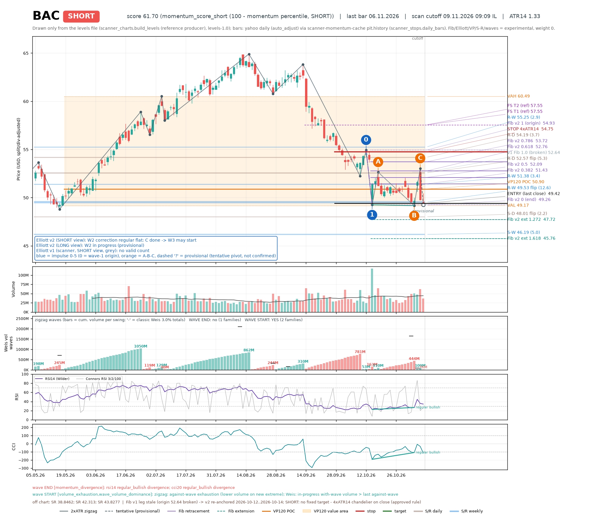

- **Jev (typesafe/jev-1.13):** 15 כותרות · 2 בביטחון ≥0.8 (סומכים על Jev) · 8 הועברו ל-Claude לשיפוט (ביטחון נמוך או חשד למניפולציה; 0 חשודות, 2 הודעות חברה) · סנטימנט שלילי (-1.00) · קטליזטור analyst
- **Grok (grok-4.3, חיפוש X של Grok):** ✅ אישור · סנטימנט ‎+0 · ביטחון low · 0 פוסטים · אין פוסטים אמיתיים ב-X נגד השורט · חשבונות מאומתים: —
- **Perplexity:** לא התקבל (חסר קרדיט - OpenRouter (Perplexity))
- **Claude:** לא התקבל (חסר קרדיט - OpenRouter (Claude))
- **GPT:** לא התקבל (חסר קרדיט - OpenRouter (GPT))
- **האם הגרף נראה נכון? (ניסיוני):** Grok: no: הספירה של אליוט נראית תקינה על הגרף · קלט: grok=img

### 16. UNH – לונג · דירוג 58.9
- **🔴 חסר קרדיט - OpenRouter (Claude) ; חסר קרדיט - OpenRouter (GPT) ; חסר קרדיט - OpenRouter (Perplexity)**
- **רמות (קובץ הרמות, נר אחרון 2026-11-06, hash cf6874958748b92b):** כניסה 394.15 · סטופ 344.73 (chandelier_close 4.0xATR14, ATR14=12.36) · יעד: 466.07 – חצי ב-Fib 1.618 (סגירה), השאר בשנדלייר 4xATR
- **טכני:** SMA20 404.82 · SMA50 390.17 · SMA200 361.25 · מומנטום 12-1 0.162 · RSI14 46.3 · CCI20 ‎-93
- **ניסיוני (משקל 0):** אליוט v2: W2 in progress (provisional) · אליוט v1: no valid count · פיבו v2 362.60→426.55 (1.618=466.07) · VP120 POC 377.03 (VAH 412.62, VAL 372.22) · תמיכה 382.30 · התנגדות 400.66 · סוף גל: 0 משפחות (—) · תחילת גל: 0 (—)
- **דוח:** מותר - דוח בעוד 44 ימי מסחר · מקורות: 2027-01-12 (Yahoo calendar)
- **סוויפ נזילות (ייחוס בלבד, משקל 0):** לא · **עבר בדיקה, שביר, משקל 0**

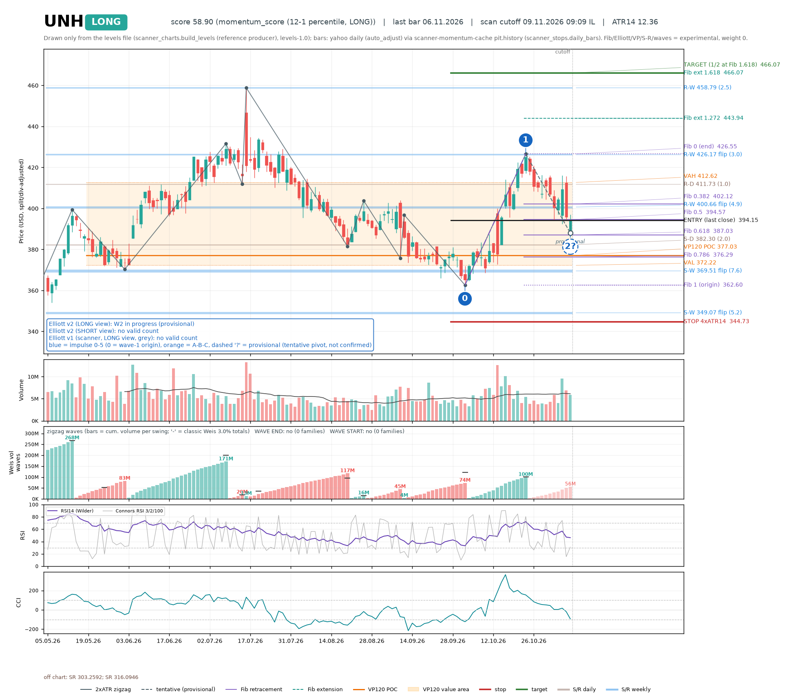

- **Jev (typesafe/jev-1.13):** 14 כותרות · 1 בביטחון ≥0.8 (סומכים על Jev) · 8 הועברו ל-Claude לשיפוט (ביטחון נמוך או חשד למניפולציה; 0 חשודות, 3 הודעות חברה) · סנטימנט ניטרלי/מעורב (+0.00) · קטליזטור other
- **Grok (grok-4.3, חיפוש X של Grok):** ✅ אישור · סנטימנט ‎+0 · ביטחון low · 0 פוסטים · אין סנטימנט שלילי ב-X, אין סיבה לווטו · חשבונות מאומתים: —
- **Perplexity:** לא התקבל (חסר קרדיט - OpenRouter (Perplexity))
- **Claude:** לא התקבל (חסר קרדיט - OpenRouter (Claude))
- **GPT:** לא התקבל (חסר קרדיט - OpenRouter (GPT))
- **האם הגרף נראה נכון? (ניסיוני):** Grok: n/a: לא נמצאו פוסטים רלוונטיים · קלט: grok=img

### 17. AEP – שורט · דירוג 57.9
- **🔴 חסר קרדיט - OpenRouter (Claude) ; חסר קרדיט - OpenRouter (GPT) ; חסר קרדיט - OpenRouter (Perplexity)**
- **רמות (קובץ הרמות, נר אחרון 2026-11-06, hash 18df445961b5c7e2):** כניסה 126.53 · סטופ 137.61 (chandelier_close 4.0xATR14, ATR14=2.7693) · יעד: אין – ללא יעד קבוע - שנדלייר 4xATR14 על סגירה (כלל מאושר)
- **טכני:** SMA20 127.86 · SMA50 123.97 · SMA200 127.29 · מומנטום 12-1 0.053 · RSI14 49.4 · CCI20 ‎-67
- **ניסיוני (משקל 0):** אליוט v2: W2 correction flat: B in progress (provisional) · אליוט v1: in_W3 (W2 done) · פיבו v2 132.17→123.72 (1.618=118.50) · VP120 POC 127.43 (VAH 130.85, VAL 119.90) · תמיכה 122.23 · התנגדות 127.58 · סוף גל: 1 משפחות (wave_volume_dominance) · תחילת גל: 1 (elliott_context)
- **דוח:** תאריך דוח לא מאומת
- **סוויפ נזילות (ייחוס בלבד, משקל 0):** לא
- **ספירלת פיבו – יעדי ייחוס בלבד (משקל 0, לא משנה סטופ/יעד; השורט נשאר עם סטופ נגרר 4×ATR בלי יעד):** T1 — (—) · T2 — (—) · מצב: none

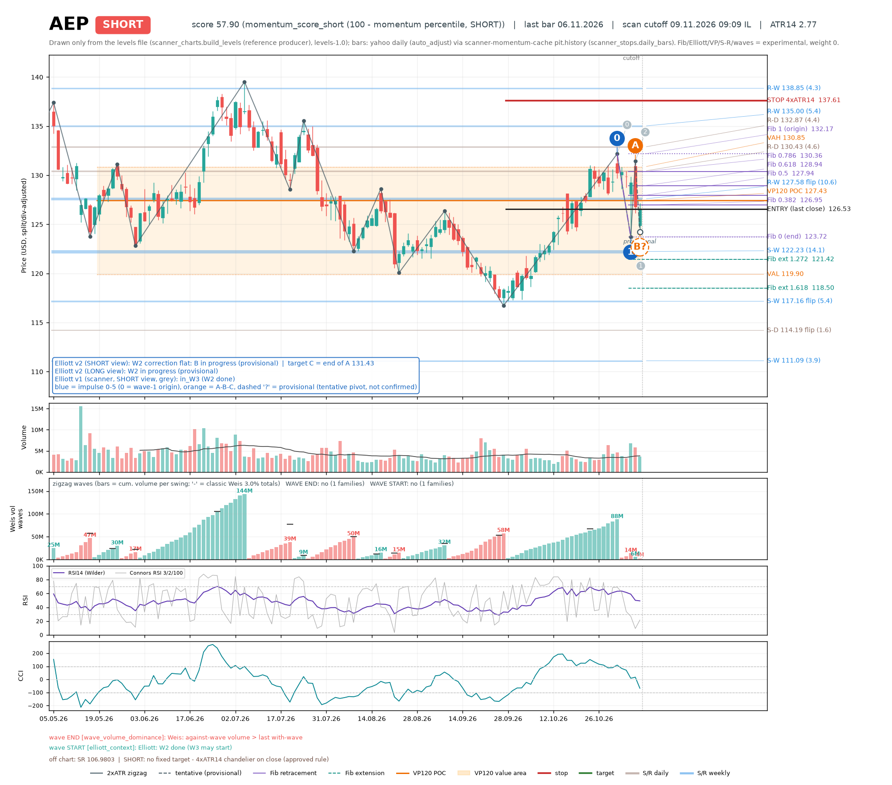

- **Jev (typesafe/jev-1.13):** 12 כותרות · 4 בביטחון ≥0.8 (סומכים על Jev) · 4 הועברו ל-Claude לשיפוט (ביטחון נמוך או חשד למניפולציה; 0 חשודות, 1 הודעות חברה) · סנטימנט חיובי (+0.74) · קטליזטור analyst
- **Grok (grok-4.3, חיפוש X של Grok):** ⚠️ דגל · סנטימנט ‎+1 · ביטחון low · 1 פוסטים · פוסט חיובי אחד על AEP מפחית תמיכה ב-SHORT · חשבונות מאומתים: @xbyhunter
- **Perplexity:** לא התקבל (חסר קרדיט - OpenRouter (Perplexity))
- **Claude:** לא התקבל (חסר קרדיט - OpenRouter (Claude))
- **GPT:** לא התקבל (חסר קרדיט - OpenRouter (GPT))
- **האם הגרף נראה נכון? (ניסיוני):** Grok: n/a · קלט: grok=img

### 18. TMO – לונג · דירוג 55.1
- **🔴 חסר קרדיט - OpenRouter (Claude) ; חסר קרדיט - OpenRouter (GPT) ; חסר קרדיט - OpenRouter (Perplexity)**
- **רמות (קובץ הרמות, נר אחרון 2026-11-06, hash cd4b2064ba1b258e):** כניסה 694.76 · סטופ 605.58 (chandelier_close 4.0xATR14, ATR14=22.29) · יעד: 742.87 – חצי ב-Fib 1.618 (סגירה), השאר בשנדלייר 4xATR
- **טכני:** SMA20 687.16 · SMA50 660.71 · SMA200 552.31 · מומנטום 12-1 0.153 · RSI14 54.8 · CCI20 ‎-9
- **ניסיוני (משקל 0):** אליוט v2: W2 correction expanded flat: C in progress (provisional) · אליוט v1: in_W4 (W3 done) · פיבו v2 635.32→705.79 (1.618=749.34) · VP120 POC 654.57 (VAH 712.17, VAL 514.68) · תמיכה 691.24 · התנגדות 708.82 · סוף גל: 3 משפחות (volume_exhaustion,wave_volume_dominance,momentum_divergence) · תחילת גל: 0 (—)
- **דוח:** מותר - דוח בעוד 55 ימי מסחר · מקורות: 2027-01-28 (Yahoo calendar)
- **סוויפ נזילות (ייחוס בלבד, משקל 0):** לא · **עבר בדיקה, שביר, משקל 0**

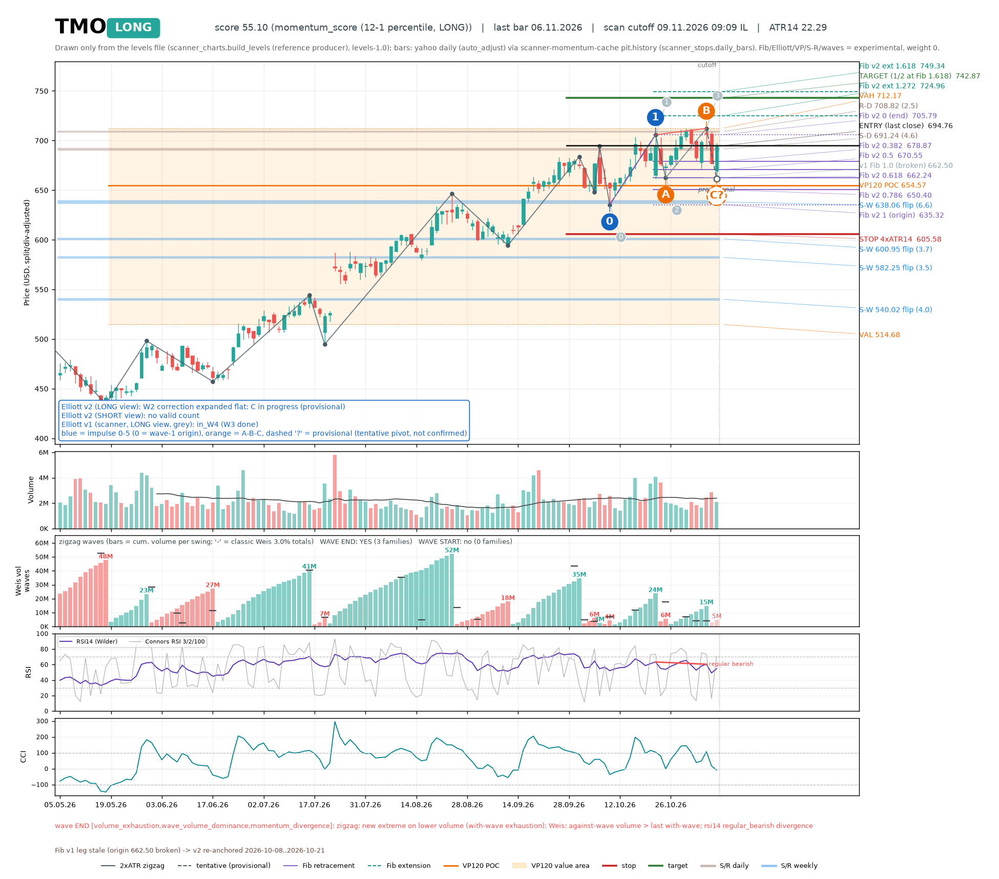

- **Jev (typesafe/jev-1.13):** 11 כותרות · 2 בביטחון ≥0.8 (סומכים על Jev) · 7 הועברו ל-Claude לשיפוט (ביטחון נמוך או חשד למניפולציה; 0 חשודות, 4 הודעות חברה) · סנטימנט ניטרלי/מעורב (+0.00) · קטליזטור other
- **Grok (grok-4.3, חיפוש X של Grok):** ✅ אישור · סנטימנט ‎+1 · ביטחון low · 4 פוסטים · אין סיבות שליליות ב-X נגד הלונג · חשבונות מאומתים: @disclosedhq
- **Perplexity:** לא התקבל (חסר קרדיט - OpenRouter (Perplexity))
- **Claude:** לא התקבל (חסר קרדיט - OpenRouter (Claude))
- **GPT:** לא התקבל (חסר קרדיט - OpenRouter (GPT))
- **האם הגרף נראה נכון? (ניסיוני):** Grok: no: ספירה ו-Fib נראים תקינים · קלט: grok=img

### 19. V – לונג · דירוג 50.5
- **🔴 חסר קרדיט - OpenRouter (Claude) ; חסר קרדיט - OpenRouter (GPT) ; חסר קרדיט - OpenRouter (Perplexity)**
- **רמות (קובץ הרמות, נר אחרון 2026-11-06, hash f668854b5c052222):** כניסה 422.65 · סטופ 385.57 (chandelier_close 4.0xATR14, ATR14=9.2693) · יעד: 472.04 – חצי ב-Fib 1.618 (סגירה), השאר בשנדלייר 4xATR
- **טכני:** SMA20 408.86 · SMA50 385.84 · SMA200 343.97 · מומנטום 12-1 0.112 · RSI14 63.3 · CCI20 82
- **ניסיוני (משקל 0):** אליוט v2: W2 in progress (provisional) · אליוט v1: in_W4 (W3 done) · פיבו v2 394.00→442.23 (1.618=472.04) · VP120 POC 368.64 (VAH 383.36, VAL 324.48) · תמיכה 385.57 · התנגדות — · סוף גל: 2 משפחות (volume_exhaustion,momentum_divergence) · תחילת גל: 0 (—)
- **דוח:** מותר - דוח בעוד 53 ימי מסחר · מקורות: 2027-01-26 (Yahoo calendar)
- **סוויפ נזילות (ייחוס בלבד, משקל 0):** לא · **עבר בדיקה, שביר, משקל 0**

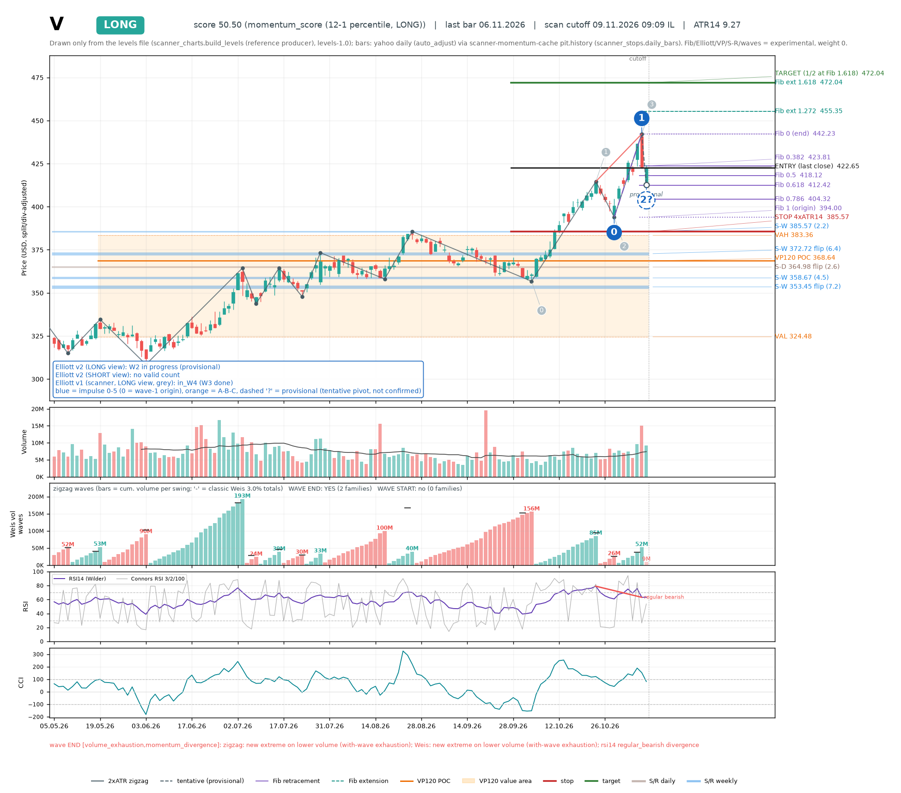

- **Jev (typesafe/jev-1.13):** 15 כותרות · 2 בביטחון ≥0.8 (סומכים על Jev) · 8 הועברו ל-Claude לשיפוט (ביטחון נמוך או חשד למניפולציה; 0 חשודות, 4 הודעות חברה) · סנטימנט חיובי (+1.00) · קטליזטור analyst
- **Grok (grok-4.3, חיפוש X של Grok):** ✅ אישור · סנטימנט ‎+2 · ביטחון high · 6 פוסטים · סנטימנט שורי חזק ב-X ללא חדשות שליליות · חשבונות מאומתים: @CamperdownCo, @FukuroStocks, @dividend_data, @stonkstradamus, @jbfinancebull
- **Perplexity:** לא התקבל (חסר קרדיט - OpenRouter (Perplexity))
- **Claude:** לא התקבל (חסר קרדיט - OpenRouter (Claude))
- **GPT:** לא התקבל (חסר קרדיט - OpenRouter (GPT))
- **האם הגרף נראה נכון? (ניסיוני):** Grok: n/a: אין דיון בספירה או Fib ב-X · קלט: grok=img

### 20. LMT – לונג · דירוג 48.6
- **🔴 חסר קרדיט - OpenRouter (Claude) ; חסר קרדיט - OpenRouter (GPT) ; חסר קרדיט - OpenRouter (Perplexity)**
- **רמות (קובץ הרמות, נר אחרון 2026-11-06, hash 2be310fb8d8b0b46):** כניסה 567.08 · סטופ 488.93 (chandelier_close 4.0xATR14, ATR14=19.54) · יעד: 755.88 – חצי ב-Fib 1.618 (סגירה), השאר בשנדלייר 4xATR
- **טכני:** SMA20 582.72 · SMA50 548.06 · SMA200 564.13 · מומנטום 12-1 0.101 · RSI14 46.5 · CCI20 ‎-25
- **ניסיוני (משקל 0):** אליוט v2: W2 in progress (provisional) · אליוט v1: no valid count · פיבו v2 497.00→657.00 (1.618=755.88) · VP120 POC 527.37 (VAH 570.58, VAL 494.53) · תמיכה 545.67 · התנגדות 567.35 · סוף גל: 0 משפחות (—) · תחילת גל: 0 (—)
- **דוח:** מותר - דוח בעוד 53 ימי מסחר · מקורות: 2027-01-26 (Yahoo calendar)
- **סוויפ נזילות (ייחוס בלבד, משקל 0):** לא · **עבר בדיקה, שביר, משקל 0**

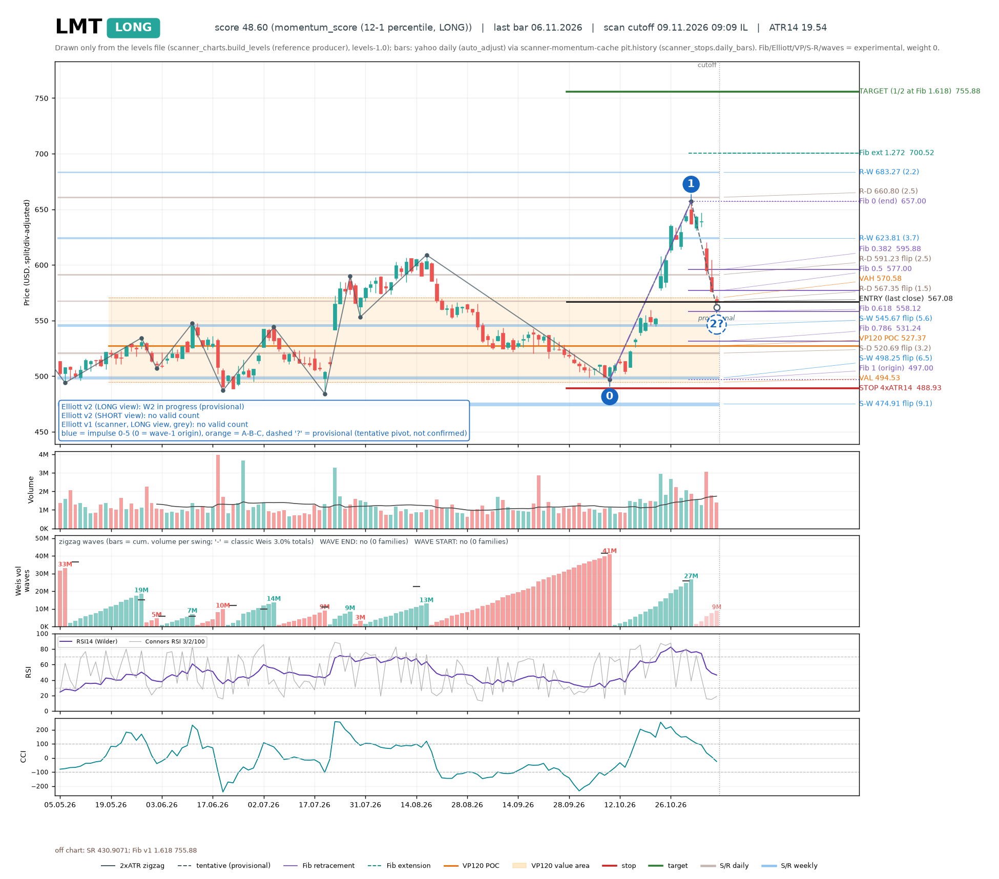

- **Jev (typesafe/jev-1.13):** 15 כותרות · 1 בביטחון ≥0.8 (סומכים על Jev) · 8 הועברו ל-Claude לשיפוט (ביטחון נמוך או חשד למניפולציה; 0 חשודות, 0 הודעות חברה) · סנטימנט שלילי (-1.00) · קטליזטור regulatory
- **Grok (grok-4.3, חיפוש X של Grok):** ✅ אישור · סנטימנט ‎+1 · ביטחון low · 3 פוסטים · סנטימנט ניטרלי-חיובי קל ללא סיבה נגד LONG · חשבונות מאומתים: @pnltrade, @jkru_mov, @MartEnterprises
- **Perplexity:** לא התקבל (חסר קרדיט - OpenRouter (Perplexity))
- **Claude:** לא התקבל (חסר קרדיט - OpenRouter (Claude))
- **GPT:** לא התקבל (חסר קרדיט - OpenRouter (GPT))
- **האם הגרף נראה נכון? (ניסיוני):** Grok: n/a: אין דיון ב-X על הגרף · קלט: grok=img

### 21. GS – שורט · דירוג 47.7
- **🔴 חסר קרדיט - OpenRouter (Claude) ; חסר קרדיט - OpenRouter (GPT) ; חסר קרדיט - OpenRouter (Perplexity)**
- **רמות (קובץ הרמות, נר אחרון 2026-11-06, hash 943c0dcade4b45b4):** כניסה 865.82 · סטופ 978.56 (chandelier_close 4.0xATR14, ATR14=28.18) · יעד: אין – ללא יעד קבוע - שנדלייר 4xATR14 על סגירה (כלל מאושר)
- **טכני:** SMA20 893.97 · SMA50 932.31 · SMA200 950.29 · מומנטום 12-1 0.135 · RSI14 40.3 · CCI20 ‎-123
- **ניסיוני (משקל 0):** אליוט v2: W3 in progress (provisional) · אליוט v1: in_W3 (W2 done) · פיבו v2 939.38→879.50 (1.618=842.49) · VP120 POC 1,033.74 (VAH 1,107.22, VAL 924.99) · תמיכה 859.04 · התנגדות 895.91 · סוף גל: 1 משפחות (wave_volume_dominance) · תחילת גל: 3 (volume_exhaustion,wave_volume_dominance,elliott_context)
- **דוח:** מותר - דוח בעוד 48 ימי מסחר · מקורות: 2027-01-19 (Yahoo calendar)
- **סוויפ נזילות (ייחוס בלבד, משקל 0):** לא
- **ספירלת פיבו – יעדי ייחוס בלבד (משקל 0, לא משנה סטופ/יעד; השורט נשאר עם סטופ נגרר 4×ATR בלי יעד):** T1 960.83 (fan:4@fib0.5) · T2 960.83 (circle:0.786@fib0.5) · מצב: triggered_earlier

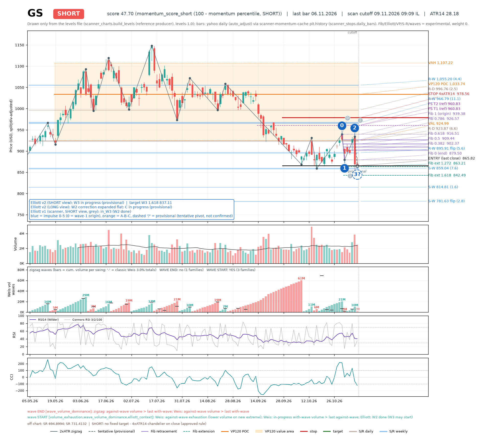

- **Jev (typesafe/jev-1.13):** 15 כותרות · 0 בביטחון ≥0.8 (סומכים על Jev) · 8 הועברו ל-Claude לשיפוט (ביטחון נמוך או חשד למניפולציה; 0 חשודות, 5 הודעות חברה) · סנטימנט — · קטליזטור —
- **Grok (grok-4.3, חיפוש X של Grok):** ✅ אישור · סנטימנט ‎-1 · ביטחון low · 4 פוסטים · אין סיבות ברורות נגד השורט ב-X · חשבונות מאומתים: @MarketUpdates7, @MarketUpdates7
- **Perplexity:** לא התקבל (חסר קרדיט - OpenRouter (Perplexity))
- **Claude:** לא התקבל (חסר קרדיט - OpenRouter (Claude))
- **GPT:** לא התקבל (חסר קרדיט - OpenRouter (GPT))
- **האם הגרף נראה נכון? (ניסיוני):** Grok: n/a: אין דיון על הגרף · קלט: grok=img

### 22. WMT – לונג · דירוג 47.7
- **🔴 חסר קרדיט - OpenRouter (Claude) ; חסר קרדיט - OpenRouter (GPT) ; חסר קרדיט - OpenRouter (Perplexity)**
- **רמות (קובץ הרמות, נר אחרון 2026-11-06, hash 5161679e0e5d117f):** כניסה 125.52 · סטופ 113.16 (chandelier_close 4.0xATR14, ATR14=3.0907) · יעד: 141.21 – חצי ב-Fib 1.618 (סגירה), השאר בשנדלייר 4xATR
- **טכני:** SMA20 120.58 · SMA50 112.48 · SMA200 118.36 · מומנטום 12-1 0.099 · RSI14 63.6 · CCI20 85
- **ניסיוני (משקל 0):** אליוט v2: W2 in progress (provisional) · אליוט v1: W5_done (correction next) · פיבו v2 116.63→131.82 (1.618=141.21) · VP120 POC 106.40 (VAH 117.84, VAL 102.80) · תמיכה 121.41 · התנגדות 126.27 · סוף גל: 2 משפחות (momentum_divergence,elliott_context) · תחילת גל: 1 (wave_volume_dominance)
- **דוח:** מותר - דוח בעוד 9 ימי מסחר · מקורות: 2026-11-19 (Yahoo calendar)
- **סוויפ נזילות (ייחוס בלבד, משקל 0):** לא · **עבר בדיקה, שביר, משקל 0**

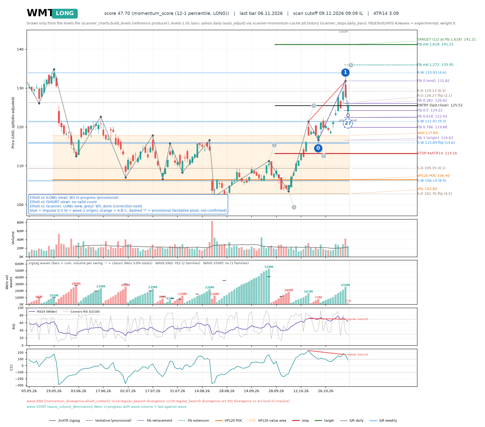

- **Jev (typesafe/jev-1.13):** 15 כותרות · 0 בביטחון ≥0.8 (סומכים על Jev) · 6 הועברו ל-Claude לשיפוט (ביטחון נמוך או חשד למניפולציה; 0 חשודות, 4 הודעות חברה) · סנטימנט — · קטליזטור —
- **Grok (grok-4.3, חיפוש X של Grok):** ✅ אישור · סנטימנט ‎+0 · ביטחון medium · 2 פוסטים · אין סיבה ברורה נגד LONG מהפוסטים ב-X · חשבונות מאומתים: @EarningsAnatomy, @Morpheu5Watcher
- **Perplexity:** לא התקבל (חסר קרדיט - OpenRouter (Perplexity))
- **Claude:** לא התקבל (חסר קרדיט - OpenRouter (Claude))
- **GPT:** לא התקבל (חסר קרדיט - OpenRouter (GPT))
- **האם הגרף נראה נכון? (ניסיוני):** Grok: n/a: אין דיון בגרף ב-X · קלט: grok=img

### 23. META – שורט · דירוג 46.7
- **🔴 חסר קרדיט - OpenRouter (Claude) ; חסר קרדיט - OpenRouter (GPT) ; חסר קרדיט - OpenRouter (Perplexity)**
- **רמות (קובץ הרמות, נר אחרון 2026-11-06, hash e963b3b5ab21de19):** כניסה 610.15 · סטופ 706.73 (chandelier_close 4.0xATR14, ATR14=24.15) · יעד: אין – ללא יעד קבוע - שנדלייר 4xATR14 על סגירה (כלל מאושר)
- **טכני:** SMA20 662.67 · SMA50 674.77 · SMA200 631.15 · מומנטום 12-1 0.137 · RSI14 36.7 · CCI20 ‎-71
- **ניסיוני (משקל 0):** אליוט v2: W3 in progress (provisional) / beyond target · אליוט v1: in_W3 (W2 done) · פיבו v2 779.82→711.68 (1.618=669.57) · VP120 POC 608.47 (VAH 677.52, VAL 554.77) · תמיכה 590.85 · התנגדות 610.52 · סוף גל: 0 משפחות (—) · תחילת גל: 2 (wave_volume_dominance,elliott_context)
- **דוח:** מותר - דוח בעוד 54 ימי מסחר · מקורות: 2027-01-27 (Yahoo calendar)
- **סוויפ נזילות (ייחוס בלבד, משקל 0):** לא
- **ספירלת פיבו – יעדי ייחוס בלבד (משקל 0, לא משנה סטופ/יעד; השורט נשאר עם סטופ נגרר 4×ATR בלי יעד):** T1 682.13 (circle:0.5@fib0.382) · T2 682.13 (circle:0.786@fib0.382) · מצב: triggered_earlier

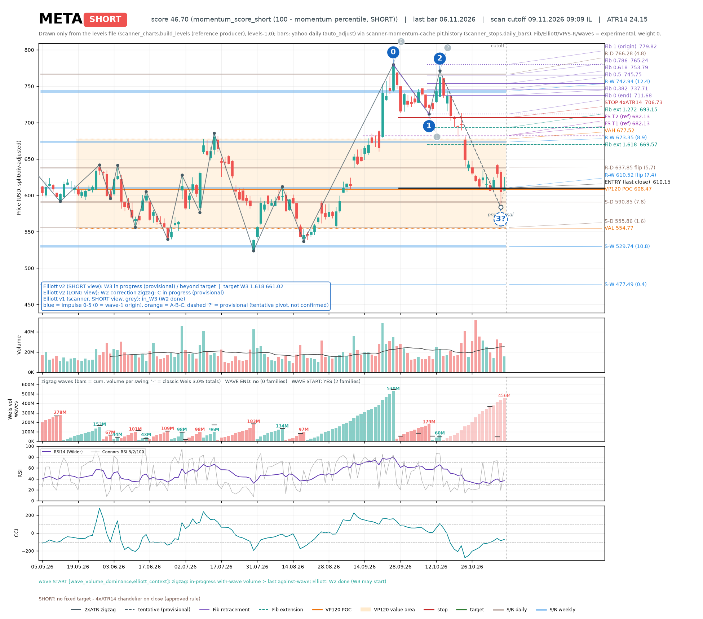

- **Jev (typesafe/jev-1.13):** 15 כותרות · 0 בביטחון ≥0.8 (סומכים על Jev) · 5 הועברו ל-Claude לשיפוט (ביטחון נמוך או חשד למניפולציה; 0 חשודות, 1 הודעות חברה) · סנטימנט — · קטליזטור —
- **Grok (grok-4.3, חיפוש X של Grok):** ✅ אישור · סנטימנט ‎+0 · ביטחון low · 10 פוסטים · אין סנטימנט חזק נגד השורט ב-X · חשבונות מאומתים: —
- **Perplexity:** לא התקבל (חסר קרדיט - OpenRouter (Perplexity))
- **Claude:** לא התקבל (חסר קרדיט - OpenRouter (Claude))
- **GPT:** לא התקבל (חסר קרדיט - OpenRouter (GPT))
- **האם הגרף נראה נכון? (ניסיוני):** Grok: n/a: אין דיון על הגרף ב-X · קלט: grok=img

### 24. D – לונג · דירוג 45.8
- **🔴 חסר קרדיט - OpenRouter (Claude) ; חסר קרדיט - OpenRouter (GPT) ; חסר קרדיט - OpenRouter (Perplexity)**
- **רמות (קובץ הרמות, נר אחרון 2026-11-06, hash 4615610ee6447021):** כניסה 68.60 · סטופ 62.74 (chandelier_close 4.0xATR14, ATR14=1.4643) · יעד: 78.29 – חצי ב-Fib 1.618 (סגירה), השאר בשנדלייר 4xATR
- **טכני:** SMA20 65.05 · SMA50 63.87 · SMA200 64.14 · מומנטום 12-1 0.079 · RSI14 64.8 · CCI20 120
- **ניסיוני (משקל 0):** אליוט v2: W2 in progress (provisional) · אליוט v1: no valid count · פיבו v2 59.44→71.09 (1.618=78.29) · VP120 POC 66.23 (VAH 69.95, VAL 64.82) · תמיכה 66.83 · התנגדות 69.30 · סוף גל: 1 משפחות (wave_volume_dominance) · תחילת גל: 0 (—)
- **דוח:** תאריך דוח לא מאומת
- **סוויפ נזילות (ייחוס בלבד, משקל 0):** כן (שורט, רמה 69.05 pivot) · **עבר בדיקה, שביר, משקל 0**

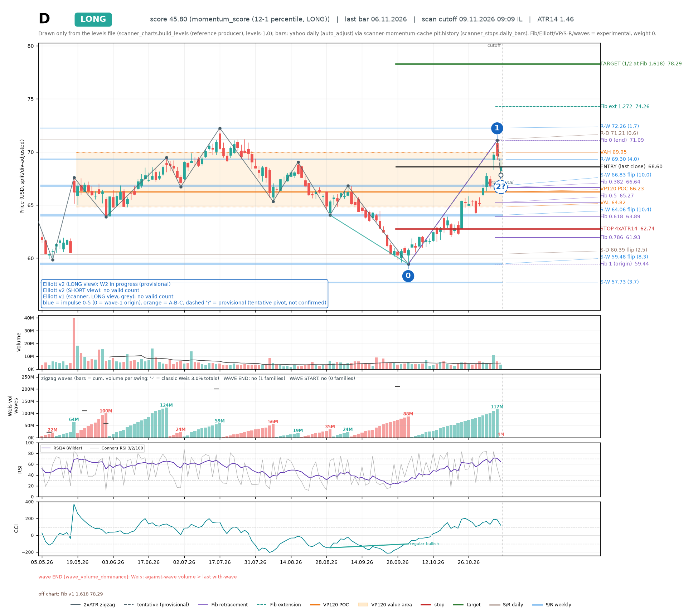

- **Jev (typesafe/jev-1.13):** 9 כותרות · 3 בביטחון ≥0.8 (סומכים על Jev) · 5 הועברו ל-Claude לשיפוט (ביטחון נמוך או חשד למניפולציה; 0 חשודות, 2 הודעות חברה) · סנטימנט שלילי (-0.35) · קטליזטור analyst
- **Grok (grok-4.3, חיפוש X של Grok):** ✅ אישור · סנטימנט ‎+0 · ביטחון low · 0 פוסטים · אין דיון משמעותי ב-X · חשבונות מאומתים: —
- **Perplexity:** לא התקבל (חסר קרדיט - OpenRouter (Perplexity))
- **Claude:** לא התקבל (חסר קרדיט - OpenRouter (Claude))
- **GPT:** לא התקבל (חסר קרדיט - OpenRouter (GPT))
- **האם הגרף נראה נכון? (ניסיוני):** Grok: n/a · קלט: grok=img

### 25. MS – שורט · דירוג 43.0
- **🔴 חסר קרדיט - OpenRouter (Claude) ; חסר קרדיט - OpenRouter (GPT) ; חסר קרדיט - OpenRouter (Perplexity)**
- **רמות (קובץ הרמות, נר אחרון 2026-11-06, hash 38b86f165732ea79):** כניסה 181.44 · סטופ 204.61 (chandelier_close 4.0xATR14, ATR14=5.7916) · יעד: אין – ללא יעד קבוע - שנדלייר 4xATR14 על סגירה (כלל מאושר)
- **טכני:** SMA20 183.95 · SMA50 194.13 · SMA200 192.19 · מומנטום 12-1 0.153 · RSI14 43.0 · CCI20 ‎-30
- **ניסיוני (משקל 0):** אליוט v2: post-W5 correction zigzag: B in progress (provisional) · אליוט v1: no valid count · פיבו v2 217.19→181.37 (1.618=159.23) · VP120 POC 213.86 (VAH 225.24, VAL 191.63) · תמיכה 175.69 · התנגדות 183.84 · סוף גל: 3 משפחות (volume_exhaustion,wave_volume_dominance,momentum_divergence) · תחילת גל: 0 (—)
- **דוח:** מותר - דוח בעוד 46 ימי מסחר · מקורות: 2027-01-14 (Yahoo calendar)
- **סוויפ נזילות (ייחוס בלבד, משקל 0):** לא
- **ספירלת פיבו – יעדי ייחוס בלבד (משקל 0, לא משנה סטופ/יעד; השורט נשאר עם סטופ נגרר 4×ATR בלי יעד):** T1 — (—) · T2 — (—) · מצב: none

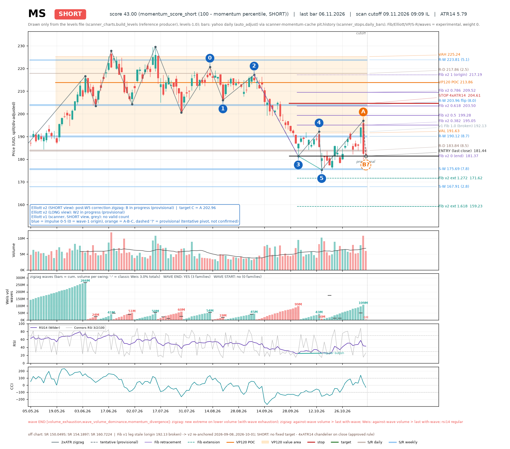

- **Jev (typesafe/jev-1.13):** 15 כותרות · 0 בביטחון ≥0.8 (סומכים על Jev) · 3 הועברו ל-Claude לשיפוט (ביטחון נמוך או חשד למניפולציה; 0 חשודות, 1 הודעות חברה) · סנטימנט — · קטליזטור —
- **Grok (grok-4.3, חיפוש X של Grok):** ✅ אישור · סנטימנט ‎+0 · ביטחון medium · 3 פוסטים · סנטימנט מעורב ללא חדשות שוברות נגד SHORT · חשבונות מאומתים: @EarningsAnatomy, @KCTrades777, @zubiqo
- **Perplexity:** לא התקבל (חסר קרדיט - OpenRouter (Perplexity))
- **Claude:** לא התקבל (חסר קרדיט - OpenRouter (Claude))
- **GPT:** לא התקבל (חסר קרדיט - OpenRouter (GPT))
- **האם הגרף נראה נכון? (ניסיוני):** Grok: no: ספירת אליוט ו-Fib תואמות את הירידה הנוכחית · קלט: grok=img

### 26. PG – לונג · דירוג 43.0
- **🔴 חסר קרדיט - OpenRouter (Claude) ; חסר קרדיט - OpenRouter (GPT) ; חסר קרדיט - OpenRouter (Perplexity)**
- **רמות (קובץ הרמות, נר אחרון 2026-11-06, hash c15b1bfcf3620573):** כניסה 165.40 · סטופ 151.95 (chandelier_close 4.0xATR14, ATR14=3.3624) · יעד: 178.63 – חצי ב-Fib 1.618 (סגירה), השאר בשנדלייר 4xATR
- **טכני:** SMA20 159.77 · SMA50 151.24 · SMA200 147.43 · מומנטום 12-1 0.056 · RSI14 64.9 · CCI20 93
- **ניסיוני (משקל 0):** אליוט v2: W2 in progress (provisional) · אליוט v1: W5_done (correction next) · פיבו v2 157.40→170.52 (1.618=178.63) · VP120 POC 144.65 (VAH 149.69, VAL 140.96) · תמיכה 165.04 · התנגדות 171.45 · סוף גל: 3 משפחות (volume_exhaustion,momentum_divergence,elliott_context) · תחילת גל: 1 (wave_volume_dominance)
- **דוח:** מותר - דוח בעוד 50 ימי מסחר · מקורות: 2027-01-21 (Yahoo calendar)
- **סוויפ נזילות (ייחוס בלבד, משקל 0):** כן (שורט, רמה 165.75 pivot) · **עבר בדיקה, שביר, משקל 0**

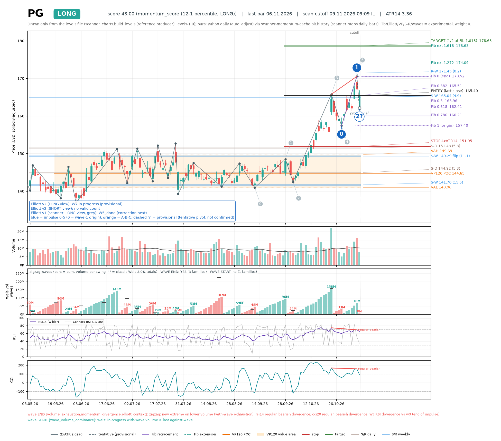

- **Jev (typesafe/jev-1.13):** 11 כותרות · 0 בביטחון ≥0.8 (סומכים על Jev) · 8 הועברו ל-Claude לשיפוט (ביטחון נמוך או חשד למניפולציה; 0 חשודות, 2 הודעות חברה) · סנטימנט — · קטליזטור —
- **Grok (grok-4.3, חיפוש X של Grok):** ✅ אישור · סנטימנט ‎+0 · ביטחון low · 1 פוסטים · אין סנטימנט שלילי ב-X · חשבונות מאומתים: —
- **Perplexity:** לא התקבל (חסר קרדיט - OpenRouter (Perplexity))
- **Claude:** לא התקבל (חסר קרדיט - OpenRouter (Claude))
- **GPT:** לא התקבל (חסר קרדיט - OpenRouter (GPT))
- **האם הגרף נראה נכון? (ניסיוני):** Grok: n/a: null · קלט: grok=img

### 27. NVDA – שורט · דירוג 38.3
- **🔴 חסר קרדיט - OpenRouter (Claude) ; חסר קרדיט - OpenRouter (GPT) ; חסר קרדיט - OpenRouter (Perplexity)**
- **רמות (קובץ הרמות, נר אחרון 2026-11-06, hash 4a712b683c840414):** כניסה 186.64 · סטופ 217.71 (chandelier_close 4.0xATR14, ATR14=7.7684) · יעד: אין – ללא יעד קבוע - שנדלייר 4xATR14 על סגירה (כלל מאושר)
- **טכני:** SMA20 211.55 · SMA50 219.77 · SMA200 204.39 · מומנטום 12-1 0.184 · RSI14 30.8 · CCI20 ‎-195
- **ניסיוני (משקל 0):** אליוט v2: no valid count · אליוט v1: no valid count · פיבו v2 —→— (1.618=—) · VP120 POC 217.99 (VAH 227.27, VAL 201.27) · תמיכה 179.36 · התנגדות 187.18 · סוף גל: 2 משפחות (volume_exhaustion,wave_volume_dominance) · תחילת גל: 1 (wave_volume_dominance)
- **דוח:** מותר - דוח בעוד 7 ימי מסחר · מקורות: 2026-11-17 (Yahoo calendar)
- **סוויפ נזילות (ייחוס בלבד, משקל 0):** לא
- **ספירלת פיבו – יעדי ייחוס בלבד (משקל 0, לא משנה סטופ/יעד; השורט נשאר עם סטופ נגרר 4×ATR בלי יעד):** T1 220.90 (fan:3@fib0.618) · T2 220.90 (fan:3@fib0.618) · מצב: triggered_earlier

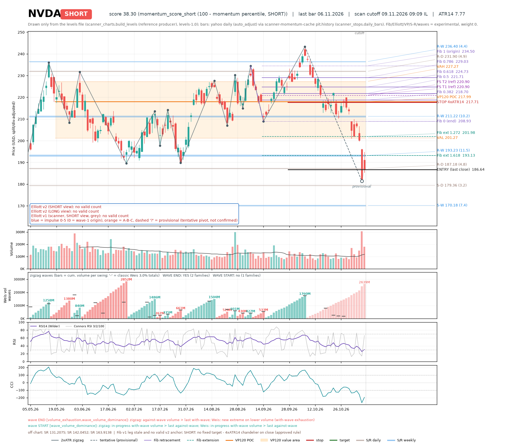

- **Jev (typesafe/jev-1.13):** 15 כותרות · 0 בביטחון ≥0.8 (סומכים על Jev) · 8 הועברו ל-Claude לשיפוט (ביטחון נמוך או חשד למניפולציה; 0 חשודות, 1 הודעות חברה) · סנטימנט — · קטליזטור —
- **Grok (grok-4.3, חיפוש X של Grok):** ✅ אישור · סנטימנט ‎-2 · ביטחון high · 10 פוסטים · חדשות שליליות תומכות ב-SHORT · חשבונות מאומתים: @J_Donnovan, @MobeeNFT, @IshfaaqPeerally, @Sino_Market
- **Perplexity:** לא התקבל (חסר קרדיט - OpenRouter (Perplexity))
- **Claude:** לא התקבל (חסר קרדיט - OpenRouter (Claude))
- **GPT:** לא התקבל (חסר קרדיט - OpenRouter (GPT))
- **האם הגרף נראה נכון? (ניסיוני):** Grok: n/a: אין דיון בגרף · קלט: grok=img

### 28. MA – לונג · דירוג 37.4
- **🔴 חסר קרדיט - OpenRouter (Claude) ; חסר קרדיט - OpenRouter (GPT) ; חסר קרדיט - OpenRouter (Perplexity)**
- **רמות (קובץ הרמות, נר אחרון 2026-11-06, hash 7a4490a1c340e069):** כניסה 652.70 · סטופ 592.59 (chandelier_close 4.0xATR14, ATR14=15.03) · יעד: 729.57 – חצי ב-Fib 1.618 (סגירה), השאר בשנדלייר 4xATR
- **טכני:** SMA20 627.35 · SMA50 592.56 · SMA200 537.36 · מומנטום 12-1 0.044 · RSI14 64.0 · CCI20 92
- **ניסיוני (משקל 0):** אליוט v2: W2 in progress (provisional) · אליוט v1: in_W4 (W3 done) · פיבו v2 605.00→681.99 (1.618=729.57) · VP120 POC 565.95 (VAH 629.44, VAL 493.69) · תמיכה 599.02 · התנגדות — · סוף גל: 2 משפחות (volume_exhaustion,momentum_divergence) · תחילת גל: 1 (wave_volume_dominance)
- **דוח:** מותר - דוח בעוד 55 ימי מסחר · מקורות: 2027-01-28 (Yahoo calendar)
- **סוויפ נזילות (ייחוס בלבד, משקל 0):** לא · **עבר בדיקה, שביר, משקל 0**

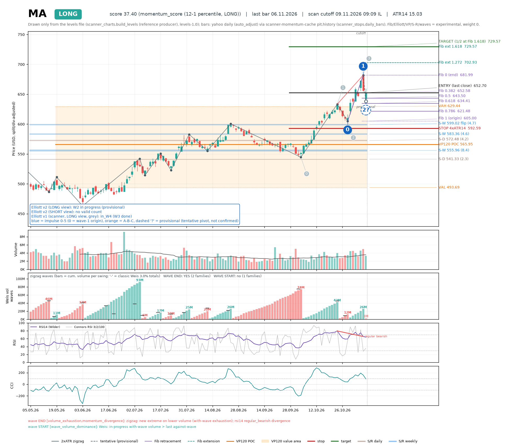

- **Jev (typesafe/jev-1.13):** 15 כותרות · 3 בביטחון ≥0.8 (סומכים על Jev) · 8 הועברו ל-Claude לשיפוט (ביטחון נמוך או חשד למניפולציה; 0 חשודות, 4 הודעות חברה) · סנטימנט חיובי (+1.00) · קטליזטור analyst
- **Grok (grok-4.3, חיפוש X של Grok):** ✅ אישור · סנטימנט ‎+2 · ביטחון high · 9 פוסטים · אין חדשות שליליות ב-X נגד ה-LONG · חשבונות מאומתים: —
- **Perplexity:** לא התקבל (חסר קרדיט - OpenRouter (Perplexity))
- **Claude:** לא התקבל (חסר קרדיט - OpenRouter (Claude))
- **GPT:** לא התקבל (חסר קרדיט - OpenRouter (GPT))
- **האם הגרף נראה נכון? (ניסיוני):** Grok: n/a · קלט: grok=img

### 29. MSFT – לונג · דירוג 36.4
- **🔴 חסר קרדיט - OpenRouter (Claude) ; חסר קרדיט - OpenRouter (GPT) ; חסר קרדיט - OpenRouter (Perplexity)**
- **רמות (קובץ הרמות, נר אחרון 2026-11-06, hash d1ee35d9e0290cdc):** כניסה 530.61 · סטופ 468.86 (chandelier_close 4.0xATR14, ATR14=15.44) · יעד: 592.64 – חצי ב-Fib 1.618 (סגירה), השאר בשנדלייר 4xATR
- **טכני:** SMA20 531.41 · SMA50 516.65 · SMA200 438.85 · מומנטום 12-1 0.039 · RSI14 52.1 · CCI20 ‎-5
- **ניסיוני (משקל 0):** אליוט v2: W2 in progress (provisional) · אליוט v1: no valid count · פיבו v2 504.96→559.15 (1.618=592.64) · VP120 POC 388.56 (VAH 500.18, VAL 348.54) · תמיכה 522.73 · התנגדות 548.95 · סוף גל: 1 משפחות (volume_exhaustion) · תחילת גל: 1 (volume_exhaustion)
- **דוח:** מותר - דוח בעוד 54 ימי מסחר · מקורות: 2027-01-27 (Yahoo calendar)
- **סוויפ נזילות (ייחוס בלבד, משקל 0):** לא · **עבר בדיקה, שביר, משקל 0**

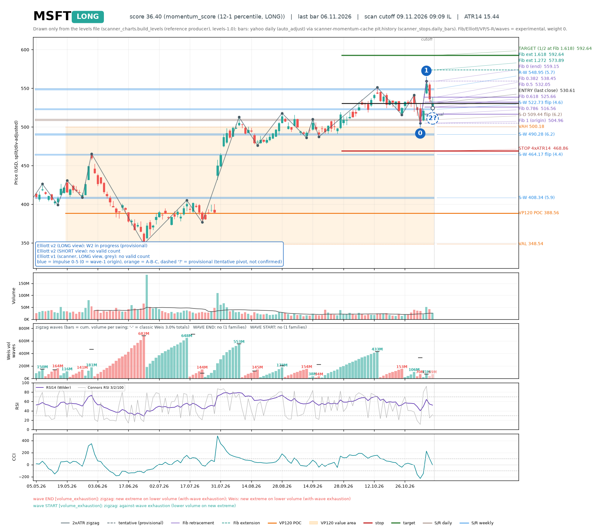

- **Jev (typesafe/jev-1.13):** 15 כותרות · 0 בביטחון ≥0.8 (סומכים על Jev) · 6 הועברו ל-Claude לשיפוט (ביטחון נמוך או חשד למניפולציה; 0 חשודות, 1 הודעות חברה) · סנטימנט — · קטליזטור —
- **Grok (grok-4.3, חיפוש X של Grok):** ✅ אישור · סנטימנט ‎+0 · ביטחון low · 9 פוסטים · אין סיבה ברורה נגד LONG מה-X · חשבונות מאומתים: —
- **Perplexity:** לא התקבל (חסר קרדיט - OpenRouter (Perplexity))
- **Claude:** לא התקבל (חסר קרדיט - OpenRouter (Claude))
- **GPT:** לא התקבל (חסר קרדיט - OpenRouter (GPT))
- **האם הגרף נראה נכון? (ניסיוני):** Grok: n/a · קלט: grok=img

### 30. COST – לונג · דירוג 32.7
- **🔴 חסר קרדיט - OpenRouter (Claude) ; חסר קרדיט - OpenRouter (GPT) ; חסר קרדיט - OpenRouter (Perplexity)**
- **רמות (קובץ הרמות, נר אחרון 2026-11-06, hash 900c3ae395f64e58):** כניסה 1,053.56 · סטופ 972.55 (chandelier_close 4.0xATR14, ATR14=20.25) · יעד: 1,105.32 – חצי ב-Fib 1.618 (סגירה), השאר בשנדלייר 4xATR
- **טכני:** SMA20 1,003.33 · SMA50 951.19 · SMA200 969.93 · מומנטום 12-1 0.018 · RSI14 67.5 · CCI20 144
- **ניסיוני (משקל 0):** אליוט v2: W3 in progress (provisional) · אליוט v1: in_W3 (W2 done) · פיבו v2 881.80→1,019.94 (1.618=1,105.32) · VP120 POC 947.31 (VAH 983.24, VAL 898.70) · תמיכה 986.26 · התנגדות 1,061.54 · סוף גל: 0 משפחות (—) · תחילת גל: 2 (wave_volume_dominance,elliott_context)
- **דוח:** מותר - דוח בעוד 23 ימי מסחר · מקורות: 2026-12-10 (Yahoo calendar)
- **סוויפ נזילות (ייחוס בלבד, משקל 0):** לא · **עבר בדיקה, שביר, משקל 0**

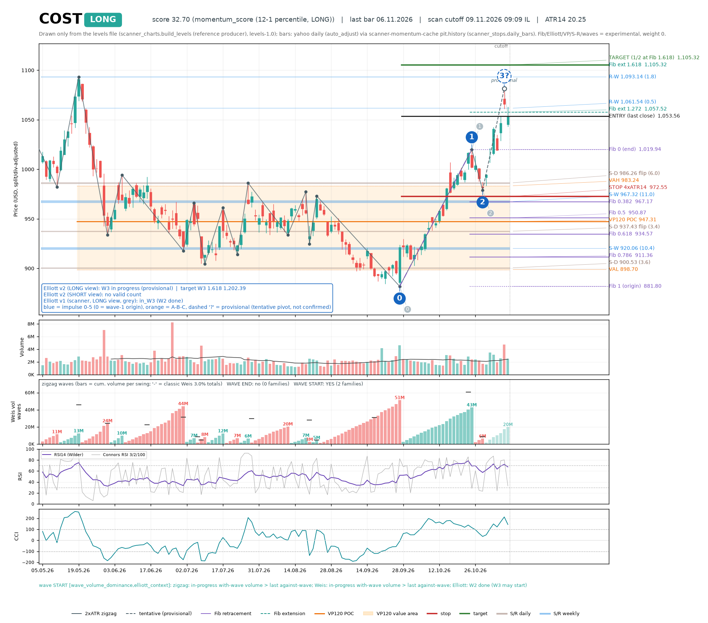

- **Jev (typesafe/jev-1.13):** 15 כותרות · 2 בביטחון ≥0.8 (סומכים על Jev) · 5 הועברו ל-Claude לשיפוט (ביטחון נמוך או חשד למניפולציה; 0 חשודות, 3 הודעות חברה) · סנטימנט חיובי (+1.00) · קטליזטור earnings
- **Grok (grok-4.3, חיפוש X של Grok):** ✅ אישור · סנטימנט ‎+1 · ביטחון high · 8 פוסטים · סנטימנט X חיובי תומך ב-LONG · חשבונות מאומתים: @twinsight_x, @ProblemSniper, @OptionKing33996, @StockTraderHub, @NotA_Bull
- **Perplexity:** לא התקבל (חסר קרדיט - OpenRouter (Perplexity))
- **Claude:** לא התקבל (חסר קרדיט - OpenRouter (Claude))
- **GPT:** לא התקבל (חסר קרדיט - OpenRouter (GPT))
- **האם הגרף נראה נכון? (ניסיוני):** Grok: no: ספירת אליוט W3 ורמות Fib תואמות מגמה עולה · קלט: grok=img

### 31. C – שורט · דירוג 30.8
- **🔴 חסר קרדיט - OpenRouter (Claude) ; חסר קרדיט - OpenRouter (GPT) ; חסר קרדיט - OpenRouter (Perplexity)**
- **רמות (קובץ הרמות, נר אחרון 2026-11-06, hash 0b18ec9f634689d1):** כניסה 119.05 · סטופ 134.03 (chandelier_close 4.0xATR14, ATR14=3.7446) · יעד: אין – ללא יעד קבוע - שנדלייר 4xATR14 על סגירה (כלל מאושר)
- **טכני:** SMA20 122.58 · SMA50 128.27 · SMA200 125.43 · מומנטום 12-1 0.279 · RSI14 39.4 · CCI20 ‎-125
- **ניסיוני (משקל 0):** אליוט v2: no valid count · אליוט v1: no valid count · פיבו v2 132.77→119.54 (1.618=111.37) · VP120 POC 131.46 (VAH 142.89, VAL 127.06) · תמיכה 108.25 · התנגדות 122.22 · סוף גל: 2 משפחות (volume_exhaustion,wave_volume_dominance) · תחילת גל: 2 (wave_volume_dominance,momentum_divergence)
- **דוח:** מותר - דוח בעוד 46 ימי מסחר · מקורות: 2027-01-14 (Yahoo calendar)
- **סוויפ נזילות (ייחוס בלבד, משקל 0):** לא
- **ספירלת פיבו – יעדי ייחוס בלבד (משקל 0, לא משנה סטופ/יעד; השורט נשאר עם סטופ נגרר 4×ATR בלי יעד):** T1 125.45 (circle:0.786@fib1.0) · T2 125.45 (fan:1@fib1.0) · מצב: triggered_earlier

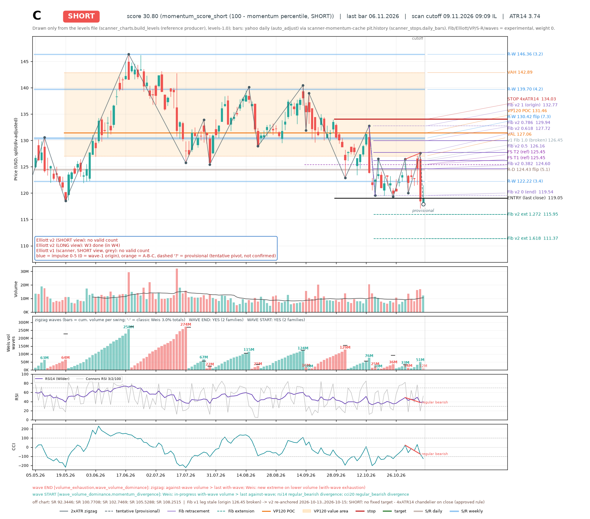

- **Jev (typesafe/jev-1.13):** 14 כותרות · 0 בביטחון ≥0.8 (סומכים על Jev) · 8 הועברו ל-Claude לשיפוט (ביטחון נמוך או חשד למניפולציה; 0 חשודות, 6 הודעות חברה) · סנטימנט — · קטליזטור —
- **Grok (grok-4.3, חיפוש X של Grok):** ✅ אישור · סנטימנט ‎+0 · ביטחון low · 0 פוסטים · אין פוסטים אמיתיים ב-X על $C · חשבונות מאומתים: —
- **Perplexity:** לא התקבל (חסר קרדיט - OpenRouter (Perplexity))
- **Claude:** לא התקבל (חסר קרדיט - OpenRouter (Claude))
- **GPT:** לא התקבל (חסר קרדיט - OpenRouter (GPT))
- **האם הגרף נראה נכון? (ניסיוני):** Grok: no: הספירה של אליוט והרמות נראות תקינות · קלט: grok=img

### 32. MMM – לונג · דירוג 29.9
- **🔴 חסר קרדיט - OpenRouter (Claude) ; חסר קרדיט - OpenRouter (GPT) ; חסר קרדיט - OpenRouter (Perplexity)**
- **רמות (קובץ הרמות, נר אחרון 2026-11-06, hash c77f2017b864cb8b):** כניסה 185.15 · סטופ 164.01 (chandelier_close 4.0xATR14, ATR14=5.2838) · יעד: 220.19 – חצי ב-Fib 1.618 (סגירה), השאר בשנדלייר 4xATR
- **טכני:** SMA20 173.32 · SMA50 168.99 · SMA200 160.75 · מומנטום 12-1 0.014 · RSI14 62.2 · CCI20 126
- **ניסיוני (משקל 0):** אליוט v2: W2 in progress (provisional) · אליוט v1: no valid count · פיבו v2 159.21→196.90 (1.618=220.19) · VP120 POC 162.75 (VAH 181.61, VAL 158.16) · תמיכה 175.91 · התנגדות — · סוף גל: 1 משפחות (climax) · תחילת גל: 2 (volume_exhaustion,momentum_divergence)
- **דוח:** מותר - דוח בעוד 48 ימי מסחר · מקורות: 2027-01-19 (Yahoo calendar)
- **סוויפ נזילות (ייחוס בלבד, משקל 0):** לא · **עבר בדיקה, שביר, משקל 0**

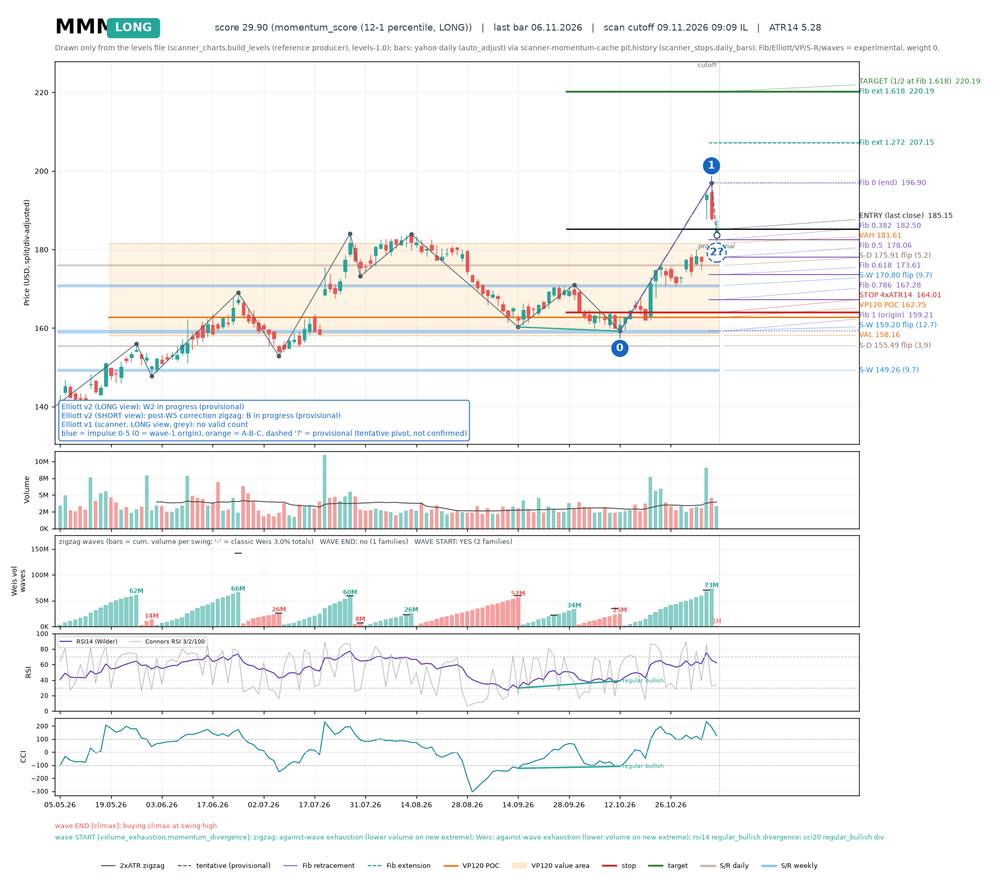

- **Jev (typesafe/jev-1.13):** 15 כותרות · 0 בביטחון ≥0.8 (סומכים על Jev) · 8 הועברו ל-Claude לשיפוט (ביטחון נמוך או חשד למניפולציה; 0 חשודות, 1 הודעות חברה) · סנטימנט — · קטליזטור —
- **Grok (grok-4.3, חיפוש X של Grok):** ✅ אישור · סנטימנט ‎+0 · ביטחון low · 0 פוסטים · אין דיון משמעותי ב-X · חשבונות מאומתים: —
- **Perplexity:** לא התקבל (חסר קרדיט - OpenRouter (Perplexity))
- **Claude:** לא התקבל (חסר קרדיט - OpenRouter (Claude))
- **GPT:** לא התקבל (חסר קרדיט - OpenRouter (GPT))
- **האם הגרף נראה נכון? (ניסיוני):** Grok: n/a · קלט: grok=img

### 33. BLK – לונג · דירוג 29.0
- **🔴 חסר קרדיט - OpenRouter (Claude) ; חסר קרדיט - OpenRouter (GPT) ; חסר קרדיט - OpenRouter (Perplexity)**
- **רמות (קובץ הרמות, נר אחרון 2026-11-06, hash a154b573b3cc48da):** כניסה 1,178.87 · סטופ 1,045.37 (chandelier_close 4.0xATR14, ATR14=33.37) · יעד: 1,326.57 – חצי ב-Fib 1.618 (סגירה), השאר בשנדלייר 4xATR
- **טכני:** SMA20 1,139.26 · SMA50 1,104.22 · SMA200 1,056.95 · מומנטום 12-1 0.014 · RSI14 58.4 · CCI20 88
- **ניסיוני (משקל 0):** אליוט v2: W2 in progress (provisional) · אליוט v1: W5_done (correction next) · פיבו v2 1,105.47→1,242.12 (1.618=1,326.57) · VP120 POC 1,065.27 (VAH 1,128.22, VAL 972.35) · תמיכה 1,175.02 · התנגדות — · סוף גל: 3 משפחות (volume_exhaustion,momentum_divergence,elliott_context) · תחילת גל: 0 (—)
- **דוח:** מותר - דוח בעוד 46 ימי מסחר · מקורות: 2027-01-14 (Yahoo calendar)
- **סוויפ נזילות (ייחוס בלבד, משקל 0):** לא · **עבר בדיקה, שביר, משקל 0**

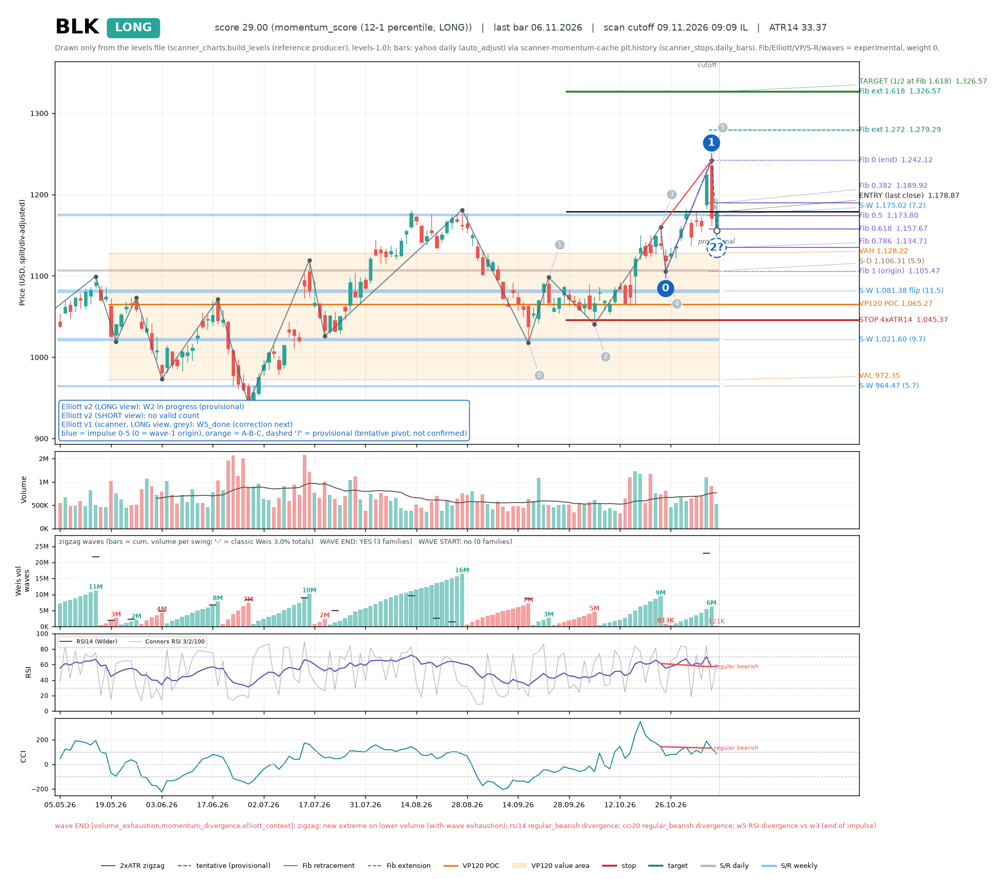

- **Jev (typesafe/jev-1.13):** 15 כותרות · 1 בביטחון ≥0.8 (סומכים על Jev) · 8 הועברו ל-Claude לשיפוט (ביטחון נמוך או חשד למניפולציה; 0 חשודות, 5 הודעות חברה) · סנטימנט חיובי (+1.00) · קטליזטור analyst
- **Grok (grok-4.3, חיפוש X של Grok):** ✅ אישור · סנטימנט ‎+1 · ביטחון low · 3 פוסטים · דוחות חיוביים תומכים ב-LONG ללא סימני שלילה · חשבונות מאומתים: @EarningsAnatomy
- **Perplexity:** לא התקבל (חסר קרדיט - OpenRouter (Perplexity))
- **Claude:** לא התקבל (חסר קרדיט - OpenRouter (Claude))
- **GPT:** לא התקבל (חסר קרדיט - OpenRouter (GPT))
- **האם הגרף נראה נכון? (ניסיוני):** Grok: no: ספירת Elliott ו-Fib נראים תואמים למבנה הגרף · קלט: grok=img

### 34. DUK – לונג · דירוג 24.3
- **🔴 חסר קרדיט - OpenRouter (Claude) ; חסר קרדיט - OpenRouter (GPT) ; חסר קרדיט - OpenRouter (Perplexity)**
- **רמות (קובץ הרמות, נר אחרון 2026-11-06, hash 1f0abee1cef8dacf):** כניסה 127.78 · סטופ 118.66 (chandelier_close 4.0xATR14, ATR14=2.2795) · יעד: 145.71 – חצי ב-Fib 1.618 (סגירה), השאר בשנדלייר 4xATR
- **טכני:** SMA20 123.80 · SMA50 119.83 · SMA200 123.33 · מומנטום 12-1 ‎-0.023 · RSI14 62.2 · CCI20 83
- **ניסיוני (משקל 0):** אליוט v2: W2 in progress (provisional) · אליוט v1: no valid count · פיבו v2 112.40→132.99 (1.618=145.71) · VP120 POC 124.14 (VAH 127.64, VAL 118.99) · תמיכה 124.50 · התנגדות 130.46 · סוף גל: 1 משפחות (wave_volume_dominance) · תחילת גל: 1 (wave_volume_dominance)
- **דוח:** תאריך דוח לא מאומת
- **סוויפ נזילות (ייחוס בלבד, משקל 0):** לא · **עבר בדיקה, שביר, משקל 0**

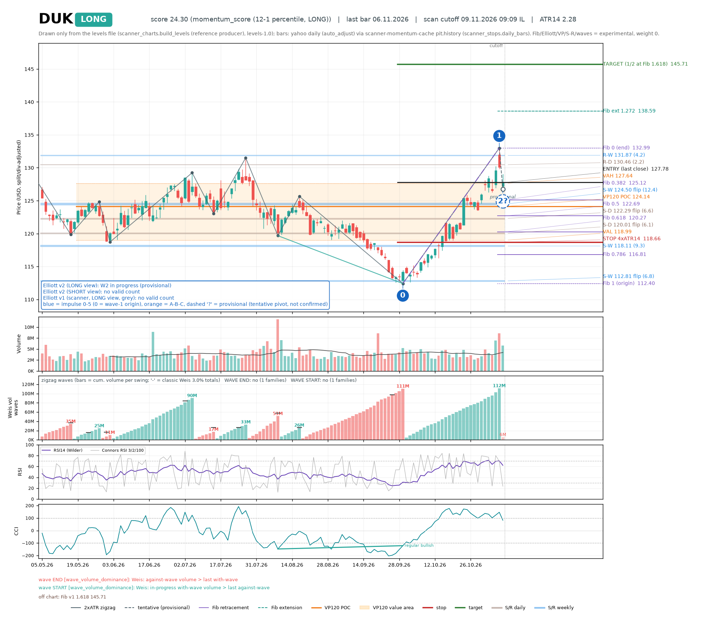

- **Jev (typesafe/jev-1.13):** 13 כותרות · 1 בביטחון ≥0.8 (סומכים על Jev) · 7 הועברו ל-Claude לשיפוט (ביטחון נמוך או חשד למניפולציה; 0 חשודות, 4 הודעות חברה) · סנטימנט חיובי (+1.00) · קטליזטור earnings
- **Grok (grok-4.3, חיפוש X של Grok):** ✅ אישור · סנטימנט ‎+1 · ביטחון low · 1 פוסטים · אין חדשות שליליות ב-X נגד ה-LONG · חשבונות מאומתים: @EarningsAnatomy
- **Perplexity:** לא התקבל (חסר קרדיט - OpenRouter (Perplexity))
- **Claude:** לא התקבל (חסר קרדיט - OpenRouter (Claude))
- **GPT:** לא התקבל (חסר קרדיט - OpenRouter (GPT))
- **האם הגרף נראה נכון? (ניסיוני):** Grok: n/a: אין דיון על הגרף · קלט: grok=img

### 35. SLB – שורט · דירוג 24.3
- **🔴 חסר קרדיט - OpenRouter (Claude) ; חסר קרדיט - OpenRouter (GPT) ; חסר קרדיט - OpenRouter (Perplexity)**
- **רמות (קובץ הרמות, נר אחרון 2026-11-06, hash c46f44dd1e908b83):** כניסה 49.92 · סטופ 56.90 (chandelier_close 4.0xATR14, ATR14=1.7440) · יעד: אין – ללא יעד קבוע - שנדלייר 4xATR14 על סגירה (כלל מאושר)
- **טכני:** SMA20 51.04 · SMA50 52.18 · SMA200 51.21 · מומנטום 12-1 0.373 · RSI14 43.0 · CCI20 ‎-29
- **ניסיוני (משקל 0):** אליוט v2: W2 correction zigzag: B in progress (provisional) · אליוט v1: in_W3 (W2 done) · פיבו v2 60.15→47.17 (1.618=39.15) · VP120 POC 47.04 (VAH 54.46, VAL 46.25) · תמיכה 48.35 · התנגדות 50.34 · סוף גל: 1 משפחות (wave_volume_dominance) · תחילת גל: 3 (volume_exhaustion,wave_volume_dominance,elliott_context)
- **דוח:** מותר - דוח בעוד 51 ימי מסחר · מקורות: 2027-01-22 (Yahoo calendar)
- **סוויפ נזילות (ייחוס בלבד, משקל 0):** לא
- **ספירלת פיבו – יעדי ייחוס בלבד (משקל 0, לא משנה סטופ/יעד; השורט נשאר עם סטופ נגרר 4×ATR בלי יעד):** T1 — (—) · T2 — (—) · מצב: none

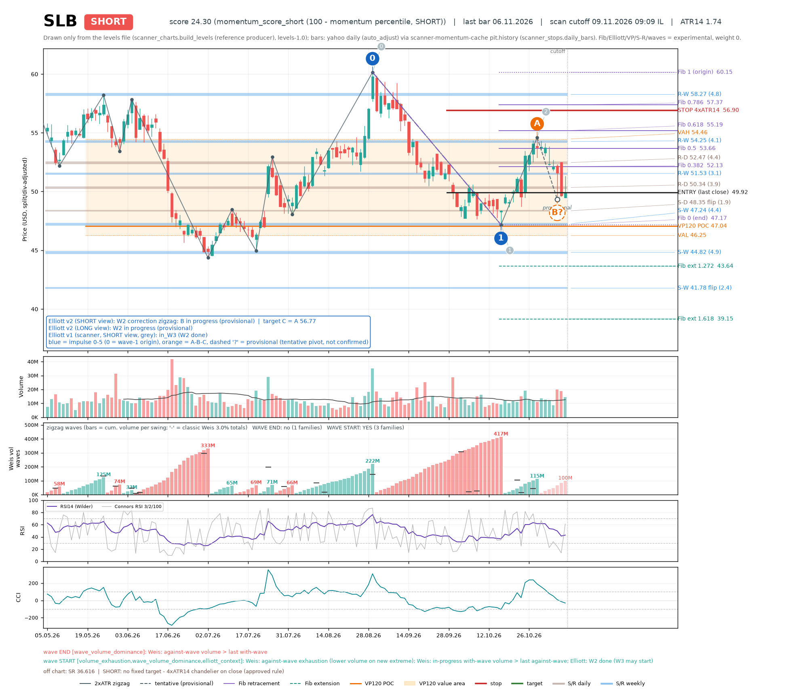

- **Jev (typesafe/jev-1.13):** 7 כותרות · 3 בביטחון ≥0.8 (סומכים על Jev) · 2 הועברו ל-Claude לשיפוט (ביטחון נמוך או חשד למניפולציה; 0 חשודות, 0 הודעות חברה) · סנטימנט שלילי (-1.00) · קטליזטור analyst
- **Grok (grok-4.3, חיפוש X של Grok):** ✅ אישור · סנטימנט ‎+0 · ביטחון low · 0 פוסטים · אין פוסטים אמיתיים על $SLB · חשבונות מאומתים: —
- **Perplexity:** לא התקבל (חסר קרדיט - OpenRouter (Perplexity))
- **Claude:** לא התקבל (חסר קרדיט - OpenRouter (Claude))
- **GPT:** לא התקבל (חסר קרדיט - OpenRouter (GPT))
- **האם הגרף נראה נכון? (ניסיוני):** Grok: no: ספירת Elliott ו-Fib נראות תקינות · קלט: grok=img

### 36. DIS – לונג · דירוג 23.4
- **🔴 חסר קרדיט - OpenRouter (Claude) ; חסר קרדיט - OpenRouter (GPT) ; חסר קרדיט - OpenRouter (Perplexity)**
- **רמות (קובץ הרמות, נר אחרון 2026-11-06, hash b5d88adb08578432):** כניסה 116.75 · סטופ 106.62 (chandelier_close 4.0xATR14, ATR14=2.5315) · יעד: 128.25 – חצי ב-Fib 1.618 (סגירה), השאר בשנדלייר 4xATR
- **טכני:** SMA20 111.89 · SMA50 108.04 · SMA200 103.13 · מומנטום 12-1 ‎-0.025 · RSI14 66.4 · CCI20 133
- **ניסיוני (משקל 0):** אליוט v2: W2 in progress (provisional) · אליוט v1: in_W4 (W3 done) · פיבו v2 108.75→120.80 (1.618=128.25) · VP120 POC 102.96 (VAH 108.34, VAL 96.45) · תמיכה 112.82 · התנגדות 117.94 · סוף גל: 2 משפחות (volume_exhaustion,momentum_divergence) · תחילת גל: 1 (wave_volume_dominance)
- **דוח:** מותר - דוח בעוד 7 ימי מסחר · מקורות: 2026-11-17 (Yahoo calendar)
- **סוויפ נזילות (ייחוס בלבד, משקל 0):** לא · **עבר בדיקה, שביר, משקל 0**

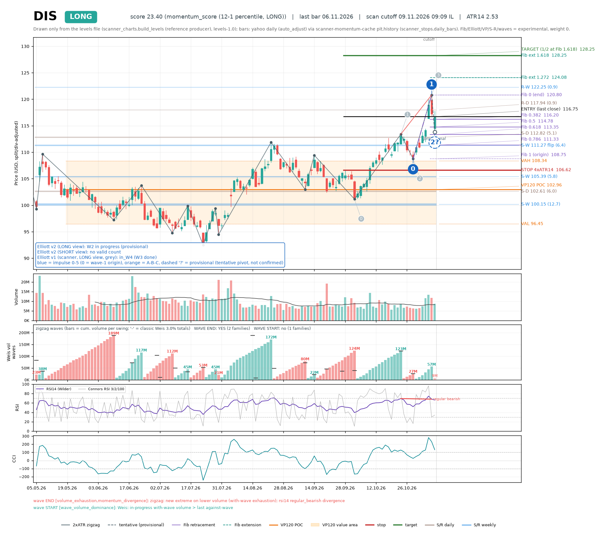

- **Jev (typesafe/jev-1.13):** 15 כותרות · 3 בביטחון ≥0.8 (סומכים על Jev) · 8 הועברו ל-Claude לשיפוט (ביטחון נמוך או חשד למניפולציה; 0 חשודות, 4 הודעות חברה) · סנטימנט ניטרלי/מעורב (+0.09) · קטליזטור analyst
- **Grok (grok-4.3, חיפוש X של Grok):** ✅ אישור · סנטימנט ‎+0 · ביטחון low · 3 פוסטים · אין חדשות שליליות ברורות נגד הלונג · חשבונות מאומתים: —
- **Perplexity:** לא התקבל (חסר קרדיט - OpenRouter (Perplexity))
- **Claude:** לא התקבל (חסר קרדיט - OpenRouter (Claude))
- **GPT:** לא התקבל (חסר קרדיט - OpenRouter (GPT))
- **האם הגרף נראה נכון? (ניסיוני):** Grok: no: ספירת אליוט ורמות פיב נראות תקינות על הגרף · קלט: grok=img

### 37. SO – לונג · דירוג 22.4
- **🔴 חסר קרדיט - OpenRouter (Claude) ; חסר קרדיט - OpenRouter (GPT) ; חסר קרדיט - OpenRouter (Perplexity)**
- **רמות (קובץ הרמות, נר אחרון 2026-11-06, hash ef44568fd827d0cf):** כניסה 92.34 · סטופ 84.95 (chandelier_close 4.0xATR14, ATR14=1.8467) · יעד: 99.01 – חצי ב-Fib 1.618 (סגירה), השאר בשנדלייר 4xATR
- **טכני:** SMA20 91.63 · SMA50 88.17 · SMA200 91.65 · מומנטום 12-1 ‎-0.026 · RSI14 56.8 · CCI20 18
- **ניסיוני (משקל 0):** אליוט v2: W2 in progress (provisional) · אליוט v1: in_W4 (W3 done) · פיבו v2 90.40→95.72 (1.618=99.01) · VP120 POC 92.58 (VAH 96.44, VAL 88.73) · תמיכה 91.38 · התנגדות 93.52 · סוף גל: 4 משפחות (volume_exhaustion,wave_volume_dominance,climax,momentum_divergence) · תחילת גל: 0 (—)
- **דוח:** תאריך דוח לא מאומת
- **סוויפ נזילות (ייחוס בלבד, משקל 0):** לא · **עבר בדיקה, שביר, משקל 0**

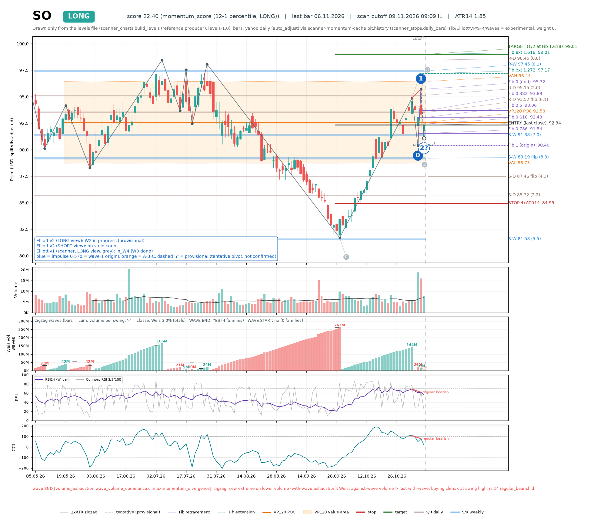

- **Jev (typesafe/jev-1.13):** 12 כותרות · 0 בביטחון ≥0.8 (סומכים על Jev) · 7 הועברו ל-Claude לשיפוט (ביטחון נמוך או חשד למניפולציה; 0 חשודות, 1 הודעות חברה) · סנטימנט — · קטליזטור —
- **Grok (grok-4.3, חיפוש X של Grok):** ✅ אישור · סנטימנט ‎+0 · ביטחון low · 1 פוסטים · אין סנטימנט שלילי ברור ב-X נגד ה-LONG · חשבונות מאומתים: @ValyeAI
- **Perplexity:** לא התקבל (חסר קרדיט - OpenRouter (Perplexity))
- **Claude:** לא התקבל (חסר קרדיט - OpenRouter (Claude))
- **GPT:** לא התקבל (חסר קרדיט - OpenRouter (GPT))
- **האם הגרף נראה נכון? (ניסיוני):** Grok: n/a: אין דיון על הגרף ב-X · קלט: grok=img

### 38. CAT – שורט · דירוג 21.5
- **🔴 חסר קרדיט - OpenRouter (Claude) ; חסר קרדיט - OpenRouter (GPT) ; חסר קרדיט - OpenRouter (Perplexity)**
- **רמות (קובץ הרמות, נר אחרון 2026-11-06, hash 354f5e6415b146c5):** כניסה 558.63 · סטופ 676.58 (chandelier_close 4.0xATR14, ATR14=29.49) · יעד: אין – ללא יעד קבוע - שנדלייר 4xATR14 על סגירה (כלל מאושר)
- **טכני:** SMA20 684.12 · SMA50 758.84 · SMA200 805.37 · מומנטום 12-1 0.407 · RSI14 21.3 · CCI20 ‎-146
- **ניסיוני (משקל 0):** אליוט v2: W3 in progress (provisional) · אליוט v1: in_W3 (W2 done) · פיבו v2 874.87→679.50 (1.618=558.76) · VP120 POC 815.05 (VAH 986.03, VAL 768.42) · תמיכה 543.67 · התנגדות 578.69 · סוף גל: 1 משפחות (momentum_divergence) · תחילת גל: 3 (wave_volume_dominance,climax,elliott_context)
- **דוח:** מותר - דוח בעוד 55 ימי מסחר · מקורות: 2027-01-28 (Yahoo calendar)
- **סוויפ נזילות (ייחוס בלבד, משקל 0):** לא
- **ספירלת פיבו – יעדי ייחוס בלבד (משקל 0, לא משנה סטופ/יעד; השורט נשאר עם סטופ נגרר 4×ATR בלי יעד):** T1 — (—) · T2 — (—) · מצב: none

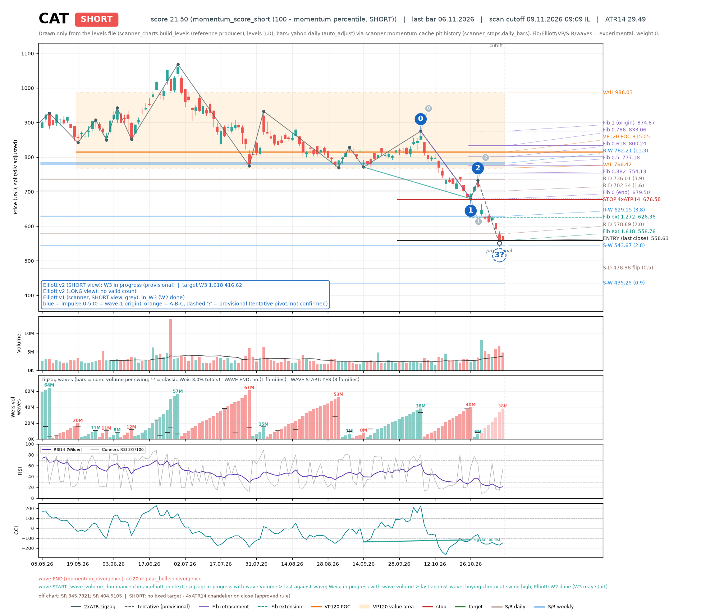

- **Jev (typesafe/jev-1.13):** 15 כותרות · 0 בביטחון ≥0.8 (סומכים על Jev) · 8 הועברו ל-Claude לשיפוט (ביטחון נמוך או חשד למניפולציה; 0 חשודות, 2 הודעות חברה) · סנטימנט — · קטליזטור —
- **Grok (grok-4.3, חיפוש X של Grok):** ✅ אישור · סנטימנט ‎+0 · ביטחון low · 0 פוסטים · אין סנטימנט שלילי ב-X נגד השורט · חשבונות מאומתים: —
- **Perplexity:** לא התקבל (חסר קרדיט - OpenRouter (Perplexity))
- **Claude:** לא התקבל (חסר קרדיט - OpenRouter (Claude))
- **GPT:** לא התקבל (חסר קרדיט - OpenRouter (GPT))
- **האם הגרף נראה נכון? (ניסיוני):** Grok: n/a: אין פוסטים רלוונטיים על המניה · קלט: grok=img

### 39. NEE – לונג · דירוג 20.6
- **🔴 חסר קרדיט - OpenRouter (Claude) ; חסר קרדיט - OpenRouter (GPT) ; חסר קרדיט - OpenRouter (Perplexity)**
- **רמות (קובץ הרמות, נר אחרון 2026-11-06, hash af63cfb83bc1bb61):** כניסה 86.95 · סטופ 79.45 (chandelier_close 4.0xATR14, ATR14=1.8739) · יעד: 99.70 – חצי ב-Fib 1.618 (סגירה), השאר בשנדלייר 4xATR
- **טכני:** SMA20 81.88 · SMA50 80.50 · SMA200 86.51 · מומנטום 12-1 ‎-0.031 · RSI14 66.9 · CCI20 125
- **ניסיוני (משקל 0):** אליוט v2: W2 in progress (provisional) · אליוט v1: no valid count · פיבו v2 74.41→90.04 (1.618=99.70) · VP120 POC 87.29 (VAH 89.04, VAL 81.72) · תמיכה 84.30 · התנגדות 87.00 · סוף גל: 1 משפחות (wave_volume_dominance) · תחילת גל: 0 (—)
- **דוח:** מותר - דוח בעוד 54 ימי מסחר · מקורות: 2027-01-27 (Yahoo calendar)
- **סוויפ נזילות (ייחוס בלבד, משקל 0):** לא · **עבר בדיקה, שביר, משקל 0**

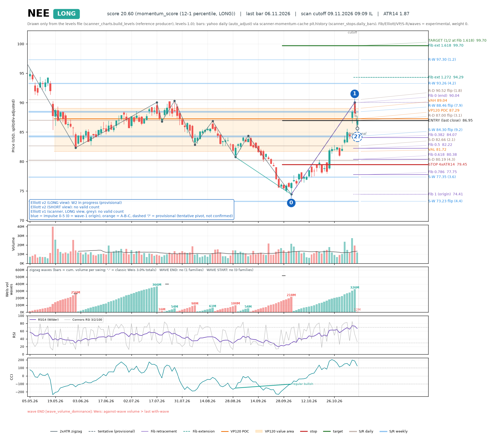

- **Jev (typesafe/jev-1.13):** 7 כותרות · 0 בביטחון ≥0.8 (סומכים על Jev) · 6 הועברו ל-Claude לשיפוט (ביטחון נמוך או חשד למניפולציה; 0 חשודות, 2 הודעות חברה) · סנטימנט — · קטליזטור —
- **Grok (grok-4.3, חיפוש X של Grok):** ✅ אישור · סנטימנט ‎+0 · ביטחון low · 1 פוסטים · אין סנטימנט שלילי ב-X · חשבונות מאומתים: —
- **Perplexity:** לא התקבל (חסר קרדיט - OpenRouter (Perplexity))
- **Claude:** לא התקבל (חסר קרדיט - OpenRouter (Claude))
- **GPT:** לא התקבל (חסר קרדיט - OpenRouter (GPT))
- **האם הגרף נראה נכון? (ניסיוני):** Grok: n/a · קלט: grok=img

### 40. WFC – לונג · דירוג 19.6
- **🔴 חסר קרדיט - OpenRouter (Claude) ; חסר קרדיט - OpenRouter (GPT) ; חסר קרדיט - OpenRouter (Perplexity)**
- **רמות (קובץ הרמות, נר אחרון 2026-11-06, hash 7a9e2c924b4097f8):** כניסה 83.94 · סטופ 75.27 (chandelier_close 4.0xATR14, ATR14=2.1682) · יעד: 96.14 – חצי ב-Fib 1.618 (סגירה), השאר בשנדלייר 4xATR
- **טכני:** SMA20 82.94 · SMA50 83.92 · SMA200 82.53 · מומנטום 12-1 ‎-0.036 · RSI14 52.0 · CCI20 49
- **ניסיוני (משקל 0):** אליוט v2: W2 in progress (provisional) · אליוט v1: in_W4 (W3 done) · פיבו v2 77.58→89.05 (1.618=96.14) · VP120 POC 85.73 (VAH 87.76, VAL 80.75) · תמיכה 83.22 · התנגדות 85.31 · סוף גל: 0 משפחות (—) · תחילת גל: 0 (—)
- **דוח:** מותר - דוח בעוד 46 ימי מסחר · מקורות: 2027-01-14 (Yahoo calendar)
- **סוויפ נזילות (ייחוס בלבד, משקל 0):** לא · **עבר בדיקה, שביר, משקל 0**

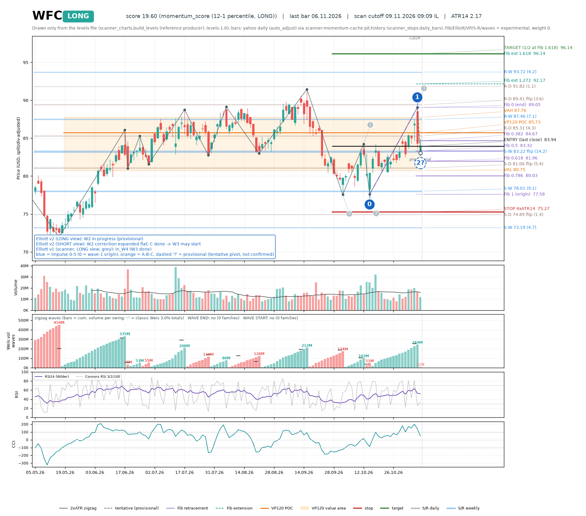

- **Jev (typesafe/jev-1.13):** 8 כותרות · 2 בביטחון ≥0.8 (סומכים על Jev) · 5 הועברו ל-Claude לשיפוט (ביטחון נמוך או חשד למניפולציה; 0 חשודות, 2 הודעות חברה) · סנטימנט ניטרלי/מעורב (+0.00) · קטליזטור other
- **Grok (grok-4.3, חיפוש X של Grok):** ✅ אישור · סנטימנט ‎+0 · ביטחון low · 1 פוסטים · אין סנטימנט שלילי ברור או חדשות נגדיות בפוסטים האחרונים · חשבונות מאומתים: —
- **Perplexity:** לא התקבל (חסר קרדיט - OpenRouter (Perplexity))
- **Claude:** לא התקבל (חסר קרדיט - OpenRouter (Claude))
- **GPT:** לא התקבל (חסר קרדיט - OpenRouter (GPT))
- **האם הגרף נראה נכון? (ניסיוני):** Grok: n/a: אין דיון בגרף או בספירה בפוסטים · קלט: grok=img

### 41. TSM – שורט · דירוג 15.0
- **🔴 חסר קרדיט - OpenRouter (Claude) ; חסר קרדיט - OpenRouter (GPT) ; חסר קרדיט - OpenRouter (Perplexity)**
- **רמות (קובץ הרמות, נר אחרון 2026-11-06, hash 30bfcad607ac8eb9):** כניסה 375.44 · סטופ 442.82 (chandelier_close 4.0xATR14, ATR14=16.84) · יעד: אין – ללא יעד קבוע - שנדלייר 4xATR14 על סגירה (כלל מאושר)
- **טכני:** SMA20 416.44 · SMA50 431.37 · SMA200 400.03 · מומנטום 12-1 0.576 · RSI14 36.3 · CCI20 ‎-183
- **ניסיוני (משקל 0):** אליוט v2: W3 in progress (provisional) · אליוט v1: in_W3 (W2 done) · פיבו v2 487.47→407.13 (1.618=357.48) · VP120 POC 417.97 (VAH 446.59, VAL 402.98) · תמיכה 349.33 · התנגדות 381.21 · סוף גל: 1 משפחות (wave_volume_dominance) · תחילת גל: 2 (wave_volume_dominance,elliott_context)
- **דוח:** מותר - דוח בעוד 46 ימי מסחר · מקורות: 2027-01-14 (Yahoo calendar)
- **סוויפ נזילות (ייחוס בלבד, משקל 0):** כן (לונג, רמה 371.72 pivot)
- **ספירלת פיבו – יעדי ייחוס בלבד (משקל 0, לא משנה סטופ/יעד; השורט נשאר עם סטופ נגרר 4×ATR בלי יעד):** T1 — (—) · T2 — (—) · מצב: none

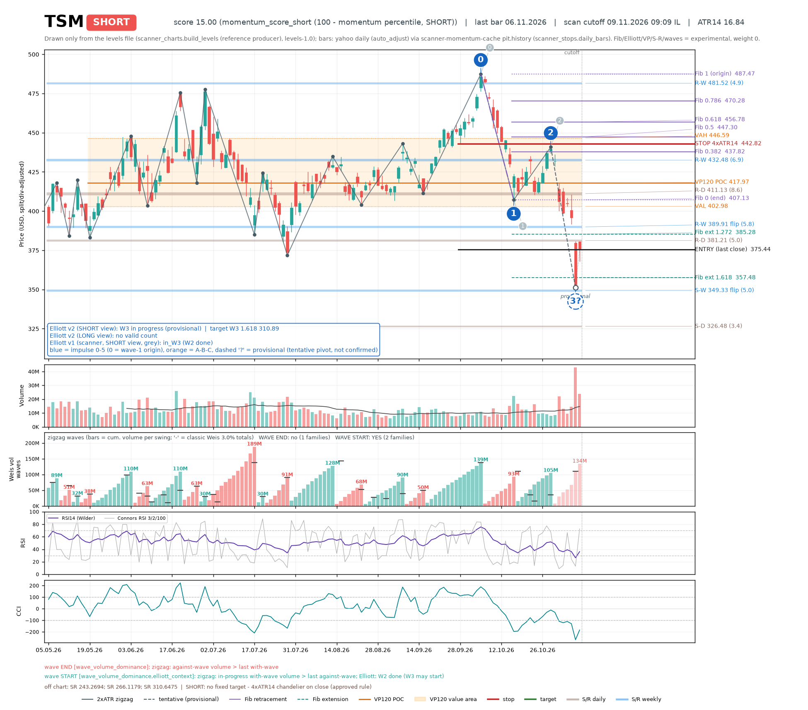

- **Jev (typesafe/jev-1.13):** 15 כותרות · 2 בביטחון ≥0.8 (סומכים על Jev) · 2 הועברו ל-Claude לשיפוט (ביטחון נמוך או חשד למניפולציה; 0 חשודות, 0 הודעות חברה) · סנטימנט חיובי (+0.53) · קטליזטור regulatory
- **Grok (grok-4.3, חיפוש X של Grok):** ⚠️ דגל · סנטימנט ‎+0 · ביטחון medium · 8 פוסטים · אותות מעורבים: ריבאונד חזק אך אין סיבה ברורה נגד השורט · חשבונות מאומתים: @OwenCarter0el, @jnconkle
- **Perplexity:** לא התקבל (חסר קרדיט - OpenRouter (Perplexity))
- **Claude:** לא התקבל (חסר קרדיט - OpenRouter (Claude))
- **GPT:** לא התקבל (חסר קרדיט - OpenRouter (GPT))
- **האם הגרף נראה נכון? (ניסיוני):** Grok: n/a: null · קלט: grok=img

### 42. KLAC – שורט · דירוג 13.1
- **🔴 חסר קרדיט - OpenRouter (Claude) ; חסר קרדיט - OpenRouter (GPT) ; חסר קרדיט - OpenRouter (Perplexity)**
- **רמות (קובץ הרמות, נר אחרון 2026-11-06, hash 707e12011611389b):** כניסה 138.49 · סטופ 176.29 (chandelier_close 4.0xATR14, ATR14=9.4506) · יעד: אין – ללא יעד קבוע - שנדלייר 4xATR14 על סגירה (כלל מאושר)
- **טכני:** SMA20 159.63 · SMA50 174.84 · SMA200 181.65 · מומנטום 12-1 0.612 · RSI14 35.1 · CCI20 ‎-127
- **ניסיוני (משקל 0):** אליוט v2: W3 in progress (provisional) · אליוט v1: in_W3 (W2 done) · פיבו v2 208.68→144.82 (1.618=105.35) · VP120 POC 183.61 (VAH 224.75, VAL 153.21) · תמיכה 129.61 · התנגדות 141.81 · סוף גל: 1 משפחות (volume_exhaustion) · תחילת גל: 2 (wave_volume_dominance,elliott_context)
- **דוח:** מותר - דוח בעוד 55 ימי מסחר · מקורות: 2027-01-28 (Yahoo calendar)
- **סוויפ נזילות (ייחוס בלבד, משקל 0):** לא
- **ספירלת פיבו – יעדי ייחוס בלבד (משקל 0, לא משנה סטופ/יעד; השורט נשאר עם סטופ נגרר 4×ATR בלי יעד):** T1 — (—) · T2 — (—) · מצב: none

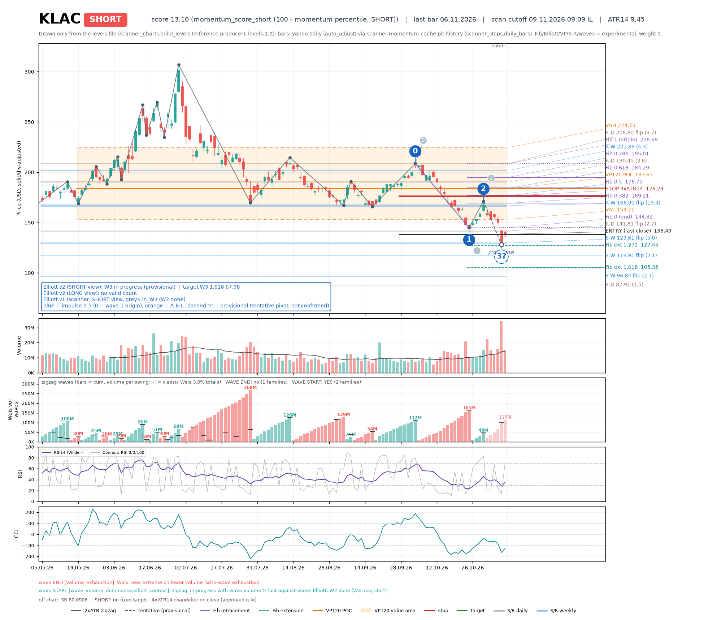

- **Jev (typesafe/jev-1.13):** 8 כותרות · 0 בביטחון ≥0.8 (סומכים על Jev) · 6 הועברו ל-Claude לשיפוט (ביטחון נמוך או חשד למניפולציה; 0 חשודות, 2 הודעות חברה) · סנטימנט — · קטליזטור —
- **Grok (grok-4.3, חיפוש X של Grok):** ⚠️ דגל · סנטימנט ‎+1 · ביטחון medium · 3 פוסטים · סנטימנט חיובי קל ב-X עלול להתנגש עם SHORT · חשבונות מאומתים: @BeuvingJordy
- **Perplexity:** לא התקבל (חסר קרדיט - OpenRouter (Perplexity))
- **Claude:** לא התקבל (חסר קרדיט - OpenRouter (Claude))
- **GPT:** לא התקבל (חסר קרדיט - OpenRouter (GPT))
- **האם הגרף נראה נכון? (ניסיוני):** Grok: no: ספירת אליוט ו-Fib נראים תקינים על הגרף · קלט: grok=img

### 43. HD – לונג · דירוג 12.1
- **🔴 חסר קרדיט - OpenRouter (Claude) ; חסר קרדיט - OpenRouter (GPT) ; חסר קרדיט - OpenRouter (Perplexity)**
- **רמות (קובץ הרמות, נר אחרון 2026-11-06, hash 51f42e02c44c2c2d):** כניסה 343.47 · סטופ 305.90 (chandelier_close 4.0xATR14, ATR14=9.3913) · יעד: 415.15 – חצי ב-Fib 1.618 (סגירה), השאר בשנדלייר 4xATR
- **טכני:** SMA20 321.09 · SMA50 309.20 · SMA200 329.93 · מומנטום 12-1 ‎-0.187 · RSI14 64.2 · CCI20 108
- **ניסיוני (משקל 0):** אליוט v2: W2 in progress (provisional) · אליוט v1: no valid count · פיבו v2 277.15→362.44 (1.618=415.15) · VP120 POC 334.29 (VAH 352.21, VAL 306.15) · תמיכה 338.50 · התנגדות 351.04 · סוף גל: 1 משפחות (volume_exhaustion) · תחילת גל: 0 (—)
- **דוח:** מותר - דוח בעוד 7 ימי מסחר · מקורות: 2026-11-17 (Yahoo calendar)
- **סוויפ נזילות (ייחוס בלבד, משקל 0):** לא · **עבר בדיקה, שביר, משקל 0**

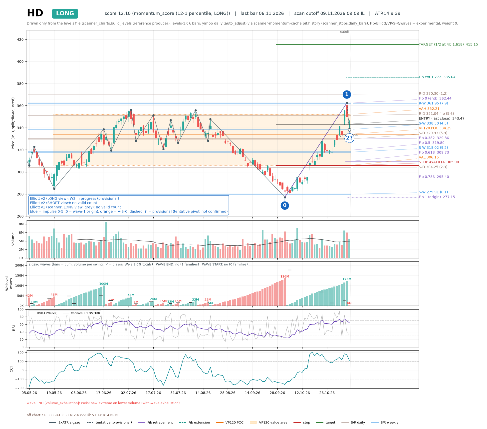

- **Jev (typesafe/jev-1.13):** 9 כותרות · 0 בביטחון ≥0.8 (סומכים על Jev) · 3 הועברו ל-Claude לשיפוט (ביטחון נמוך או חשד למניפולציה; 0 חשודות, 4 הודעות חברה) · סנטימנט — · קטליזטור —
- **Grok (grok-4.3, חיפוש X של Grok):** ✅ אישור · סנטימנט ‎+0 · ביטחון low · 10 פוסטים · אין חדשות שליליות ב-X · חשבונות מאומתים: —
- **Perplexity:** לא התקבל (חסר קרדיט - OpenRouter (Perplexity))
- **Claude:** לא התקבל (חסר קרדיט - OpenRouter (Claude))
- **GPT:** לא התקבל (חסר קרדיט - OpenRouter (GPT))
- **האם הגרף נראה נכון? (ניסיוני):** Grok: n/a: אין דיון על הגרף · קלט: grok=img

### 44. ASML – שורט · דירוג 11.2
- **🔴 חסר קרדיט - OpenRouter (Claude) ; חסר קרדיט - OpenRouter (GPT) ; חסר קרדיט - OpenRouter (Perplexity)**
- **רמות (קובץ הרמות, נר אחרון 2026-11-06, hash 0170f80bc2bc3103):** כניסה 1,424.75 · סטופ 1,697.42 (chandelier_close 4.0xATR14, ATR14=68.17) · יעד: אין – ללא יעד קבוע - שנדלייר 4xATR14 על סגירה (כלל מאושר)
- **טכני:** SMA20 1,598.35 · SMA50 1,675.41 · SMA200 1,595.78 · מומנטום 12-1 0.704 · RSI14 34.7 · CCI20 ‎-167
- **ניסיוני (משקל 0):** אליוט v2: W3 in progress (provisional) · אליוט v1: in_W3 (W2 done) · פיבו v2 1,871.03→1,547.96 (1.618=1,348.30) · VP120 POC 1,783.65 (VAH 1,828.42, VAL 1,585.34) · תמיכה 1,379.45 · התנגדות 1,462.15 · סוף גל: 2 משפחות (volume_exhaustion,momentum_divergence) · תחילת גל: 2 (wave_volume_dominance,elliott_context)
- **דוח:** מותר - דוח בעוד 54 ימי מסחר · מקורות: 2027-01-27 (Yahoo calendar)
- **סוויפ נזילות (ייחוס בלבד, משקל 0):** לא
- **ספירלת פיבו – יעדי ייחוס בלבד (משקל 0, לא משנה סטופ/יעד; השורט נשאר עם סטופ נגרר 4×ATR בלי יעד):** T1 — (—) · T2 — (—) · מצב: none

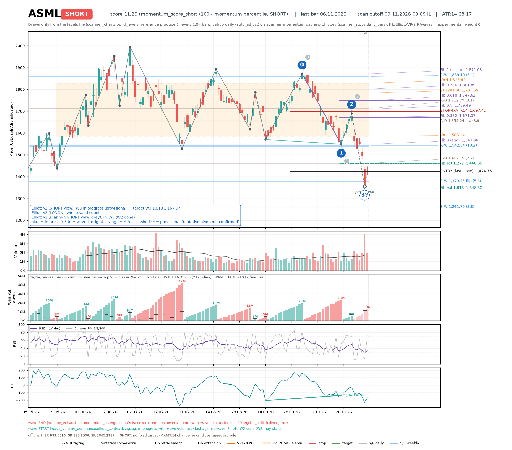

- **Jev (typesafe/jev-1.13):** 2 כותרות · 0 בביטחון ≥0.8 (סומכים על Jev) · 0 הועברו ל-Claude לשיפוט (ביטחון נמוך או חשד למניפולציה; 0 חשודות, 0 הודעות חברה) · סנטימנט — · קטליזטור —
- **Grok (grok-4.3, חיפוש X של Grok):** ⚠️ דגל · סנטימנט ‎+2 · ביטחון high · 8 פוסטים · סנטימנט X שורי חזק עם טירגטים גבוהים · חשבונות מאומתים: @Tickeron, @ThierryBorgeat, @TacticzH
- **Perplexity:** לא התקבל (חסר קרדיט - OpenRouter (Perplexity))
- **Claude:** לא התקבל (חסר קרדיט - OpenRouter (Claude))
- **GPT:** לא התקבל (חסר קרדיט - OpenRouter (GPT))
- **האם הגרף נראה נכון? (ניסיוני):** Grok: yes: ספירת אליוט SHORT ו-Fib נראים לא תואמים לטירגטים שוריים · קלט: grok=img

### 45. ADI – שורט · דירוג 9.3
- **🔴 חסר קרדיט - OpenRouter (Claude) ; חסר קרדיט - OpenRouter (GPT) ; חסר קרדיט - OpenRouter (Perplexity)**
- **רמות (קובץ הרמות, נר אחרון 2026-11-06, hash 1815890f1b218daa):** כניסה 363.56 · סטופ 437.20 (chandelier_close 4.0xATR14, ATR14=18.41) · יעד: אין – ללא יעד קבוע - שנדלייר 4xATR14 על סגירה (כלל מאושר)
- **טכני:** SMA20 403.67 · SMA50 390.48 · SMA200 372.98 · מומנטום 12-1 0.742 · RSI14 36.2 · CCI20 ‎-216
- **ניסיוני (משקל 0):** אליוט v2: no valid count · אליוט v1: no valid count · פיבו v2 444.56→351.66 (1.618=294.25) · VP120 POC 393.38 (VAH 413.66, VAL 363.45) · תמיכה 363.09 · התנגדות 385.85 · סוף גל: 1 משפחות (momentum_divergence) · תחילת גל: 3 (volume_exhaustion,wave_volume_dominance,momentum_divergence)
- **דוח:** מותר - דוח בעוד 12 ימי מסחר · מקורות: 2026-11-24 (Yahoo calendar)
- **סוויפ נזילות (ייחוס בלבד, משקל 0):** לא
- **ספירלת פיבו – יעדי ייחוס בלבד (משקל 0, לא משנה סטופ/יעד; השורט נשאר עם סטופ נגרר 4×ATR בלי יעד):** T1 348.00 (fan:8@fib1.0) · T2 348.00 (fan:3@fib1.0) · מצב: triggered_earlier

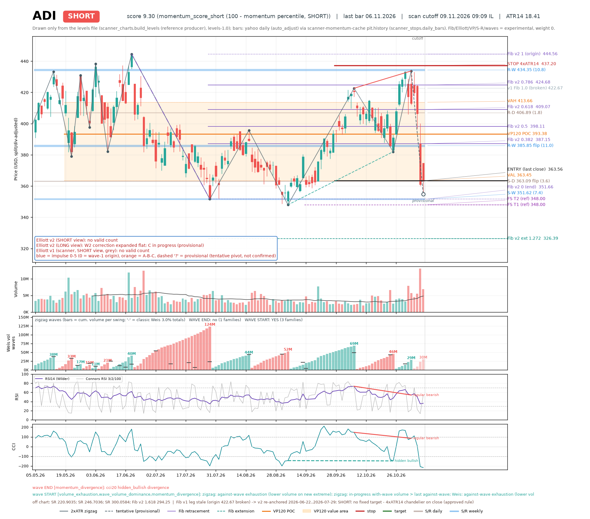

- **Jev (typesafe/jev-1.13):** 2 כותרות · 1 בביטחון ≥0.8 (סומכים על Jev) · 0 הועברו ל-Claude לשיפוט (ביטחון נמוך או חשד למניפולציה; 0 חשודות, 1 הודעות חברה) · סנטימנט חיובי (+1.00) · קטליזטור m_and_a
- **Grok (grok-4.3, חיפוש X של Grok):** ⚠️ דגל · סנטימנט ‎+2 · ביטחון high · 4 פוסטים · סנטימנט חיובי חזק ב-X נגד SHORT · חשבונות מאומתים: @StockSavvyShay
- **Perplexity:** לא התקבל (חסר קרדיט - OpenRouter (Perplexity))
- **Claude:** לא התקבל (חסר קרדיט - OpenRouter (Claude))
- **GPT:** לא התקבל (חסר קרדיט - OpenRouter (GPT))
- **האם הגרף נראה נכון? (ניסיוני):** Grok: n/a: אין דיון בגרף או Elliott בפוסטים · קלט: grok=img

### 46. ISRG – לונג · דירוג 6.5
- **🔴 חסר קרדיט - OpenRouter (Claude) ; חסר קרדיט - OpenRouter (GPT) ; חסר קרדיט - OpenRouter (Perplexity)**
- **רמות (קובץ הרמות, נר אחרון 2026-11-06, hash 36d46b0352038ffc):** כניסה 452.80 · סטופ 389.03 (chandelier_close 4.0xATR14, ATR14=15.94) · יעד: 519.63 – חצי ב-Fib 1.618 (סגירה), השאר בשנדלייר 4xATR
- **טכני:** SMA20 441.17 · SMA50 409.93 · SMA200 431.20 · מומנטום 12-1 ‎-0.243 · RSI14 57.2 · CCI20 84
- **ניסיוני (משקל 0):** אליוט v2: W2 in progress (provisional) · אליוט v1: in_W4 (W3 done) · פיבו v2 431.19→485.85 (1.618=519.63) · VP120 POC 402.49 (VAH 448.10, VAL 369.46) · תמיכה 435.05 · התנגדות 455.73 · סוף גל: 1 משפחות (volume_exhaustion) · תחילת גל: 1 (momentum_divergence)
- **דוח:** מותר - דוח בעוד 50 ימי מסחר · מקורות: 2027-01-21 (Yahoo calendar)
- **סוויפ נזילות (ייחוס בלבד, משקל 0):** כן (שורט, רמה 458.88 pivot) · **עבר בדיקה, שביר, משקל 0**

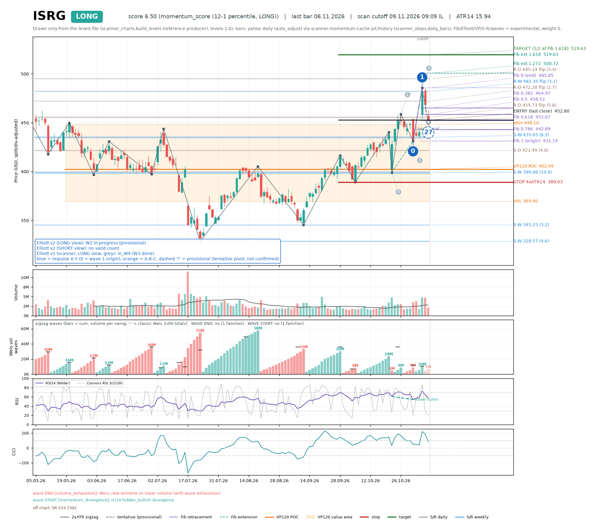

- **Jev (typesafe/jev-1.13):** 4 כותרות · 0 בביטחון ≥0.8 (סומכים על Jev) · 4 הועברו ל-Claude לשיפוט (ביטחון נמוך או חשד למניפולציה; 0 חשודות, 1 הודעות חברה) · סנטימנט — · קטליזטור —
- **Grok (grok-4.3, חיפוש X של Grok):** ✅ אישור · סנטימנט ‎+0 · ביטחון low · 3 פוסטים · אין חדשות שליליות ב-X נגד ה-LONG · חשבונות מאומתים: @zeiierman, @GreenGarageInv
- **Perplexity:** לא התקבל (חסר קרדיט - OpenRouter (Perplexity))
- **Claude:** לא התקבל (חסר קרדיט - OpenRouter (Claude))
- **GPT:** לא התקבל (חסר קרדיט - OpenRouter (GPT))
- **האם הגרף נראה נכון? (ניסיוני):** Grok: n/a: אין דיון בגרף ב-X · קלט: grok=img

### 47. LRCX – שורט · דירוג 5.6
- **🔴 חסר קרדיט - OpenRouter (Claude) ; חסר קרדיט - OpenRouter (GPT) ; חסר קרדיט - OpenRouter (Perplexity)**
- **רמות (קובץ הרמות, נר אחרון 2026-11-06, hash 03eb18693084df1f):** כניסה 200.44 · סטופ 267.12 (chandelier_close 4.0xATR14, ATR14=16.67) · יעד: אין – ללא יעד קבוע - שנדלייר 4xATR14 על סגירה (כלל מאושר)
- **טכני:** SMA20 249.34 · SMA50 284.26 · SMA200 283.63 · מומנטום 12-1 0.951 · RSI14 30.4 · CCI20 ‎-131
- **ניסיוני (משקל 0):** אליוט v2: W3 in progress (provisional) · אליוט v1: in_W3 (W2 done) · פיבו v2 352.56→225.14 (1.618=146.39) · VP120 POC 313.68 (VAH 366.97, VAL 260.38) · תמיכה 198.65 · התנגדות 221.26 · סוף גל: 1 משפחות (momentum_divergence) · תחילת גל: 2 (wave_volume_dominance,elliott_context)
- **דוח:** מותר - דוח בעוד 54 ימי מסחר · מקורות: 2027-01-27 (Yahoo calendar)
- **סוויפ נזילות (ייחוס בלבד, משקל 0):** לא
- **ספירלת פיבו – יעדי ייחוס בלבד (משקל 0, לא משנה סטופ/יעד; השורט נשאר עם סטופ נגרר 4×ATR בלי יעד):** T1 — (—) · T2 — (—) · מצב: broken_below_A

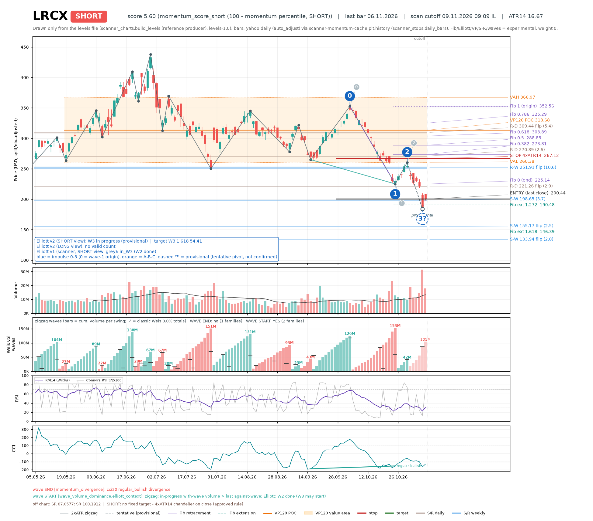

- **Jev (typesafe/jev-1.13):** 15 כותרות · 2 בביטחון ≥0.8 (סומכים על Jev) · 3 הועברו ל-Claude לשיפוט (ביטחון נמוך או חשד למניפולציה; 0 חשודות, 2 הודעות חברה) · סנטימנט חיובי (+1.00) · קטליזטור other
- **Grok (grok-4.3, חיפוש X של Grok):** ✅ אישור · סנטימנט ‎-1 · ביטחון low · 1 פוסטים · פוסט בודד תומך בשורט · חשבונות מאומתים: @jnconkle
- **Perplexity:** לא התקבל (חסר קרדיט - OpenRouter (Perplexity))
- **Claude:** לא התקבל (חסר קרדיט - OpenRouter (Claude))
- **GPT:** לא התקבל (חסר קרדיט - OpenRouter (GPT))
- **האם הגרף נראה נכון? (ניסיוני):** Grok: no: ספירת אליוט ו-Fib תואמות · קלט: grok=img

### 48. INTC – שורט · דירוג 1.9
- **🔴 חסר קרדיט - OpenRouter (Claude) ; חסר קרדיט - OpenRouter (GPT) ; חסר קרדיט - OpenRouter (Perplexity)**
- **רמות (קובץ הרמות, נר אחרון 2026-11-06, hash ced3615080442dfd):** כניסה 56.28 · סטופ 81.67 (chandelier_close 4.0xATR14, ATR14=6.3487) · יעד: אין – ללא יעד קבוע - שנדלייר 4xATR14 על סגירה (כלל מאושר)
- **טכני:** SMA20 83.08 · SMA50 97.95 · SMA200 87.04 · מומנטום 12-1 1.790 · RSI14 25.7 · CCI20 ‎-127
- **ניסיוני (משקל 0):** אליוט v2: W3 in progress (provisional) · אליוט v1: in_W3 (W2 done) · פיבו v2 127.44→84.65 (1.618=58.21) · VP120 POC 101.47 (VAH 122.37, VAL 86.03) · תמיכה 42.99 · התנגדות 70.33 · סוף גל: 0 משפחות (—) · תחילת גל: 2 (wave_volume_dominance,elliott_context)
- **דוח:** מותר - דוח בעוד 55 ימי מסחר · מקורות: 2027-01-28 (Yahoo calendar)
- **סוויפ נזילות (ייחוס בלבד, משקל 0):** לא
- **ספירלת פיבו – יעדי ייחוס בלבד (משקל 0, לא משנה סטופ/יעד; השורט נשאר עם סטופ נגרר 4×ATR בלי יעד):** T1 81.79 (circle:0.786@fib1.0) · T2 81.79 (fan:1@fib1.0) · מצב: triggered_earlier

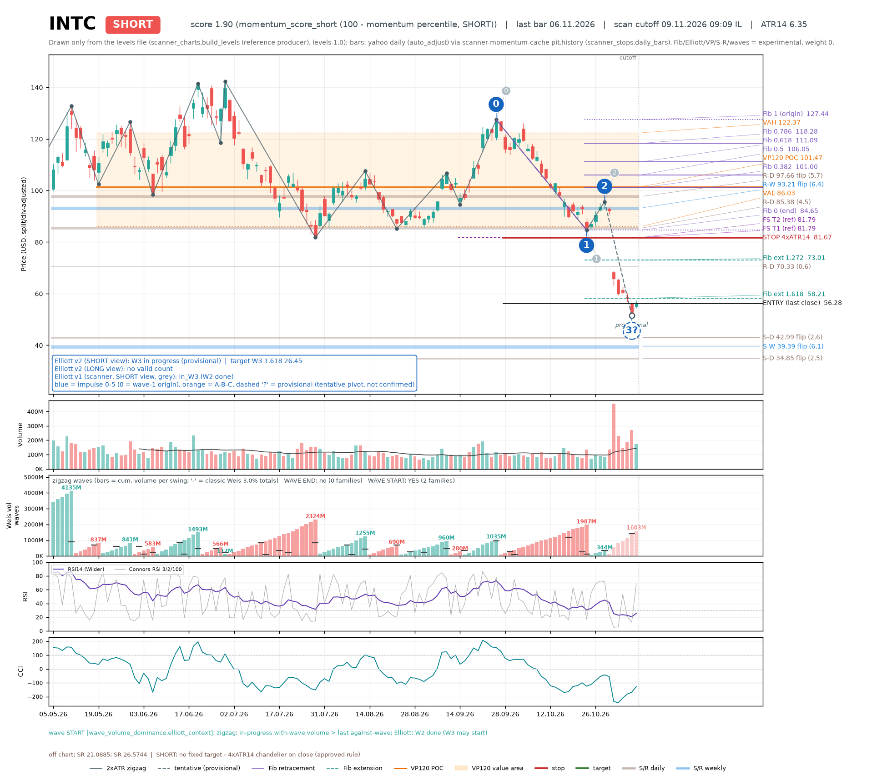

- **Jev (typesafe/jev-1.13):** 15 כותרות · 1 בביטחון ≥0.8 (סומכים על Jev) · 5 הועברו ל-Claude לשיפוט (ביטחון נמוך או חשד למניפולציה; 0 חשודות, 2 הודעות חברה) · סנטימנט שלילי (-1.00) · קטליזטור guidance
- **Grok (grok-4.3, חיפוש X של Grok):** ✅ אישור · סנטימנט ‎-1 · ביטחון medium · 10 פוסטים · סנטימנט שלילי/מעורב תומך ב-SHORT ללא חדשות נגד · חשבונות מאומתים: @marceloz28, @ssslumdunk, @Linnazhan, @ypeooo
- **Perplexity:** לא התקבל (חסר קרדיט - OpenRouter (Perplexity))
- **Claude:** לא התקבל (חסר קרדיט - OpenRouter (Claude))
- **GPT:** לא התקבל (חסר קרדיט - OpenRouter (GPT))
- **האם הגרף נראה נכון? (ניסיוני):** Grok: no: ספירת אליוט ו-Fib נראים תקינים על הגרף · קלט: grok=img

### 49. MRVL – שורט · דירוג 0.9
- **🔴 חסר קרדיט - OpenRouter (Claude) ; חסר קרדיט - OpenRouter (GPT) ; חסר קרדיט - OpenRouter (Perplexity)**
- **רמות (קובץ הרמות, נר אחרון 2026-11-06, hash 9e4b132ecde7f6ff):** כניסה 141.20 · סטופ 213.30 (chandelier_close 4.0xATR14, ATR14=18.02) · יעד: אין – ללא יעד קבוע - שנדלייר 4xATR14 על סגירה (כלל מאושר)
- **טכני:** SMA20 217.24 · SMA50 234.27 · SMA200 184.98 · מומנטום 12-1 1.961 · RSI14 26.2 · CCI20 ‎-161
- **ניסיוני (משקל 0):** אליוט v2: W3 in progress (provisional) · אליוט v1: in_W3 (W2 done) · פיבו v2 301.20→220.21 (1.618=170.16) · VP120 POC 221.27 (VAH 294.23, VAL 191.70) · תמיכה 99.63 · התנגדות 146.78 · סוף גל: 1 משפחות (momentum_divergence) · תחילת גל: 2 (wave_volume_dominance,elliott_context)
- **דוח:** מותר - דוח בעוד 16 ימי מסחר · מקורות: 2026-12-01 (Yahoo calendar)
- **סוויפ נזילות (ייחוס בלבד, משקל 0):** לא
- **ספירלת פיבו – יעדי ייחוס בלבד (משקל 0, לא משנה סטופ/יעד; השורט נשאר עם סטופ נגרר 4×ATR בלי יעד):** T1 232.03 (fan:3@fib0.5) · T2 232.03 (fan:3@fib0.5) · מצב: triggered_earlier

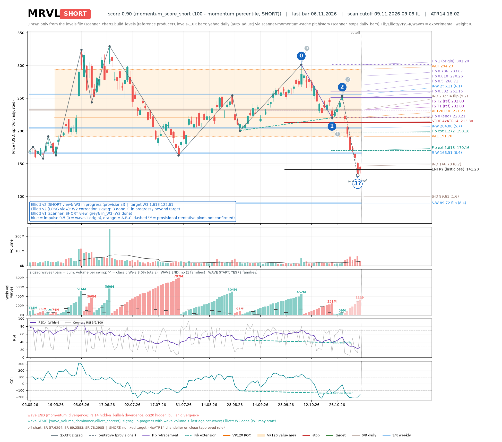

- **Jev (typesafe/jev-1.13):** 15 כותרות · 1 בביטחון ≥0.8 (סומכים על Jev) · 4 הועברו ל-Claude לשיפוט (ביטחון נמוך או חשד למניפולציה; 0 חשודות, 2 הודעות חברה) · סנטימנט שלילי (-1.00) · קטליזטור analyst
- **Grok (grok-4.3, חיפוש X של Grok):** ✅ אישור · סנטימנט ‎-1 · ביטחון low · 2 פוסטים · סנטימנט שלילי קל ב-X תומך ב-SHORT · חשבונות מאומתים: @leonid_zador
- **Perplexity:** לא התקבל (חסר קרדיט - OpenRouter (Perplexity))
- **Claude:** לא התקבל (חסר קרדיט - OpenRouter (Claude))
- **GPT:** לא התקבל (חסר קרדיט - OpenRouter (GPT))
- **האם הגרף נראה נכון? (ניסיוני):** Grok: n/a: אין דיון מספיק ב-X על הספירה · קלט: grok=img

### 50. MU – שורט · דירוג 0.0
- **🔴 חסר קרדיט - OpenRouter (Claude) ; חסר קרדיט - OpenRouter (GPT) ; חסר קרדיט - OpenRouter (Perplexity)**
- **רמות (קובץ הרמות, נר אחרון 2026-11-06, hash 7e1eb60c1369727e):** כניסה 690.00 · סטופ 924.99 (chandelier_close 4.0xATR14, ATR14=58.75) · יעד: אין – ללא יעד קבוע - שנדלייר 4xATR14 על סגירה (כלל מאושר)
- **טכני:** SMA20 878.99 · SMA50 961.53 · SMA200 756.53 · מומנטום 12-1 3.366 · RSI14 31.3 · CCI20 ‎-235
- **ניסיוני (משקל 0):** אליוט v2: W3 in progress (provisional) · אליוט v1: in_W3 (W2 done) · פיבו v2 1,108.55→849.25 (1.618=689.01) · VP120 POC 934.17 (VAH 1,073.23, VAL 855.57) · תמיכה 652.01 · התנגדות 737.76 · סוף גל: 0 משפחות (—) · תחילת גל: 2 (wave_volume_dominance,elliott_context)
- **דוח:** מותר - דוח בעוד 32 ימי מסחר · מקורות: 2026-12-23 (Yahoo calendar)
- **סוויפ נזילות (ייחוס בלבד, משקל 0):** לא
- **ספירלת פיבו – יעדי ייחוס בלבד (משקל 0, לא משנה סטופ/יעד; השורט נשאר עם סטופ נגרר 4×ATR בלי יעד):** T1 — (—) · T2 — (—) · מצב: none

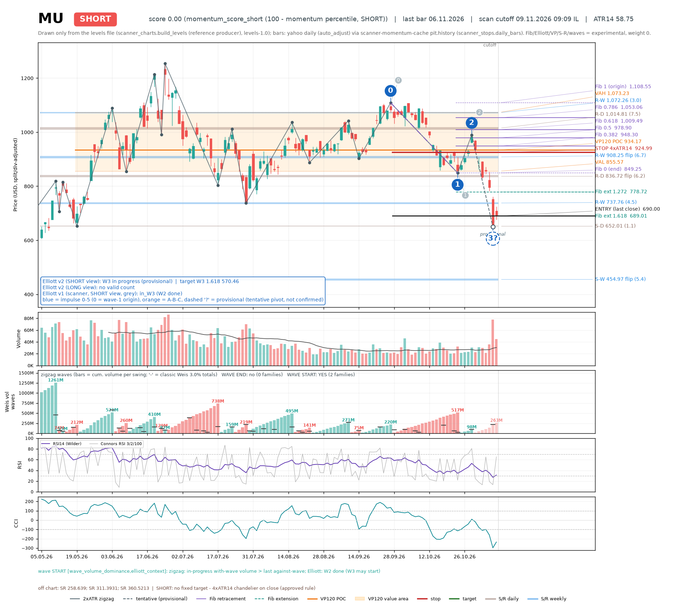

- **Jev (typesafe/jev-1.13):** 15 כותרות · 0 בביטחון ≥0.8 (סומכים על Jev) · 0 הועברו ל-Claude לשיפוט (ביטחון נמוך או חשד למניפולציה; 0 חשודות, 0 הודעות חברה) · סנטימנט — · קטליזטור —
- **Grok (grok-4.3, חיפוש X של Grok):** ✅ אישור · סנטימנט ‎+0 · ביטחון low · 1 פוסטים · אין סנטימנט שלילי ב-X נגד SHORT · חשבונות מאומתים: @lukeoncapital
- **Perplexity:** לא התקבל (חסר קרדיט - OpenRouter (Perplexity))
- **Claude:** לא התקבל (חסר קרדיט - OpenRouter (Claude))
- **GPT:** לא התקבל (חסר קרדיט - OpenRouter (GPT))
- **האם הגרף נראה נכון? (ניסיוני):** Grok: no: ספירת אליוט ו-Fib נראות תקינות · קלט: grok=img

## 9. סטטיסטיקת כלים (tool_stats, משקל 0)
### אמינות המודלים באזהרות על שורטים (v3-shortveto-cred (2026-10-16))
| מודל | אזהרות שנמדדו | צדקו | שיעור מכווץ | משקל | קנס לאזהרה | רמות שנספרות | % שורטים עם אזהרה |
|---|---|---|---|---|---|---|---|
| gpt | 31 | 21 | 0.590 | 0.180 | -1.80 | strong,weak | 0.449 |
| grok | 6 | 4 | 0.528 | 0.056 | -0.56 | strong,weak | 0.203 |
| pplx | 27 | 17 | 0.561 | 0.123 | -1.23 | strong,weak | 0.391 |
| claude | 10 | 5 | 0.500 | 0.000 | -0.00 | strong,weak | 0.145 |
| jev | 5 | 2 | 0.486 | 0.000 | -0.00 | strong,weak | 0.174 |

### כלים ניסיוניים (משקל 0) — סטטיסטיקה קדימה מ-12.10.2026

מדד עיקרי: תשואה עודפת ביום 20 מול SPY (מניות) / BTC (קריפטו), מותאמת כיוון. כלל: 15 תוצאות = בדיקת ביניים, 30 = החלטה (ולפחות 5 ימי כניסה שונים). FDR ‏(BH, q<0.10) על כל הכלים יחד, רק בדיקות עם 20+ תוצאות בכל צד. קביעות מודלים (Grok, Perplexity, Claude, GPT, Jev) נמדדות רק מ-12.10. שורות במעקב: 11.

| כלי | עמודות נבדקות | שורות מתועדות | תוצאות מסומנות (מקס׳) | ימי כניסה | הבדיקה החזקה | הפרש עודף (נק׳ %) [95% CI] | q | סטטוס |
|---|---|---|---|---|---|---|---|---|
| claude | 2 | 11 | 0 | 0 | llm_claude_conviction >= median (45) (stock LONG) | — | — | איסוף (0/15) |
| gpt | 2 | 11 | 0 | 0 | llm_gpt_flag_or_veto == True (ALL) | — | — | איסוף (0/15) |
| grok | 3 | 11 | 0 | 0 | llm_grok_approve == True (ALL) | — | — | איסוף (0/15) |
| jev | 1 | 4 | 0 | 0 | llm_jev_sentiment sign agrees with direction (ALL) | — | — | איסוף (0/15) |
| pplx | 2 | 11 | 0 | 0 | llm_pplx_approve == True (ALL) | — | — | איסוף (0/15) |

**בדיקות מובילות (לפי p, עד 15):**

| עמודה | בדיקה | מקטע | מסומן/לא | הצלחה | ממוצע עודף מסומן | חציון | הפרש [CI] | p | q | מתאם למומנטום | סטטוס |
|---|---|---|---|---|---|---|---|---|---|---|---|

שורדי FDR: 0 מתוך 0 בדיקות שעמדו בסף. אף כלי לא עבר את הסף — כולם נשארים במשקל 0.

## 10. עלויות ותקינות
- **עלות המודלים בריצה:** $2.811 מתוך תקרה $8.00. פירוט ב-`platform_costs.json`.
- **ממוצע למועמד:** כ-$0.056 (Grok 0.056, Perplexity —, Jev 0.0004, Claude —, GPT —) · הערכה שבועית: כ-$2.98.
- **Grok:** 50 מתוך 50 הצליחו
- **Perplexity:** 0 מתוך 50 הצליחו
- **Claude:** 0 מתוך 50 הצליחו
- **GPT:** 0 מתוך 50 הצליחו
- **עמודות מחקר (research_columns):** {"talib": {"ok": 135, "failed": 0, "errors": {}, "sec_mean": 0.029, "sec_total": 4.0}, "pta": {"ok": 135, "failed": 0, "errors": {}, "sec_mean": 0.117, "sec_total": 15.8}, "smc": {"ok": 135, "failed":
- **קבצים:** `candidates_full.csv`, ‏`levels/`, ‏`charts/` + `chart_index.json`, ‏`tracker_rows.csv`, ‏`reconciliation.json`, ‏`platform_enrichment.csv`, ‏`platform_raw.json`, ‏`research_columns.csv`.
